# Markov Chain Monte Carlo for the $N^2$-queens problem

[GitHub repository](https://github.com/renonesopocaj/3d-queens-mcmc)

<!-- COMPLETE ORIGINAL REPORT -->

<h2 class='titleHead'>Solving the 3D
<!-- l. 38 --><math display='inline' xmlns='http://www.w3.org/1998/Math/MathML'><msup><mi>N</mi><mn>2</mn></msup></math>
Queens Problem 
via Markov Chain Monte Carlo</h2>
          
Chengheng Li Chen, Francisco Badia Laguillo, Jacopo Senoner
                 School of Computer and Communication Sciences
                           EPFL, Lausanne, Switzerland
  {chengheng.lichen, francisco.badialaguillo, jacopo.senoner}@epfl.ch
 

<section class='abstract' role='doc-abstract'>
<h3 class='abstracttitle'>Abstract</h3>
<!-- l. 40 -->

    The classical <!-- l. 41 --><math display='inline' xmlns='http://www.w3.org/1998/Math/MathML'><mi>N</mi></math>-queens
    problem            admits            a            natural
    three-dimensional       generalization:       placing
    <!-- l. 41 --><math display='inline' xmlns='http://www.w3.org/1998/Math/MathML'><msup><mrow><mi>N</mi></mrow><mrow><mn>2</mn></mrow></msup></math>
    mutually     non-attacking     queens     on     an
    <!-- l. 41 --><math display='inline' xmlns='http://www.w3.org/1998/Math/MathML'><mrow><mi>N</mi> <mo class='MathClass-bin' stretchy='false'>×</mo><mi>N</mi> <mo class='MathClass-bin' stretchy='false'>×</mo><mi>N</mi></mrow></math>
    cubic  board,  where  queens  attack  along  rook
    lines,   planar   diagonals,   and   space   diagonals.
    We   formulate   this   as   energy   minimization
    and   develop   a   Metropolis-Hastings   algorithm
    with  simulated  annealing,  proving  correctness
    by     establishing     irreducibility,     aperiodicity,
    and     weak     reversibility.     Experiments     for
    <!-- l. 41 --><math display='inline' xmlns='http://www.w3.org/1998/Math/MathML'><mrow><mi>N</mi> <mo class='MathClass-rel' stretchy='false'>=</mo> <mn>3</mn></mrow></math>
    to <!-- l. 41 --><math display='inline' xmlns='http://www.w3.org/1998/Math/MathML'><mrow><mi>N</mi> <mo class='MathClass-rel' stretchy='false'>=</mo> <mn>11</mn></mrow></math>
    confirm  theoretical  predictions:  instances  with
    <!-- l. 41 --><math display='inline' xmlns='http://www.w3.org/1998/Math/MathML'><mrow><mi class='qopname'> gcd</mi><mo> ⁡<!-- FUNCTION APPLICATION --> </mo><mo class='MathClass-open' stretchy='false'>(</mo><mi>N</mi><mo class='MathClass-punc' stretchy='false'>,</mo><mn>210</mn><mo class='MathClass-close' stretchy='false'>)</mo> <mo class='MathClass-rel' stretchy='false'>&gt;</mo> <mn>1</mn></mrow></math>
    converge      to      positive      energy,      while
    <!-- l. 41 --><math display='inline' xmlns='http://www.w3.org/1998/Math/MathML'><mrow><mi>N</mi> <mo class='MathClass-rel' stretchy='false'>=</mo> <mn>11</mn></mrow></math>
    reaches   zero-energy   configurations.   We   find
    that   only   the   linear   energy   transformation
    reliably attains global minima, and that constant
    high-<!-- l. 41 --><math display='inline' xmlns='http://www.w3.org/1998/Math/MathML'><mi>β</mi></math>
    schedules          suffice          for          moderate
    <!-- l. 41 --><math display='inline' xmlns='http://www.w3.org/1998/Math/MathML'><mi>N</mi></math>,
    suggesting  a  benign  energy  landscape  at  these
    problem sizes.

</section>
<h3 class='sectionHead' id='introduction'>1    Introduction</h3>
<!-- l. 45 -->
The classical <!-- l. 45 --><math display='inline' xmlns='http://www.w3.org/1998/Math/MathML'><mi>N</mi></math>-queens
problem asks to place <!-- l. 45 --><math display='inline' xmlns='http://www.w3.org/1998/Math/MathML'><mi>N</mi></math>
queens on an <!-- l. 45 --><math display='inline' xmlns='http://www.w3.org/1998/Math/MathML'><mrow><mi>N</mi> <mo class='MathClass-bin' stretchy='false'>×</mo> <mi>N</mi></mrow></math>chessboard such that no two queens attack each other. This
 work studies a natural three-dimensional generalization: placing
 <!-- l. 45 --><math display='inline' xmlns='http://www.w3.org/1998/Math/MathML'><msup><mrow><mi>N</mi></mrow><mrow><mn>2</mn></mrow></msup></math> queens
 on an <!-- l. 45 --><math display='inline' xmlns='http://www.w3.org/1998/Math/MathML'><mrow><mi>N</mi> <mo class='MathClass-bin' stretchy='false'>×</mo> <mi>N</mi> <mo class='MathClass-bin' stretchy='false'>×</mo> <mi>N</mi></mrow></math>
 cubic board without mutual attacks.
 
<!-- l. 47 -->
The transition to three dimensions introduces additional attack
 directions and a substantially larger configuration space,
 rendering exhaustive enumeration infeasible for moderate values
 of <!-- l. 47 --><math display='inline' xmlns='http://www.w3.org/1998/Math/MathML'><mi>N</mi></math>.
 We therefore adopt a Markov Chain Monte Carlo (MCMC)
 approach, constructing a Markov chain whose stationary
 distribution concentrates on low-energy configurations.
 
<!-- l. 49 -->
The remainder of this report is organized as follows.
 Section <a href='#problem-formulation'>2<!-- tex4ht:ref: sec:formulation  --></a> formalizes the problem by introducing the attack
 relations, state space, and energy function, addressing the
 first two questions of the mini-project description. Section <a href='#mcmc-algorithm'>3<!-- tex4ht:ref: sec:mcmc  --></a>
 develops the MCMC algorithm and discusses the design of
 the proposal distribution, addressing the remaining question
 of Section 2. Section <a href='#experimental-results'>4<!-- tex4ht:ref: sec:experiments  --></a> presents experimental results, with
 each subsection corresponding to a question from the
 mini-project description. Section <a href='#conclusion'>5<!-- tex4ht:ref: sec:conclusion  --></a> offers concluding
 remarks.
 

 <h3 class='sectionHead' id='problem-formulation'>2    Problem Formulation</h3>
 <!-- l. 52 -->
We begin by establishing the mathematical framework for
 the three-dimensional queens problem.
 

 <h4 class='subsectionHead' id='board-and-positions'>2.1    Board and Positions</h4>
 

 <!-- l. 55 -->

Definition 2.1 (Board).  The board is the discrete cube
<!-- l. 56 --><math display='inline' xmlns='http://www.w3.org/1998/Math/MathML'><mrow><msub><mrow><mstyle mathvariant='script'><mi>B</mi></mstyle></mrow><mrow><mi>N</mi></mrow></msub> <mo class='MathClass-rel' stretchy='false'>=</mo> <msup><mrow><mo class='MathClass-open' stretchy='false'>{</mo><mn>0</mn><mo class='MathClass-punc' stretchy='false'>,</mo><mn>1</mn><mo class='MathClass-punc' stretchy='false'>,</mo><mo>…</mo><mo class='MathClass-punc' stretchy='false'>,</mo><mi>N</mi> <mo class='MathClass-bin' stretchy='false'>−</mo> <mn>1</mn><mo class='MathClass-close' stretchy='false'>}</mo></mrow><mrow><mn>3</mn></mrow></msup></mrow></math>.
Each element <!-- l. 56 --><math display='inline' xmlns='http://www.w3.org/1998/Math/MathML'><mrow><mo class='MathClass-open' stretchy='false'>(</mo><mi>i</mi><mo class='MathClass-punc' stretchy='false'>,</mo><mi>j</mi><mo class='MathClass-punc' stretchy='false'>,</mo><mi>k</mi><mo class='MathClass-close' stretchy='false'>)</mo> <mo class='MathClass-rel' stretchy='false'>∈</mo><msub><mrow><mstyle mathvariant='script'><mi>B</mi></mstyle></mrow><mrow><mi>N</mi></mrow></msub></mrow></math>
represents             a             position,             where
<!-- l. 56 --><math display='inline' xmlns='http://www.w3.org/1998/Math/MathML'><mi>i</mi></math>,
<!-- l. 56 --><math display='inline' xmlns='http://www.w3.org/1998/Math/MathML'><mi>j</mi></math>,
and <!-- l. 56 --><math display='inline' xmlns='http://www.w3.org/1998/Math/MathML'><mi>k</mi></math>
denote coordinates along the three orthogonal axes.

<!-- l. 57 -->
 For instance, when <!-- l. 58 --><math display='inline' xmlns='http://www.w3.org/1998/Math/MathML'><mrow><mi>N</mi> <mo class='MathClass-rel' stretchy='false'>=</mo> <mn>4</mn></mrow></math>,
the board contains <!-- l. 58 --><math display='inline' xmlns='http://www.w3.org/1998/Math/MathML'><mrow><msup><mrow><mn>4</mn></mrow><mrow><mn>3</mn></mrow></msup> <mo class='MathClass-rel' stretchy='false'>=</mo> <mn>64</mn></mrow></math>
positions, and we seek to place
<!-- l. 58 --><math display='inline' xmlns='http://www.w3.org/1998/Math/MathML'><mrow><msup><mrow><mn>4</mn></mrow><mrow><mn>2</mn></mrow></msup> <mo class='MathClass-rel' stretchy='false'>=</mo> <mn>16</mn></mrow></math>
queens.

<h4 class='subsectionHead' id='attack-relations'>2.2    Attack Relations</h4>
<!-- l. 61 -->
In three dimensions, queens attack along more directions
than in the classical planar setting. We identify three
distinct types of attack, each generalizing a familiar
movement pattern from two-dimensional chess.

<!-- l. 63 -->

Definition 2.2 (Attack Relation).   Two distinct positions
<!-- l. 64 --><math display='inline' xmlns='http://www.w3.org/1998/Math/MathML'><mrow><mo class='MathClass-open' stretchy='false'>(</mo><mi>i</mi><mo class='MathClass-punc' stretchy='false'>,</mo><mi>j</mi><mo class='MathClass-punc' stretchy='false'>,</mo><mi>k</mi><mo class='MathClass-close' stretchy='false'>)</mo></mrow></math> and
<!-- l. 64 --><math display='inline' xmlns='http://www.w3.org/1998/Math/MathML'><mrow><mo class='MathClass-open' stretchy='false'>(</mo><msup><mrow><mi>i</mi></mrow><mrow><mi>′</mi></mrow></msup><mo class='MathClass-punc' stretchy='false'>,</mo><msup><mrow><mi>j</mi></mrow><mrow><mi>′</mi></mrow></msup><mo class='MathClass-punc' stretchy='false'>,</mo><msup><mrow><mi>k</mi></mrow><mrow><mi>′</mi></mrow></msup><mo class='MathClass-close' stretchy='false'>)</mo></mrow></math> are
said to be in attack if any of the following conditions holds:

  <ul class='itemize1'>
  <li class='itemize'>Rook-type attack: The positions share at least two
  coordinates.  Equivalently,  they  have  the  same  pair
  <!-- l. 66 --><math display='inline' xmlns='http://www.w3.org/1998/Math/MathML'><mrow><mo class='MathClass-open' stretchy='false'>(</mo><mi>i</mi><mo class='MathClass-punc' stretchy='false'>,</mo><mi>j</mi><mo class='MathClass-close' stretchy='false'>)</mo></mrow></math>,
  the same pair <!-- l. 66 --><math display='inline' xmlns='http://www.w3.org/1998/Math/MathML'><mrow><mo class='MathClass-open' stretchy='false'>(</mo><mi>i</mi><mo class='MathClass-punc' stretchy='false'>,</mo><mi>k</mi><mo class='MathClass-close' stretchy='false'>)</mo></mrow></math>,
  or the same pair <!-- l. 66 --><math display='inline' xmlns='http://www.w3.org/1998/Math/MathML'><mrow><mo class='MathClass-open' stretchy='false'>(</mo><mi>j</mi><mo class='MathClass-punc' stretchy='false'>,</mo><mi>k</mi><mo class='MathClass-close' stretchy='false'>)</mo></mrow></math>.
  </li>
  <li class='itemize'>Planar     diagonal     attack:    The     positions
  lie     on     a     common     diagonal     within     one
  of    the    three    coordinate    planes.    In    the
  <!-- l. 67 --><math display='inline' xmlns='http://www.w3.org/1998/Math/MathML'><mrow><mi mathvariant='italic'>𝑥𝑦</mi></mrow></math>-plane
  (when <!-- l. 67 --><math display='inline' xmlns='http://www.w3.org/1998/Math/MathML'><mrow><mi>k</mi> <mo class='MathClass-rel' stretchy='false'>=</mo> <msup><mrow><mi>k</mi></mrow><mrow><mi>′</mi></mrow></msup></mrow></math>),
  this occurs when <!-- l. 67 --><math display='inline' xmlns='http://www.w3.org/1998/Math/MathML'><mrow><mo class='MathClass-rel' stretchy='false'>|</mo><mi>i</mi> <mo class='MathClass-bin' stretchy='false'>−</mo> <msup><mrow><mi>i</mi></mrow><mrow><mi>′</mi></mrow></msup><mo class='MathClass-rel' stretchy='false'>|</mo> <mo class='MathClass-rel' stretchy='false'>=</mo> <mo class='MathClass-rel' stretchy='false'>|</mo><mi>j</mi> <mo class='MathClass-bin' stretchy='false'>−</mo> <msup><mrow><mi>j</mi></mrow><mrow><mi>′</mi></mrow></msup><mo class='MathClass-rel' stretchy='false'>|</mo><mo class='MathClass-rel' stretchy='false'>≠</mo><mn>0</mn></mrow></math>.
  Analogous       conditions       apply       to       the
  <!-- l. 67 --><math display='inline' xmlns='http://www.w3.org/1998/Math/MathML'><mrow><mi mathvariant='italic'>𝑥𝑧</mi></mrow></math>-plane
  and the <!-- l. 67 --><math display='inline' xmlns='http://www.w3.org/1998/Math/MathML'><mrow><mi mathvariant='italic'>𝑦𝑧</mi></mrow></math>-plane.</li>
   <li class='itemize'>Space   diagonal   attack:  All   three   coordinate
   differences     have     equal     nonzero     magnitude:
   <!-- l. 68 --><math display='inline' xmlns='http://www.w3.org/1998/Math/MathML'><mrow><mo class='MathClass-rel' stretchy='false'>|</mo><mi>i</mi> <mo class='MathClass-bin' stretchy='false'>−</mo> <msup><mrow><mi>i</mi></mrow><mrow><mi>′</mi></mrow></msup><mo class='MathClass-rel' stretchy='false'>|</mo> <mo class='MathClass-rel' stretchy='false'>=</mo> <mo class='MathClass-rel' stretchy='false'>|</mo><mi>j</mi> <mo class='MathClass-bin' stretchy='false'>−</mo> <msup><mrow><mi>j</mi></mrow><mrow><mi>′</mi></mrow></msup><mo class='MathClass-rel' stretchy='false'>|</mo> <mo class='MathClass-rel' stretchy='false'>=</mo> <mo class='MathClass-rel' stretchy='false'>|</mo><mi>k</mi> <mo class='MathClass-bin' stretchy='false'>−</mo> <msup><mrow><mi>k</mi></mrow><mrow><mi>′</mi></mrow></msup><mo class='MathClass-rel' stretchy='false'>|</mo><mo class='MathClass-rel' stretchy='false'>≠</mo><mn>0</mn></mrow></math>.</li></ul>
 

 <!-- l. 70 -->
 The rook-type and planar diagonal attacks generalize the
 movement of the “classical” chess queen to each axis-aligned
 plane. The space diagonal condition introduces the four
 families of diagonals that traverse the interior of the cube, a
 feature unique to three dimensions.
 

 

 <!-- l. 73 -->

 
Example 2.1 (Central Queen).  On                        a
 <!-- l. 74 --><math display='inline' xmlns='http://www.w3.org/1998/Math/MathML'><mrow><mn>3</mn> <mo class='MathClass-bin' stretchy='false'>×</mo> <mn>3</mn> <mo class='MathClass-bin' stretchy='false'>×</mo> <mn>3</mn></mrow></math>
 board, a queen at <!-- l. 74 --><math display='inline' xmlns='http://www.w3.org/1998/Math/MathML'><mrow><mo class='MathClass-open' stretchy='false'>(</mo><mn>1</mn><mo class='MathClass-punc' stretchy='false'>,</mo><mn>1</mn><mo class='MathClass-punc' stretchy='false'>,</mo><mn>1</mn><mo class='MathClass-close' stretchy='false'>)</mo></mrow></math>
 attacks <!-- l. 74 --><math display='inline' xmlns='http://www.w3.org/1998/Math/MathML'><mrow><mo class='MathClass-open' stretchy='false'>(</mo><mn>0</mn><mo class='MathClass-punc' stretchy='false'>,</mo><mn>0</mn><mo class='MathClass-punc' stretchy='false'>,</mo><mn>0</mn><mo class='MathClass-close' stretchy='false'>)</mo></mrow></math>
 and <!-- l. 74 --><math display='inline' xmlns='http://www.w3.org/1998/Math/MathML'><mrow><mo class='MathClass-open' stretchy='false'>(</mo><mn>2</mn><mo class='MathClass-punc' stretchy='false'>,</mo><mn>2</mn><mo class='MathClass-punc' stretchy='false'>,</mo><mn>2</mn><mo class='MathClass-close' stretchy='false'>)</mo></mrow></math>
 via space diagonals, <!-- l. 74 --><math display='inline' xmlns='http://www.w3.org/1998/Math/MathML'><mrow><mo class='MathClass-open' stretchy='false'>(</mo><mn>0</mn><mo class='MathClass-punc' stretchy='false'>,</mo><mn>1</mn><mo class='MathClass-punc' stretchy='false'>,</mo><mn>1</mn><mo class='MathClass-close' stretchy='false'>)</mo></mrow></math>
 and <!-- l. 74 --><math display='inline' xmlns='http://www.w3.org/1998/Math/MathML'><mrow><mo class='MathClass-open' stretchy='false'>(</mo><mn>2</mn><mo class='MathClass-punc' stretchy='false'>,</mo><mn>1</mn><mo class='MathClass-punc' stretchy='false'>,</mo><mn>1</mn><mo class='MathClass-close' stretchy='false'>)</mo></mrow></math>
 via rook-type (shared <!-- l. 74 --><math display='inline' xmlns='http://www.w3.org/1998/Math/MathML'><mrow><mi>j</mi><mo class='MathClass-punc' stretchy='false'>,</mo><mi>k</mi></mrow></math>),
 and <!-- l. 74 --><math display='inline' xmlns='http://www.w3.org/1998/Math/MathML'><mrow><mo class='MathClass-open' stretchy='false'>(</mo><mn>0</mn><mo class='MathClass-punc' stretchy='false'>,</mo><mn>0</mn><mo class='MathClass-punc' stretchy='false'>,</mo><mn>1</mn><mo class='MathClass-close' stretchy='false'>)</mo></mrow></math>
 and <!-- l. 74 --><math display='inline' xmlns='http://www.w3.org/1998/Math/MathML'><mrow><mo class='MathClass-open' stretchy='false'>(</mo><mn>2</mn><mo class='MathClass-punc' stretchy='false'>,</mo><mn>2</mn><mo class='MathClass-punc' stretchy='false'>,</mo><mn>1</mn><mo class='MathClass-close' stretchy='false'>)</mo></mrow></math>
 via          planar          diagonals          in          the
 <!-- l. 74 --><math display='inline' xmlns='http://www.w3.org/1998/Math/MathML'><mrow><mi>k</mi> <mo class='MathClass-rel' stretchy='false'>=</mo> <mn>1</mn></mrow></math>
 plane.
 

 

 <!-- l. 75 -->

 

 

 <!-- l. 77 -->

 
Example 2.2 (Non-Attacking Pair).  Queens          at
 <!-- l. 78 --><math display='inline' xmlns='http://www.w3.org/1998/Math/MathML'><mrow><mo class='MathClass-open' stretchy='false'>(</mo><mn>0</mn><mo class='MathClass-punc' stretchy='false'>,</mo><mn>0</mn><mo class='MathClass-punc' stretchy='false'>,</mo><mn>0</mn><mo class='MathClass-close' stretchy='false'>)</mo></mrow></math>
 and
 <!-- l. 78 --><math display='inline' xmlns='http://www.w3.org/1998/Math/MathML'><mrow><mo class='MathClass-open' stretchy='false'>(</mo><mn>2</mn><mo class='MathClass-punc' stretchy='false'>,</mo><mn>1</mn><mo class='MathClass-punc' stretchy='false'>,</mo><mn>3</mn><mo class='MathClass-close' stretchy='false'>)</mo></mrow></math>
 do   not   attack:   no   two   coordinates   match   (not
 rook-type),               coordinate               differences
 <!-- l. 78 --><math display='inline' xmlns='http://www.w3.org/1998/Math/MathML'><mrow><mn>2</mn><mo class='MathClass-punc' stretchy='false'>,</mo><mn>1</mn><mo class='MathClass-punc' stretchy='false'>,</mo><mn>3</mn></mrow></math>
 are pairwise distinct (not planar), and not all equal (not
 space diagonal).
 

 

 <!-- l. 79 -->

 

<h4 class='subsectionHead' id='state-space'>2.3    State Space</h4>
<!-- l. 82 -->
We now define how configurations of queens are represented.
Since queens are indistinguishable, two arrangements
occupying the same set of positions are considered
identical.

<!-- l. 84 -->

Definition 2.3 (Configuration and State Space).  A configuration
is a set <!-- l. 85 --><math display='inline' xmlns='http://www.w3.org/1998/Math/MathML'><mrow><mi>s</mi> <mo class='MathClass-rel' stretchy='false'>⊂</mo><msub><mrow><mstyle mathvariant='script'><mi>B</mi></mstyle></mrow><mrow><mi>N</mi></mrow></msub></mrow></math>
of <!-- l. 85 --><math display='inline' xmlns='http://www.w3.org/1998/Math/MathML'><msup><mrow><mi>N</mi></mrow><mrow><mn>2</mn></mrow></msup></math>
distinct positions. The state space is 
<table class='equation-star'><tr><td>
<!-- l. 86 --><math class='equation' display='block' xmlns='http://www.w3.org/1998/Math/MathML'><mrow>
            <mstyle mathvariant='script'><mi>𝒮</mi></mstyle> <mo class='MathClass-rel' stretchy='false'>=</mo><mrow><mo class='MathClass-open' fence='true' mathsize='1.19em'>{</mo><mrow><mi>s</mi> <mo class='MathClass-rel' stretchy='false'>⊂</mo><msub><mrow><mstyle mathvariant='script'><mi>B</mi></mstyle></mrow><mrow><mi>N</mi></mrow></msub> <mo class='MathClass-punc' stretchy='false'>:</mo> <mo class='MathClass-rel' stretchy='false'>|</mo><mi>s</mi><mo class='MathClass-rel' stretchy='false'>|</mo> <mo class='MathClass-rel' stretchy='false'>=</mo> <msup><mrow><mi>N</mi></mrow><mrow><mn>2</mn></mrow></msup></mrow><mo class='MathClass-close' fence='true' mathsize='1.19em'>}</mo></mrow><mo class='MathClass-punc' stretchy='false'>,</mo>
</mrow></math></td></tr></table>
<!-- l. 89 -->
with cardinality <!-- l. 89 --><math display='inline' xmlns='http://www.w3.org/1998/Math/MathML'><mrow><mo class='MathClass-rel' stretchy='false'>|</mo><mstyle mathvariant='script'><mi>𝒮</mi></mstyle><mo class='MathClass-rel' stretchy='false'>|</mo> <mo class='MathClass-rel' stretchy='false'>=</mo><mrow><mo fence='true' form='prefix'>(</mo><mfrac linethickness='0.0pt'><mrow> <msup><mrow><mi>N</mi></mrow><mrow><mn>3</mn></mrow></msup></mrow>
<mrow><msup><mrow><mi>N</mi></mrow><mrow><mn>2</mn></mrow></msup></mrow></mfrac><mo fence='true' form='postfix'>)</mo></mrow> </mrow></math>.

<!-- l. 90 -->
 This general formulation admits any arrangement of
<!-- l. 91 --><math display='inline' xmlns='http://www.w3.org/1998/Math/MathML'><msup><mrow><mi>N</mi></mrow><mrow><mn>2</mn></mrow></msup></math> queens on the
board. For <!-- l. 91 --><math display='inline' xmlns='http://www.w3.org/1998/Math/MathML'><mrow><mi>N</mi> <mo class='MathClass-rel' stretchy='false'>=</mo> <mn>3</mn></mrow></math>, we have
<!-- l. 91 --><math display='inline' xmlns='http://www.w3.org/1998/Math/MathML'><mrow><mo class='MathClass-rel' stretchy='false'>|</mo><mstyle mathvariant='script'><mi>𝒮</mi></mstyle><mo class='MathClass-rel' stretchy='false'>|</mo> <mo class='MathClass-rel' stretchy='false'>=</mo><mrow><mo fence='true' form='prefix'>(</mo><mfrac linethickness='0.0pt'><mrow> <mn>27</mn></mrow>
 <mrow><mn>9</mn></mrow></mfrac><mo fence='true' form='postfix'>)</mo></mrow>  <mo class='MathClass-rel' stretchy='false'>≈</mo> <mn>4.7</mn> <mo class='MathClass-bin' stretchy='false'>×</mo> <mn>1</mn><msup><mrow><mn>0</mn></mrow><mrow><mn>6</mn></mrow></msup></mrow></math> configurations,
and for <!-- l. 91 --><math display='inline' xmlns='http://www.w3.org/1998/Math/MathML'><mrow><mi>N</mi> <mo class='MathClass-rel' stretchy='false'>=</mo> <mn>4</mn></mrow></math>, this
grows to <!-- l. 91 --><math display='inline' xmlns='http://www.w3.org/1998/Math/MathML'><mrow><mo class='MathClass-rel' stretchy='false'>|</mo><mstyle mathvariant='script'><mi>𝒮</mi></mstyle><mo class='MathClass-rel' stretchy='false'>|</mo><mo class='MathClass-rel' stretchy='false'>≈</mo> <mn>4.9</mn> <mo class='MathClass-bin' stretchy='false'>×</mo> <mn>1</mn><msup><mrow><mn>0</mn></mrow><mrow><mn>13</mn></mrow></msup></mrow></math>,
rendering exhaustive search infeasible.

<h5 class='subsubsectionHead' id='possible-state-space-reductions'>2.3.1    Possible State Space Reductions</h5>
<!-- l. 94 -->
Several approaches can reduce the effective size of the state
space.

<!-- l. 96 -->
Restricted configurations. Rather than
representing a configuration as an arbitrary set of
<!-- l. 96 --><math display='inline' xmlns='http://www.w3.org/1998/Math/MathML'><msup><mrow><mi>N</mi></mrow><mrow><mn>2</mn></mrow></msup></math>
positions, one can encode it as a function
<!-- l. 96 --><math display='inline' xmlns='http://www.w3.org/1998/Math/MathML'><mrow><mi>κ</mi> <mo class='MathClass-punc' stretchy='false'>:</mo> <msup><mrow><mo class='MathClass-open' stretchy='false'>{</mo><mn>0</mn><mo class='MathClass-punc' stretchy='false'>,</mo><mo>…</mo><mo class='MathClass-punc' stretchy='false'>,</mo><mi>N</mi> <mo class='MathClass-bin' stretchy='false'>−</mo> <mn>1</mn><mo class='MathClass-close' stretchy='false'>}</mo></mrow><mrow><mn>2</mn></mrow></msup> <mo class='MathClass-rel' stretchy='false'>→</mo><mo class='MathClass-open' stretchy='false'>{</mo><mn>0</mn><mo class='MathClass-punc' stretchy='false'>,</mo><mo>…</mo><mo class='MathClass-punc' stretchy='false'>,</mo><mi>N</mi> <mo class='MathClass-bin' stretchy='false'>−</mo> <mn>1</mn><mo class='MathClass-close' stretchy='false'>}</mo></mrow></math>,
placing exactly one queen at position
<!-- l. 96 --><math display='inline' xmlns='http://www.w3.org/1998/Math/MathML'><mrow><mo class='MathClass-open' stretchy='false'>(</mo><mi>i</mi><mo class='MathClass-punc' stretchy='false'>,</mo><mi>j</mi><mo class='MathClass-punc' stretchy='false'>,</mo><mi>κ</mi><mo class='MathClass-open' stretchy='false'>(</mo><mi>i</mi><mo class='MathClass-punc' stretchy='false'>,</mo><mi>j</mi><mo class='MathClass-close' stretchy='false'>)</mo><mo class='MathClass-close' stretchy='false'>)</mo></mrow></math> for each
pair <!-- l. 96 --><math display='inline' xmlns='http://www.w3.org/1998/Math/MathML'><mrow><mo class='MathClass-open' stretchy='false'>(</mo><mi>i</mi><mo class='MathClass-punc' stretchy='false'>,</mo><mi>j</mi><mo class='MathClass-close' stretchy='false'>)</mo></mrow></math>.
Geometrically, this places one queen per vertical line parallel to
the <!-- l. 96 --><math display='inline' xmlns='http://www.w3.org/1998/Math/MathML'><mi>k</mi></math>-axis.
The restricted state space has cardinality              <!-- l. 96 --><math display='inline' xmlns='http://www.w3.org/1998/Math/MathML'><msup><mrow><mi>N</mi></mrow><mrow><msup><mrow><mi>N</mi></mrow><mrow><mn>2</mn></mrow></msup>
     </mrow></msup></math>, substantially
  smaller than <!-- l. 96 --><math display='inline' xmlns='http://www.w3.org/1998/Math/MathML'><mrow><mrow><mo fence='true' form='prefix'>(</mo><mfrac linethickness='0.0pt'><mrow><msup><mrow><mi>N</mi></mrow><mrow><mn>3</mn></mrow></msup></mrow>
<mrow><msup><mrow><mi>N</mi></mrow><mrow><mn>2</mn></mrow></msup></mrow></mfrac><mo fence='true' form='postfix'>)</mo></mrow> </mrow></math>.
  Moreover, rook-type attacks along the
  <!-- l. 96 --><math display='inline' xmlns='http://www.w3.org/1998/Math/MathML'><mi>k</mi></math>-axis are
  eliminated by construction, since no two queens can share the
  same <!-- l. 96 --><math display='inline' xmlns='http://www.w3.org/1998/Math/MathML'><mrow><mo class='MathClass-open' stretchy='false'>(</mo><mi>i</mi><mo class='MathClass-punc' stretchy='false'>,</mo><mi>j</mi><mo class='MathClass-close' stretchy='false'>)</mo></mrow></math>
 coordinates. Importantly, this restriction preserves all zero-energy
  solutions: any valid solution must have exactly one queen
  per <!-- l. 96 --><math display='inline' xmlns='http://www.w3.org/1998/Math/MathML'><mrow><mo class='MathClass-open' stretchy='false'>(</mo><mi>i</mi><mo class='MathClass-punc' stretchy='false'>,</mo><mi>j</mi><mo class='MathClass-close' stretchy='false'>)</mo></mrow></math>
 pair, as having two would create a rook-type attack.
  
<!-- l. 98 -->
Symmetry reduction. The cubic board
  <!-- l. 98 --><math display='inline' xmlns='http://www.w3.org/1998/Math/MathML'><msub><mrow><mstyle mathvariant='script'><mi>B</mi></mstyle></mrow><mrow><mi>N</mi></mrow></msub></math>
  admits geometric symmetries including rotations and
  reflections. These symmetries partition the state space into
  equivalence classes, and one could in principle explore only
  one representative per class. However, this approach is not
  effective for MCMC: all configurations in the same
  equivalence class share the same energy, so the algorithm
  already treats them equivalently. Furthermore, computing
  the canonical representative of an equivalence class is
  computationally costly, adding overhead without improving
  convergence.
  
<!-- l. 100 -->
For simplicity of implementation, we adopted the general state
  space <!-- l. 100 --><math display='inline' xmlns='http://www.w3.org/1998/Math/MathML'><mstyle mathvariant='script'><mi>𝒮</mi></mstyle></math>
 without these reductions in our experiments. The MCMC
  algorithm remains correct on the full space, and the moderate
  values of <!-- l. 100 --><math display='inline' xmlns='http://www.w3.org/1998/Math/MathML'><mi>N</mi></math>
 considered did not require additional optimizations.
  

  <h4 class='subsectionHead' id='energy-function'>2.4    Energy Function</h4>
  <!-- l. 103 -->
The energy function quantifies the degree of conflict in a
  configuration. A valid solution, in which no two queens
  attack each other, corresponds to zero energy.
  

  

  <!-- l. 105 -->

  
Definition 2.4 (Energy Function).    The energy of a configuration
  <!-- l. 106 --><math display='inline' xmlns='http://www.w3.org/1998/Math/MathML'><mrow><mi>s</mi> <mo class='MathClass-rel' stretchy='false'>∈</mo><mstyle mathvariant='script'><mi>𝒮</mi></mstyle></mrow></math> is
  the number of attacking pairs: 
<table class='equation'><tr><td>
  <!-- l. 107 -->

<!-- l. 107 --><math class='equation' display='block' xmlns='http://www.w3.org/1998/Math/MathML'><mrow>
        <mstyle class='label' id='x1-7002r1'></mstyle><!-- endlabel --><mi>J</mi><mo class='MathClass-open' stretchy='false'>(</mo><mi>s</mi><mo class='MathClass-close' stretchy='false'>)</mo> <mo class='MathClass-punc' stretchy='false'>:</mo><mo class='MathClass-rel' stretchy='false'>=</mo><munder class='msub'><mrow><mo> ∑</mo>
   </mrow><mrow><mo class='MathClass-open' stretchy='false'>{</mo><mi>q</mi><mo class='MathClass-punc' stretchy='false'>,</mo><msup><mrow><mi>q</mi></mrow><mrow><mi>′</mi></mrow></msup><mo class='MathClass-close' stretchy='false'>}</mo><mo class='MathClass-rel' stretchy='false'>⊆</mo><mi>s</mi></mrow></munder><mstyle mathvariant='bold'><mn>1</mn></mstyle><mrow><mo class='MathClass-open' fence='true' mathsize='1.19em'>[</mo><mrow><mi>q</mi><mstyle class='text'><mtext> attacks </mtext></mstyle><msup><mrow><mi>q</mi></mrow><mrow><mi>′</mi></mrow></msup></mrow><mo class='MathClass-close' fence='true' mathsize='1.19em'>]</mo></mrow><mo class='MathClass-punc' stretchy='false'>.</mo>
</mrow></math></td><td class='eq-no'>(1)</td></tr></table>
<!-- l. 109 -->

<!-- l. 110 -->
 The energy counts unordered pairs of mutually attacking
queens, rather than the number of endangered queens. Each
attacking pair is counted exactly once, even if the two queens
attack each other along multiple directions simultaneously.
Thus <!-- l. 111 --><math display='inline' xmlns='http://www.w3.org/1998/Math/MathML'><mrow><mi>J</mi><mo class='MathClass-open' stretchy='false'>(</mo><mi>s</mi><mo class='MathClass-close' stretchy='false'>)</mo> <mo class='MathClass-rel' stretchy='false'>=</mo> <mn>0</mn></mrow></math>
if and only if no attacks exist.

<!-- l. 113 -->
Second, the function <!-- l. 113 --><math display='inline' xmlns='http://www.w3.org/1998/Math/MathML'><mi>g</mi></math>
offers flexibility in shaping the energy landscape: 

  <ul class='itemize1'>
  <li class='itemize'><!-- l. 115 --><math display='inline' xmlns='http://www.w3.org/1998/Math/MathML'><mrow><mi>g</mi><mo class='MathClass-open' stretchy='false'>(</mo><mi>x</mi><mo class='MathClass-close' stretchy='false'>)</mo> <mo class='MathClass-rel' stretchy='false'>=</mo> <mi>x</mi></mrow></math>:
  directly counts attacking pairs (our choice).
  </li>
  <li class='itemize'><!-- l. 116 --><math display='inline' xmlns='http://www.w3.org/1998/Math/MathML'><mrow><mi>g</mi><mo class='MathClass-open' stretchy='false'>(</mo><mi>x</mi><mo class='MathClass-close' stretchy='false'>)</mo> <mo class='MathClass-rel' stretchy='false'>=</mo> <msup><mrow><mi>x</mi></mrow><mrow><mn>2</mn></mrow></msup></mrow></math>:
  penalizes high-conflict states more heavily.
  </li>
  <li class='itemize'><!-- l. 117 --><math display='inline' xmlns='http://www.w3.org/1998/Math/MathML'><mrow><mi>g</mi><mo class='MathClass-open' stretchy='false'>(</mo><mi>x</mi><mo class='MathClass-close' stretchy='false'>)</mo> <mo class='MathClass-rel' stretchy='false'>=</mo> <mi class='loglike'>log</mi><mo>⁡<!-- FUNCTION APPLICATION --></mo><!-- nolimits --><mo class='MathClass-open' stretchy='false'>(</mo><mn>1</mn> <mo class='MathClass-bin' stretchy='false'>+</mo> <mi>x</mi><mo class='MathClass-close' stretchy='false'>)</mo></mrow></math>:
  compresses large values.</li></ul>

<!-- l. 120 -->

Example 2.3 (Energy Calculation).  For
<!-- l. 121 --><math display='inline' xmlns='http://www.w3.org/1998/Math/MathML'><mrow><mi>N</mi> <mo class='MathClass-rel' stretchy='false'>=</mo> <mn>2</mn></mrow></math>,
consider               four               queens               at
<!-- l. 121 --><math display='inline' xmlns='http://www.w3.org/1998/Math/MathML'><mrow><mo class='MathClass-open' stretchy='false'>(</mo><mn>0</mn><mo class='MathClass-punc' stretchy='false'>,</mo><mn>0</mn><mo class='MathClass-punc' stretchy='false'>,</mo><mn>0</mn><mo class='MathClass-close' stretchy='false'>)</mo></mrow></math>,
<!-- l. 121 --><math display='inline' xmlns='http://www.w3.org/1998/Math/MathML'><mrow><mo class='MathClass-open' stretchy='false'>(</mo><mn>0</mn><mo class='MathClass-punc' stretchy='false'>,</mo><mn>0</mn><mo class='MathClass-punc' stretchy='false'>,</mo><mn>1</mn><mo class='MathClass-close' stretchy='false'>)</mo></mrow></math>,
<!-- l. 121 --><math display='inline' xmlns='http://www.w3.org/1998/Math/MathML'><mrow><mo class='MathClass-open' stretchy='false'>(</mo><mn>1</mn><mo class='MathClass-punc' stretchy='false'>,</mo><mn>1</mn><mo class='MathClass-punc' stretchy='false'>,</mo><mn>0</mn><mo class='MathClass-close' stretchy='false'>)</mo></mrow></math>,
<!-- l. 121 --><math display='inline' xmlns='http://www.w3.org/1998/Math/MathML'><mrow><mo class='MathClass-open' stretchy='false'>(</mo><mn>1</mn><mo class='MathClass-punc' stretchy='false'>,</mo><mn>1</mn><mo class='MathClass-punc' stretchy='false'>,</mo><mn>1</mn><mo class='MathClass-close' stretchy='false'>)</mo></mrow></math>.
The pairs <!-- l. 121 --><math display='inline' xmlns='http://www.w3.org/1998/Math/MathML'><mrow><mo class='MathClass-open' stretchy='false'>{</mo><mo class='MathClass-open' stretchy='false'>(</mo><mn>0</mn><mo class='MathClass-punc' stretchy='false'>,</mo><mn>0</mn><mo class='MathClass-punc' stretchy='false'>,</mo><mn>0</mn><mo class='MathClass-close' stretchy='false'>)</mo><mo class='MathClass-punc' stretchy='false'>,</mo><mo class='MathClass-open' stretchy='false'>(</mo><mn>0</mn><mo class='MathClass-punc' stretchy='false'>,</mo><mn>0</mn><mo class='MathClass-punc' stretchy='false'>,</mo><mn>1</mn><mo class='MathClass-close' stretchy='false'>)</mo><mo class='MathClass-close' stretchy='false'>}</mo></mrow></math>
and <!-- l. 121 --><math display='inline' xmlns='http://www.w3.org/1998/Math/MathML'><mrow><mo class='MathClass-open' stretchy='false'>{</mo><mo class='MathClass-open' stretchy='false'>(</mo><mn>1</mn><mo class='MathClass-punc' stretchy='false'>,</mo><mn>1</mn><mo class='MathClass-punc' stretchy='false'>,</mo><mn>0</mn><mo class='MathClass-close' stretchy='false'>)</mo><mo class='MathClass-punc' stretchy='false'>,</mo><mo class='MathClass-open' stretchy='false'>(</mo><mn>1</mn><mo class='MathClass-punc' stretchy='false'>,</mo><mn>1</mn><mo class='MathClass-punc' stretchy='false'>,</mo><mn>1</mn><mo class='MathClass-close' stretchy='false'>)</mo><mo class='MathClass-close' stretchy='false'>}</mo></mrow></math>
each  share  two  coordinates  (rook-type  attacks),  so
<!-- l. 121 --><math display='inline' xmlns='http://www.w3.org/1998/Math/MathML'><mrow><mi>J</mi><mo class='MathClass-open' stretchy='false'>(</mo><mi>s</mi><mo class='MathClass-close' stretchy='false'>)</mo> <mo class='MathClass-rel' stretchy='false'>=</mo> <mn>2</mn></mrow></math>.

<!-- l. 122 -->

<h5 class='subsubsectionHead' id='energy-computation'>2.4.1    Energy Computation</h5>                         <!-- l. 125 -->
A direct approach to computing
  <!-- l. 125 --><math display='inline' xmlns='http://www.w3.org/1998/Math/MathML'><mrow><mi>J</mi><mo class='MathClass-open' stretchy='false'>(</mo><mi>s</mi><mo class='MathClass-close' stretchy='false'>)</mo></mrow></math> examines
  all <!-- l. 125 --><math display='inline' xmlns='http://www.w3.org/1998/Math/MathML'><mrow><mrow><mo fence='true' form='prefix'>(</mo><mfrac linethickness='0.0pt'><mrow><msup><mrow><mi>N</mi></mrow><mrow><mn>2</mn></mrow></msup></mrow>
 <mrow><mn>2</mn></mrow></mfrac><mo fence='true' form='postfix'>)</mo></mrow>  </mrow></math>
  pairs of queens and checks whether each pair satisfies any of
  the attack conditions in Definition <a href='#x1-4001r2'>2.2<!-- tex4ht:ref: def:attack  --></a>. This yields
  <!-- l. 125 --><math display='inline' xmlns='http://www.w3.org/1998/Math/MathML'><mrow><mstyle mathvariant='script'><mi>𝒪</mi></mstyle><mo class='MathClass-open' stretchy='false'>(</mo><msup><mrow><mi>N</mi></mrow><mrow><mn>4</mn></mrow></msup><mo class='MathClass-close' stretchy='false'>)</mo></mrow></math>
 complexity.
  

  

<!-- l. 127 -->

<figure class='float' id='x1-8001r1'>
<figcaption class='caption'>Algorithm 1 Direct Energy Computation
</figcaption><!-- tex4ht:label?: x1-8001r1  -->

       
Require:   Configuration    <!-- l. 130 --><math display='inline' xmlns='http://www.w3.org/1998/Math/MathML'><mrow><mi>s</mi> <mo class='MathClass-rel' stretchy='false'>=</mo> <mo class='MathClass-open' stretchy='false'>{</mo><msub><mrow><mi>q</mi></mrow><mrow><mn>0</mn></mrow></msub><mo class='MathClass-punc' stretchy='false'>,</mo><mo>…</mo><mo class='MathClass-punc' stretchy='false'>,</mo><msub><mrow><mi>q</mi></mrow><mrow><msup><mrow><mi>N</mi></mrow><mrow><mn>2</mn></mrow></msup><mo class='MathClass-bin' stretchy='false'>−</mo><mn>1</mn></mrow></msub><mo class='MathClass-close' stretchy='false'>}</mo></mrow></math>          Ensure:   Energy <!-- l. 131 --><math display='inline' xmlns='http://www.w3.org/1998/Math/MathML'><mrow><mi>J</mi><mo class='MathClass-open' stretchy='false'>(</mo><mi>s</mi><mo class='MathClass-close' stretchy='false'>)</mo></mrow></math>           1:   <!-- l. 132 --><math display='inline' xmlns='http://www.w3.org/1998/Math/MathML'><mrow><mstyle mathvariant='normal'><mi>count</mi></mstyle> <mo class='MathClass-rel' stretchy='false'>←</mo> <mn>0</mn></mrow></math>           2:   for <!-- l. 133 --><math display='inline' xmlns='http://www.w3.org/1998/Math/MathML'><mrow><mi>i</mi> <mo class='MathClass-rel' stretchy='false'>=</mo> <mn>0</mn></mrow></math>    to <!-- l. 133 --><math display='inline' xmlns='http://www.w3.org/1998/Math/MathML'><mrow><msup><mrow><mi>N</mi></mrow><mrow><mn>2</mn></mrow></msup> <mo class='MathClass-bin' stretchy='false'>−</mo> <mn>1</mn></mrow></math> do           3:        for <!-- l. 134 --><math display='inline' xmlns='http://www.w3.org/1998/Math/MathML'><mrow><mi>j</mi> <mo class='MathClass-rel' stretchy='false'>=</mo> <mi>i</mi> <mo class='MathClass-bin' stretchy='false'>+</mo> <mn>1</mn></mrow></math>    to <!-- l. 134 --><math display='inline' xmlns='http://www.w3.org/1998/Math/MathML'><mrow><msup><mrow><mi>N</mi></mrow><mrow><mn>2</mn></mrow></msup> <mo class='MathClass-bin' stretchy='false'>−</mo> <mn>1</mn></mrow></math> do           4:            if CheckAttack(<!-- l. 135 --><math display='inline' xmlns='http://www.w3.org/1998/Math/MathML'><mrow><msub><mrow><mi>q</mi></mrow><mrow><mi>i</mi></mrow></msub><mo class='MathClass-punc' stretchy='false'>,</mo><msub><mrow><mi>q</mi></mrow><mrow><mi>j</mi></mrow></msub></mrow></math>) then           5:                 <!-- l. 136 --><math display='inline' xmlns='http://www.w3.org/1998/Math/MathML'><mrow><mstyle mathvariant='normal'><mi>count</mi></mstyle> <mo class='MathClass-rel' stretchy='false'>←</mo><mstyle mathvariant='normal'><mi>count</mi></mstyle> <mo class='MathClass-bin' stretchy='false'>+</mo> <mn>1</mn></mrow></math>           6:            end if           7:        end for           8:   end for           9:   return <!-- l. 140 --><math display='inline' xmlns='http://www.w3.org/1998/Math/MathML'><mstyle mathvariant='normal'><mi>count</mi></mstyle></math>

</figure>

<!-- l. 144 -->

Remark 2.1 (Attack Check).  The                  function
CheckAttack<!-- l. 145 --><math display='inline' xmlns='http://www.w3.org/1998/Math/MathML'><mrow><mo class='MathClass-open' stretchy='false'>(</mo><mi>q</mi><mo class='MathClass-punc' stretchy='false'>,</mo><msup><mrow><mi>q</mi></mrow><mrow><mi>′</mi></mrow></msup><mo class='MathClass-close' stretchy='false'>)</mo></mrow></math>
returns               true               if               positions
<!-- l. 145 --><math display='inline' xmlns='http://www.w3.org/1998/Math/MathML'><mrow><mi>q</mi> <mo class='MathClass-rel' stretchy='false'>=</mo> <mo class='MathClass-open' stretchy='false'>(</mo><mi>i</mi><mo class='MathClass-punc' stretchy='false'>,</mo><mi>j</mi><mo class='MathClass-punc' stretchy='false'>,</mo><mi>k</mi><mo class='MathClass-close' stretchy='false'>)</mo></mrow></math>
and <!-- l. 145 --><math display='inline' xmlns='http://www.w3.org/1998/Math/MathML'><mrow><msup><mrow><mi>q</mi></mrow><mrow><mi>′</mi></mrow></msup> <mo class='MathClass-rel' stretchy='false'>=</mo> <mo class='MathClass-open' stretchy='false'>(</mo><msup><mrow><mi>i</mi></mrow><mrow><mi>′</mi></mrow></msup><mo class='MathClass-punc' stretchy='false'>,</mo><msup><mrow><mi>j</mi></mrow><mrow><mi>′</mi></mrow></msup><mo class='MathClass-punc' stretchy='false'>,</mo><msup><mrow><mi>k</mi></mrow><mrow><mi>′</mi></mrow></msup><mo class='MathClass-close' stretchy='false'>)</mo></mrow></math>
satisfy      any      attack      condition:       rook-type
(sharing     two     coordinates),     planar     diagonal
(<!-- l. 145 --><math display='inline' xmlns='http://www.w3.org/1998/Math/MathML'><mrow><mo class='MathClass-rel' stretchy='false'>|</mo><mi>i</mi> <mo class='MathClass-bin' stretchy='false'>−</mo> <msup><mrow><mi>i</mi></mrow><mrow><mi>′</mi></mrow></msup><mo class='MathClass-rel' stretchy='false'>|</mo> <mo class='MathClass-rel' stretchy='false'>=</mo> <mo class='MathClass-rel' stretchy='false'>|</mo><mi>j</mi> <mo class='MathClass-bin' stretchy='false'>−</mo> <msup><mrow><mi>j</mi></mrow><mrow><mi>′</mi></mrow></msup><mo class='MathClass-rel' stretchy='false'>|</mo></mrow></math>
with <!-- l. 145 --><math display='inline' xmlns='http://www.w3.org/1998/Math/MathML'><mrow><mi>k</mi> <mo class='MathClass-rel' stretchy='false'>=</mo> <msup><mrow><mi>k</mi></mrow><mrow><mi>′</mi></mrow></msup></mrow></math>,
or  analogously  for  other  planes),  or  space  diagonal
(<!-- l. 145 --><math display='inline' xmlns='http://www.w3.org/1998/Math/MathML'><mrow><mo class='MathClass-rel' stretchy='false'>|</mo><mi>i</mi> <mo class='MathClass-bin' stretchy='false'>−</mo> <msup><mrow><mi>i</mi></mrow><mrow><mi>′</mi></mrow></msup><mo class='MathClass-rel' stretchy='false'>|</mo> <mo class='MathClass-rel' stretchy='false'>=</mo> <mo class='MathClass-rel' stretchy='false'>|</mo><mi>j</mi> <mo class='MathClass-bin' stretchy='false'>−</mo> <msup><mrow><mi>j</mi></mrow><mrow><mi>′</mi></mrow></msup><mo class='MathClass-rel' stretchy='false'>|</mo> <mo class='MathClass-rel' stretchy='false'>=</mo> <mo class='MathClass-rel' stretchy='false'>|</mo><mi>k</mi> <mo class='MathClass-bin' stretchy='false'>−</mo> <msup><mrow><mi>k</mi></mrow><mrow><mi>′</mi></mrow></msup><mo class='MathClass-rel' stretchy='false'>|</mo><mo class='MathClass-rel' stretchy='false'>≠</mo><mn>0</mn></mrow></math>).
Each check requires <!-- l. 145 --><math display='inline' xmlns='http://www.w3.org/1998/Math/MathML'><mrow><mstyle mathvariant='script'><mi>𝒪</mi></mstyle><mo class='MathClass-open' stretchy='false'>(</mo><mn>1</mn><mo class='MathClass-close' stretchy='false'>)</mo></mrow></math>
time.

<!-- l. 146 -->

<!-- l. 148 -->
Note that two queens may attack each other through
multiple attack types simultaneously. For instance, queens
at <!-- l. 148 --><math display='inline' xmlns='http://www.w3.org/1998/Math/MathML'><mrow><mo class='MathClass-open' stretchy='false'>(</mo><mn>0</mn><mo class='MathClass-punc' stretchy='false'>,</mo><mn>0</mn><mo class='MathClass-punc' stretchy='false'>,</mo><mn>0</mn><mo class='MathClass-close' stretchy='false'>)</mo></mrow></math>
and <!-- l. 148 --><math display='inline' xmlns='http://www.w3.org/1998/Math/MathML'><mrow><mo class='MathClass-open' stretchy='false'>(</mo><mn>1</mn><mo class='MathClass-punc' stretchy='false'>,</mo><mn>1</mn><mo class='MathClass-punc' stretchy='false'>,</mo><mn>0</mn><mo class='MathClass-close' stretchy='false'>)</mo></mrow></math>
attack via both rook-type (shared
<!-- l. 148 --><math display='inline' xmlns='http://www.w3.org/1998/Math/MathML'><mi>k</mi></math>) and planar
diagonal (in the <!-- l. 148 --><math display='inline' xmlns='http://www.w3.org/1998/Math/MathML'><mrow><mi>k</mi> <mo class='MathClass-rel' stretchy='false'>=</mo> <mn>0</mn></mrow></math>
plane). However, this pair contributes only one conflict to
the energy, as we count attacking pairs rather than attack
relationships.

<!-- l. 150 -->

Remark 2.2 (Incremental Updates).  When
a      single      queen      moves      from      position
<!-- l. 151 --><math display='inline' xmlns='http://www.w3.org/1998/Math/MathML'><mi>q</mi></math>
to position <!-- l. 151 --><math display='inline' xmlns='http://www.w3.org/1998/Math/MathML'><msup><mrow><mi>q</mi></mrow><mrow><mi>′</mi></mrow></msup></math>,
the energy change <!-- l. 151 --><math display='inline' xmlns='http://www.w3.org/1998/Math/MathML'><mrow><mi mathvariant='normal'>Δ</mi><mi>J</mi></mrow></math>
can be computed in <!-- l. 151 --><math display='inline' xmlns='http://www.w3.org/1998/Math/MathML'><mrow><mstyle mathvariant='script'><mi>𝒪</mi></mstyle><mo class='MathClass-open' stretchy='false'>(</mo><msup><mrow><mi>N</mi></mrow><mrow><mn>2</mn></mrow></msup><mo class='MathClass-close' stretchy='false'>)</mo></mrow></math>
time   by   checking   the   moved   queen   against   all
<!-- l. 151 --><math display='inline' xmlns='http://www.w3.org/1998/Math/MathML'><mrow><msup><mrow><mi>N</mi></mrow><mrow><mn>2</mn></mrow></msup> <mo class='MathClass-bin' stretchy='false'>−</mo> <mn>1</mn></mrow></math>
other queens.

<!-- l. 152 -->

<!-- l. 154 -->
An alternative approach maintains counts of queens
on each of the 13 attack line families, enabling
<!-- l. 154 --><math display='inline' xmlns='http://www.w3.org/1998/Math/MathML'><mrow><mstyle mathvariant='script'><mi>𝒪</mi></mstyle><mo class='MathClass-open' stretchy='false'>(</mo><mn>1</mn><mo class='MathClass-close' stretchy='false'>)</mo></mrow></math>
incremental updates. However, this method counts attack
relationships rather than attacking pairs, overcounting whentwo queens attack via multiple lines. For the moderate values
 of <!-- l. 154 --><math display='inline' xmlns='http://www.w3.org/1998/Math/MathML'><mi>N</mi></math>
 in our experiments, the direct algorithm provided sufficient
 performance, and we adopted it for simplicity and
 correctness.
 

 <h3 class='sectionHead' id='mcmc-algorithm'>3    MCMC Algorithm</h3>
 <!-- l. 157 -->
We cast the search for a zero-energy configuration as a
 sampling problem. The Metropolis-Hastings algorithm
 generates a Markov chain whose stationary distribution
 concentrates probability on low-energy states. By gradually
 lowering the temperature, the chain is guided toward
 configurations of minimal energy.
 

 <h4 class='subsectionHead' id='proposal-base-chain'>3.1    Proposal Base Chain</h4>
 <!-- l. 160 -->
The proposal base chain defines how candidate moves are generated.
 Let <!-- l. 160 --><math display='inline' xmlns='http://www.w3.org/1998/Math/MathML'><mrow><mi mathvariant='normal'>Ψ</mi> <mo class='MathClass-rel' stretchy='false'>=</mo> <mo class='MathClass-open' stretchy='false'>(</mo><msub><mrow><mi>ψ</mi></mrow><mrow><mi>s</mi><msup><mrow><mi>s</mi></mrow><mrow><mi>′</mi></mrow></msup></mrow></msub><mo class='MathClass-close' stretchy='false'>)</mo></mrow></math>
 denote its transition matrix. For the Metropolis-Hastings
 algorithm to converge to the correct stationary
 distribution, the proposal chain must be irreducible
 (any configuration reachable from any other), aperiodic
 (no deterministic cycling), and weakly reversible
 (<!-- l. 160 --><math display='inline' xmlns='http://www.w3.org/1998/Math/MathML'><mrow><msub><mrow><mi>ψ</mi></mrow><mrow><mi>s</mi><msup><mrow><mi>s</mi></mrow><mrow><mi>′</mi></mrow></msup></mrow></msub> <mo class='MathClass-rel' stretchy='false'>&gt;</mo> <mn>0</mn></mrow></math> if and
 only if <!-- l. 160 --><math display='inline' xmlns='http://www.w3.org/1998/Math/MathML'><mrow><msub><mrow><mi>ψ</mi></mrow><mrow><msup><mrow><mi>s</mi></mrow><mrow><mi>′</mi></mrow></msup><mi>s</mi></mrow></msub> <mo class='MathClass-rel' stretchy='false'>&gt;</mo> <mn>0</mn></mrow></math>).
 The last condition ensures that the Metropolis-Hastings
 chain satisfies detailed balance with respect to the target
 distribution.
 
<!-- l. 162 -->
We adopt a single-queen move that satisfies all three
 conditions.
 

 

 <!-- l. 164 -->

 
Definition 3.1 (Move Proposal).  Given                  a
 configuration <!-- l. 165 --><math display='inline' xmlns='http://www.w3.org/1998/Math/MathML'><mrow><mi>s</mi> <mo class='MathClass-rel' stretchy='false'>∈</mo><mstyle mathvariant='script'><mi>𝒮</mi></mstyle></mrow></math>,
 a new configuration <!-- l. 165 --><math display='inline' xmlns='http://www.w3.org/1998/Math/MathML'><msup><mrow><mi>s</mi></mrow><mrow><mi>′</mi></mrow></msup></math>
 is       proposed       by       selecting       a       queen
 <!-- l. 165 --><math display='inline' xmlns='http://www.w3.org/1998/Math/MathML'><mrow><mi>q</mi> <mo class='MathClass-rel' stretchy='false'>∈</mo> <mi>s</mi></mrow></math>
 uniformly   at   random,   selecting   an   empty   cell
 <!-- l. 165 --><math display='inline' xmlns='http://www.w3.org/1998/Math/MathML'><mrow><msup><mrow><mi>q</mi></mrow><mrow><mi>′</mi></mrow></msup><mo class='MathClass-rel' stretchy='false'>∈</mo><msub><mrow><mstyle mathvariant='script'><mi>B</mi></mstyle></mrow><mrow><mi>N</mi></mrow></msub> <mo class='MathClass-bin' stretchy='false'>∖</mo> <mi>s</mi></mrow></math>
 uniformly        at        random,        and        defining
 <!-- l. 165 --><math display='inline' xmlns='http://www.w3.org/1998/Math/MathML'><mrow><msup><mrow><mi>s</mi></mrow><mrow><mi>′</mi></mrow></msup> <mo class='MathClass-punc' stretchy='false'>:</mo><mo class='MathClass-rel' stretchy='false'>=</mo> <mo class='MathClass-open' stretchy='false'>(</mo><mi>s</mi> <mo class='MathClass-bin' stretchy='false'>∖</mo><mo class='MathClass-open' stretchy='false'>{</mo><mi>q</mi><mo class='MathClass-close' stretchy='false'>}</mo><mo class='MathClass-close' stretchy='false'>)</mo> <mo class='MathClass-bin' stretchy='false'>∪</mo><mo class='MathClass-open' stretchy='false'>{</mo><msup><mrow><mi>q</mi></mrow><mrow><mi>′</mi></mrow></msup><mo class='MathClass-close' stretchy='false'>}</mo></mrow></math>.
 

 

 <!-- l. 166 -->
 The proposal probability from
 <!-- l. 167 --><math display='inline' xmlns='http://www.w3.org/1998/Math/MathML'><mi>s</mi></math> to
 <!-- l. 167 --><math display='inline' xmlns='http://www.w3.org/1998/Math/MathML'><msup><mrow><mi>s</mi></mrow><mrow><mi>′</mi></mrow></msup></math> is
<!-- l. 167 --><math display='inline' xmlns='http://www.w3.org/1998/Math/MathML'><mrow><msub><mrow><mi>ψ</mi></mrow><mrow><mi>s</mi><msup><mrow><mi>s</mi></mrow><mrow><mi>′</mi></mrow></msup></mrow></msub> <mo class='MathClass-rel' stretchy='false'>=</mo>  <mfrac><mrow><mn>1</mn></mrow>
<mrow><msup><mrow><mi>N</mi></mrow><mrow><mn>2</mn></mrow></msup></mrow></mfrac> <mo class='MathClass-bin' stretchy='false'>⋅</mo>  <mfrac><mrow><mn>1</mn></mrow>
<mrow><msup><mrow><mi>N</mi></mrow><mrow><mn>3</mn></mrow></msup><mo class='MathClass-bin' stretchy='false'>−</mo><msup><mrow><mi>N</mi></mrow><mrow><mn>2</mn></mrow></msup></mrow></mfrac> </mrow></math>, since we select
uniformly among <!-- l. 167 --><math display='inline' xmlns='http://www.w3.org/1998/Math/MathML'><msup><mrow><mi>N</mi></mrow><mrow><mn>2</mn></mrow></msup></math>
queens and <!-- l. 167 --><math display='inline' xmlns='http://www.w3.org/1998/Math/MathML'><mrow><msup><mrow><mi>N</mi></mrow><mrow><mn>3</mn></mrow></msup> <mo class='MathClass-bin' stretchy='false'>−</mo> <msup><mrow><mi>N</mi></mrow><mrow><mn>2</mn></mrow></msup></mrow></math>
empty cells.

<!-- l. 169 -->

Proposition 3.1 (Correctness of the Proposal Chain).
The        proposal        chain        is        irreducible,
aperiodic,        and        weakly        reversible        on
<!-- l. 170 --><math display='inline' xmlns='http://www.w3.org/1998/Math/MathML'><mstyle mathvariant='script'><mi>𝒮</mi></mstyle></math>.

<!-- l. 171 -->

<!-- l. 173 -->

Proof. For irreducibility, observe that any configuration
<!-- l. 173 --><math display='inline' xmlns='http://www.w3.org/1998/Math/MathML'><mi>s</mi></math>
can   be   transformed   into   any   other   configuration
<!-- l. 173 --><math display='inline' xmlns='http://www.w3.org/1998/Math/MathML'><msup><mrow><mi>s</mi></mrow><mrow><mi>′</mi></mrow></msup></math>
through     a     finite     sequence     of     single-queen
moves:       we       relocate       each       queen       in
<!-- l. 173 --><math display='inline' xmlns='http://www.w3.org/1998/Math/MathML'><mrow><mi>s</mi> <mo class='MathClass-bin' stretchy='false'>∖</mo> <msup><mrow><mi>s</mi></mrow><mrow><mi>′</mi></mrow></msup></mrow></math>
to      a      temporary      position,      then      move
queens       to       their       target       positions       in
<!-- l. 173 --><math display='inline' xmlns='http://www.w3.org/1998/Math/MathML'><mrow><msup><mrow><mi>s</mi></mrow><mrow><mi>′</mi></mrow></msup><mo class='MathClass-bin' stretchy='false'>∖</mo> <mi>s</mi></mrow></math>.
Since <!-- l. 173 --><math display='inline' xmlns='http://www.w3.org/1998/Math/MathML'><mrow><mo class='MathClass-rel' stretchy='false'>|</mo><mi>s</mi><mo class='MathClass-rel' stretchy='false'>|</mo> <mo class='MathClass-rel' stretchy='false'>=</mo> <mo class='MathClass-rel' stretchy='false'>|</mo><msup><mrow><mi>s</mi></mrow><mrow><mi>′</mi></mrow></msup><mo class='MathClass-rel' stretchy='false'>|</mo> <mo class='MathClass-rel' stretchy='false'>=</mo> <msup><mrow><mi>N</mi></mrow><mrow><mn>2</mn></mrow></msup></mrow></math>
and  each  move  has  positive  probability,  any  two
configurations communicate.

<!-- l. 175 -->
For aperiodicity, note that proposed moves are accepted
with probability less than one when the energy increases,
creating self-loops that prevent deterministic cycling.

<!-- l. 177 -->
For            weak            reversibility,            suppose
<!-- l. 177 --><math display='inline' xmlns='http://www.w3.org/1998/Math/MathML'><mi>s</mi></math>
and <!-- l. 177 --><math display='inline' xmlns='http://www.w3.org/1998/Math/MathML'><msup><mrow><mi>s</mi></mrow><mrow><mi>′</mi></mrow></msup></math>
differ               by               moving               queen
<!-- l. 177 --><math display='inline' xmlns='http://www.w3.org/1998/Math/MathML'><mi>q</mi></math>
to position <!-- l. 177 --><math display='inline' xmlns='http://www.w3.org/1998/Math/MathML'><msup><mrow><mi>q</mi></mrow><mrow><mi>′</mi></mrow></msup></math>,
so that <!-- l. 177 --><math display='inline' xmlns='http://www.w3.org/1998/Math/MathML'><mrow><msup><mrow><mi>s</mi></mrow><mrow><mi>′</mi></mrow></msup> <mo class='MathClass-rel' stretchy='false'>=</mo> <mo class='MathClass-open' stretchy='false'>(</mo><mi>s</mi> <mo class='MathClass-bin' stretchy='false'>∖</mo><mo class='MathClass-open' stretchy='false'>{</mo><mi>q</mi><mo class='MathClass-close' stretchy='false'>}</mo><mo class='MathClass-close' stretchy='false'>)</mo> <mo class='MathClass-bin' stretchy='false'>∪</mo><mo class='MathClass-open' stretchy='false'>{</mo><msup><mrow><mi>q</mi></mrow><mrow><mi>′</mi></mrow></msup><mo class='MathClass-close' stretchy='false'>}</mo></mrow></math>.
Then <!-- l. 177 --><math display='inline' xmlns='http://www.w3.org/1998/Math/MathML'><mrow><msub><mrow><mi>ψ</mi></mrow><mrow><mi>s</mi><msup><mrow><mi>s</mi></mrow><mrow><mi>′</mi></mrow></msup></mrow></msub> <mo class='MathClass-rel' stretchy='false'>&gt;</mo> <mn>0</mn></mrow></math>
since <!-- l. 177 --><math display='inline' xmlns='http://www.w3.org/1998/Math/MathML'><mrow><mi>q</mi> <mo class='MathClass-rel' stretchy='false'>∈</mo> <mi>s</mi></mrow></math>
and <!-- l. 177 --><math display='inline' xmlns='http://www.w3.org/1998/Math/MathML'><mrow><msup><mrow><mi>q</mi></mrow><mrow><mi>′</mi></mrow></msup><mo class='MathClass-rel' stretchy='false'>∉</mo><mi>s</mi></mrow></math>.
Symmetrically, <!-- l. 177 --><math display='inline' xmlns='http://www.w3.org/1998/Math/MathML'><mrow><msub><mrow><mi>ψ</mi></mrow><mrow><msup><mrow><mi>s</mi></mrow><mrow><mi>′</mi></mrow></msup><mi>s</mi></mrow></msub> <mo class='MathClass-rel' stretchy='false'>&gt;</mo> <mn>0</mn></mrow></math>
since <!-- l. 177 --><math display='inline' xmlns='http://www.w3.org/1998/Math/MathML'><mrow><msup><mrow><mi>q</mi></mrow><mrow><mi>′</mi></mrow></msup><mo class='MathClass-rel' stretchy='false'>∈</mo> <msup><mrow><mi>s</mi></mrow><mrow><mi>′</mi></mrow></msup></mrow></math>
and <!-- l. 177 --><math display='inline' xmlns='http://www.w3.org/1998/Math/MathML'><mrow><mi>q</mi><mo class='MathClass-rel' stretchy='false'>∉</mo><msup><mrow><mi>s</mi></mrow><mrow><mi>′</mi></mrow></msup></mrow></math>.
Thus <!-- l. 177 --><math display='inline' xmlns='http://www.w3.org/1998/Math/MathML'><mrow><msub><mrow><mi>ψ</mi></mrow><mrow><mi>s</mi><msup><mrow><mi>s</mi></mrow><mrow><mi>′</mi></mrow></msup></mrow></msub> <mo class='MathClass-rel' stretchy='false'>&gt;</mo> <mn>0</mn></mrow></math>
if and only if <!-- l. 177 --><math display='inline' xmlns='http://www.w3.org/1998/Math/MathML'><mrow><msub><mrow><mi>ψ</mi></mrow><mrow><msup><mrow><mi>s</mi></mrow><mrow><mi>′</mi></mrow></msup><mi>s</mi></mrow></msub> <mo class='MathClass-rel' stretchy='false'>&gt;</mo> <mn>0</mn></mrow></math>.
                                             □

                                                 

  

  <!-- l. 180 -->

  
Example 3.1 (Move Proposal).   For
  <!-- l. 181 --><math display='inline' xmlns='http://www.w3.org/1998/Math/MathML'><mrow><mi>N</mi> <mo class='MathClass-rel' stretchy='false'>=</mo> <mn>3</mn></mrow></math>
 with a configuration <!-- l. 181 --><math display='inline' xmlns='http://www.w3.org/1998/Math/MathML'><mi>s</mi></math>
 containing      9      queens      including      one      at
  <!-- l. 181 --><math display='inline' xmlns='http://www.w3.org/1998/Math/MathML'><mrow><mo class='MathClass-open' stretchy='false'>(</mo><mn>0</mn><mo class='MathClass-punc' stretchy='false'>,</mo><mn>0</mn><mo class='MathClass-punc' stretchy='false'>,</mo><mn>0</mn><mo class='MathClass-close' stretchy='false'>)</mo></mrow></math>,
  suppose we select <!-- l. 181 --><math display='inline' xmlns='http://www.w3.org/1998/Math/MathML'><mrow><mi>q</mi> <mo class='MathClass-rel' stretchy='false'>=</mo> <mo class='MathClass-open' stretchy='false'>(</mo><mn>0</mn><mo class='MathClass-punc' stretchy='false'>,</mo><mn>0</mn><mo class='MathClass-punc' stretchy='false'>,</mo><mn>0</mn><mo class='MathClass-close' stretchy='false'>)</mo></mrow></math>
 and empty cell <!-- l. 181 --><math display='inline' xmlns='http://www.w3.org/1998/Math/MathML'><mrow><msup><mrow><mi>q</mi></mrow><mrow><mi>′</mi></mrow></msup> <mo class='MathClass-rel' stretchy='false'>=</mo> <mo class='MathClass-open' stretchy='false'>(</mo><mn>2</mn><mo class='MathClass-punc' stretchy='false'>,</mo><mn>0</mn><mo class='MathClass-punc' stretchy='false'>,</mo><mn>1</mn><mo class='MathClass-close' stretchy='false'>)</mo></mrow></math>.
  The            proposed            configuration            is
  <!-- l. 181 --><math display='inline' xmlns='http://www.w3.org/1998/Math/MathML'><mrow><msup><mrow><mi>s</mi></mrow><mrow><mi>′</mi></mrow></msup> <mo class='MathClass-rel' stretchy='false'>=</mo> <mo class='MathClass-open' stretchy='false'>(</mo><mi>s</mi> <mo class='MathClass-bin' stretchy='false'>∖</mo><mo class='MathClass-open' stretchy='false'>{</mo><mo class='MathClass-open' stretchy='false'>(</mo><mn>0</mn><mo class='MathClass-punc' stretchy='false'>,</mo><mn>0</mn><mo class='MathClass-punc' stretchy='false'>,</mo><mn>0</mn><mo class='MathClass-close' stretchy='false'>)</mo><mo class='MathClass-close' stretchy='false'>}</mo><mo class='MathClass-close' stretchy='false'>)</mo> <mo class='MathClass-bin' stretchy='false'>∪</mo><mo class='MathClass-open' stretchy='false'>{</mo><mo class='MathClass-open' stretchy='false'>(</mo><mn>2</mn><mo class='MathClass-punc' stretchy='false'>,</mo><mn>0</mn><mo class='MathClass-punc' stretchy='false'>,</mo><mn>1</mn><mo class='MathClass-close' stretchy='false'>)</mo><mo class='MathClass-close' stretchy='false'>}</mo></mrow></math>.
  

  

  <!-- l. 182 -->

  

  

  <!-- l. 184 -->

  
Remark 3.1 (Choice of Move Size).
 Allowing   multiple   queens   to   move   simultaneously
  would increase connectivity but make transitions more
  random, reducing the effectiveness of gradual cooling. A
  single-queen move balances local refinement with global
  exploration when combined with simulated annealing.
  

  

  <!-- l. 186 -->

  

  <h4 class='subsectionHead' id='metropolishastings-acceptance'>3.2    Metropolis-Hastings Acceptance</h4>
  <!-- l. 189 -->
Given a proposal from configuration
  <!-- l. 189 --><math display='inline' xmlns='http://www.w3.org/1998/Math/MathML'><mi>s</mi></math> to
  <!-- l. 189 --><math display='inline' xmlns='http://www.w3.org/1998/Math/MathML'><msup><mrow><mi>s</mi></mrow><mrow><mi>′</mi></mrow></msup></math>, the
  Metropolis-Hastings algorithm accepts or rejects the move
  according to a probability that depends on the energy
  difference. This mechanism ensures that the chain satisfies
  detailed balance and converges to the desired stationary
  distribution.
  

  

  <!-- l. 191 -->

  
Definition 3.2 (Acceptance Probability).   The
  acceptance probability for a proposed move from
  <!-- l. 192 --><math display='inline' xmlns='http://www.w3.org/1998/Math/MathML'><mi>s</mi></math> to
<!-- l. 192 --><math display='inline' xmlns='http://www.w3.org/1998/Math/MathML'><msup><mrow><mi>s</mi></mrow><mrow><mi>′</mi></mrow></msup></math> is

<table class='equation'><tr><td>
<!-- l. 193 -->

<!-- l. 193 --><math class='equation' display='block' xmlns='http://www.w3.org/1998/Math/MathML'><mrow>
<mstyle class='label' id='x1-11002r2'></mstyle><!-- endlabel --><msub><mrow><mi>a</mi></mrow><mrow><mi>s</mi><msup><mrow><mi>s</mi></mrow><mrow><mi>′</mi></mrow></msup></mrow></msub> <mo class='MathClass-punc' stretchy='false'>:</mo><mo class='MathClass-rel' stretchy='false'>=</mo> <mrow class='cases'> <mrow><mo fence='true' form='prefix'>{</mo><mrow> <mtable align='axis' class='array' columnlines='none' displaystyle='true' equalcolumns='false' equalrows='false' rowlines='' style=''> <mtr class='array-row'><mtd class='array-td' columnalign='left'><mi class='qopname'>min</mi><mo> ⁡<!-- FUNCTION APPLICATION --> </mo><mrow><mo class='MathClass-open' fence='true' mathsize='1.19em'>(</mo><mrow><mn>1</mn><mo class='MathClass-punc' stretchy='false'>,</mo><mstyle class='qopname'><mi class='loglike'>exp</mi><mo>⁡<!-- FUNCTION APPLICATION --></mo></mstyle><mo> ⁡<!-- FUNCTION APPLICATION --> </mo><!-- nolimits --><mo class='MathClass-open' stretchy='false'>(</mo><mo class='MathClass-bin' stretchy='false'>−</mo><mi>β</mi><mi mathvariant='normal'>Δ</mi><mi>J</mi><mo class='MathClass-close' stretchy='false'>)</mo></mrow><mo class='MathClass-close' fence='true' mathsize='1.19em'>)</mo></mrow><mspace class='quad' width='1em'></mspace></mtd><mtd class='array-td' columnalign='left'><mstyle class='text'><mtext>if </mtext></mstyle><msub><mrow><mi>ψ</mi></mrow><mrow><mi>s</mi><msup><mrow><mi>s</mi></mrow><mrow><mi>′</mi></mrow></msup></mrow></msub> <mo class='MathClass-rel' stretchy='false'>&gt;</mo> <mn>0</mn><mo class='MathClass-punc' stretchy='false'>,</mo></mtd>
</mtr>  <mtr class='array-row'><mtd class='array-td' columnalign='left'><mn>0</mn>                          <mspace class='quad' width='1em'></mspace></mtd><mtd class='array-td' columnalign='left'><mstyle class='text'><mtext>otherwise</mtext></mstyle><mo class='MathClass-punc' stretchy='false'>,</mo> </mtd></mtr>
<!-- @{}l@{\quad }l@{} --></mtable>                                                              </mrow><mo fence='true' form='postfix'></mo></mrow></mrow>
</mrow></math></td><td class='eq-no'>(2)</td></tr></table>
<!-- l. 198 -->
where <!-- l. 199 --><math display='inline' xmlns='http://www.w3.org/1998/Math/MathML'><mrow><mi mathvariant='normal'>Δ</mi><mi>J</mi> <mo class='MathClass-rel' stretchy='false'>=</mo> <mi>J</mi><mo class='MathClass-open' stretchy='false'>(</mo><msup><mrow><mi>s</mi></mrow><mrow><mi>′</mi></mrow></msup><mo class='MathClass-close' stretchy='false'>)</mo> <mo class='MathClass-bin' stretchy='false'>−</mo> <mi>J</mi><mo class='MathClass-open' stretchy='false'>(</mo><mi>s</mi><mo class='MathClass-close' stretchy='false'>)</mo></mrow></math>
denotes the energy difference and
<!-- l. 199 --><math display='inline' xmlns='http://www.w3.org/1998/Math/MathML'><mrow><mi>β</mi> <mo class='MathClass-rel' stretchy='false'>≥</mo> <mn>0</mn></mrow></math> is
the inverse temperature parameter.

<!-- l. 200 -->
 When <!-- l. 201 --><math display='inline' xmlns='http://www.w3.org/1998/Math/MathML'><mrow><mi mathvariant='normal'>Δ</mi><mi>J</mi> <mo class='MathClass-rel' stretchy='false'>≤</mo> <mn>0</mn></mrow></math>,
the proposed configuration has equal or lower
energy, and the move is always accepted. When
<!-- l. 201 --><math display='inline' xmlns='http://www.w3.org/1998/Math/MathML'><mrow><mi mathvariant='normal'>Δ</mi><mi>J</mi> <mo class='MathClass-rel' stretchy='false'>&gt;</mo> <mn>0</mn></mrow></math>, the
move increases energy and is accepted with probability
<!-- l. 201 --><math display='inline' xmlns='http://www.w3.org/1998/Math/MathML'><mrow> <mi class='loglike'>exp</mi><mo>⁡<!-- FUNCTION APPLICATION --></mo><!-- nolimits --><mo class='MathClass-open' stretchy='false'>(</mo><mo class='MathClass-bin' stretchy='false'>−</mo><mi>β</mi><mi mathvariant='normal'>Δ</mi><mi>J</mi><mo class='MathClass-close' stretchy='false'>)</mo></mrow></math>, which
decreases as <!-- l. 201 --><math display='inline' xmlns='http://www.w3.org/1998/Math/MathML'><mi>β</mi></math>
increases. This allows occasional uphill moves that help the
chain escape local minima, with the frequency of such
moves controlled by the temperature.

<!-- l. 203 -->

Example 3.2 (Acceptance Decision).  Suppose
<!-- l. 204 --><math display='inline' xmlns='http://www.w3.org/1998/Math/MathML'><mrow><mi>β</mi> <mo class='MathClass-rel' stretchy='false'>=</mo> <mn>2</mn></mrow></math>,
<!-- l. 204 --><math display='inline' xmlns='http://www.w3.org/1998/Math/MathML'><mrow><mi>J</mi><mo class='MathClass-open' stretchy='false'>(</mo><mi>s</mi><mo class='MathClass-close' stretchy='false'>)</mo> <mo class='MathClass-rel' stretchy='false'>=</mo> <mn>5</mn></mrow></math>,
and <!-- l. 204 --><math display='inline' xmlns='http://www.w3.org/1998/Math/MathML'><mrow><mi>J</mi><mo class='MathClass-open' stretchy='false'>(</mo><msup><mrow><mi>s</mi></mrow><mrow><mi>′</mi></mrow></msup><mo class='MathClass-close' stretchy='false'>)</mo> <mo class='MathClass-rel' stretchy='false'>=</mo> <mn>7</mn></mrow></math>,
so <!-- l. 204 --><math display='inline' xmlns='http://www.w3.org/1998/Math/MathML'><mrow><mi mathvariant='normal'>Δ</mi><mi>J</mi> <mo class='MathClass-rel' stretchy='false'>=</mo> <mn>2</mn></mrow></math>.
The            acceptance            probability            is
<!-- l. 204 --><math display='inline' xmlns='http://www.w3.org/1998/Math/MathML'><mrow><msub><mrow><mi>a</mi></mrow><mrow><mi>s</mi><msup><mrow><mi>s</mi></mrow><mrow><mi>′</mi></mrow></msup></mrow></msub> <mo class='MathClass-rel' stretchy='false'>=</mo> <mi class='loglike'>exp</mi><mo>⁡<!-- FUNCTION APPLICATION --></mo><!-- nolimits --><mo class='MathClass-open' stretchy='false'>(</mo><mo class='MathClass-bin' stretchy='false'>−</mo><mn>2</mn> <mo class='MathClass-bin' stretchy='false'>⋅</mo> <mn>2</mn><mo class='MathClass-close' stretchy='false'>)</mo> <mo class='MathClass-rel' stretchy='false'>=</mo> <msup><mrow><mi>e</mi></mrow><mrow><mo class='MathClass-bin' stretchy='false'>−</mo><mn>4</mn></mrow></msup> <mo class='MathClass-rel' stretchy='false'>≈</mo> <mn>0.018</mn></mrow></math>.
Despite increasing energy, the move has a small chance
of  acceptance,  allowing  the  chain  to  explore  beyond
local minima.

<!-- l. 205 -->

<h4 class='subsectionHead' id='simulated-annealing'>3.3    Simulated Annealing</h4>                           <!-- l. 208 -->
Rather than fixing <!-- l. 208 --><math display='inline' xmlns='http://www.w3.org/1998/Math/MathML'><mi>β</mi></math>
 throughout the simulation, we allow it to vary over time
  according to a predefined schedule.
  

  

  <!-- l. 210 -->

  
Definition 3.3 (Annealing Schedule).   An    annealing
  schedule      specifies      the      inverse      temperature
  <!-- l. 211 --><math display='inline' xmlns='http://www.w3.org/1998/Math/MathML'><msup><mrow><mi>β</mi></mrow><mrow><mo class='MathClass-open' stretchy='false'>(</mo><mi>t</mi><mo class='MathClass-close' stretchy='false'>)</mo></mrow></msup></math>
  at each step <!-- l. 211 --><math display='inline' xmlns='http://www.w3.org/1998/Math/MathML'><mrow><mi>t</mi> <mo class='MathClass-rel' stretchy='false'>∈</mo><mo class='MathClass-open' stretchy='false'>{</mo><mn>0</mn><mo class='MathClass-punc' stretchy='false'>,</mo><mn>1</mn><mo class='MathClass-punc' stretchy='false'>,</mo><mo>…</mo><mo class='MathClass-punc' stretchy='false'>,</mo><mi>T</mi><mo class='MathClass-close' stretchy='false'>}</mo></mrow></math>,
  where <!-- l. 211 --><math display='inline' xmlns='http://www.w3.org/1998/Math/MathML'><mi>T</mi></math>
 is      the      total      number      of      steps.      The
  schedule     interpolates     from     an     initial     value
  <!-- l. 211 --><math display='inline' xmlns='http://www.w3.org/1998/Math/MathML'><msup><mrow><mi>β</mi></mrow><mrow><mo class='MathClass-open' stretchy='false'>(</mo><mn>0</mn><mo class='MathClass-close' stretchy='false'>)</mo></mrow></msup></math>
  to a final value <!-- l. 211 --><math display='inline' xmlns='http://www.w3.org/1998/Math/MathML'><msup><mrow><mi>β</mi></mrow><mrow><mo class='MathClass-open' stretchy='false'>(</mo><mi>T</mi><mo class='MathClass-close' stretchy='false'>)</mo></mrow></msup></math>.
  

  

  <!-- l. 212 -->
 We consider two annealing schedules. The linear schedule
  increases <!-- l. 213 --><math display='inline' xmlns='http://www.w3.org/1998/Math/MathML'><mi>β</mi></math>
 at a constant rate: 
<table class='equation'><tr><td>
  <!-- l. 214 -->

  
<!-- l. 214 --><math class='equation' display='block' xmlns='http://www.w3.org/1998/Math/MathML'><mrow>
                 <mstyle class='label' id='x1-12002r3'></mstyle><!-- endlabel --><msup><mrow><mi>β</mi></mrow><mrow><mo class='MathClass-open' stretchy='false'>(</mo><mi>t</mi><mo class='MathClass-close' stretchy='false'>)</mo></mrow></msup> <mo class='MathClass-punc' stretchy='false'>:</mo><mo class='MathClass-rel' stretchy='false'>=</mo> <msup><mrow><mi>β</mi></mrow><mrow><mo class='MathClass-open' stretchy='false'>(</mo><mn>0</mn><mo class='MathClass-close' stretchy='false'>)</mo></mrow></msup> <mo class='MathClass-bin' stretchy='false'>+</mo> <mrow><mo fence='true' form='prefix'>(</mo><mrow><msup><mrow><mi>β</mi></mrow><mrow><mo class='MathClass-open' stretchy='false'>(</mo><mi>T</mi><mo class='MathClass-close' stretchy='false'>)</mo></mrow></msup> <mo class='MathClass-bin' stretchy='false'>−</mo> <msup><mrow><mi>β</mi></mrow><mrow><mo class='MathClass-open' stretchy='false'>(</mo><mn>0</mn><mo class='MathClass-close' stretchy='false'>)</mo></mrow></msup></mrow><mo fence='true' form='postfix'>)</mo></mrow> <mo class='MathClass-bin' stretchy='false'>⋅</mo> <mfrac><mrow><mi>t</mi></mrow>
<mrow><mi>T</mi></mrow></mfrac><mo class='MathClass-punc' stretchy='false'>.</mo>
</mrow></math></td><td class='eq-no'>(3)</td></tr></table>
  <!-- l. 216 -->
The exponential schedule increases
  <!-- l. 217 --><math display='inline' xmlns='http://www.w3.org/1998/Math/MathML'><mi>β</mi></math>
 geometrically, spending more iterations at lower temperatures:
  
<table class='equation'><tr><td>
  <!-- l. 218 -->

  
<!-- l. 218 --><math class='equation' display='block' xmlns='http://www.w3.org/1998/Math/MathML'><mrow>
                      <mstyle class='label' id='x1-12003r4'></mstyle><!-- endlabel --><msup><mrow><mi>β</mi></mrow><mrow><mo class='MathClass-open' stretchy='false'>(</mo><mi>t</mi><mo class='MathClass-close' stretchy='false'>)</mo></mrow></msup> <mo class='MathClass-punc' stretchy='false'>:</mo><mo class='MathClass-rel' stretchy='false'>=</mo> <msup><mrow><mi>β</mi></mrow><mrow><mo class='MathClass-open' stretchy='false'>(</mo><mn>0</mn><mo class='MathClass-close' stretchy='false'>)</mo></mrow></msup> <mo class='MathClass-bin' stretchy='false'>⋅</mo><msup><mrow><mrow><mo fence='true' form='prefix'>(</mo><mrow><mfrac><mrow><msup><mrow><mi>β</mi></mrow><mrow><mo class='MathClass-open' stretchy='false'>(</mo><mi>T</mi><mo class='MathClass-close' stretchy='false'>)</mo></mrow></msup></mrow>
<mrow><msup><mrow><mi>β</mi></mrow><mrow><mo class='MathClass-open' stretchy='false'>(</mo><mn>0</mn><mo class='MathClass-close' stretchy='false'>)</mo></mrow></msup></mrow></mfrac> </mrow><mo fence='true' form='postfix'>)</mo></mrow> </mrow><mrow><mi>t</mi><mo class='MathClass-bin' stretchy='false'>∕</mo><mi>T</mi></mrow></msup><mo class='MathClass-punc' stretchy='false'>.</mo>
</mrow></math></td><td class='eq-no'>(4)</td></tr></table>
  <!-- l. 220 -->

  

  

<!-- l. 222 -->

Remark 3.2 (Schedule Comparison).
The  linear  schedule  provides  uniform  coverage  across
temperature  ranges,  while  the  exponential  schedule
allocates  more  steps  to  the  high-temperature  regime,
potentially   improving   exploration   before   the   final
cooling phase. The choice of schedule can significantly
affect   convergence   behavior,   as   we   investigate   in
Section <a href='#experimental-results'>4<!-- tex4ht:ref: sec:experiments  --></a>.

<!-- l. 224 -->

<h3 class='sectionHead' id='experimental-results'>4    Experimental Results</h3>
<!-- l. 227 -->
We evaluate the MCMC algorithm for board sizes
<!-- l. 227 --><math display='inline' xmlns='http://www.w3.org/1998/Math/MathML'><mrow><mi>N</mi> <mo class='MathClass-rel' stretchy='false'>=</mo> <mn>4</mn></mrow></math> to
<!-- l. 227 --><math display='inline' xmlns='http://www.w3.org/1998/Math/MathML'><mrow><mi>N</mi> <mo class='MathClass-rel' stretchy='false'>=</mo> <mn>11</mn></mrow></math>. A
sufficient condition for the existence of a zero-energy configuration
is <!-- l. 227 --><math display='inline' xmlns='http://www.w3.org/1998/Math/MathML'><mrow><mi class='qopname'> gcd</mi><mo> ⁡<!-- FUNCTION APPLICATION --> </mo><mo class='MathClass-open' stretchy='false'>(</mo><mi>N</mi><mo class='MathClass-punc' stretchy='false'>,</mo><mn>210</mn><mo class='MathClass-close' stretchy='false'>)</mo> <mo class='MathClass-rel' stretchy='false'>=</mo> <mn>1</mn></mrow></math>,
conjectured to be necessary [<a href='#XKunt2024nQueensHigherDimensions'>Kunt</a>, <a href='#XKunt2024nQueensHigherDimensions'>2024</a>]. Values
<!-- l. 227 --><math display='inline' xmlns='http://www.w3.org/1998/Math/MathML'><mrow><mi>N</mi> <mo class='MathClass-rel' stretchy='false'>∈</mo><mo class='MathClass-open' stretchy='false'>{</mo><mn>2</mn><mo class='MathClass-punc' stretchy='false'>,</mo><mo>…</mo><mo class='MathClass-punc' stretchy='false'>,</mo><mn>10</mn><mo class='MathClass-close' stretchy='false'>}</mo></mrow></math> are proven unsolvable,
while <!-- l. 227 --><math display='inline' xmlns='http://www.w3.org/1998/Math/MathML'><mrow><mi>N</mi> <mo class='MathClass-rel' stretchy='false'>=</mo> <mn>11</mn></mrow></math> admits
solutions. Thus, for <!-- l. 227 --><math display='inline' xmlns='http://www.w3.org/1998/Math/MathML'><mrow><mi>N</mi> <mo class='MathClass-rel' stretchy='false'>≤</mo> <mn>10</mn></mrow></math>
we expect convergence to positive energy, whereas for
<!-- l. 227 --><math display='inline' xmlns='http://www.w3.org/1998/Math/MathML'><mrow><mi>N</mi> <mo class='MathClass-rel' stretchy='false'>=</mo> <mn>11</mn></mrow></math>
zero energy should be attainable.

<!-- l. 229 -->
All experiments average energy over multiple independent
runs with distinct random seeds.

<h4 class='subsectionHead' id='choice-of-energy-transformation'>4.1    Choice of Energy Transformation</h4>
<!-- l. 232 -->
We compare the three transformations introduced in Section <a href='#energy-function'>2.4<!-- tex4ht:ref: subsec:energy  --></a>
for <!-- l. 232 --><math display='inline' xmlns='http://www.w3.org/1998/Math/MathML'><mrow><mi>N</mi> <mo class='MathClass-rel' stretchy='false'>=</mo> <mn>11</mn></mrow></math>.
As shown in Figure <a href='#energy-evolution-for-n-a-logarithmic-oscillates-linear-and-quadratic-reach-zero-b-larger-enables-logarithmic-convergence-but-only-to-a-local-minimum'>1<!-- tex4ht:ref: fig:energy-transform  --></a>(a), linear and quadratic
transformations both converge, while the logarithmic
transformation oscillates without settling. Even with
a substantially larger inverse temperature range
(<!-- l. 232 --><math display='inline' xmlns='http://www.w3.org/1998/Math/MathML'><mrow><mi>β</mi> <mo class='MathClass-punc' stretchy='false'>:</mo> <mn>50</mn> <mo class='MathClass-rel' stretchy='false'>→</mo> <mn>10000</mn></mrow></math>), the
logarithmic case converges only to a local minimum with final
energy around 103 (Figure <a href='#energy-evolution-for-n-a-logarithmic-oscillates-linear-and-quadratic-reach-zero-b-larger-enables-logarithmic-convergence-but-only-to-a-local-minimum'>1<!-- tex4ht:ref: fig:energy-transform  --></a>(b)), as the compression of
energy differences flattens the landscape and traps the chain
in suboptimal configurations. The quadratic transformation
converges faster than linear but similarly fails to reach the
global minimum consistently. Only the linear transformation
reliably attains zero energy, and we therefore adopt
<!-- l. 232 --><math display='inline' xmlns='http://www.w3.org/1998/Math/MathML'><mrow><mi>g</mi><mo class='MathClass-open' stretchy='false'>(</mo><mi>x</mi><mo class='MathClass-close' stretchy='false'>)</mo> <mo class='MathClass-rel' stretchy='false'>=</mo> <mi>x</mi></mrow></math> for
all subsequent experiments.

                                                 <figure class='figure' id='x1-14003r1'>

<!-- l. 236 -->

<!-- l. 237 -->
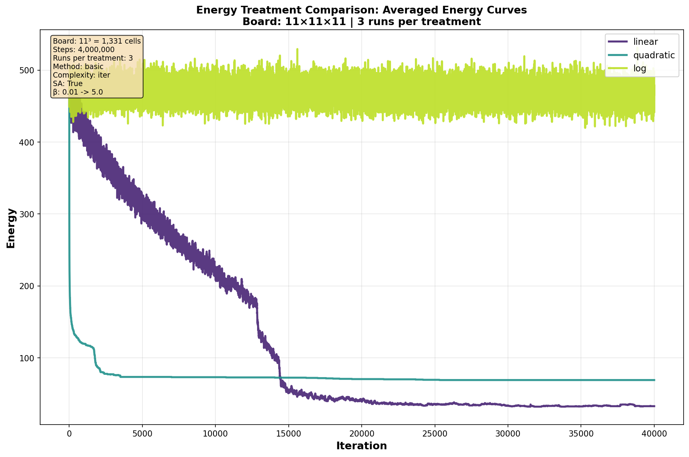 

(a)
<!-- l. 238 --><math display='inline' xmlns='http://www.w3.org/1998/Math/MathML'><mrow><msub><mrow><mi>g</mi></mrow><mrow><mn>1</mn></mrow></msub><mo class='MathClass-open' stretchy='false'>(</mo><mi>x</mi><mo class='MathClass-close' stretchy='false'>)</mo> <mo class='MathClass-rel' stretchy='false'>=</mo> <mi>x</mi></mrow></math>,
<!-- l. 238 --><math display='inline' xmlns='http://www.w3.org/1998/Math/MathML'><mrow><msub><mrow><mi>g</mi></mrow><mrow><mn>2</mn></mrow></msub><mo class='MathClass-open' stretchy='false'>(</mo><mi>x</mi><mo class='MathClass-close' stretchy='false'>)</mo> <mo class='MathClass-rel' stretchy='false'>=</mo> <msup><mrow><mi>x</mi></mrow><mrow><mn>2</mn></mrow></msup></mrow></math>,
<!-- l. 238 --><math display='inline' xmlns='http://www.w3.org/1998/Math/MathML'><mrow><msub><mrow><mi>g</mi></mrow><mrow><mn>3</mn></mrow></msub><mo class='MathClass-open' stretchy='false'>(</mo><mi>x</mi><mo class='MathClass-close' stretchy='false'>)</mo> <mo class='MathClass-rel' stretchy='false'>=</mo> <mi class='loglike'>log</mi><mo>⁡<!-- FUNCTION APPLICATION --></mo><!-- nolimits --><mo class='MathClass-open' stretchy='false'>(</mo><mi>x</mi><mo class='MathClass-close' stretchy='false'>)</mo></mrow></math>

                      
                                         

<!-- l. 240 -->

<!-- l. 241 -->
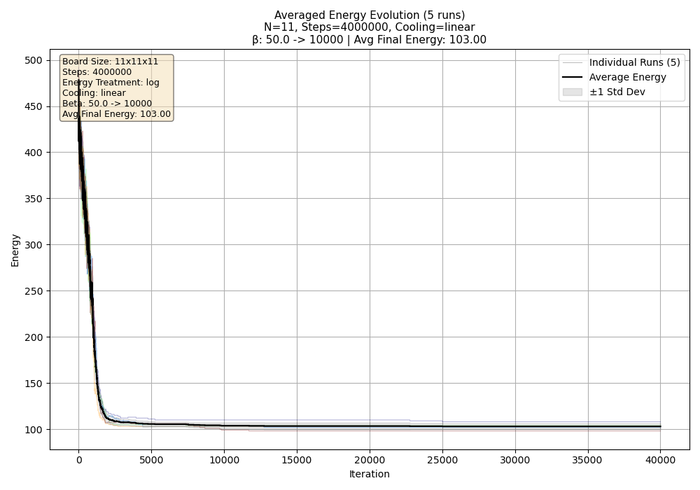 

(b)
<!-- l. 242 --><math display='inline' xmlns='http://www.w3.org/1998/Math/MathML'><mrow><mi>g</mi><mo class='MathClass-open' stretchy='false'>(</mo><mi>x</mi><mo class='MathClass-close' stretchy='false'>)</mo> <mo class='MathClass-rel' stretchy='false'>=</mo> <mi class='loglike'>log</mi><mo>⁡<!-- FUNCTION APPLICATION --></mo><!-- nolimits --><mo class='MathClass-open' stretchy='false'>(</mo><mi>x</mi><mo class='MathClass-close' stretchy='false'>)</mo></mrow></math>
with
<!-- l. 242 --><math display='inline' xmlns='http://www.w3.org/1998/Math/MathML'><mrow><mi>β</mi> <mo class='MathClass-punc' stretchy='false'>:</mo> <mn>50</mn> <mo class='MathClass-rel' stretchy='false'>→</mo><mn>10000</mn></mrow></math>

                      

Figure 1:            Energy            evolution            for
<!-- l. 244 --><math display='inline' xmlns='http://www.w3.org/1998/Math/MathML'><mrow><mi>N</mi> <mo class='MathClass-rel' stretchy='false'>=</mo> <mn>11</mn></mrow></math>.
(a)       Logarithmic       oscillates;       linear       and
quadratic         reach         zero.         (b)         Larger
<!-- l. 244 --><math display='inline' xmlns='http://www.w3.org/1998/Math/MathML'><mi>β</mi></math>
enables  logarithmic  convergence,  but  only  to  a  local
minimum.

</figure>
<h5 class='subsubsectionHead' id='nonuniqueness-of-solutions'>4.1.1    Non-Uniqueness of Solutions</h5>
<!-- l. 249 -->
When zero-energy configurations exist, they are generally
not unique. Figure <a href='#two-distinct-solutions-for-n'>2<!-- tex4ht:ref: fig:solutions  --></a> displays two distinct solutions for
<!-- l. 249 --><math display='inline' xmlns='http://www.w3.org/1998/Math/MathML'><mrow><mi>N</mi> <mo class='MathClass-rel' stretchy='false'>=</mo> <mn>11</mn></mrow></math> obtained
with different <!-- l. 249 --><math display='inline' xmlns='http://www.w3.org/1998/Math/MathML'><mi>g</mi></math>
functions, represented as Latin squares where cell
<!-- l. 249 --><math display='inline' xmlns='http://www.w3.org/1998/Math/MathML'><mrow><mo class='MathClass-open' stretchy='false'>(</mo><mi>i</mi><mo class='MathClass-punc' stretchy='false'>,</mo><mi>j</mi><mo class='MathClass-close' stretchy='false'>)</mo></mrow></math> contains the
queen’s height <!-- l. 249 --><math display='inline' xmlns='http://www.w3.org/1998/Math/MathML'><mi>k</mi></math>.

<figure class='figure' id='x1-15003r2'>

<!-- l. 253 -->

<!-- l. 254 -->
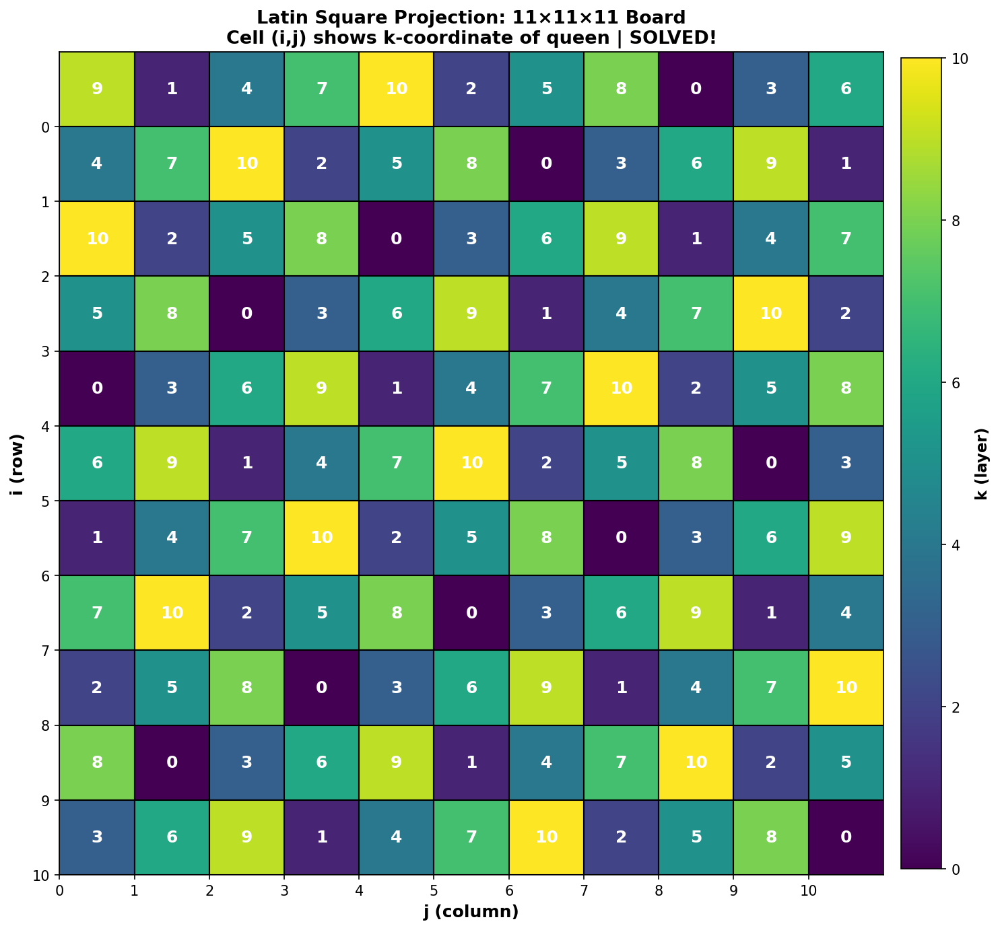 

(a)
<!-- l. 255 --><math display='inline' xmlns='http://www.w3.org/1998/Math/MathML'><mrow><mi>g</mi><mo class='MathClass-open' stretchy='false'>(</mo><mi>x</mi><mo class='MathClass-close' stretchy='false'>)</mo> <mo class='MathClass-rel' stretchy='false'>=</mo> <msup><mrow><mi>x</mi></mrow><mrow><mn>2</mn></mrow></msup></mrow></math>

                      
                                                  

<!-- l. 257 -->

<!-- l. 258 -->
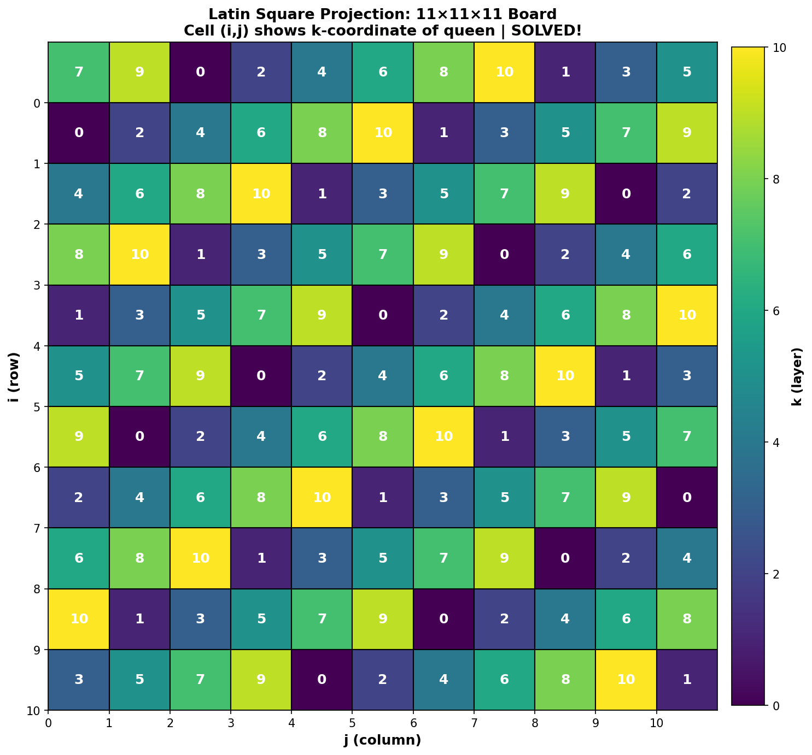 

(b)
<!-- l. 259 --><math display='inline' xmlns='http://www.w3.org/1998/Math/MathML'><mrow><mi>g</mi><mo class='MathClass-open' stretchy='false'>(</mo><mi>x</mi><mo class='MathClass-close' stretchy='false'>)</mo> <mo class='MathClass-rel' stretchy='false'>=</mo> <mi>x</mi></mrow></math>

                      

Figure 2:       Two       distinct       solutions       for
<!-- l. 261 --><math display='inline' xmlns='http://www.w3.org/1998/Math/MathML'><mrow><mi>N</mi> <mo class='MathClass-rel' stretchy='false'>=</mo> <mn>11</mn></mrow></math>.

</figure>
<h4 class='subsectionHead' id='energy-evolution'>4.2    Energy Evolution</h4>
<!-- l. 266 -->
We examine energy evolution for
<!-- l. 266 --><math display='inline' xmlns='http://www.w3.org/1998/Math/MathML'><mrow><mi>N</mi> <mo class='MathClass-rel' stretchy='false'>=</mo> <mn>4</mn></mrow></math> to
<!-- l. 266 --><math display='inline' xmlns='http://www.w3.org/1998/Math/MathML'><mrow><mi>N</mi> <mo class='MathClass-rel' stretchy='false'>=</mo> <mn>11</mn></mrow></math>, using linear cooling
for <!-- l. 266 --><math display='inline' xmlns='http://www.w3.org/1998/Math/MathML'><mrow><mi>N</mi> <mo class='MathClass-rel' stretchy='false'>∈</mo><mo class='MathClass-open' stretchy='false'>{</mo><mn>4</mn><mo class='MathClass-punc' stretchy='false'>,</mo><mn>5</mn><mo class='MathClass-punc' stretchy='false'>,</mo><mn>6</mn><mo class='MathClass-punc' stretchy='false'>,</mo><mn>11</mn><mo class='MathClass-close' stretchy='false'>}</mo></mrow></math> and geometric
cooling for <!-- l. 266 --><math display='inline' xmlns='http://www.w3.org/1998/Math/MathML'><mrow><mi>N</mi> <mo class='MathClass-rel' stretchy='false'>∈</mo><mo class='MathClass-open' stretchy='false'>{</mo><mn>7</mn><mo class='MathClass-punc' stretchy='false'>,</mo><mn>8</mn><mo class='MathClass-punc' stretchy='false'>,</mo><mn>9</mn><mo class='MathClass-punc' stretchy='false'>,</mo><mn>10</mn><mo class='MathClass-close' stretchy='false'>}</mo></mrow></math>.
Full results appear in Appendix <a href='#energy-evolution-plots'>A<!-- tex4ht:ref: app:energy  --></a>; here we highlight the key
cases <!-- l. 266 --><math display='inline' xmlns='http://www.w3.org/1998/Math/MathML'><mrow><mi>N</mi> <mo class='MathClass-rel' stretchy='false'>=</mo> <mn>10</mn></mrow></math>
and <!-- l. 266 --><math display='inline' xmlns='http://www.w3.org/1998/Math/MathML'><mrow><mi>N</mi> <mo class='MathClass-rel' stretchy='false'>=</mo> <mn>11</mn></mrow></math>
in Figure <a href='#energy-evolution-for-n-unsolvable-and-n-solvable-iteration-axis-scaled-by-light-individual-runs-dark-average-'>3<!-- tex4ht:ref: fig:energy-main  --></a>.

<!-- l. 268 -->
The two cooling schedules produce distinct descent
profiles. Linear cooling yields approximately linear
curves with steady descent, while geometric cooling
produces convex curves that drop rapidly early then
flatten as high-temperature steps concentrate at the
beginning. Both schedules converge to comparable final
energies.

<!-- l. 270 -->
For <!-- l. 270 --><math display='inline' xmlns='http://www.w3.org/1998/Math/MathML'><mrow><mi>N</mi> <mo class='MathClass-rel' stretchy='false'>≤</mo> <mn>10</mn></mrow></math>,
energy stabilizes at positive values, consistent
with theoretical unsolvability. The final energy
increases with board size, from around 21 for
<!-- l. 270 --><math display='inline' xmlns='http://www.w3.org/1998/Math/MathML'><mrow><mi>N</mi> <mo class='MathClass-rel' stretchy='false'>=</mo> <mn>4</mn></mrow></math> to 37
for <!-- l. 270 --><math display='inline' xmlns='http://www.w3.org/1998/Math/MathML'><mrow><mi>N</mi> <mo class='MathClass-rel' stretchy='false'>=</mo> <mn>10</mn></mrow></math>.
For <!-- l. 270 --><math display='inline' xmlns='http://www.w3.org/1998/Math/MathML'><mrow><mi>N</mi> <mo class='MathClass-rel' stretchy='false'>=</mo> <mn>11</mn></mrow></math>,
multiple runs reach zero energy, confirming existence of
valid solutions. The individual trajectories diverge: some
runs descend sharply to zero, while others plateau before
finding the global minimum.

<figure class='figure' id='x1-16003r3'>

<!-- l. 274 -->

<!-- l. 275 -->
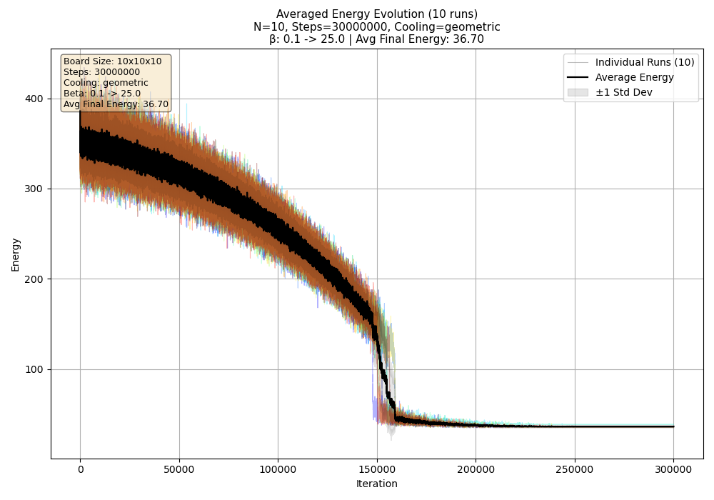 

(a)
<!-- l. 276 --><math display='inline' xmlns='http://www.w3.org/1998/Math/MathML'><mrow><mi>N</mi> <mo class='MathClass-rel' stretchy='false'>=</mo> <mn>10</mn></mrow></math>
(geometric)

                      
                                         

<!-- l. 278 -->

<!-- l. 279 -->
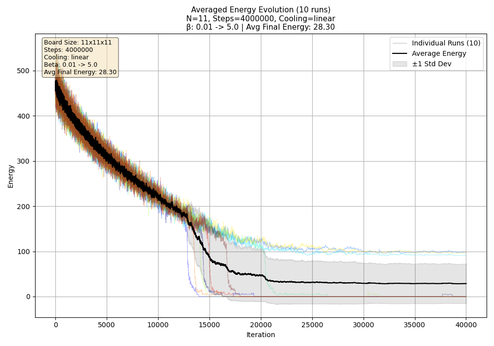 

(b)
<!-- l. 280 --><math display='inline' xmlns='http://www.w3.org/1998/Math/MathML'><mrow><mi>N</mi> <mo class='MathClass-rel' stretchy='false'>=</mo> <mn>11</mn></mrow></math>
(linear)

                      

Figure 3:            Energy            evolution            for
<!-- l. 282 --><math display='inline' xmlns='http://www.w3.org/1998/Math/MathML'><mrow><mi>N</mi> <mo class='MathClass-rel' stretchy='false'>=</mo> <mn>10</mn></mrow></math>
(unsolvable) and <!-- l. 282 --><math display='inline' xmlns='http://www.w3.org/1998/Math/MathML'><mrow><mi>N</mi> <mo class='MathClass-rel' stretchy='false'>=</mo> <mn>11</mn></mrow></math>
(solvable).        Iteration        axis        scaled        by
<!-- l. 282 --><math display='inline' xmlns='http://www.w3.org/1998/Math/MathML'><mrow><mn>1</mn><msup><mrow><mn>0</mn></mrow><mrow><mn>1</mn></mrow></msup></mrow></math>.
Light:       individual       runs;       dark:       average.
<!-- l. 282 --><math display='inline' xmlns='http://www.w3.org/1998/Math/MathML'><mrow><mi>β</mi> <mo class='MathClass-punc' stretchy='false'>:</mo> <mn>0.1</mn> <mo class='MathClass-rel' stretchy='false'>→</mo> <mn>5</mn></mrow></math>

</figure>
<h4 class='subsectionHead' id='effect-of-annealing-schedule'>4.3    Effect of Annealing Schedule</h4>
<!-- l. 287 -->
Simulated annealing gradually increases
<!-- l. 287 --><math display='inline' xmlns='http://www.w3.org/1998/Math/MathML'><mi>β</mi></math> to
balance exploration and exploitation. To assess whether this
schedule is necessary, we compare runs with constant
<!-- l. 287 --><math display='inline' xmlns='http://www.w3.org/1998/Math/MathML'><mi>β</mi></math>
values ranging from 0.01 to 1000 for
<!-- l. 287 --><math display='inline' xmlns='http://www.w3.org/1998/Math/MathML'><mrow><mi>N</mi> <mo class='MathClass-rel' stretchy='false'>=</mo> <mn>11</mn></mrow></math>.

<!-- l. 289 -->
As shown in Figure <a href='#energy-evolution-with-constant-for-n-low-oscillates-high-converges-to-zero'>4<!-- tex4ht:ref: fig:constant-beta  --></a>, low values
(<!-- l. 289 --><math display='inline' xmlns='http://www.w3.org/1998/Math/MathML'><mrow><mi>β</mi> <mo class='MathClass-rel' stretchy='false'>≤</mo> <mn>1</mn></mrow></math>)
accept too many uphill moves, causing the chain to
oscillate at high energy without converging. High values
(<!-- l. 289 --><math display='inline' xmlns='http://www.w3.org/1998/Math/MathML'><mrow><mi>β</mi> <mo class='MathClass-rel' stretchy='false'>≥</mo> <mn>10</mn></mrow></math>)
converge effectively to zero energy, suggesting that a greedy
approach suffices for this problem size. Moreover, larger
<!-- l. 289 --><math display='inline' xmlns='http://www.w3.org/1998/Math/MathML'><mi>β</mi></math> values yield faster
convergence: <!-- l. 289 --><math display='inline' xmlns='http://www.w3.org/1998/Math/MathML'><mrow><mi>β</mi> <mo class='MathClass-rel' stretchy='false'>=</mo> <mn>1000</mn></mrow></math>
reaches zero energy in approximately 5000
iterations, compared to around 15000 for
<!-- l. 289 --><math display='inline' xmlns='http://www.w3.org/1998/Math/MathML'><mrow><mi>β</mi> <mo class='MathClass-rel' stretchy='false'>=</mo> <mn>10</mn></mrow></math>.
This behavior likely reflects a relatively benign
energy landscape with few local minima. For larger
<!-- l. 289 --><math display='inline' xmlns='http://www.w3.org/1998/Math/MathML'><mi>N</mi></math>,
the solution space grows and local minima proliferate,
potentially requiring annealing to escape traps.

<figure class='figure'>
<!-- l. 293 -->
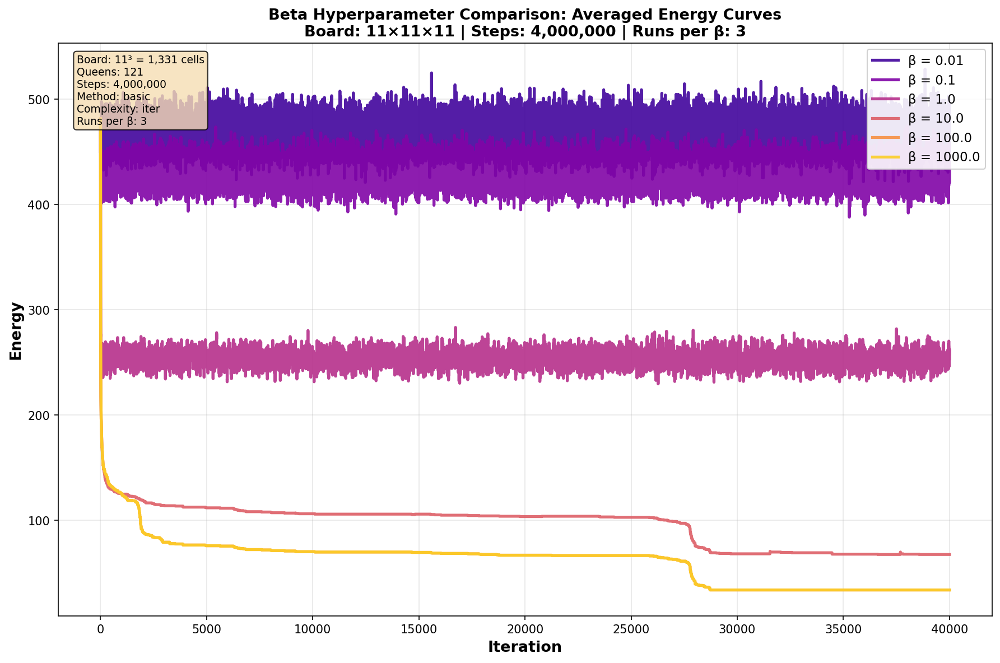 

<figcaption class='caption'>Figure 4:      Energy      evolution      with      constant
<!-- l. 294 --><math display='inline' xmlns='http://www.w3.org/1998/Math/MathML'><mi>β</mi></math>
for <!-- l. 294 --><math display='inline' xmlns='http://www.w3.org/1998/Math/MathML'><mrow><mi>N</mi> <mo class='MathClass-rel' stretchy='false'>=</mo> <mn>11</mn></mrow></math>.
Low <!-- l. 294 --><math display='inline' xmlns='http://www.w3.org/1998/Math/MathML'><mi>β</mi></math>
oscillates; high <!-- l. 294 --><math display='inline' xmlns='http://www.w3.org/1998/Math/MathML'><mi>β</mi></math>
converges to zero.                               </figcaption><!-- tex4ht:label?: x1-17001r4  -->
</figure>
<h4 class='subsectionHead' id='minimal-energy-vs-board-size'>4.4    Minimal Energy vs Board Size</h4>
<!-- l. 299 -->
We examine how the minimal achievable energy varies with board
size. Table <a href='#minimal-energy-achieved-for-each-board-size-only-n-reaches-zero'>1<!-- tex4ht:ref: tab:minimal-energy  --></a> reports the best energy obtained across all runs for
each <!-- l. 299 --><math display='inline' xmlns='http://www.w3.org/1998/Math/MathML'><mi>N</mi></math>.

<!-- l. 301 -->
For <!-- l. 301 --><math display='inline' xmlns='http://www.w3.org/1998/Math/MathML'><mrow><mi>N</mi> <mo class='MathClass-rel' stretchy='false'>≤</mo> <mn>10</mn></mrow></math>,
the algorithm converges to positive energy,
with the minimum generally increasing with
<!-- l. 301 --><math display='inline' xmlns='http://www.w3.org/1998/Math/MathML'><mi>N</mi></math> as
the number of potential conflicts grows. The exception at
<!-- l. 301 --><math display='inline' xmlns='http://www.w3.org/1998/Math/MathML'><mrow><mi>N</mi> <mo class='MathClass-rel' stretchy='false'>=</mo> <mn>10</mn></mrow></math>, which achieves
lower energy than <!-- l. 301 --><math display='inline' xmlns='http://www.w3.org/1998/Math/MathML'><mrow><mi>N</mi> <mo class='MathClass-rel' stretchy='false'>=</mo> <mn>8</mn></mrow></math>
and <!-- l. 301 --><math display='inline' xmlns='http://www.w3.org/1998/Math/MathML'><mrow><mi>N</mi> <mo class='MathClass-rel' stretchy='false'>=</mo> <mn>9</mn></mrow></math>, may
reflect variance across runs or favorable structure in the energy
landscape. For <!-- l. 301 --><math display='inline' xmlns='http://www.w3.org/1998/Math/MathML'><mrow><mi>N</mi> <mo class='MathClass-rel' stretchy='false'>=</mo> <mn>11</mn></mrow></math>,
the algorithm reaches zero energy, confirming
the existence of a valid solution as predicted by
<!-- l. 301 --><math display='inline' xmlns='http://www.w3.org/1998/Math/MathML'><mrow><mi class='qopname'> gcd</mi><mo> ⁡<!-- FUNCTION APPLICATION --> </mo><mo class='MathClass-open' stretchy='false'>(</mo><mn>11</mn><mo class='MathClass-punc' stretchy='false'>,</mo><mn>210</mn><mo class='MathClass-close' stretchy='false'>)</mo> <mo class='MathClass-rel' stretchy='false'>=</mo> <mn>1</mn></mrow></math>.

<!-- l. 303 -->

<figure class='float' id='x1-18001r1'>

 <table class='tabular' id='TBL-3' rules='groups'><colgroup id='TBL-3-1g'><col id='TBL-3-1' /></colgroup><colgroup id='TBL-3-2g'><col id='TBL-3-2' /><col id='TBL-3-3' /><col id='TBL-3-4' /><col id='TBL-3-5' /><col id='TBL-3-6' /><col id='TBL-3-7' /><col id='TBL-3-8' /><col id='TBL-3-9' /><col id='TBL-3-10' /></colgroup><tr class='array-hline'><td></td><td></td><td></td><td></td><td></td><td></td><td></td><td></td><td></td><td></td></tr><tr id='TBL-3-1-' style='vertical-align:baseline;'><td class='td11' id='TBL-3-1-1' style='text-align:center; white-space:nowrap;'> <!-- l. 307 --><math display='inline' xmlns='http://www.w3.org/1998/Math/MathML'><mi>N</mi></math> </td><td class='td11' id='TBL-3-1-2' style='text-align:right; white-space:nowrap;'>  3  </td><td class='td11' id='TBL-3-1-3' style='text-align:right; white-space:nowrap;'>  4  </td><td class='td11' id='TBL-3-1-4' style='text-align:right; white-space:nowrap;'>  5  </td><td class='td11' id='TBL-3-1-5' style='text-align:right; white-space:nowrap;'>  6  </td><td class='td11' id='TBL-3-1-6' style='text-align:right; white-space:nowrap;'>  7  </td><td class='td11' id='TBL-3-1-7' style='text-align:right; white-space:nowrap;'>  8  </td><td class='td11' id='TBL-3-1-8' style='text-align:right; white-space:nowrap;'>  9  </td><td class='td11' id='TBL-3-1-9' style='text-align:right; white-space:nowrap;'> 10  </td><td class='td11' id='TBL-3-1-10' style='text-align:right; white-space:nowrap;'> 11  </td></tr><tr class='array-hline'><td></td><td></td><td></td><td></td><td></td><td></td><td></td><td></td><td></td><td></td></tr><tr id='TBL-3-2-' style='vertical-align:baseline;'><td class='td11' id='TBL-3-2-1' style='text-align:center; white-space:nowrap;'> <!-- l. 309 --><math display='inline' xmlns='http://www.w3.org/1998/Math/MathML'><msub><mrow><mi>J</mi></mrow><mrow>
<mi class='qopname'>min</mi><mo> ⁡<!-- FUNCTION APPLICATION --> </mo></mrow></msub></math>   </td><td class='td11' id='TBL-3-2-2' style='text-align:right; white-space:nowrap;'> 13  </td><td class='td11' id='TBL-3-2-3' style='text-align:right; white-space:nowrap;'> 21  </td><td class='td11' id='TBL-3-2-4' style='text-align:right; white-space:nowrap;'> 32  </td><td class='td11' id='TBL-3-2-5' style='text-align:right; white-space:nowrap;'> 41  </td><td class='td11' id='TBL-3-2-6' style='text-align:right; white-space:nowrap;'> 50  </td><td class='td11' id='TBL-3-2-7' style='text-align:right; white-space:nowrap;'> 53  </td><td class='td11' id='TBL-3-2-8' style='text-align:right; white-space:nowrap;'> 55  </td><td class='td11' id='TBL-3-2-9' style='text-align:right; white-space:nowrap;'> 36  </td><td class='td11' id='TBL-3-2-10' style='text-align:right; white-space:nowrap;'>  0  </td>
</tr><tr class='array-hline'><td></td><td></td><td></td><td></td><td></td><td></td><td></td><td></td><td></td><td></td></tr></table>                                                        

<figcaption class='caption'>Table 1: Minimal energy achieved for each board size.
Only
<!-- l. 312 --><math display='inline' xmlns='http://www.w3.org/1998/Math/MathML'><mrow><mi>N</mi> <mo class='MathClass-rel' stretchy='false'>=</mo> <mn>11</mn></mrow></math>
reaches zero.
</figcaption><!-- tex4ht:label?: x1-18001r1  -->
</figure>

<h4 class='subsectionHead' id='favorable-values-of-n'>4.5    Favorable Values of <!-- l. 316 --><math display='inline' xmlns='http://www.w3.org/1998/Math/MathML'><mi>N</mi></math></h4>
<!-- l. 317 -->
We identify which board sizes admit zero-energy
configurations. Among all tested values, only
<!-- l. 317 --><math display='inline' xmlns='http://www.w3.org/1998/Math/MathML'><mrow><mi>N</mi> <mo class='MathClass-rel' stretchy='false'>=</mo> <mn>11</mn></mrow></math> achieves
zero energy (Figure <a href='#energy-evolution-for-n-unsolvable-and-n-solvable-iteration-axis-scaled-by-light-individual-runs-dark-average-'>3<!-- tex4ht:ref: fig:energy-main  --></a>), with a representative solution shown
in Figure <a href='#two-distinct-solutions-for-n'>2<!-- tex4ht:ref: fig:solutions  --></a>. This result aligns with the theoretical condition
<!-- l. 317 --><math display='inline' xmlns='http://www.w3.org/1998/Math/MathML'><mrow><mi class='qopname'> gcd</mi><mo> ⁡<!-- FUNCTION APPLICATION --> </mo><mo class='MathClass-open' stretchy='false'>(</mo><mi>N</mi><mo class='MathClass-punc' stretchy='false'>,</mo><mn>210</mn><mo class='MathClass-close' stretchy='false'>)</mo> <mo class='MathClass-rel' stretchy='false'>=</mo> <mn>1</mn></mrow></math>: since 11
is coprime to 210, a solution is guaranteed to exist. Conversely,
for <!-- l. 317 --><math display='inline' xmlns='http://www.w3.org/1998/Math/MathML'><mrow><mi>N</mi> <mo class='MathClass-rel' stretchy='false'>=</mo> <mn>4</mn></mrow></math>
to 10, all of which share common factors with 210, the
algorithm converges to positive energy, empirically
confirming their unsolvability.

<h3 class='sectionHead' id='conclusion'>5    Conclusion</h3>
<!-- l. 320 -->
We have presented an MCMC approach to the three-dimensional
<!-- l. 320 --><math display='inline' xmlns='http://www.w3.org/1998/Math/MathML'><msup><mrow><mi>N</mi></mrow><mrow><mn>2</mn></mrow></msup></math>-queens problem,
placing <!-- l. 320 --><math display='inline' xmlns='http://www.w3.org/1998/Math/MathML'><msup><mrow><mi>N</mi></mrow><mrow><mn>2</mn></mrow></msup></math> non-attacking
queens on an <!-- l. 320 --><math display='inline' xmlns='http://www.w3.org/1998/Math/MathML'><mrow><mi>N</mi> <mo class='MathClass-bin' stretchy='false'>×</mo> <mi>N</mi> <mo class='MathClass-bin' stretchy='false'>×</mo> <mi>N</mi></mrow></math>
board. Our formulation defines attack relations generalizing
classical chess moves to three dimensions, introduces an
energy function counting attacking pairs, and constructs a
Metropolis-Hastings chain with provable correctness
guarantees.

<!-- l. 322 -->
Experimental results across
<!-- l. 322 --><math display='inline' xmlns='http://www.w3.org/1998/Math/MathML'><mrow><mi>N</mi> <mo class='MathClass-rel' stretchy='false'>=</mo> <mn>3</mn></mrow></math> to
<!-- l. 322 --><math display='inline' xmlns='http://www.w3.org/1998/Math/MathML'><mrow><mi>N</mi> <mo class='MathClass-rel' stretchy='false'>=</mo> <mn>11</mn></mrow></math>
confirm theoretical predictions: the algorithm
converges to positive energy for unsolvable instances
(<!-- l. 322 --><math display='inline' xmlns='http://www.w3.org/1998/Math/MathML'><mrow><mi>N</mi> <mo class='MathClass-rel' stretchy='false'>≤</mo> <mn>10</mn></mrow></math>)
and successfully finds zero-energy configurations for
<!-- l. 322 --><math display='inline' xmlns='http://www.w3.org/1998/Math/MathML'><mrow><mi>N</mi> <mo class='MathClass-rel' stretchy='false'>=</mo> <mn>11</mn></mrow></math>,
consistent with the sufficient condition
<!-- l. 322 --><math display='inline' xmlns='http://www.w3.org/1998/Math/MathML'><mrow><mi class='qopname'> gcd</mi><mo> ⁡<!-- FUNCTION APPLICATION --> </mo><mo class='MathClass-open' stretchy='false'>(</mo><mi>N</mi><mo class='MathClass-punc' stretchy='false'>,</mo><mn>210</mn><mo class='MathClass-close' stretchy='false'>)</mo> <mo class='MathClass-rel' stretchy='false'>=</mo> <mn>1</mn></mrow></math>. Our
analysis of energy transformations reveals that only the linear
function <!-- l. 322 --><math display='inline' xmlns='http://www.w3.org/1998/Math/MathML'><mrow><mi>g</mi><mo class='MathClass-open' stretchy='false'>(</mo><mi>x</mi><mo class='MathClass-close' stretchy='false'>)</mo> <mo class='MathClass-rel' stretchy='false'>=</mo> <mi>x</mi></mrow></math>
reliably reaches global minima, while quadratic
and logarithmic alternatives distort the energy
landscape unfavorably. Surprisingly, for moderate
<!-- l. 322 --><math display='inline' xmlns='http://www.w3.org/1998/Math/MathML'><mi>N</mi></math>, constant
high-<!-- l. 322 --><math display='inline' xmlns='http://www.w3.org/1998/Math/MathML'><mi>β</mi></math>
schedules outperform simulated annealing, suggesting a
relatively benign landscape with few local minima at these
problem sizes.

<!-- l. 324 -->
Several directions remain for future work. Most promising is
adopting the restricted state space formulation discussed in
Section <a href='#problem-formulation'>2<!-- tex4ht:ref: sec:formulation  --></a>, which encodes configurations as functions
<!-- l. 324 --><math display='inline' xmlns='http://www.w3.org/1998/Math/MathML'><mrow><mi>κ</mi> <mo class='MathClass-punc' stretchy='false'>:</mo> <msup><mrow><mo class='MathClass-open' stretchy='false'>{</mo><mn>0</mn><mo class='MathClass-punc' stretchy='false'>,</mo><mo>…</mo><mo class='MathClass-punc' stretchy='false'>,</mo><mi>N</mi> <mo class='MathClass-bin' stretchy='false'>−</mo> <mn>1</mn><mo class='MathClass-close' stretchy='false'>}</mo></mrow><mrow><mn>2</mn></mrow></msup> <mo class='MathClass-rel' stretchy='false'>→</mo><mo class='MathClass-open' stretchy='false'>{</mo><mn>0</mn><mo class='MathClass-punc' stretchy='false'>,</mo><mo>…</mo><mo class='MathClass-punc' stretchy='false'>,</mo><mi>N</mi> <mo class='MathClass-bin' stretchy='false'>−</mo> <mn>1</mn><mo class='MathClass-close' stretchy='false'>}</mo></mrow></math>.   This representation reduces the state space from
  <!-- l. 324 --><math display='inline' xmlns='http://www.w3.org/1998/Math/MathML'><mrow><mrow><mo fence='true' form='prefix'>(</mo><mfrac linethickness='0.0pt'><mrow><msup><mrow><mi>N</mi></mrow><mrow><mn>3</mn></mrow></msup></mrow>
<mrow><msup><mrow><mi>N</mi></mrow><mrow><mn>2</mn></mrow></msup></mrow></mfrac><mo fence='true' form='postfix'>)</mo></mrow> </mrow></math> to
  <!-- l. 324 --><math display='inline' xmlns='http://www.w3.org/1998/Math/MathML'><msup><mrow><mi>N</mi></mrow><mrow><msup><mrow><mi>N</mi></mrow><mrow><mn>2</mn></mrow></msup>
     </mrow></msup></math>,
  eliminates rook-type attacks along one axis by construction,
  and preserves all zero-energy solutions. The resulting efficiency
  gains would enable exploration of larger solvable values such as
  <!-- l. 324 --><math display='inline' xmlns='http://www.w3.org/1998/Math/MathML'><mrow><mi>N</mi> <mo class='MathClass-rel' stretchy='false'>=</mo> <mn>13</mn></mrow></math>, 17, or 19.
  Additionally, all <!-- l. 324 --><math display='inline' xmlns='http://www.w3.org/1998/Math/MathML'><mi>β</mi></math>
 tuning in this work was performed manually; systematic
  approaches such as grid search over initial and final
  <!-- l. 324 --><math display='inline' xmlns='http://www.w3.org/1998/Math/MathML'><mi>β</mi></math>
 values, or adaptive update rules, could further improve
  convergence. Other directions include informed proposal
  distributions targeting high-conflict queens and theoretical
  analysis of the energy landscape structure.
  

  <h3 class='likesectionHead' id='references'>References</h3>
  <!-- l. 326 -->

     

     

     Tim Kunt. The <!-- l. 328 --><math display='inline' xmlns='http://www.w3.org/1998/Math/MathML'><mi>n</mi></math>-queens
     problem    in    higher    dimensions,    2024.    URL
     <a class='url' href='https://arxiv.org/abs/2406.06260'>https://arxiv.org/abs/2406.06260</a>.

<h3 class='sectionHead' id='energy-evolution-plots'>A    Energy Evolution Plots</h3>
<!-- l. 334 -->
Figure <a href='#energy-evolution-for-n-to-n-linear-cooling-for-n-geometric-for-n-iteration-axis-scaled-by-light-individual-runs-dark-average-'>5<!-- tex4ht:ref: fig:energy-all  --></a> presents energy evolution for all board sizes
<!-- l. 334 --><math display='inline' xmlns='http://www.w3.org/1998/Math/MathML'><mrow><mi>N</mi> <mo class='MathClass-rel' stretchy='false'>=</mo> <mn>4</mn></mrow></math> to
<!-- l. 334 --><math display='inline' xmlns='http://www.w3.org/1998/Math/MathML'><mrow><mi>N</mi> <mo class='MathClass-rel' stretchy='false'>=</mo> <mn>11</mn></mrow></math>.

<figure class='figure' id='x1-22009r5'>

<!-- l. 338 -->

<!-- l. 339 -->
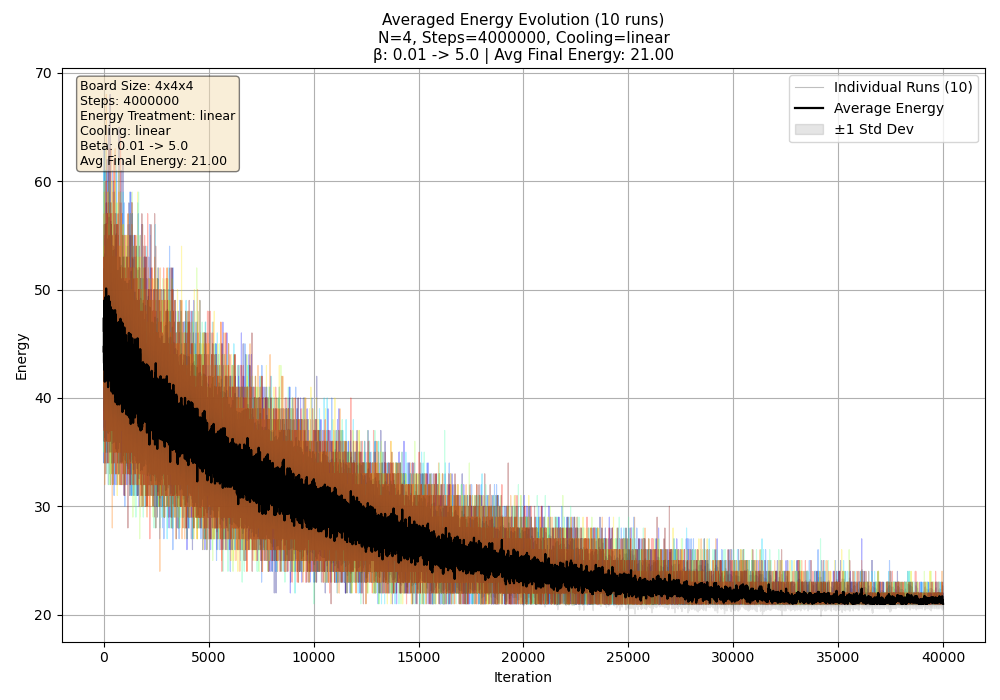 

(a)
<!-- l. 340 --><math display='inline' xmlns='http://www.w3.org/1998/Math/MathML'><mrow><mi>N</mi> <mo class='MathClass-rel' stretchy='false'>=</mo> <mn>4</mn></mrow></math>
(linear)

                      
                                         

<!-- l. 342 -->

<!-- l. 343 -->
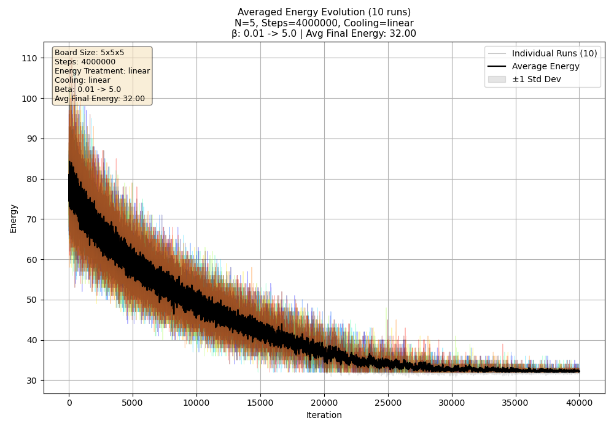 

(b)
<!-- l. 344 --><math display='inline' xmlns='http://www.w3.org/1998/Math/MathML'><mrow><mi>N</mi> <mo class='MathClass-rel' stretchy='false'>=</mo> <mn>5</mn></mrow></math>
(linear)

                      

<!-- l. 347 -->

<!-- l. 348 -->
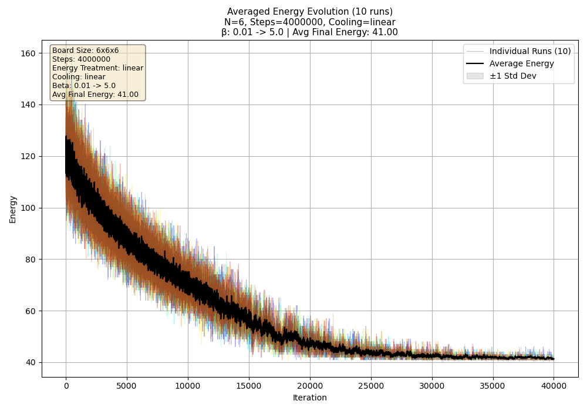 

(c)
<!-- l. 349 --><math display='inline' xmlns='http://www.w3.org/1998/Math/MathML'><mrow><mi>N</mi> <mo class='MathClass-rel' stretchy='false'>=</mo> <mn>6</mn></mrow></math>
(linear)

                      
                                         

<!-- l. 351 -->

<!-- l. 352 -->
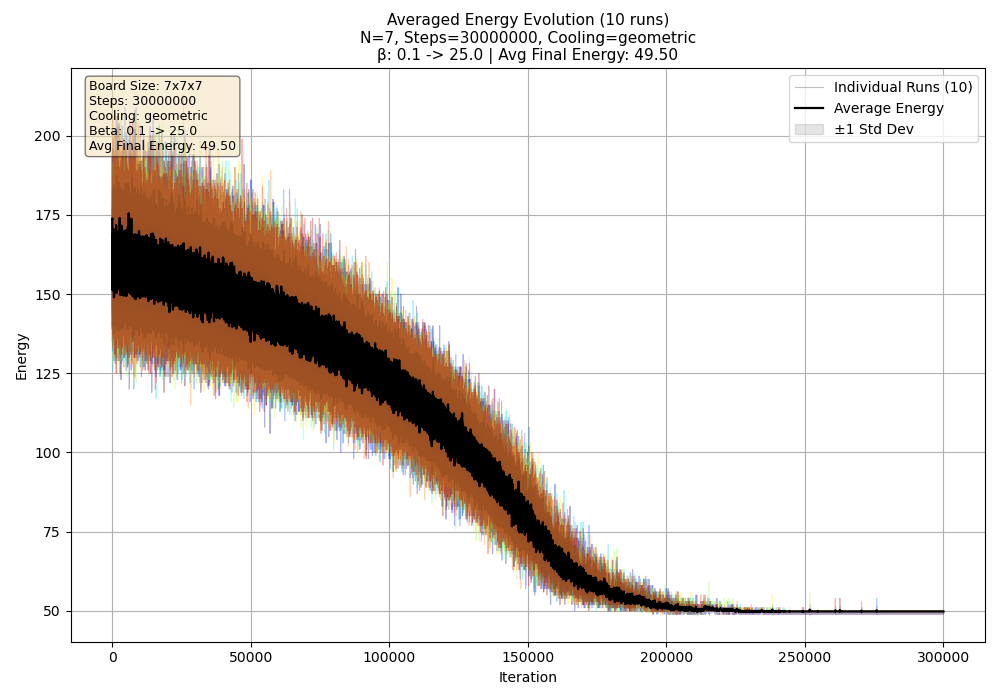 

(d)
<!-- l. 353 --><math display='inline' xmlns='http://www.w3.org/1998/Math/MathML'><mrow><mi>N</mi> <mo class='MathClass-rel' stretchy='false'>=</mo> <mn>7</mn></mrow></math>
(geometric)

                      

<!-- l. 356 -->

<!-- l. 357 -->
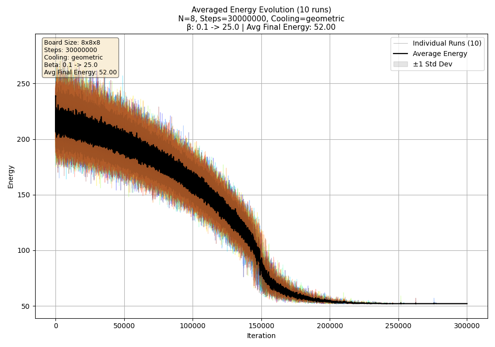 

(e)
<!-- l. 358 --><math display='inline' xmlns='http://www.w3.org/1998/Math/MathML'><mrow><mi>N</mi> <mo class='MathClass-rel' stretchy='false'>=</mo> <mn>8</mn></mrow></math>
(geometric)

                      
                                         

<!-- l. 360 -->

<!-- l. 361 -->
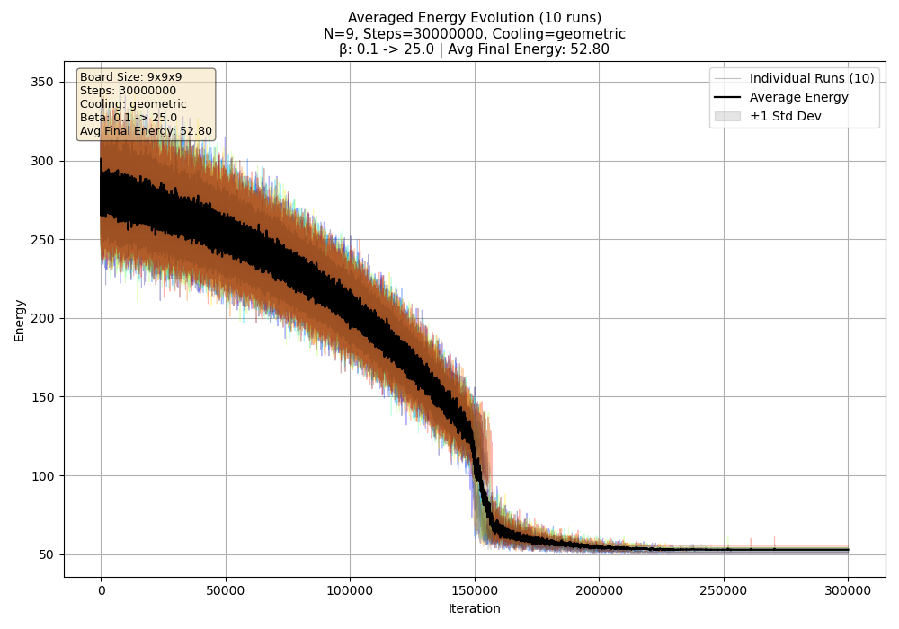 

(f)
<!-- l. 362 --><math display='inline' xmlns='http://www.w3.org/1998/Math/MathML'><mrow><mi>N</mi> <mo class='MathClass-rel' stretchy='false'>=</mo> <mn>9</mn></mrow></math>
(geometric)

                      

<!-- l. 365 -->

<!-- l. 366 -->
 

(g)
<!-- l. 367 --><math display='inline' xmlns='http://www.w3.org/1998/Math/MathML'><mrow><mi>N</mi> <mo class='MathClass-rel' stretchy='false'>=</mo> <mn>10</mn></mrow></math>
(geometric)

                      
                                         

<!-- l. 369 -->

<!-- l. 370 -->
 

(h)
<!-- l. 371 --><math display='inline' xmlns='http://www.w3.org/1998/Math/MathML'><mrow><mi>N</mi> <mo class='MathClass-rel' stretchy='false'>=</mo> <mn>11</mn></mrow></math>
(linear)

                      

Figure 5:            Energy            evolution            for
<!-- l. 373 --><math display='inline' xmlns='http://www.w3.org/1998/Math/MathML'><mrow><mi>N</mi> <mo class='MathClass-rel' stretchy='false'>=</mo> <mn>4</mn></mrow></math>
to <!-- l. 373 --><math display='inline' xmlns='http://www.w3.org/1998/Math/MathML'><mrow><mi>N</mi> <mo class='MathClass-rel' stretchy='false'>=</mo> <mn>11</mn></mrow></math>.
Linear cooling for <!-- l. 373 --><math display='inline' xmlns='http://www.w3.org/1998/Math/MathML'><mrow><mi>N</mi> <mo class='MathClass-rel' stretchy='false'>∈</mo><mo class='MathClass-open' stretchy='false'>{</mo><mn>4</mn><mo class='MathClass-punc' stretchy='false'>,</mo><mn>5</mn><mo class='MathClass-punc' stretchy='false'>,</mo><mn>6</mn><mo class='MathClass-punc' stretchy='false'>,</mo><mn>11</mn><mo class='MathClass-close' stretchy='false'>}</mo></mrow></math>;
geometric for <!-- l. 373 --><math display='inline' xmlns='http://www.w3.org/1998/Math/MathML'><mrow><mi>N</mi> <mo class='MathClass-rel' stretchy='false'>∈</mo><mo class='MathClass-open' stretchy='false'>{</mo><mn>7</mn><mo class='MathClass-punc' stretchy='false'>,</mo><mn>8</mn><mo class='MathClass-punc' stretchy='false'>,</mo><mn>9</mn><mo class='MathClass-punc' stretchy='false'>,</mo><mn>10</mn><mo class='MathClass-close' stretchy='false'>}</mo></mrow></math>.
Iteration               axis               scaled               by
<!-- l. 373 --><math display='inline' xmlns='http://www.w3.org/1998/Math/MathML'><mrow><mn>1</mn><msup><mrow><mn>0</mn></mrow><mrow><mn>1</mn></mrow></msup></mrow></math>.
Light:       individual       runs;       dark:       average.
<!-- l. 373 --><math display='inline' xmlns='http://www.w3.org/1998/Math/MathML'><mrow><mi>β</mi> <mo class='MathClass-punc' stretchy='false'>:</mo> <mn>0.1</mn> <mo class='MathClass-rel' stretchy='false'>→</mo> <mn>5</mn></mrow></math>.

</figure>

