# Adversarial Attacks Against LLM Routers

An adversarial attack against LLM routers by using a paraphraser Seq2Seq model. 
The goal is to rewrite a query so it remains semantically equivalent, while increasing the probability that a router
sends it to a stronger and more expensive model, thus focusing on cost-escalation attacks. 

[GitHub repository](https://github.com/renonesopocaj/adversarial-paraphraser)

<!-- COMPLETE ORIGINAL REPORT -->

Modern Natural Language Processing - Open Project Final Report EPFL – Spring Semester 2026

   

<h2 class='titleHead'>Adversarial Paraphrasing for Cost-Escalation Attacks against
LLM Routers</h2>
 
Caviglia Matteo | 414369, Mamouri Mohamed | 362231,
    Pellonara Mauro | 416280, Senoner Jacopo | 416355,
                       Chaddetto 
 
   

   <section class='abstract' role='doc-abstract'>
<h3 class='abstracttitle'>
Abstract
</h3>
     <!-- l. 91 -->
LLM routers send user queries to different language models to optimise performance, and are
     deployed in OpenRouter, Unify, and OpenAI’s GPT-5 auto-router. Recent work shows these
     routers are adversarially fragile, but the attacks are mainly based on appending special suffixes
     <!-- l. 92 --><math display='inline' xmlns='http://www.w3.org/1998/Math/MathML'><mi>s</mi></math>
     to a query <!-- l. 92 --><math display='inline' xmlns='http://www.w3.org/1998/Math/MathML'><mi>q</mi></math>.
     We propose a Seq2Seq adversarial paraphraser that fully rewrites a query <!-- l. 93 --><math display='inline' xmlns='http://www.w3.org/1998/Math/MathML'><mi>q</mi></math>
     into a semantically equivalent variant <!-- l. 93 --><math display='inline' xmlns='http://www.w3.org/1998/Math/MathML'><msup><mrow><mi>q</mi></mrow><mrow><mstyle class='text'><mtext>adv</mtext></mstyle></mrow></msup></math>,
     affecting  the  router’s  decision.  Our  main  findings  are:  (i)  we  introduce  a  novel  black-box
     cost-escalation attack against LLM routers based on adversarial paraphrasing; (ii) with loosened
     similarity constraints, an aggressive attacker compromises all three routers in our training pool
     (ASR <!-- l. 93 --><math display='inline' xmlns='http://www.w3.org/1998/Math/MathML'><mrow> <mo class='MathClass-rel' stretchy='false'>≥</mo></mrow></math>
     15% on each) at moderate semantic similarity (<!-- l. 93 --><math display='inline' xmlns='http://www.w3.org/1998/Math/MathML'><mrow><mn>0.91</mn></mrow></math>);
     (iii) under stricter similarity constraints (similarity <!-- l. 93 --><math display='inline' xmlns='http://www.w3.org/1998/Math/MathML'><mrow><mn>0.94</mn></mrow></math>),
     a conservative attacker still successfully attacks <!-- l. 93 --><math display='inline' xmlns='http://www.w3.org/1998/Math/MathML'><mn>2</mn></math>
     out of <!-- l. 93 --><math display='inline' xmlns='http://www.w3.org/1998/Math/MathML'><mn>3</mn></math>
     routers in the pool; (iv) attacks generalize across out-of-distribution data but transfer poorly to
     unseen routers.

</section>
   <h3 class='sectionHead' id='introduction'>1     Introduction</h3>
<!-- l. 98 -->
Large Language Model (LLM) routers control inference cost and output quality by directing queries
towards the most appropriate LLM, optimizing performance, latency, and cost.

<!-- l. 100 -->
   Routers are vulnerable to adversarial attacks [<a href='#Xzhang2026rerouteguard'>21</a>]; Zhang et al. [<a href='#Xzhang2026rerouteguard'>21</a>] identifies three threat scenarios:
cost escalation, quality hijacking, safety bypass. Cost-escalation attacks are the focus of this project; their
aim is to maliciously manipulate routers by tricking them into sending simple queries to expensive
models.

<!-- l. 102 -->
   Existing attack methods work via token-level perturbations (sometimes called confounder gadgets)
appended at the end of the sentence, and typically degrade grammar and alter semantics [<a href='#Xtang2026routeromeattackdirecting'>15</a>]. We propose
an adversarial paraphraser able to execute cost-escalation attacks by rewording a given query into an
adversarial one, while maintaining semantics. We motivate the use of a paraphraser to reflect realistic
threats, where an attacker rephrases their query to sound more complex, triggering routing to a more
capable model.

<!-- l. 105 -->
   Furthermore, our thesis is that adversarial paraphrasing offers a stealthier threat model than simple
token substitution or appending when used against LLM routers. Li et al. [<a href='#Xli2020bertattack'>7</a>] and Jin et al. [<a href='#Xjin2020textfooler'>3</a>] present
adversarial attacks able to preserve semantics and successfully attack BERT classifiers. In sentiment
analysis, for instance, Iyyer et al. [<a href='#Xiyyer-etal-2018-adversarial'>2</a>] demonstrated that adversarially paraphrased examples can
reliably breaking classifiers. More recently, Kaneko [<a href='#Xkaneko2026paraphrasingadversarialattackllmasareviewer'>5</a>] explored paraphrasing attacks against
LLM-as-a-reviewer systems, showing how simple rewording can skew automated evaluation
scores.

<!-- l. 107 -->
   Paraphrasing attacks remain unexplored against LLM routers, establishing the critical gap our project
addresses.

<!-- l. 109 -->
   Our main findings are that our paraphraser is indeed able to attack the RouteLLM-BERT and Chayan training routers
with an ASR above <!-- l. 109 --><math display='inline' xmlns='http://www.w3.org/1998/Math/MathML'><mrow><mn>70</mn><mi>%</mi></mrow></math>,
but falls well short of this mark against RouteLLM-Causal. Moreover, we find the semantic
preservation terms are necessary to preserve meaning, and semantic drift is accentuated if
excessive length of the paraphrases is not penalized. Finally, although semantic preservation
prevents our paraphraser from overfitting to a specific router, it alone does not seem to guarantee
transferability.

   <h3 class='sectionHead' id='methodology'>2     Methodology</h3>
<!-- l. 118 -->
Our framework for creating the adversarial attacks consists in training a paraphraser model
<!-- l. 118 --><math display='inline' xmlns='http://www.w3.org/1998/Math/MathML'><msub><mrow><mi>G</mi></mrow><mrow><mi>𝜃</mi></mrow></msub></math> using Reinforcement
Learning (RL). In practice, we fine-tune T5-chatGPT-paraphraser [<a href='#Xchatgpt_paraphraser'>16</a>], a 0.22B-parameter Seq2Seq model, so that, given a
query <!-- l. 118 --><math display='inline' xmlns='http://www.w3.org/1998/Math/MathML'><mi>q</mi></math> routed to a low-cost
model <!-- l. 118 --><math display='inline' xmlns='http://www.w3.org/1998/Math/MathML'><msub><mrow><mstyle mathvariant='script'><mi>M</mi></mstyle></mrow><mrow><mstyle class='text'><mtext>weak</mtext></mstyle></mrow></msub></math>, the generated
<!-- l. 118 --><math display='inline' xmlns='http://www.w3.org/1998/Math/MathML'><msup><mrow><mi>q</mi></mrow><mrow><mstyle mathvariant='normal'><mi>adv</mi></mstyle></mrow></msup></math> is routed towards a
high-cost model <!-- l. 118 --><math display='inline' xmlns='http://www.w3.org/1998/Math/MathML'><msub><mrow><mstyle mathvariant='script'><mi>M</mi></mstyle></mrow><mrow><mstyle class='text'><mtext>strong</mtext></mstyle></mrow></msub></math>.
The model choice is motivated by recent evidence that small paraphrasers, such as the chosen model, can
be competitive with much larger instruction-tuned models for paraphrase generation [<a href='#Xlemesle2026fewshot'>6</a>]. Since our attack
only requires meaning-preserving rewrites rather than open-ended generations, a lightweight Seq2Seq
paraphraser offers a better fit for the cost-escalation threat model.

   <h4 class='subsectionHead' id='grpo-training'>2.1     GRPO Training</h4>
<!-- l. 122 -->
We implement a custom GRPO [<a href='#Xdeepseek-math'>22</a>] training pipeline, as existing RL libraries lack support for
encoder-decoder models or are not maintained.

<!-- l. 124 -->
   Let <!-- l. 124 --><math display='inline' xmlns='http://www.w3.org/1998/Math/MathML'><msub><mrow><mi>G</mi></mrow><mrow><mi>𝜃</mi></mrow></msub></math> be the trainable
paraphraser and <!-- l. 124 --><math display='inline' xmlns='http://www.w3.org/1998/Math/MathML'><msub><mrow><mi>G</mi></mrow><mrow><mstyle mathvariant='normal'><mi>ref</mi></mstyle></mrow></msub></math>
a frozen copy of the initial paraphraser. For each clean query
<!-- l. 124 --><math display='inline' xmlns='http://www.w3.org/1998/Math/MathML'><msub><mrow><mi>q</mi></mrow><mrow><mi>i</mi></mrow></msub></math>, we sample
<!-- l. 124 --><math display='inline' xmlns='http://www.w3.org/1998/Math/MathML'><mi>N</mi></math> completions, score them with the
composite reward <!-- l. 124 --><math display='inline' xmlns='http://www.w3.org/1998/Math/MathML'><msub><mrow><mi>R</mi></mrow><mrow><mi mathvariant='italic'>𝑖𝑗</mi></mrow></msub></math>, and normalize
rewards (with their mean <!-- l. 124 --><math display='inline' xmlns='http://www.w3.org/1998/Math/MathML'><msub><mrow><mi>μ</mi></mrow><mrow><mi>i</mi></mrow></msub></math>
and standard deviation <!-- l. 124 --><math display='inline' xmlns='http://www.w3.org/1998/Math/MathML'><msub><mrow><mi>σ</mi></mrow><mrow><mi>i</mi></mrow></msub></math>)
within the group: <!-- l. 125 --><math display='inline' xmlns='http://www.w3.org/1998/Math/MathML'><mrow><msub><mrow><mi>A</mi></mrow><mrow><mi mathvariant='italic'>𝑖𝑗</mi></mrow></msub> <mo class='MathClass-rel' stretchy='false'>=</mo> <mfrac><mrow><msub><mrow><mi>R</mi></mrow><mrow><mi mathvariant='italic'>𝑖𝑗</mi></mrow></msub><mo class='MathClass-bin' stretchy='false'>−</mo><msub><mrow><mi>μ</mi></mrow><mrow><mi>i</mi></mrow></msub></mrow>
  <mrow><msub><mrow><mi>σ</mi></mrow><mrow><mi>i</mi></mrow></msub><mo class='MathClass-bin' stretchy='false'>+</mo><mi>𝜖</mi></mrow></mfrac>  <mo class='MathClass-punc' stretchy='false'>,</mo></mrow></math> For
each generated token <!-- l. 129 --><math display='inline' xmlns='http://www.w3.org/1998/Math/MathML'><mi>t</mi></math>,
we store the rollout log-probability, recompute the current policy log-probability, use the clipped PPO
surrogate, and include the usual KL penality, anchoring the policy to the frozen baseline. Details can be
found in Appendix <a href='#grpo'>A.3<!-- tex4ht:ref: subsec:appendixggrpo  --></a>.

   <h4 class='subsectionHead' id='reward'>2.2     Reward</h4>
<!-- l. 133 -->
For a clean query <!-- l. 133 --><math display='inline' xmlns='http://www.w3.org/1998/Math/MathML'><mi>q</mi></math> and
generated paraphrase <!-- l. 133 --><math display='inline' xmlns='http://www.w3.org/1998/Math/MathML'><msup><mrow><mi>q</mi></mrow><mrow><mstyle mathvariant='normal'><mi>adv</mi></mstyle></mrow></msup></math>,
the reward uses three components: (i) a routing term that encourages cost escalation attacks, (ii) a
semantic-preservation term that penalizes queries that drift from the meaning of the original query
<!-- l. 133 --><math display='inline' xmlns='http://www.w3.org/1998/Math/MathML'><mi>q</mi></math>,
and (iii) a length-deviation penalty that penalizes excessive length compared to
<!-- l. 133 --><math display='inline' xmlns='http://www.w3.org/1998/Math/MathML'><mi>q</mi></math>. We denote
<!-- l. 133 --><math display='inline' xmlns='http://www.w3.org/1998/Math/MathML'><mi>σ</mi></math> as the sigmoid function,
parameterized by a temperature <!-- l. 133 --><math display='inline' xmlns='http://www.w3.org/1998/Math/MathML'><mi>T</mi></math>.
The code supports two variants: an additive reward and a multiplicative reward.

<!-- l. 135 -->
Routing term.
   For each router <!-- l. 137 --><math display='inline' xmlns='http://www.w3.org/1998/Math/MathML'><mi>k</mi></math> in
the active router pool <!-- l. 137 --><math display='inline' xmlns='http://www.w3.org/1998/Math/MathML'><msub><mrow><mstyle mathvariant='script'><mi>R</mi></mstyle></mrow><mrow><mstyle mathvariant='normal'><mi>pool</mi></mstyle></mrow></msub></math>,
let <!-- l. 137 --><math display='inline' xmlns='http://www.w3.org/1998/Math/MathML'><mrow><msub><mrow><mi>p</mi></mrow><mrow><mi>k</mi></mrow></msub><mo class='MathClass-open' stretchy='false'>(</mo><mi>x</mi><mo class='MathClass-close' stretchy='false'>)</mo></mrow></math>
be the router confidence assigned to the strong model for input
<!-- l. 137 --><math display='inline' xmlns='http://www.w3.org/1998/Math/MathML'><mi>x</mi></math>. The routing term is
defined as the difference <!-- l. 138 --><math display='inline' xmlns='http://www.w3.org/1998/Math/MathML'><msub><mrow><mi mathvariant='normal'>Δ</mi></mrow><mrow><mi>k</mi></mrow></msub></math>,
between the confidence score of the query before and after being paraphrased, plus an optional weighted flip bonus
<!-- l. 138 --><math display='inline' xmlns='http://www.w3.org/1998/Math/MathML'><mi>f</mi></math> if the paraphrased query’s
score is now above <!-- l. 138 --><math display='inline' xmlns='http://www.w3.org/1998/Math/MathML'><mrow><mn>0.5</mn></mrow></math>.
In formulas, given <!-- l. 139 --><math display='inline' xmlns='http://www.w3.org/1998/Math/MathML'><mrow><msub><mrow><mi mathvariant='normal'>Δ</mi></mrow><mrow><mi>k</mi></mrow></msub> <mo class='MathClass-punc' stretchy='false'>:</mo><mo class='MathClass-rel' stretchy='false'>=</mo> <mstyle mathvariant='normal'><mi>clip</mi></mstyle><mspace class='negthinspace' width='-0.17em'></mspace> <mrow><mo fence='true' form='prefix'>(</mo><mrow><msub><mrow><mi>p</mi></mrow><mrow><mi>k</mi></mrow></msub><mo class='MathClass-open' stretchy='false'>(</mo><msup><mrow><mi>q</mi></mrow><mrow><mstyle mathvariant='normal'><mi>adv</mi></mstyle></mrow></msup><mo class='MathClass-close' stretchy='false'>)</mo> <mo class='MathClass-bin' stretchy='false'>−</mo> <msub><mrow><mi>p</mi></mrow><mrow><mi>k</mi></mrow></msub><mo class='MathClass-open' stretchy='false'>(</mo><mi>q</mi><mo class='MathClass-close' stretchy='false'>)</mo><mo class='MathClass-punc' stretchy='false'>,</mo><mo class='MathClass-bin' stretchy='false'>−</mo><mn>1</mn><mo class='MathClass-punc' stretchy='false'>,</mo><mn>1</mn></mrow><mo fence='true' form='postfix'>)</mo></mrow></mrow></math>,
<!-- l. 141 --><math display='inline' xmlns='http://www.w3.org/1998/Math/MathML'><mrow><mi>f</mi> <mo class='MathClass-punc' stretchy='false'>:</mo><mo class='MathClass-rel' stretchy='false'>=</mo> <mi>𝕀</mi> <mrow><mo fence='true' form='prefix'>[</mo><mrow><msub><mrow><mi>p</mi></mrow><mrow><mi>k</mi></mrow></msub><mo class='MathClass-open' stretchy='false'>(</mo><mi>q</mi><mo class='MathClass-close' stretchy='false'>)</mo> <mo class='MathClass-rel' stretchy='false'>&lt;</mo> <mn>0.5</mn><mo class='MathClass-punc' stretchy='false'>,</mo><msub><mrow><mi>p</mi></mrow><mrow><mi>k</mi></mrow></msub><mo class='MathClass-open' stretchy='false'>(</mo><msup><mrow><mi>q</mi></mrow><mrow><mstyle mathvariant='normal'><mi>adv</mi></mstyle></mrow></msup><mo class='MathClass-close' stretchy='false'>)</mo> <mo class='MathClass-rel' stretchy='false'>≥</mo> <mn>0.5</mn></mrow><mo fence='true' form='postfix'>]</mo></mrow></mrow></math>. We
define <!--l. 144--><math display='inline' xmlns='http://www.w3.org/1998/Math/MathML'><mrow><msub><mrow><mi>r</mi></mrow><mrow><mstyle mathvariant='normal'><mi>route</mi></mstyle></mrow></msub> <mo class='MathClass-punc' stretchy='false'>:</mo><mo class='MathClass-rel' stretchy='false'>=</mo><msub><mrow> <mi mathvariant='normal'>Δ</mi></mrow><mrow><mi>k</mi></mrow></msub> <mo class='MathClass-bin' stretchy='false'>+</mo> <msub><mrow><mi>w</mi></mrow><mrow><mstyle mathvariant='normal'><mi>flip</mi></mstyle></mrow></msub><mi>f</mi></mrow></math>.
The pooled routing reward is the weighted mean across active routers.

<!-- l. 148 -->
Semantic similarity term.

   This term starts from a clamped cosine <!-- l. 150 --><math display='inline' xmlns='http://www.w3.org/1998/Math/MathML'><mover accent='true'><mrow><mi>s</mi></mrow><mo accent='true'>~</mo></mover></math>
between L2-normalized embeddings <!-- l. 150 --><math display='inline' xmlns='http://www.w3.org/1998/Math/MathML'><mstyle mathvariant='bold'><mi>𝐞</mi></mstyle></math>,
<!-- l. 150 --><math display='inline' xmlns='http://www.w3.org/1998/Math/MathML'><msup><mrow><mstyle mathvariant='bold'><mi>𝐞</mi></mstyle></mrow><mrow><mstyle mathvariant='normal'><mi>adv</mi></mstyle></mrow></msup></math>:
<!-- l. 151 --><math display='inline' xmlns='http://www.w3.org/1998/Math/MathML'><mrow><mover accent='true'><mrow><mi>s</mi></mrow><mo accent='true'>~</mo></mover> <mo class='MathClass-punc' stretchy='false'>:</mo><mo class='MathClass-rel' stretchy='false'>=</mo><mi class='qopname'> max</mi><mo> ⁡<!-- FUNCTION APPLICATION --> </mo><mspace class='negthinspace' width='-0.17em'></mspace> <mrow><mo fence='true' form='prefix'>(</mo><mrow><mn>0</mn><mo class='MathClass-punc' stretchy='false'>,</mo><msup><mrow><mstyle mathvariant='bold'><mi>𝐞</mi></mstyle></mrow><mrow><mi class='MathClass-op'>⊤</mi><mo> ⁡<!-- FUNCTION APPLICATION --></mo></mrow></msup><msup><mrow><mstyle mathvariant='bold'><mi>𝐞</mi></mstyle></mrow><mrow><mstyle mathvariant='normal'><mi>adv</mi></mstyle></mrow></msup></mrow><mo fence='true' form='postfix'>)</mo></mrow></mrow></math>. If NLI gating
is disabled <!-- l. 151 --><math display='inline' xmlns='http://www.w3.org/1998/Math/MathML'><mrow><msub><mrow><mi>r</mi></mrow><mrow><mstyle mathvariant='normal'><mi>sim</mi></mstyle></mrow></msub> <mo class='MathClass-punc' stretchy='false'>:</mo><mo class='MathClass-rel' stretchy='false'>=</mo> <mover accent='true'><mrow><mi>s</mi></mrow><mo accent='true'>~</mo></mover></mrow></math>,
else, we compute contradiction probabilities in both directions:
<!-- l. 151 --><math display='inline' xmlns='http://www.w3.org/1998/Math/MathML'><mrow><mi>g</mi> <mo class='MathClass-punc' stretchy='false'>:</mo><mo class='MathClass-rel' stretchy='false'>=</mo> <mn>1</mn> <mo class='MathClass-bin' stretchy='false'>−</mo><mfrac><mrow><mn>1</mn></mrow>
<mrow><mn>2</mn></mrow></mfrac><mo class='MathClass-open' stretchy='false'>(</mo><msup><mrow><mi>c</mi></mrow><mrow><mstyle mathvariant='normal'><mi>fwd</mi></mstyle></mrow></msup> <mo class='MathClass-bin' stretchy='false'>+</mo> <msup><mrow><mi>c</mi></mrow><mrow><mstyle mathvariant='normal'><mi>bwd</mi></mstyle></mrow></msup><mo class='MathClass-close' stretchy='false'>)</mo></mrow></math> and define
<!-- l. 151 --><math display='inline' xmlns='http://www.w3.org/1998/Math/MathML'><mrow><msub><mrow><mi>r</mi></mrow><mrow><mstyle mathvariant='normal'><mi>sim</mi></mstyle></mrow></msub> <mo class='MathClass-punc' stretchy='false'>:</mo><mo class='MathClass-rel' stretchy='false'>=</mo> <mi>g</mi><mover accent='true'><mrow><mi>s</mi></mrow><mo accent='true'>~</mo></mover></mrow></math>. For the additive reward, a hard
similarity floor which assigns <!-- l. 151 --><math display='inline' xmlns='http://www.w3.org/1998/Math/MathML'><mrow><msub><mrow><mi>r</mi></mrow><mrow><mstyle mathvariant='normal'><mi>sim</mi></mstyle></mrow></msub> <mo class='MathClass-punc' stretchy='false'>:</mo><mo class='MathClass-rel' stretchy='false'>=</mo> <mo class='MathClass-bin' stretchy='false'>−</mo><mn>1</mn></mrow></math>
if <!-- l. 151 --><math display='inline' xmlns='http://www.w3.org/1998/Math/MathML'><mrow><mover accent='true'><mrow><mi>s</mi></mrow><mo accent='true'>~</mo></mover> <mo class='MathClass-rel' stretchy='false'>&lt;</mo> <msub><mrow><mi>τ</mi></mrow><mrow><mstyle mathvariant='normal'><mi>sim</mi></mstyle></mrow></msub></mrow></math> can
be applied.

<!-- l. 153 -->
Length penalty.
   The length term discourages degenerate paraphrases that become much
shorter or longer than the original prompt. With whitespace-token length
<!-- l. 154 --><math display='inline' xmlns='http://www.w3.org/1998/Math/MathML'><mrow><mi>ℓ</mi><mo class='MathClass-open' stretchy='false'>(</mo><mo class='MathClass-bin' stretchy='false'>⋅</mo><mo class='MathClass-close' stretchy='false'>)</mo></mrow></math> and tolerance
<!-- l. 154 --><math display='inline' xmlns='http://www.w3.org/1998/Math/MathML'><msub><mrow><mi>τ</mi></mrow><mrow><mstyle mathvariant='normal'><mi>len</mi></mstyle></mrow></msub></math>, the penalty
is: <!-- l. 154 --><math display='inline' xmlns='http://www.w3.org/1998/Math/MathML'><mrow><msub><mrow><mi>r</mi></mrow><mrow><mstyle mathvariant='normal'><mi>len</mi></mstyle></mrow></msub> <mo class='MathClass-punc' stretchy='false'>:</mo><mo class='MathClass-rel' stretchy='false'>=</mo><mi class='qopname'> max</mi><mo> ⁡<!-- FUNCTION APPLICATION --> </mo><mspace class='negthinspace' width='-0.17em'></mspace> <mrow><mo fence='true' form='prefix'>(</mo><mrow><mn>0</mn><mo class='MathClass-punc' stretchy='false'>,</mo> <mfrac><mrow><mo class='MathClass-rel' stretchy='false'>|</mo><mi>ℓ</mi><mo class='MathClass-open' stretchy='false'>(</mo><msup><mrow><mi>q</mi></mrow><mrow><mstyle mathvariant='normal'><mi>adv</mi></mstyle></mrow></msup><mo class='MathClass-close' stretchy='false'>)</mo><mo class='MathClass-bin' stretchy='false'>−</mo><mi>ℓ</mi><mo class='MathClass-open' stretchy='false'>(</mo><mi>q</mi><mo class='MathClass-close' stretchy='false'>)</mo><mo class='MathClass-rel' stretchy='false'>|</mo></mrow>
 <mrow><mi class='qopname'> max</mi><mo> ⁡<!-- FUNCTION APPLICATION --> </mo><mo class='MathClass-open' stretchy='false'>(</mo><mn>1</mn><mo class='MathClass-punc' stretchy='false'>,</mo><mi>ℓ</mi><mo class='MathClass-open' stretchy='false'>(</mo><mi>q</mi><mo class='MathClass-close' stretchy='false'>)</mo><mo class='MathClass-close' stretchy='false'>)</mo></mrow></mfrac>   <mo class='MathClass-bin' stretchy='false'>−</mo> <msub><mrow><mi>τ</mi></mrow><mrow><mstyle mathvariant='normal'><mi>len</mi></mstyle></mrow></msub></mrow><mo fence='true' form='postfix'>)</mo></mrow> <mo class='MathClass-punc' stretchy='false'>.</mo></mrow></math>

<!-- l. 156 -->
Reward Variants.
   In the additive version of the reward function, routing and semantic preservation are treated as separate objectives.
Given <!-- l. 157 --><math display='inline' xmlns='http://www.w3.org/1998/Math/MathML'><mrow><msub><mrow><mi>w</mi></mrow><mrow><mstyle mathvariant='normal'><mi>l</mi></mstyle></mrow></msub><mo class='MathClass-punc' stretchy='false'>,</mo><msub><mrow><mi>w</mi></mrow><mrow><mstyle mathvariant='normal'><mi>r</mi></mstyle></mrow></msub><mo class='MathClass-punc' stretchy='false'>,</mo><msub><mrow><mi>w</mi></mrow><mrow><mstyle mathvariant='normal'><mi>s</mi></mstyle></mrow></msub></mrow></math> weights
for each term: <!-- l. 158 --><math display='inline' xmlns='http://www.w3.org/1998/Math/MathML'><mrow><mi>R</mi> <mo class='MathClass-punc' stretchy='false'>:</mo><mo class='MathClass-rel' stretchy='false'>=</mo> <msub><mrow><mi>w</mi></mrow><mrow><mstyle mathvariant='normal'><mi>route</mi></mstyle></mrow></msub><msub><mrow><mi>r</mi></mrow><mrow><mstyle mathvariant='normal'><mi>route</mi></mstyle></mrow></msub> <mo class='MathClass-bin' stretchy='false'>+</mo> <msub><mrow><mi>w</mi></mrow><mrow><mstyle mathvariant='normal'><mi>sim</mi></mstyle></mrow></msub><msub><mrow><mi>r</mi></mrow><mrow><mstyle mathvariant='normal'><mi>sim</mi></mstyle></mrow></msub> <mo class='MathClass-bin' stretchy='false'>−</mo> <msub><mrow><mi>w</mi></mrow><mrow><mstyle mathvariant='normal'><mi>len</mi></mstyle></mrow></msub><msub><mrow><mi>r</mi></mrow><mrow><mstyle mathvariant='normal'><mi>len</mi></mstyle></mrow></msub><mo class='MathClass-punc' stretchy='false'>.</mo></mrow></math>

<!-- l. 160 -->
   We also define a multiplicative reward: <!-- l. 161 --><math display='inline' xmlns='http://www.w3.org/1998/Math/MathML'><mrow><mi>R</mi> <mo class='MathClass-rel' stretchy='false'>=</mo> <msub><mrow><mi>w</mi></mrow><mrow><mstyle mathvariant='normal'><mi>route</mi></mstyle></mrow></msub> <mrow><mo fence='true' form='prefix'>(</mo><mrow><msup><mrow><mi>m</mi></mrow><mrow><mstyle mathvariant='normal'><mi>NLI</mi></mstyle></mrow></msup><msup><mrow><mi>r</mi></mrow><mrow><mstyle mathvariant='normal'><mi>core</mi></mstyle></mrow></msup> <mo class='MathClass-bin' stretchy='false'>+</mo> <mi>f</mi><msub><mrow><mi>g</mi></mrow><mrow><mi>s</mi></mrow></msub><msub><mrow><mi>g</mi></mrow><mrow><mstyle mathvariant='normal'><mi>NLI</mi></mstyle></mrow></msub></mrow><mo fence='true' form='postfix'>)</mo></mrow> <mo class='MathClass-bin' stretchy='false'>−</mo> <msub><mrow><mi>w</mi></mrow><mrow><mstyle mathvariant='normal'><mi>len</mi></mstyle></mrow></msub><msub><mrow><mi>r</mi></mrow><mrow><mstyle mathvariant='normal'><mi>len</mi></mstyle></mrow></msub><mo class='MathClass-punc' stretchy='false'>.</mo></mrow></math>
The core term <!-- l. 162 --><math display='inline' xmlns='http://www.w3.org/1998/Math/MathML'><msup><mrow><mi>r</mi></mrow><mrow><mstyle mathvariant='normal'><mi>core</mi></mstyle></mrow></msup></math>
modulates the base routing reward using semantic similarity. To penalize semantic drift, the NLI multiplier
<!-- l. 162 --><math display='inline' xmlns='http://www.w3.org/1998/Math/MathML'><msup><mrow><mi>m</mi></mrow><mrow><mstyle mathvariant='normal'><mi>NLI</mi></mstyle></mrow></msup></math>
suppresses positive rewards and amplifies negative ones when a contradiction is detected between
<!-- l. 162 --><math display='inline' xmlns='http://www.w3.org/1998/Math/MathML'><mi>q</mi></math> and
<!-- l. 162 --><math display='inline' xmlns='http://www.w3.org/1998/Math/MathML'><msup><mrow><mi>q</mi></mrow><mrow><mstyle mathvariant='normal'><mi>adv</mi></mstyle></mrow></msup></math>.
Complete definitions for the core reward, NLI gates, and similarity thresholds are provided in
Appendix <a href='#implementation-details'>A.2<!-- tex4ht:ref: subsubsec:nlisemanticmodel  --></a>.

   <h4 class='subsectionHead' id='training-methodologies'>2.3     Training methodologies</h4>
<!-- l. 168 -->
Curriculum Learning [<a href='#Xbengio2009curriculum'>1</a>] is used over training queries based on the router margin. We first introduce
samples whose clean routing score is closest to the decision threshold between the weak and strong model.
These borderline samples are more likely to trigger a shift in routing decisions after small paraphrasing
changes, thereby providing an early less-noisy reward signal.

<!-- l. 170 -->
Including multiple routers.

   Our goal is to train a paraphraser effective against multiple routers, let
<!-- l. 173 --><math display='inline' xmlns='http://www.w3.org/1998/Math/MathML'><mrow><msub><mrow><mstyle mathvariant='script'><mi>R</mi></mstyle></mrow><mrow><mi mathvariant='italic'>𝑝𝑜𝑜𝑙</mi></mrow></msub> <mo class='MathClass-rel' stretchy='false'>=</mo> <mo class='MathClass-open' stretchy='false'>{</mo><mi>A</mi><mo class='MathClass-punc' stretchy='false'>,</mo><mi>B</mi><mo class='MathClass-punc' stretchy='false'>,</mo><mi>C</mi><mo class='MathClass-close' stretchy='false'>}</mo></mrow></math> for this subsection
only. We try two approaches: (i) we include all routers in the routing term of the reward, by taking the mean of the
routing terms <!-- l. 173 --><math display='inline' xmlns='http://www.w3.org/1998/Math/MathML'><mi>A</mi></math>,
<!-- l. 173 --><math display='inline' xmlns='http://www.w3.org/1998/Math/MathML'><mi>B</mi></math>,
<!-- l. 173 --><math display='inline' xmlns='http://www.w3.org/1998/Math/MathML'><mi>C</mi></math> (mixed
training in Yang et al. [<a href='#Xyang2026whendomainsinteract'>19</a>]); (ii) we train on one router at a time (sequential training in Yang et al. [<a href='#Xyang2026whendomainsinteract'>19</a>]).
We order routers based on their vulnerability, measured by the maximum attack success rate
achieved during individual training runs against each router, and report the exact sequence in
Section <a href='#x1-15000doc'>3.2<!-- tex4ht:ref: subsec:trainingrregimes  --></a>.

<!-- l. 175 -->
   Rather than training to converge on <!-- l. 175 --><math display='inline' xmlns='http://www.w3.org/1998/Math/MathML'><mi>A</mi></math>,
then on <!-- l. 175 --><math display='inline' xmlns='http://www.w3.org/1998/Math/MathML'><mi>B</mi></math>, and finally
on <!-- l. 175 --><math display='inline' xmlns='http://www.w3.org/1998/Math/MathML'><mi>C</mi></math>, we use a “cyclic”
schedule: we train for <!-- l. 175 --><math display='inline' xmlns='http://www.w3.org/1998/Math/MathML'><mi>K</mi></math>
epochs on <!-- l. 175 --><math display='inline' xmlns='http://www.w3.org/1998/Math/MathML'><mi>A</mi></math>,
then <!-- l. 175 --><math display='inline' xmlns='http://www.w3.org/1998/Math/MathML'><mi>K</mi></math>
epochs on <!-- l. 175 --><math display='inline' xmlns='http://www.w3.org/1998/Math/MathML'><mi>B</mi></math>,
then <!-- l. 175 --><math display='inline' xmlns='http://www.w3.org/1998/Math/MathML'><mi>K</mi></math>
epochs on <!-- l. 175 --><math display='inline' xmlns='http://www.w3.org/1998/Math/MathML'><mi>C</mi></math>,
and repeat this cycle. A similar pattern, based on periodic revisiting of tasks over training, was explored by
Speckmann and Eimer [<a href='#Xspeckmann2025taskschedulingforgetting'>13</a>]. The cyclic schedule is designed to mitigate over-specialization to
the most recently trained router, a known issue in the analogous setting of multi-domain RL.
[<a href='#Xyang2026whendomainsinteract'>19</a>].

   <h3 class='sectionHead' id='experiments'>3     Experiments</h3>
   <h4 class='subsectionHead' id='data'>3.1     Data</h4>
<!-- l. 182 -->
We draw queries from three public English question-answering datasets used as realistic user-query proxies:
TriviaQA [<a href='#Xjoshi-etal-2017-triviaqa'>4</a>] (open-domain factual), CommonsenseQA [<a href='#Xtalmor-etal-2019-commonsenseqa'>14</a>] (commonsense reasoning), and SVAMP [<a href='#Xpatel-etal-2021-nlp'>11</a>]
(arithmetic word problems). We avoid datasets used to train the routers in our pool, so that the held-out routers
are evaluated on disjoint data and we do not overfit to the training routers. We keep the question text as the query
<!-- l. 182 --><math display='inline' xmlns='http://www.w3.org/1998/Math/MathML'><mi>q</mi></math> and remove duplicates,
yielding <!-- l. 182 --><math display='inline' xmlns='http://www.w3.org/1998/Math/MathML'><mrow> <mo class='MathClass-rel' stretchy='false'>≈</mo><mspace class='negthinspace' width='-0.17em'></mspace><mn>98</mn><mo class='MathClass-punc' stretchy='false'>,</mo><mn>129</mn></mrow></math> unique queries;
for every query and router <!-- l. 182 --><math display='inline' xmlns='http://www.w3.org/1998/Math/MathML'><mrow><mi>k</mi> <mo class='MathClass-rel' stretchy='false'>∈</mo><mstyle mathvariant='script'><mi>R</mi></mstyle></mrow></math>
we precompute and cache the routing decision. We use per-source stratified train/val/test splits, containing
only queries routed to the weak model, resulting in a reduced dataset (size and source mix in
Appendix <a href='#dataset-details'>A.1<!-- tex4ht:ref: appendix:data  --></a>).

   <h4 class='subsectionHead' id='experimental-configuration'>3.2     Experimental Configuration</h4>
<!-- l. 187 -->
Router Pool.
   We integrate six routers: two RouteLLM [<a href='#Xong2025routellm'>10</a>] variants (RouteLLM-BERT, RouteLLM-Causal)
and Chayan [<a href='#Xlu2025routerarena'>8</a>] are used for training, while R2 [<a href='#Xxue2026r2router'>17</a>] and other two RouteLLM [<a href='#Xong2025routellm'>10</a>] variants
(RouteLLM-MatrixFactorization, RouteLLM-SimilarityWeighted) are held out to measure
transferability to unseen routers. Details on all six routers are provided in Appendix <a href='#router-pool1'>A.4.1<!-- tex4ht:ref: appendix:routerppool  --></a>.

<!-- l. 190 -->
Training Regimes.

   Runs are either single-router or multi-router. Multi-router runs train against all three routers in sequence
(RouteLLM-BERT<!-- l. 192 --><math display='inline' xmlns='http://www.w3.org/1998/Math/MathML'><mrow> <mo class='MathClass-rel' stretchy='false'>→</mo></mrow></math>
Chayan<!-- l. 192 --><math display='inline' xmlns='http://www.w3.org/1998/Math/MathML'><mrow> <mo class='MathClass-rel' stretchy='false'>→</mo></mrow></math>
RouteLLM-Causal), spending two epochs on each before rotating. Hyperparameter and configuration
details are in Appendix <a href='#reproducibility'>A.4.2<!-- tex4ht:ref: appendix:configs  --></a>. All experiments were run on a single A100 GPU, 40 GB VRAM and used
AdamW as optimizer.

<!-- l. 194 -->
Training Efficiency.
   In  our  first  implementation,  training  time  took
<!-- l. 194 --><math display='inline' xmlns='http://www.w3.org/1998/Math/MathML'><mrow> <mo class='MathClass-rel' stretchy='false'>∼</mo></mrow></math>5 hours per epoch with only
RouteLLM-BERT in <!-- l. 194 --><math display='inline' xmlns='http://www.w3.org/1998/Math/MathML'><mstyle mathvariant='script'><msub><mrow><mi>R</mi></mrow><mrow><mstyle class='text'><mtext>𝓅oo𝓁</mtext></mstyle></mrow></msub></mstyle></math>. Batch
routing reduced this to <!-- l. 194 --><math display='inline' xmlns='http://www.w3.org/1998/Math/MathML'><mrow> <mo class='MathClass-rel' stretchy='false'>∼</mo></mrow></math>20
minutes per epoch, with parallel routing further cutting time when multiple routers are used.

   <h4 class='subsectionHead' id='evaluation'>3.3     Evaluation</h4>
<!-- l. 199 -->
For a router <!-- l. 199 --><math display='inline' xmlns='http://www.w3.org/1998/Math/MathML'><mi>k</mi></math>, let
<!-- l. 199 --><math display='inline' xmlns='http://www.w3.org/1998/Math/MathML'><mrow><msub><mrow><mi>m</mi></mrow><mrow><mi>k</mi></mrow></msub><mo class='MathClass-open' stretchy='false'>(</mo><mi>x</mi><mo class='MathClass-close' stretchy='false'>)</mo></mrow></math> be the model
selected for an input <!-- l. 199 --><math display='inline' xmlns='http://www.w3.org/1998/Math/MathML'><mi>x</mi></math>,
while <!-- l. 199 --><math display='inline' xmlns='http://www.w3.org/1998/Math/MathML'><msubsup><mrow><mstyle mathvariant='script'><mi>M</mi></mstyle></mrow><mrow><mstyle mathvariant='normal'><mi>weak</mi></mstyle></mrow><mrow><mo class='MathClass-open' stretchy='false'>(</mo><mi>k</mi><mo class='MathClass-close' stretchy='false'>)</mo></mrow></msubsup></math>
and <!-- l. 199 --><math display='inline' xmlns='http://www.w3.org/1998/Math/MathML'><msubsup><mrow><mstyle mathvariant='script'><mi>M</mi></mstyle></mrow><mrow><mstyle mathvariant='normal'><mi>strong</mi></mstyle></mrow><mrow><mo class='MathClass-open' stretchy='false'>(</mo><mi>k</mi><mo class='MathClass-close' stretchy='false'>)</mo></mrow></msubsup></math>
represent the sets of weak and strong models, respectively.

<!-- l. 201 -->
   Our primary metrics are: (i) Attack Success Rate (ASR): The proportion of queries routed to a weak
model that are successfully "flipped" to a strong model when paraphrased. A more detailed description is
provided in Appendix <a href='#attack-success-rate-formulation'>A.2.3<!-- tex4ht:ref: appendix:asr  --></a>.

<!-- l. 204 -->
   (ii) Semantic Similarity: The cosine similarity between the embeddings of
<!-- l. 204 --><math display='inline' xmlns='http://www.w3.org/1998/Math/MathML'><mi>q</mi></math> and its
paraphrase <!-- l. 204 --><math display='inline' xmlns='http://www.w3.org/1998/Math/MathML'><msup><mrow><mi>q</mi></mrow><mrow><mstyle mathvariant='normal'><mi>adv</mi></mstyle></mrow></msup></math>,
computed via an embedding model (see <a href='#implementation-details'>A.2<!-- tex4ht:ref: subsubsec:nlisemanticmodel  --></a>).

<!-- l. 222 -->
   We also monitor two additional metrics: the KL divergence with respect to the original paraphraser
and the average generated sentence length.

   <h3 class='sectionHead' id='results-and-analysis'>4     Results and Analysis</h3>
   <h4 class='subsectionHead' id='single-router-attacks'>4.1     Single Router Attacks</h4>
<!-- l. 229 -->
We first validate the viability of single-router attacks by training separate paraphrasers against RouteLLM-BERT,
Chayan, and RouteLLM-Causal. As summarized in Table <a href='#checkpoint-configurations-for-the-four-singlerouter-runs-brt-chy-csl-cag-abbreviations-as-in-tableref-tabablationlegend-each-was-tuned-independently-against-its-target-router-the-dash-for-the-cag-step-size-denotes-a-constant-nonstepped-schedule'>5<!-- tex4ht:ref: tab:single_router_configs  --></a>, we observe significant variability in router
robustness. The target Chayan is the most vulnerable, as our single-router model (CHY) achieves
<!-- l. 230 --><math display='inline' xmlns='http://www.w3.org/1998/Math/MathML'><mrow><mn>77</mn><mo class='MathClass-punc' stretchy='false'>.</mo><mn>18</mn><mi>%</mi></mrow></math> ASR with a strong
semantic similarity of <!-- l. 230 --><math display='inline' xmlns='http://www.w3.org/1998/Math/MathML'><mrow><mn>0.871</mn></mrow></math>.
Similarly, RouteLLM-BERT is also vulnerable, showing an ASR of
<!-- l. 230 --><math display='inline' xmlns='http://www.w3.org/1998/Math/MathML'><mrow><mn>9.48</mn><mi>%</mi></mrow></math> with
<!-- l. 230 --><math display='inline' xmlns='http://www.w3.org/1998/Math/MathML'><mrow><mn>0.926</mn></mrow></math>
similarity. Conversely, RouteLLM-Causal demonstrates high robustness as the CSL run only yields a
<!-- l. 231 --><math display='inline' xmlns='http://www.w3.org/1998/Math/MathML'><mrow><mn>0.96</mn><mi>%</mi></mrow></math> ASR
with <!-- l. 231 --><math display='inline' xmlns='http://www.w3.org/1998/Math/MathML'><mrow><mn>0.890</mn></mrow></math>
similarity.

<!-- l. 233 -->
   The ablation study on RouteLLM-Causal shows key interactions among the KL weight
<!-- l. 233 --><math display='inline' xmlns='http://www.w3.org/1998/Math/MathML'><mi>β</mi></math>, similarity floor, and
validation performance. Figure <a href='#klasr-pareto-frontier-of-the-routellmcausal-sweep-each-marker-is-one-configuration-from-tableref-tabcausalsweepconfig-placed-at-its-kl-divergence-at-peak-asr-x-log-scale-and-its-peak-validation-asr-y-the-marker-colour-encodes-the-similarity-floor-sim-filled-markers-and-the-dashed-line-trace-the-nondominated-frontier-faded-markers-are-dominated-and-the-star-is-the-aggressive-variant-cag-asr-grows-monotonically-with-the-allowed-kl-even-the-best-causal-configuration-only-reaches-asr-and-only-by-tolerating-large-drift-which-confirms-that-routellmcausal-is-the-most-robust-router-in-the-training-pool'>17<!-- tex4ht:ref: fig:causalssweepppareto  --></a> shows the ASR–paraphrasing tradeoff (KL; sim-floor): the aggressive CAG run reaches
<!-- l. 233 --><math display='inline' xmlns='http://www.w3.org/1998/Math/MathML'><mrow><mn>4.68</mn><mi>%</mi></mrow></math> ASR by allowing lower
semantic similarity (<!-- l. 233 --><math display='inline' xmlns='http://www.w3.org/1998/Math/MathML'><mrow><mn>0.865</mn></mrow></math>).

   <h4 class='subsectionHead' id='multirouter-attacks-and-baselines'>4.2     Multi-Router Attacks and Baselines</h4>
<!-- l. 238 -->
Our Finetuned model (FT) manages to balance semantic integrity (Sim:
<!-- l. 238 --><math display='inline' xmlns='http://www.w3.org/1998/Math/MathML'><mrow><mn>0.942</mn></mrow></math>) while attacking successfully
Chayan (<!-- l. 238 --><math display='inline' xmlns='http://www.w3.org/1998/Math/MathML'><mrow><mn>53</mn><mo class='MathClass-punc' stretchy='false'>.</mo><mn>69</mn><mi>%</mi></mrow></math> ASR) and RouteLLM-BERT
(<!-- l. 238 --><math display='inline' xmlns='http://www.w3.org/1998/Math/MathML'><mrow><mn>6.12</mn><mi>%</mi></mrow></math> ASR). RouteLLM-Causal
remains relatively intact (<!-- l. 238 --><math display='inline' xmlns='http://www.w3.org/1998/Math/MathML'><mrow><mn>0.11</mn><mi>%</mi></mrow></math>
ASR) (Figure <a href='#x1-43001r1'>8a<!-- tex4ht:ref: fig:RESEEVAL  --></a>).

<!-- l. 240 -->
   In the AGG (Aggressive) baseline, where KL penalties are loosened and the
PPO clip widened, the results shift radically. With an accepted similarity drop to
<!-- l. 240 --><math display='inline' xmlns='http://www.w3.org/1998/Math/MathML'><mrow><mn>0.907</mn></mrow></math>,
the  attacker  succeeds  across  the  pool:  it  breaks  Chayan
(<!-- l. 240 --><math display='inline' xmlns='http://www.w3.org/1998/Math/MathML'><mrow><mn>100</mn><mi>%</mi></mrow></math> ASR), RouteLLM-BERT
(<!-- l. 240 --><math display='inline' xmlns='http://www.w3.org/1998/Math/MathML'><mrow><mn>73</mn><mo class='MathClass-punc' stretchy='false'>.</mo><mn>59</mn><mi>%</mi></mrow></math> ASR) and finally penetrates
RouteLLM-Causal with a <!-- l. 240 --><math display='inline' xmlns='http://www.w3.org/1998/Math/MathML'><mrow><mn>15</mn><mo class='MathClass-punc' stretchy='false'>.</mo><mn>73</mn><mi>%</mi></mrow></math>
ASR. As plotted in Figures <a href='#pareto-frontier-of-attack-success-rate-asr-vs-mean-semantic-similarity-on-the-routellmbert-indistribution-router-each-point-is-one-trained-checkpoint-the-dashed-line-connects-the-nondominated-front-marker-shapes-denote-run-category-baseline-reward-ablation-singlerouter-pretrained-the-xaxis-is-broken-to-isolate-the-zerosimilarityweight-outlier-zwsa-s-from-the-main-cluster'>11<!-- tex4ht:ref: fig:pareto_bert  --></a>, <a href='#pareto-frontier-of-asr-vs-mean-semantic-similarity-on-the-chayan-indistribution-router-chayan-uses-a-different-decision-boundary-than-bertbased-routers-so-frontier-membership-differs-noticeably-across-the-two-indistribution-plots'>12<!-- tex4ht:ref: fig:pareto_chayan  --></a>, <a href='#pareto-frontier-of-asr-vs-mean-semantic-similarity-on-the-routellmcausal-indistribution-router-the-aggressive-singlerouter-checkpoint-agg-anchors-the-highasr-end-of-the-frontier-reaching-the-highest-attack-rate-among-all-runs'>13<!-- tex4ht:ref: fig:pareto_causal  --></a>, this illustrates a Pareto frontier between semantic fidelity and
successful cost-escalation attacks on LLM-Routers.

<!-- l. 242 -->
   Finally, we present a qualitative analysis of some example of paraphrases in Appendix <a href='#paraphrases-qualitative-analysis'>A.5<!-- tex4ht:ref: appendix:qualitative  --></a>.

   <h4 class='subsectionHead' id='transferability'>4.3     Transferability</h4>
<!-- l. 247 -->
Out-of-distribution Routers.
   Zero-shot transferability of crafted queries is tested on the three unseen routers introduced
in Section <a href='#experimental-configuration'>3.2<!-- tex4ht:ref: subsec:experimentalconfig  --></a>. As shown in Figures <a href='#x1-43002r2'>8b<!-- tex4ht:ref: fig:RESTTRANSF  --></a>, <a href='#zeroshot-transfer-pareto-frontier-on-the-heldout-r-router-interestingly-the-zwsa-run-which-was-left-free-to-shape-its-paraphrases-without-constraints-does-not-transfer-well-suggesting-that-it-overfitted-to-the-training-routers-overall-since-no-checkpoint-was-trained-against-r-the-frontier-collapses-to-asr-indicating-limited-transferability-to-this-router'>14<!-- tex4ht:ref: fig:pareto_r2  --></a>, <a href='#zeroshot-transfer-pareto-frontier-on-the-heldout-routellmmf-matrix-factorization-router-interestingly-the-unconstrained-zwsa-run-again-transfers-poorly-suggesting-that-freely-optimized-paraphrases-overfitted-to-the-training-routers-rather-than-learning-broadly-transferable-adversarial-patterns-as-with-r-no-checkpoint-was-trained-on-this-router-the-frontier-reflects-the-degree-to-which-adversarial-paraphrases-generalise-across-router-families'>15<!-- tex4ht:ref: fig:pareto_mf  --></a>, <a href='#zeroshot-transfer-pareto-frontier-on-the-heldout-routellmsw-similarity-weighted-router-asr-drops-to-for-all-checkpoints-similarityweighted-routing-is-robust-to-the-paraphrasing-strategy-learned-in-training'>16<!-- tex4ht:ref: fig:pareto_sw  --></a>, cross-router cost-escalation via
paraphrasing exhibits low transferability. Our FT model records a maximum ASR of
<!-- l. 248 --><math display='inline' xmlns='http://www.w3.org/1998/Math/MathML'><mrow><mn>2.16</mn><mi>%</mi></mrow></math> against R2, recording no damage
to MF or SW (<!-- l. 248 --><math display='inline' xmlns='http://www.w3.org/1998/Math/MathML'><mrow><mn>0.0</mn><mi>%</mi></mrow></math> ASR). Even the
AGG configuration peaks only at <!-- l. 248 --><math display='inline' xmlns='http://www.w3.org/1998/Math/MathML'><mrow><mn>2.70</mn><mi>%</mi></mrow></math>
ASR on R2. This indicates that query-routing heuristics learn distinctly different latent boundaries, making
generalized black-box attacks via natural paraphrasing very difficult.

<!-- l. 250 -->
Out-of-distribution queries.
   Evaluating the final models on unseen data from IFEval (Figure <a href='#outofdistribution-evaluation-on-ifeval-test-asr-of-the-two-final-models-ft-agg-against-all-six-routers-on-heldout-instructionfollowing-prompts-that-are-new-to-both-the-paraphraser-and-the-routers-the-legend-reports-each-models-mean-semantic-similarity-the-cosine-similarity-between-the-stellaenbv-embeddings-of-the-original-query-q-and-its-paraphrase-q-adv-averaged-over-the-prompts-sectionref-subsecevaluation-the-attack-generalizes-offdistribution-on-the-training-routers-chayan-for-ftagg-routellmbert-routellmcausal-reproducing-the-indistribution-ranking-at-comparable-similarity-while-the-heldout-routers-stay-essentially-unattacked-mf-sw-at-r-generalization-is-therefore-to-new-data-not-new-routers'>10<!-- tex4ht:ref: fig:oodiifeval  --></a>) shows that the attack generalizes
to unseen data but not unseen routers: ASR on the training routers stays high (AGG: Chayan
<!-- l. 251 --><math display='inline' xmlns='http://www.w3.org/1998/Math/MathML'><mrow><mn>88</mn><mo class='MathClass-punc' stretchy='false'>.</mo><mn>6</mn><mi>%</mi></mrow></math>, RouteLLM-BERT
<!-- l. 251 --><math display='inline' xmlns='http://www.w3.org/1998/Math/MathML'><mrow><mn>67</mn><mo class='MathClass-punc' stretchy='false'>.</mo><mn>2</mn><mi>%</mi></mrow></math>) at
similarity comparable to in-distribution, while the held-out routers remain unattacked.

   <h4 class='subsectionHead' id='ablations'>4.4     Ablations</h4>
<!-- l. 258 -->
Similarity Constraints.
   Controlling the similarity floor strictly influences attack possibilities. By removing semantic
penalties completely (ZWSA), the model degenerates into pure adversarial perturbations (Sim:
<!-- l. 258 --><math display='inline' xmlns='http://www.w3.org/1998/Math/MathML'><mrow><mn>0.268</mn></mrow></math>) but massively exploits
Chayan (<!-- l. 258 --><math display='inline' xmlns='http://www.w3.org/1998/Math/MathML'><mrow><mn>99</mn><mo class='MathClass-punc' stretchy='false'>.</mo><mn>33</mn><mi>%</mi></mrow></math> ASR) and
RouteLLM-BERT (<!-- l. 258 --><math display='inline' xmlns='http://www.w3.org/1998/Math/MathML'><mrow><mn>98</mn><mo class='MathClass-punc' stretchy='false'>.</mo><mn>44</mn><mi>%</mi></mrow></math>
ASR). Conversely, a very high similarity floor (HSF) preserves
<!-- l. 258 --><math display='inline' xmlns='http://www.w3.org/1998/Math/MathML'><mrow><mn>0.986</mn></mrow></math> Sim but
vastly dampens the attack potential compared to the baseline.

<!-- l. 263 -->
Curriculum Learning.
   Figure <a href='#routingreward-trajectories-rewardroutemean-for-the-baseline-finetuned-run-and-the-nocurriculum-ablation-over-training-steps-ft-a-shows-clean-periodic-spikes-aligned-with-the-cyclic-router-schedule-and-returns-to-a-stable-baseline-between-phases-whereas-nc-b-is-noisy-throughout-with-highamplitude-fluctuations-and-no-clear-structure-illustrating-how-curriculum-ordering-stabilizes-the-training-signal'>7<!-- tex4ht:ref: fig:rewardmmeanfftvvsnnc  --></a> contrasts reward trajectories between the FT model and the No Curriculum (NC) ablation,
showing that curriculum learning produces smoother, more stable optimization while NC is noisier and
more chaotic.

<!-- l. 265 -->
Reward ablations
   We implemented the multiplicative reward based on the following intuition: adding the similarity
term to the routing term could yield highly positive rewards even when the router provides
no reward. Instead, we wanted the signal to be zero whenever the routing reward is absent
or negative. In practice, however, the additive and multiplicative variants appear to behave
similarly.

   <h3 class='sectionHead' id='ethical-considerations'>5     Ethical considerations</h3>
<!-- l. 276 -->
This research studies the vulnerability of LLM routers to adversarial paraphrasing, This creates a dual-use
risk: malicious actors could exploit such attacks at scale to inflate infrastructure costs for model providers,
while understanding them is necessary for researchers and system designers to evaluate and make routing
systems more robust.

<!-- l. 280 -->
   Our paraphraser was trained only on English text from public question-answering datasets. Although
these data do not contain sensitive information, they may reflect English-centric biases. Defenses built on
such models must be evaluated carefully to avoid penalizing unconventional language, which could
disproportionately affect non-native English speakers, users with speech or cognitive disabilities, and
speakers of dialectal varieties. Signed-language interaction falls outside the scope of this work, as most
routers operate exclusively on text.

<!-- l. 282 -->
   Extending our work beyond English introduces dependencies on multilingual paraphrasers, similarity
metrics, NLI models, and routers. High-resource languages would require replacing T5 with its
multilingual variant mT5 [<a href='#XDBLP_journals_corr_abs-2010-11934'>18</a>] and validating all components through native-speaker review and
multilingual benchmarks. Low-resource languages pose greater challenges, since reliable routers and
similarity metrics may be unavailable or weak. Gathering paraphraser training data for RL training is
simpler, as our approach requires only collections of relatively simple questions available in many
lower-resource settings.

   <h3 class='sectionHead' id='conclusion'>6     Conclusion</h3>
<!-- l. 290 -->
We presented a fine-tuned paraphraser <!-- l. 290 --><math display='inline' xmlns='http://www.w3.org/1998/Math/MathML'><msub><mrow><mi>G</mi></mrow><mrow><mi>𝜃</mi></mrow></msub></math>
able to perform adversarial attacks on a set of chosen LLM routers. Under the
conservative configuration (FT), we reach an average in-distribution ASR of
<!-- l. 290 --><math display='inline' xmlns='http://www.w3.org/1998/Math/MathML'><mrow><mn>20</mn><mo class='MathClass-punc' stretchy='false'>.</mo><mn>0</mn><mi>%</mi></mrow></math> at a mean semantic
similarity of <!-- l. 290 --><math display='inline' xmlns='http://www.w3.org/1998/Math/MathML'><mrow><mn>0.942</mn></mrow></math>.
Relaxing the similarity constraints (AGG) raises the average ASR to
<!-- l. 290 --><math display='inline' xmlns='http://www.w3.org/1998/Math/MathML'><mrow><mn>63</mn><mo class='MathClass-punc' stretchy='false'>.</mo><mn>1</mn><mi>%</mi></mrow></math> at a similarity
of <!-- l. 290 --><math display='inline' xmlns='http://www.w3.org/1998/Math/MathML'><mrow><mn>0.907</mn></mrow></math>, at
the cost of lower meaning preservation. Our attacks generalize well on unseen queries
(Figure <a href='#outofdistribution-evaluation-on-ifeval-test-asr-of-the-two-final-models-ft-agg-against-all-six-routers-on-heldout-instructionfollowing-prompts-that-are-new-to-both-the-paraphraser-and-the-routers-the-legend-reports-each-models-mean-semantic-similarity-the-cosine-similarity-between-the-stellaenbv-embeddings-of-the-original-query-q-and-its-paraphrase-q-adv-averaged-over-the-prompts-sectionref-subsecevaluation-the-attack-generalizes-offdistribution-on-the-training-routers-chayan-for-ftagg-routellmbert-routellmcausal-reproducing-the-indistribution-ranking-at-comparable-similarity-while-the-heldout-routers-stay-essentially-unattacked-mf-sw-at-r-generalization-is-therefore-to-new-data-not-new-routers'>10<!-- tex4ht:ref: fig:oodiifeval  --></a>). Our main limitations are (i) low ASR on RouteLLM-Causal under tight
similarity constraints and (ii) poor transferability to unseen routers, with average ASR below
<!-- l. 290 --><math display='inline' xmlns='http://www.w3.org/1998/Math/MathML'><mrow><mn>1.1</mn><mi>%</mi></mrow></math>, though R2 shows a weak
but non-zero signal (<!-- l. 290 --><math display='inline' xmlns='http://www.w3.org/1998/Math/MathML'><mrow><mn>2.7</mn><mi>%</mi></mrow></math>).
Our ablations show the necessity of the semantic similarity term and length penalty to preserve the
meaning of the paraphrases.

<!-- l. 292 -->
   For future work, we could: (i) fine-tune an LLM with the same reward to test whether added capacity
improves ASR without increasing semantic drift; (ii) generate a synthetic dataset of paraphrases for an
SFT warm-up before our RL pipeline.

<!-- l. 296 -->

   <h3 class='likesectionHead' id='references'>References</h3>
<!-- l. 1 -->

     

     

 [1]    Yoshua  Bengio,  Jérôme  Louradour,  Ronan  Collobert,  and  Jason  Weston.  2009.
     <a href='https://doi.org/10.1145/1553374.1553380'>Curriculum learning</a>. In Proceedings of the 26th Annual International Conference on Machine
     Learning, pages 41–48. ACM.
     

     

 [2]    Mohit Iyyer, John Wieting, Kevin Gimpel, and Luke Zettlemoyer. 2018.    <a href='https://doi.org/10.18653/v1/N18-1170'>Adversarial
     example  generation  with  syntactically  controlled  paraphrase  networks</a>.   In  Proceedings  of
     the 2018 Conference of the North American Chapter of the Association for Computational
     Linguistics: Human Language Technologies, Volume 1 (Long Papers), pages 1875–1885, New
     Orleans, Louisiana. Association for Computational Linguistics.
     

     

 [3]    Di Jin,  Zhijing  Jin,  Joey Tianyi  Zhou,  and  Peter  Szolovits.  2020.      <a href='https://doi.org/10.1609/aaai.v34i05.6311'>Is  BERT  really
     robust? a strong baseline for natural language attack on text classification and entailment</a>.  In
     Proceedings of the AAAI Conference on Artificial Intelligence, volume 34, pages 8018–8025.
     

     

 [4]    Mandar Joshi, Eunsol Choi, Daniel Weld, and Luke Zettlemoyer. 2017.    <a href='https://doi.org/10.18653/v1/P17-1147'>TriviaQA: A
     large scale distantly supervised challenge dataset for reading comprehension</a>. In Proceedings
     of the 55th Annual Meeting of the Association for Computational Linguistics (Volume 1: Long
     Papers), pages 1601–1611, Vancouver, Canada. Association for Computational Linguistics.
     

     

 [5]    Masahiro Kaneko. 2026.  <a href='http://arxiv.org/abs/2601.06884'>Paraphrasing adversarial attack on llm-as-a-reviewer</a>.
     

     

 [6]    Quentin Lemesle, Jonathan Chevelu, Damien Lolive, and Arnaud Delhay. 2026.  <a href='https://openreview.net/forum?id=wjjqurlXvg'>Few-shot
     paraphrase generation with LLMs: An empirical study of models and hyperparameters</a>.
     

     

 [7]    Linyang  Li,  Ruotian  Ma,  Qipeng  Guo,  Xiangyang  Xue,  and  Xipeng  Qiu.  2020.
     <a href='https://doi.org/10.18653/v1/2020.emnlp-main.500'>BERT-ATTACK:  Adversarial  attack  against  BERT  using  BERT</a>.    In  Proceedings  of  the
     2020 Conference on Empirical Methods in Natural Language Processing (EMNLP), pages
     6193–6202, Online. Association for Computational Linguistics.
     

     

 [8]    Yifan Lu, Rixin Liu, Jiayi Yuan, Xingqi Cui, Shenrun Zhang, Hongyi Liu, and Jiarong
     Xing. 2025.  <a href='https://doi.org/10.48550/arXiv.2510.00202'>RouterArena: An open platform for comprehensive comparison of LLM routers</a>.
     

     

 [9]    D. Lee Miller. 2025.  <a href='https://huggingface.co/dleemiller/ModernCE-base-nli'>Modernce nli: An nli cross encoder model</a>.
     

     

[10]    Isaac  Ong,  Amjad  Almahairi,  Vincent  Wu,  Wei-Lin  Chiang,  Tianhao  Wu,  Joseph E.
     Gonzalez, M Waleed Kadous, and Ion Stoica. 2025.   <a href='http://arxiv.org/abs/2406.18665'>Routellm: Learning to route llms with
     preference data</a>.
     

     

[11]    Arkil  Patel,  Satwik  Bhattamishra,  and  Navin  Goyal.  2021.     <a href='https://doi.org/10.18653/v1/2021.naacl-main.168'>Are  NLP  models  really
     able to solve simple math word problems?</a>   In Proceedings of the 2021 Conference of the
     North American Chapter of the Association for Computational Linguistics: Human Language
     Technologies, pages 2080–2094, Online. Association for Computational Linguistics.
     

     

[12]    Aivin V. Solatorio. 2024.  <a href='http://arxiv.org/abs/2402.16829'>GISTEmbed: Guided in-sample selection of training negatives
     for text embedding fine-tuning</a>.
     

     

[13]    Marc Speckmann and Theresa Eimer. 2025.   <a href='https://doi.org/10.48550/arXiv.2503.01941'>Task scheduling &amp;forgetting in multi-task
     reinforcement learning</a>. Presented at RLDM 2025.
     

     

[14]    Alon   Talmor,   Jonathan   Herzig,   Nicholas   Lourie,   and   Jonathan   Berant.   2019.
     <a href='https://doi.org/10.18653/v1/N19-1421'>CommonsenseQA: A question answering challenge targeting commonsense knowledge</a>.  In
     Proceedings  of  the  2019  Conference  of  the  North  American  Chapter  of  the  Association
     for  Computational  Linguistics:  Human  Language  Technologies,  Volume  1  (Long  and
     Short  Papers),  pages  4149–4158,  Minneapolis,  Minnesota.  Association  for  Computational
     Linguistics.
     

     

[15]    Haochun Tang, Yuliang Yan, Jiahua Lu, Huaxiao Liu, and Enyan Dai. 2026.   Route to
     rome attack: Directing llm routers to expensive models via adversarial suffix optimization.
     In Proceedings of the 64th Annual Meeting of the Association for Computational Linguistics
     (ACL 2026).
     

     

[16]    Maxim Kuznetsov  Vladimir Vorobev.  2023.   A  paraphrasing  model  based  on  chatgpt
     paraphrases.
     

     

[17]    Jiaqi Xue, Qian Lou, Jiarong Xing, and Heng Huang. 2026.  <a href='https://doi.org/10.48550/arXiv.2602.02823'>R2-Router: A new paradigm
     for LLM routing with reasoning</a>.
     

     

[18]    Linting Xue, Noah Constant, Adam Roberts, Mihir Kale, Rami Al-Rfou, Aditya Siddhant,
     Aditya Barua, and Colin Raffel. 2020.  <a href='http://arxiv.org/abs/2010.11934'>mt5: A massively multilingual pre-trained text-to-text
     transformer</a>. CoRR, abs/2010.11934.
     

     

[19]    Wang  Yang,  Shouren  Wang,  Chaoda  Song,  Chuang  Ma,  Xinpeng  Li,  Nengbo  Wang,
     Kaixiong  Zhou,  Vipin  Chaudhary,  and  Xiaotian  Han.  2026.       <a href='https://doi.org/10.48550/arXiv.2602.01365'>When  domains  interact:
     Asymmetric and order-sensitive cross-domain effects in reinforcement learning for reasoning</a>.
     

     

[20]    Dun  Zhang,  Jiacheng  Li,  Ziyang  Zeng,  and  Fulong  Wang.  2025.     <a href='http://arxiv.org/abs/2412.19048'>Jasper  and  stella:
     distillation of sota embedding models</a>.
     

     

[21]    Wenhui Zhang, Huiyu Xu, Zhibo Wang, Zhichao Li, Zeqing He, Xuelin Wei, and Kui
     Ren. 2026.  <a href='http://arxiv.org/abs/2601.21380'>Rerouteguard: Understanding and mitigating adversarial risks for llm routing</a>.
     

     

[22]    Qihao  Zhu  Runxin  Xu  Junxiao  Song  Mingchuan  Zhang  Y.K.  Li  Y.  Wu  Daya Guo
     Zhihong Shao,  Peiyi Wang.  2024.      <a href='https://arxiv.org/abs/2402.03300'>Deepseekmath:  Pushing  the  limits  of  mathematical
     reasoning in open language models</a>.

     

   <h3 class='sectionHead' id='appendix'>A     Appendix</h3>
   <h4 class='subsectionHead' id='dataset-details'>A.1     Dataset Details</h4>
<!-- l. 310 -->
Figure <a href='#three-public-qa-datasets-are-reduced-to-a-query-q-normalized-and-deduplicated-into-a-unified-schema-enriched-with-the-cached-cleanquery-routing-decision-of-all-routers-and-split-with-persource-stratification'>1<!-- tex4ht:ref: fig:datappipeline  --></a> summarizes the construction pipeline, and Figure <a href='#raw-record-to-query-q-graysout-struckout-gray-fields-are-discarded-the-highlighted-text-is-the-retained-query'>2<!-- tex4ht:ref: fig:datattransform  --></a> shows the
raw-record<!-- l. 310 --><math display='inline' xmlns='http://www.w3.org/1998/Math/MathML'><mrow> <mo class='MathClass-rel' stretchy='false'>→</mo></mrow></math>query
transformation.

   <figure class='figure'>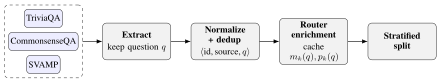<figcaption class='caption'>Figure 1:        Three        public        QA        datasets        are        reduced        to        a        query
<!-- l. 340 --><math display='inline' xmlns='http://www.w3.org/1998/Math/MathML'><mi>q</mi></math>,
normalized and deduplicated into a unified schema, enriched with the cached clean-query routing
decision of all routers, and split with per-source stratification.
</figcaption><!-- tex4ht:label?: x1332001r1  -->
   </figure>
   <figure class='figure' id='x1-32002r2'>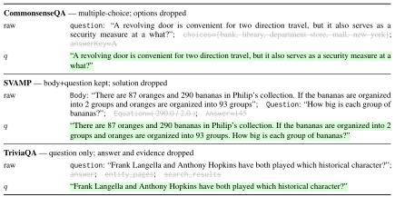<figcaption class='caption'>Figure 2: Raw record to query <!-- l. 384 --><math display='inline' xmlns='http://www.w3.org/1998/Math/MathML'><mi>q</mi></math>.
 Struck-out gray fields are discarded; the highlighted text is the retained query.
</figcaption><!-- tex4ht:label?: x1332002r2  -->
   </figure>
   

<!-- l. 388 -->
   
<figure class='float' id='x1-32003r1'>

 <table class='tabular' id='TBL-3'><colgroup id='TBL-3-1g'><col id='TBL-3-1' /><col id='TBL-3-2' /><col id='TBL-3-3' /><col id='TBL-3-4' /><col id='TBL-3-5' /><col id='TBL-3-6' /><col id='TBL-3-7' /><col id='TBL-3-8' /><col id='TBL-3-9' /></colgroup><tr id='TBL-3-1-' style='vertical-align:baseline;'><td class='td01' id='TBL-3-1-1' style='text-align:left; white-space:nowrap;'>               </td><td class='td11' colspan='4' id='TBL-3-1-2' style='text-align:center; white-space:nowrap;'>             
Full corpus
             </td><td class='td11' colspan='4' id='TBL-3-1-6' style='text-align:center; white-space:nowrap;'>        
Reduced subset

</td></tr><tr id='TBL-3-2-' style='vertical-align:baseline;'><td class='td01' id='TBL-3-2-1' style='text-align:left; white-space:nowrap;'>               </td><td class='td11' colspan='4' id='TBL-3-2-2' style='text-align:right; white-space:nowrap;'></td><td class='td11' colspan='4' id='TBL-3-3-6' style='text-align:right; white-space:nowrap;'></td></tr><tr id='TBL-3-4-' style='vertical-align:baseline;'><td class='td01' id='TBL-3-4-1' style='text-align:left; white-space:nowrap;'>Source                    </td><td class='td11' id='TBL-3-4-2' style='text-align:right; white-space:nowrap;'>  Train  </td><td class='td11' id='TBL-3-4-3' style='text-align:right; white-space:nowrap;'>    Val  </td><td class='td11' id='TBL-3-4-4' style='text-align:right; white-space:nowrap;'>   Test  </td><td class='td11' id='TBL-3-4-5' style='text-align:right; white-space:nowrap;'>  Total  </td><td class='td11' id='TBL-3-4-6' style='text-align:right; white-space:nowrap;'> Train  </td><td class='td11' id='TBL-3-4-7' style='text-align:right; white-space:nowrap;'> Val  </td><td class='td11' id='TBL-3-4-8' style='text-align:right; white-space:nowrap;'> Test  </td><td class='td10' id='TBL-3-4-9' style='text-align:right; white-space:nowrap;'> Total</td>
</tr><tr id='TBL-3-5-' style='vertical-align:baseline;'><td class='td01' id='TBL-3-5-1' style='text-align:left; white-space:nowrap;'>TriviaQA                </td><td class='td11' id='TBL-3-5-2' style='text-align:right; white-space:nowrap;'> 60,529  </td><td class='td11' id='TBL-3-5-3' style='text-align:right; white-space:nowrap;'> 12,971  </td><td class='td11' id='TBL-3-5-4' style='text-align:right; white-space:nowrap;'> 12,971  </td><td class='td11' id='TBL-3-5-5' style='text-align:right; white-space:nowrap;'> 86,471  </td><td class='td11' id='TBL-3-5-6' style='text-align:right; white-space:nowrap;'> 1,948  </td><td class='td11' id='TBL-3-5-7' style='text-align:right; white-space:nowrap;'> 418  </td><td class='td11' id='TBL-3-5-8' style='text-align:right; white-space:nowrap;'> 418  </td><td class='td10' id='TBL-3-5-9' style='text-align:right; white-space:nowrap;'> 2,784</td>
</tr><tr id='TBL-3-6-' style='vertical-align:baseline;'><td class='td01' id='TBL-3-6-1' style='text-align:left; white-space:nowrap;'>CommonsenseQA  </td><td class='td11' id='TBL-3-6-2' style='text-align:right; white-space:nowrap;'>  7,672  </td><td class='td11' id='TBL-3-6-3' style='text-align:right; white-space:nowrap;'>  1,645  </td><td class='td11' id='TBL-3-6-4' style='text-align:right; white-space:nowrap;'>  1,645  </td><td class='td11' id='TBL-3-6-5' style='text-align:right; white-space:nowrap;'> 10,962  </td><td class='td11' id='TBL-3-6-6' style='text-align:right; white-space:nowrap;'> 1,948  </td><td class='td11' id='TBL-3-6-7' style='text-align:right; white-space:nowrap;'> 418  </td><td class='td11' id='TBL-3-6-8' style='text-align:right; white-space:nowrap;'> 418  </td><td class='td10' id='TBL-3-6-9' style='text-align:right; white-space:nowrap;'> 2,784</td>
</tr><tr id='TBL-3-7-' style='vertical-align:baseline;'><td class='td01' id='TBL-3-7-1' style='text-align:left; white-space:nowrap;'>SVAMP                  </td><td class='td11' id='TBL-3-7-2' style='text-align:right; white-space:nowrap;'>    486  </td><td class='td11' id='TBL-3-7-3' style='text-align:right; white-space:nowrap;'>    105  </td><td class='td11' id='TBL-3-7-4' style='text-align:right; white-space:nowrap;'>    105  </td><td class='td11' id='TBL-3-7-5' style='text-align:right; white-space:nowrap;'>    696  </td><td class='td11' id='TBL-3-7-6' style='text-align:right; white-space:nowrap;'>   486  </td><td class='td11' id='TBL-3-7-7' style='text-align:right; white-space:nowrap;'> 105  </td><td class='td11' id='TBL-3-7-8' style='text-align:right; white-space:nowrap;'> 105  </td><td class='td10' id='TBL-3-7-9' style='text-align:right; white-space:nowrap;'>   696</td>
</tr><tr id='TBL-3-8-' style='vertical-align:baseline;'><td class='td01' id='TBL-3-8-1' style='text-align:left; white-space:nowrap;'>Total                       </td><td class='td11' id='TBL-3-8-2' style='text-align:right; white-space:nowrap;'> 68,687  </td><td class='td11' id='TBL-3-8-3' style='text-align:right; white-space:nowrap;'> 14,721  </td><td class='td11' id='TBL-3-8-4' style='text-align:right; white-space:nowrap;'> 14,721  </td><td class='td11' id='TBL-3-8-5' style='text-align:right; white-space:nowrap;'> 98,129  </td><td class='td11' id='TBL-3-8-6' style='text-align:right; white-space:nowrap;'> 4,382  </td><td class='td11' id='TBL-3-8-7' style='text-align:right; white-space:nowrap;'> 941  </td><td class='td11' id='TBL-3-8-8' style='text-align:right; white-space:nowrap;'> 941  </td><td class='td10' id='TBL-3-8-9' style='text-align:right; white-space:nowrap;'> 6,264</td>
</tr></table>                                                                 

<figcaption class='caption'>Table 1:     Per-source     split     sizes.     The     full     corpus     is     dominated     by     TriviaQA
(<!-- l. 406 --><math display='inline' xmlns='http://www.w3.org/1998/Math/MathML'><mrow><mn>88</mn><mo class='MathClass-punc' stretchy='false'>.</mo><mn>1</mn><mi>%</mi></mrow></math>);
the reduced subset rebalances the two large sources (equal TriviaQA/CommonsenseQA).
</figcaption><!-- tex4ht:label?: x1332003r1  -->
   </figure>
   

   <h4 class='subsectionHead' id='implementation-details'>A.2     Implementation details</h4>
<!-- l. 435 -->
When choosing models for NLI and semantic similarity, we considered three criteria: (i) whether a public
pre-trained checkpoint was available; (ii) model size, since all the required models had to fit on our GPU;
and (iii) performance, measured through correlation with human evaluation.

<!-- l. 437 -->
   For semantic similarity, we used GIST-Embedding-v0 [<a href='#Xsolatorio2024gistembed'>12</a>]. For NLI, we used ModernCE-base [<a href='#Xmoderncenli2025'>9</a>].
During evaluation, we used stella_en_1.5B_v5 [<a href='#Xzhang2025jasperstelladistillationsota'>20</a>] to measure semantic similarity, since we no longer
needed to keep several models loaded on the same GPU.

   <h5 class='subsubsectionHead' id='natural-language-inference-nli-gate'>A.2.1     Natural Language Inference (NLI) Gate</h5>
<!-- l. 442 -->
Embedding similarity alone can assign high scores to rewrites that preserve the broad topic of a query while changing
important logical constraints. To reduce this failure mode, we add an NLI gate that checks whether the clean query
<!-- l. 442 --><math display='inline' xmlns='http://www.w3.org/1998/Math/MathML'><msub><mrow><mi>q</mi></mrow><mrow><mi>i</mi></mrow></msub></math> and generated
paraphrase <!-- l. 442 --><math display='inline' xmlns='http://www.w3.org/1998/Math/MathML'><msubsup><mrow><mi>q</mi></mrow><mrow><mi>i</mi></mrow><mrow><mstyle mathvariant='normal'><mi>adv</mi></mstyle></mrow></msubsup></math>
contradict each other. The NLI model returns contradiction probabilities in both directions:

<table class='equation-star'><tr><td>
<!-- l. 443 --><math class='equation' display='block' xmlns='http://www.w3.org/1998/Math/MathML'><mrow>
       <msubsup><mrow><mi>c</mi></mrow><mrow><mi>i</mi></mrow><mrow><mstyle mathvariant='normal'><mi>fwd</mi></mstyle></mrow></msubsup> <mo class='MathClass-rel' stretchy='false'>=</mo> <msub><mrow><mi>P</mi></mrow><mrow><mstyle mathvariant='normal'>
<mi>NLI</mi></mstyle></mrow></msub><mo class='MathClass-open' stretchy='false'>(</mo><mstyle mathvariant='normal'><mi>contradiction</mi></mstyle><mo class='MathClass-rel' stretchy='false'>∣</mo><msub><mrow><mi>q</mi></mrow><mrow><mi>i</mi></mrow></msub><mo class='MathClass-punc' stretchy='false'>,</mo><msubsup><mrow><mi>q</mi></mrow><mrow><mi>i</mi></mrow><mrow><mstyle mathvariant='normal'><mi>adv</mi></mstyle></mrow></msubsup><mo class='MathClass-close' stretchy='false'>)</mo><mo class='MathClass-punc' stretchy='false'>,</mo><mspace class='qquad' width='2em'></mspace><msubsup><mrow><mi>c</mi></mrow><mrow>
<mi>i</mi></mrow><mrow><mstyle mathvariant='normal'><mi>bwd</mi></mstyle></mrow></msubsup> <mo class='MathClass-rel' stretchy='false'>=</mo> <msub><mrow><mi>P</mi></mrow><mrow><mstyle mathvariant='normal'>
<mi>NLI</mi></mstyle></mrow></msub><mo class='MathClass-open' stretchy='false'>(</mo><mstyle mathvariant='normal'><mi>contradiction</mi></mstyle><mo class='MathClass-rel' stretchy='false'>∣</mo><msubsup><mrow><mi>q</mi></mrow><mrow><mi>i</mi></mrow><mrow><mstyle mathvariant='normal'><mi>adv</mi></mstyle></mrow></msubsup><mo class='MathClass-punc' stretchy='false'>,</mo><msub><mrow><mi>q</mi></mrow><mrow>
<mi>i</mi></mrow></msub><mo class='MathClass-close' stretchy='false'>)</mo><mo class='MathClass-punc' stretchy='false'>.</mo>
</mrow></math></td></tr></table>
<!-- l. 447 -->
   The forward pass catches paraphrases that introduce unsupported assumptions, while the backward
pass catches paraphrases that drop constraints from the original query. We then define a conservative
bidirectional non-contradiction score: 
<table class='equation-star'><tr><td>
<!-- l. 448 --><math class='equation' display='block' xmlns='http://www.w3.org/1998/Math/MathML'><mrow>
                          <msubsup><mrow><mi>p</mi></mrow><mrow><mi>i</mi></mrow><mrow><mstyle mathvariant='normal'><mi>NLI</mi></mstyle></mrow></msubsup> <mo class='MathClass-punc' stretchy='false'>:</mo><mo class='MathClass-rel' stretchy='false'>=</mo><mi class='qopname'> min</mi><mo> ⁡<!-- FUNCTION APPLICATION --> </mo><mo class='MathClass-open' stretchy='false'>(</mo><mn>1</mn> <mo class='MathClass-bin' stretchy='false'>−</mo> <munderover accent='false' accentunder='false'><mrow><mi>c</mi></mrow><mrow>
<mi>i</mi></mrow><mrow><mstyle mathvariant='normal'><mi>fwd</mi></mstyle></mrow></munderover><mo class='MathClass-punc' stretchy='false'>,</mo><mn>1</mn> <mo class='MathClass-bin' stretchy='false'>−</mo> <msubsup><mrow><mi>c</mi></mrow><mrow>
<mi>i</mi></mrow><mrow><mstyle mathvariant='normal'><mi>bwd</mi></mstyle></mrow></msubsup><mo class='MathClass-close' stretchy='false'>)</mo><mo class='MathClass-punc' stretchy='false'>.</mo>
</mrow></math></td></tr></table>
<!-- l. 451 -->
   Taking the minimum makes the gate reject a pair if either direction appears contradictory, which is
appropriate because paraphrase equivalence is stricter than one-way entailment.

<!-- l. 453 -->
   For the multiplicative reward, this score is converted into a smooth gate: 
<table class='equation-star'><tr><td>
<!-- l. 454 --><math class='equation' display='block' xmlns='http://www.w3.org/1998/Math/MathML'><mrow>
                             <msub><mrow><mi>g</mi></mrow><mrow><mstyle mathvariant='normal'><mi>NLI</mi></mstyle><mo class='MathClass-punc' stretchy='false'>,</mo><mi>i</mi></mrow></msub> <mo class='MathClass-punc' stretchy='false'>:</mo><mo class='MathClass-rel' stretchy='false'>=</mo> <mi>σ</mi><mspace class='negthinspace' width='-0.17em'></mspace> <mrow><mo fence='true' form='prefix'>(</mo><mrow><mfrac><mrow><msubsup><mrow><mi>p</mi></mrow><mrow><mi>i</mi></mrow><mrow><mstyle mathvariant='normal'><mi>NLI</mi></mstyle></mrow></msubsup> <mo class='MathClass-bin' stretchy='false'>−</mo> <msub><mrow><mi>τ</mi></mrow><mrow><mstyle mathvariant='normal'><mi>NLI</mi></mstyle></mrow></msub></mrow>
      <mrow><msub><mrow><mi>T</mi></mrow><mrow><mstyle mathvariant='normal'><mi>NLI</mi></mstyle></mrow></msub></mrow></mfrac>       </mrow><mo fence='true' form='postfix'>)</mo></mrow> <mo class='MathClass-punc' stretchy='false'>.</mo>
</mrow></math></td></tr></table>
<!-- l. 457 -->
   When <!-- l. 457 --><math display='inline' xmlns='http://www.w3.org/1998/Math/MathML'><msubsup><mrow><mi>p</mi></mrow><mrow><mi>i</mi></mrow><mrow><mstyle mathvariant='normal'><mi>NLI</mi></mstyle></mrow></msubsup></math> is above
the NLI floor <!-- l. 457 --><math display='inline' xmlns='http://www.w3.org/1998/Math/MathML'><msub><mrow><mi>τ</mi></mrow><mrow><mstyle mathvariant='normal'><mi>NLI</mi></mstyle></mrow></msub></math>, the
gate remains close to <!-- l. 457 --><math display='inline' xmlns='http://www.w3.org/1998/Math/MathML'><mn>1</mn></math>
and the routing reward is mostly preserved. When it is below the floor, the gate moves toward
<!-- l. 457 --><math display='inline' xmlns='http://www.w3.org/1998/Math/MathML'><mn>0</mn></math>,
reducing positive rewards for likely semantic drift. In the full reward this effect is sign-aware: low NLI
confidence suppresses positive core rewards, but amplifies negative ones. Thus, the paraphraser
is discouraged from exploiting router weaknesses by changing the user’s intent, while still
receiving credit for benign lexical or syntactic rewrites that are not perfectly captured by cosine
similarity.

   <h5 class='subsubsectionHead' id='multiplicative-reward-formulation'>A.2.2     Multiplicative Reward Formulation</h5>
<!-- l. 462 -->
The core reward <!-- l. 462 --><math display='inline' xmlns='http://www.w3.org/1998/Math/MathML'><msup><mrow><mi>r</mi></mrow><mrow><mstyle mathvariant='normal'><mi>core</mi></mstyle></mrow></msup></math> relies on soft
similarity floors and sigmoid gates <!-- l. 462 --><math display='inline' xmlns='http://www.w3.org/1998/Math/MathML'><mi>σ</mi></math>:

<table class='equation-star'><tr><td>
<!-- l. 463 --><math class='equation' display='block' xmlns='http://www.w3.org/1998/Math/MathML'><mrow>
                <msup><mrow><mi>r</mi></mrow><mrow><mstyle mathvariant='normal'><mi>core</mi></mstyle></mrow></msup> <mo class='MathClass-rel' stretchy='false'>=</mo> <msub><mrow><mi>g</mi></mrow><mrow>
<mi>x</mi></mrow></msub> <mrow><mo fence='true' form='prefix'>[</mo><mrow><mi>z</mi> <mrow><mo fence='true' form='prefix'>(</mo><mrow><msub><mrow><mi>g</mi></mrow><mrow><mi>s</mi></mrow></msub><mi>x</mi> <mo class='MathClass-bin' stretchy='false'>+</mo> <mo class='MathClass-open' stretchy='false'>(</mo><mn>1</mn> <mo class='MathClass-bin' stretchy='false'>−</mo> <msub><mrow><mi>g</mi></mrow><mrow><mi>s</mi></mrow></msub><mo class='MathClass-close' stretchy='false'>)</mo><mo class='MathClass-open' stretchy='false'>(</mo><mn>1</mn> <mo class='MathClass-bin' stretchy='false'>−</mo> <mi>x</mi><mo class='MathClass-close' stretchy='false'>)</mo></mrow><mo fence='true' form='postfix'>)</mo></mrow></mrow><mo fence='true' form='postfix'>]</mo></mrow> <mo class='MathClass-bin' stretchy='false'>+</mo> <mo class='MathClass-open' stretchy='false'>(</mo><mn>1</mn> <mo class='MathClass-bin' stretchy='false'>−</mo> <msub><mrow><mi>g</mi></mrow><mrow><mi>x</mi></mrow></msub><mo class='MathClass-close' stretchy='false'>)</mo><mo class='MathClass-open' stretchy='false'>(</mo><mn>1</mn> <mo class='MathClass-bin' stretchy='false'>−</mo><mover accent='true'><mrow><mi>s</mi></mrow><mo accent='true'>~</mo></mover><mo class='MathClass-close' stretchy='false'>)</mo><mi>x</mi>
</mrow></math></td></tr></table>
<!-- l. 466 -->
   where <!-- l. 466 --><math display='inline' xmlns='http://www.w3.org/1998/Math/MathML'><mi>x</mi></math> is the routing reward
excluding the flip bonus, <!-- l. 466 --><math display='inline' xmlns='http://www.w3.org/1998/Math/MathML'><mrow><mi>z</mi> <mo class='MathClass-punc' stretchy='false'>:</mo><mo class='MathClass-rel' stretchy='false'>=</mo> <mover accent='true'><mrow><mi>s</mi></mrow><mo accent='true'>~</mo></mover> <mo class='MathClass-bin' stretchy='false'>−</mo> <msub><mrow><mi>τ</mi></mrow><mrow><mstyle mathvariant='normal'><mi>sim</mi></mstyle></mrow></msub></mrow></math> is the
margin above similarity floor <!-- l. 466 --><math display='inline' xmlns='http://www.w3.org/1998/Math/MathML'><msub><mrow><mi>τ</mi></mrow><mrow><mstyle mathvariant='normal'><mi>sim</mi></mstyle></mrow></msub></math>,
and the gating functions are <!-- l. 466 --><math display='inline' xmlns='http://www.w3.org/1998/Math/MathML'><mrow><msub><mrow><mi>g</mi></mrow><mrow><mi>s</mi></mrow></msub> <mo class='MathClass-punc' stretchy='false'>:</mo><mo class='MathClass-rel' stretchy='false'>=</mo> <mi>σ</mi><mo class='MathClass-open' stretchy='false'>(</mo><mi>z</mi><mo class='MathClass-bin' stretchy='false'>∕</mo><msub><mrow><mi>T</mi></mrow><mrow><mi>s</mi></mrow></msub><mo class='MathClass-close' stretchy='false'>)</mo></mrow></math>
and <!-- l. 466 --><math display='inline' xmlns='http://www.w3.org/1998/Math/MathML'><mrow><msub><mrow><mi>g</mi></mrow><mrow><mi>x</mi></mrow></msub> <mo class='MathClass-punc' stretchy='false'>:</mo><mo class='MathClass-rel' stretchy='false'>=</mo> <mi>σ</mi><mo class='MathClass-open' stretchy='false'>(</mo><mi>x</mi><mo class='MathClass-bin' stretchy='false'>∕</mo><msub><mrow><mi>T</mi></mrow><mrow><mi>x</mi></mrow></msub><mo class='MathClass-close' stretchy='false'>)</mo></mrow></math>.

<!-- l. 468 -->
   The NLI term <!-- l. 468 --><math display='inline' xmlns='http://www.w3.org/1998/Math/MathML'><msup><mrow><mi>m</mi></mrow><mrow><mstyle mathvariant='normal'><mi>NLI</mi></mstyle></mrow></msup></math>
adjusts the core reward based on contradiction: 
<table class='equation-star'><tr><td>
<!-- l. 469 --><math class='equation' display='block' xmlns='http://www.w3.org/1998/Math/MathML'><mrow>
                         <msup><mrow><mi>m</mi></mrow><mrow><mstyle mathvariant='normal'><mi>NLI</mi></mstyle></mrow></msup> <mo class='MathClass-rel' stretchy='false'>=</mo> <msub><mrow><mi>g</mi></mrow><mrow>
<mi>r</mi></mrow></msub><msub><mrow><mi>g</mi></mrow><mrow><mstyle mathvariant='normal'><mi>NLI</mi></mstyle></mrow></msub> <mo class='MathClass-bin' stretchy='false'>+</mo> <mo class='MathClass-open' stretchy='false'>(</mo><mn>1</mn> <mo class='MathClass-bin' stretchy='false'>−</mo> <msub><mrow><mi>g</mi></mrow><mrow><mi>r</mi></mrow></msub><mo class='MathClass-close' stretchy='false'>)</mo><mo class='MathClass-open' stretchy='false'>(</mo><mn>2</mn> <mo class='MathClass-bin' stretchy='false'>−</mo> <msub><mrow><mi>g</mi></mrow><mrow><mstyle mathvariant='normal'><mi>NLI</mi></mstyle></mrow></msub><mo class='MathClass-close' stretchy='false'>)</mo>
</mrow></math></td></tr></table>
<!-- l. 472 -->
   where <!-- l. 472 --><math display='inline' xmlns='http://www.w3.org/1998/Math/MathML'><mrow><msub><mrow><mi>g</mi></mrow><mrow><mi>r</mi></mrow></msub> <mo class='MathClass-rel' stretchy='false'>=</mo> <mi>σ</mi><mo class='MathClass-open' stretchy='false'>(</mo><msup><mrow><mi>r</mi></mrow><mrow><mstyle mathvariant='normal'><mi>core</mi></mstyle></mrow></msup><mo class='MathClass-bin' stretchy='false'>∕</mo><msub><mrow><mi>T</mi></mrow><mrow><mi>r</mi></mrow></msub><mo class='MathClass-close' stretchy='false'>)</mo></mrow></math>
switches behavior depending on the core reward’s sign and
<!-- l. 472 --><math display='inline' xmlns='http://www.w3.org/1998/Math/MathML'><msub><mrow><mi>g</mi></mrow><mrow><mstyle mathvariant='normal'><mi>NLI</mi></mstyle><mo class='MathClass-punc' stretchy='false'>,</mo><mi>i</mi></mrow></msub></math> is the
NLI gate. The sigmoid gates provide smooth transitions between these regimes, preserving reward
continuity and avoiding the noisy signals that would arise from hard thresholding.

   <h5 class='subsubsectionHead' id='attack-success-rate-formulation'>A.2.3     Attack Success Rate Formulation</h5>
<!-- l. 477 -->
The Attack Success Rate (<!-- l. 477 --><math display='inline' xmlns='http://www.w3.org/1998/Math/MathML'><msub><mrow><mstyle class='text'><mtext>ASR</mtext></mstyle></mrow><mrow><mi>k</mi></mrow></msub></math>)
for a given router <!-- l. 477 --><math display='inline' xmlns='http://www.w3.org/1998/Math/MathML'><mi>k</mi></math>
measures the fraction of queries originally assigned to the weak model that
are successfully redirected to the strong model via the adversarial paraphrase
<!-- l. 477 --><math display='inline' xmlns='http://www.w3.org/1998/Math/MathML'><msup><mrow><mi>q</mi></mrow><mrow><mstyle mathvariant='normal'><mi>adv</mi></mstyle></mrow></msup></math>. It is
defined as: 
<table class='equation-star'><tr><td>
<!-- l. 478 --><math class='equation' display='block' xmlns='http://www.w3.org/1998/Math/MathML'><mrow><msub><mrow>
             <mstyle class='text'><mtext>ASR</mtext></mstyle></mrow><mrow><mi>k</mi></mrow></msub> <mo class='MathClass-rel' stretchy='false'>=</mo> <mfrac><mrow><munderover accent='false' accentunder='false'><mrow><mo>∑</mo>
  </mrow><mrow><mi>i</mi><mo class='MathClass-rel' stretchy='false'>=</mo><mn>1</mn></mrow><mrow><mi>n</mi></mrow></munderover><mi>𝕀</mi><mstyle mathsize='1.61em'><mrow><mo fence='true' form='prefix'>[</mo><mrow></mrow><mo fence='true' form='postfix'></mo></mrow></mstyle><msub><mrow><mi>m</mi></mrow><mrow><mi>k</mi></mrow></msub><mo class='MathClass-open' stretchy='false'>(</mo><msub><mrow><mi>q</mi></mrow><mrow><mi>i</mi></mrow></msub><mo class='MathClass-close' stretchy='false'>)</mo> <mo class='MathClass-rel' stretchy='false'>∈</mo><msubsup><mrow><mstyle mathvariant='script'><mi>M</mi></mstyle></mrow><mrow><mstyle mathvariant='normal'><mi>weak</mi></mstyle></mrow><mrow><mo class='MathClass-open' stretchy='false'>(</mo><mi>k</mi><mo class='MathClass-close' stretchy='false'>)</mo></mrow></msubsup><mspace class='nbsp' width='0.33em'></mspace> <mo class='MathClass-bin' stretchy='false'>∧</mo><mspace class='nbsp' width='0.33em'></mspace><msub><mrow><mi>m</mi></mrow><mrow><mi>k</mi></mrow></msub><mo class='MathClass-open' stretchy='false'>(</mo><msubsup><mrow><mi>q</mi></mrow><mrow><mi>i</mi></mrow><mrow><mstyle mathvariant='normal'><mi>adv</mi></mstyle></mrow></msubsup><mo class='MathClass-close' stretchy='false'>)</mo> <mo class='MathClass-rel' stretchy='false'>∈</mo><msubsup><mrow><mstyle mathvariant='script'><mi>M</mi></mstyle></mrow><mrow><mstyle mathvariant='normal'><mi>strong</mi></mstyle></mrow><mrow><mo class='MathClass-open' stretchy='false'>(</mo><mi>k</mi><mo class='MathClass-close' stretchy='false'>)</mo></mrow></msubsup><mstyle mathsize='1.61em'><mrow><mo fence='true' form='prefix'>]</mo><mrow></mrow><mo fence='true' form='postfix'></mo></mrow></mstyle></mrow>
                     <mrow><munderover accent='false' accentunder='false'><mrow><mo> ∑</mo>
  </mrow><mrow><mi>i</mi><mo class='MathClass-rel' stretchy='false'>=</mo><mn>1</mn></mrow><mrow><mi>n</mi></mrow></munderover><mi>𝕀</mi><mstyle mathsize='1.61em'><mrow><mo fence='true' form='prefix'>[</mo><mrow></mrow><mo fence='true' form='postfix'></mo></mrow></mstyle><msub><mrow><mi>m</mi></mrow><mrow><mi>k</mi></mrow></msub><mo class='MathClass-open' stretchy='false'>(</mo><msub><mrow><mi>q</mi></mrow><mrow><mi>i</mi></mrow></msub><mo class='MathClass-close' stretchy='false'>)</mo> <mo class='MathClass-rel' stretchy='false'>∈</mo><msubsup><mrow><mstyle mathvariant='script'><mi>M</mi></mstyle></mrow><mrow><mstyle mathvariant='normal'><mi>weak</mi></mstyle></mrow><mrow><mo class='MathClass-open' stretchy='false'>(</mo><mi>k</mi><mo class='MathClass-close' stretchy='false'>)</mo></mrow></msubsup><mstyle mathsize='1.61em'><mrow><mo fence='true' form='prefix'>]</mo><mrow></mrow><mo fence='true' form='postfix'></mo></mrow></mstyle></mrow></mfrac>
</mrow></math></td></tr></table>
   <h4 class='subsectionHead' id='grpo'>A.3     GRPO</h4>
<!-- l. 486 -->
We define: 
<table class='equation-star'><tr><td>
<!-- l. 487 --><math class='equation' display='block' xmlns='http://www.w3.org/1998/Math/MathML'>
 <mrow><mo fence='true' form='prefix'>{</mo><mrow> <mtable align='axis' class='array' columnlines='none' displaystyle='true' equalcolumns='false' equalrows='false' rowlines='none' style=''> <mtr class='array-row'><mtd class='array-td' columnalign='left'><msubsup><mrow><mi>ℓ</mi></mrow><mrow><mi mathvariant='italic'>𝑖𝑗𝑡</mi></mrow><mrow><mstyle mathvariant='normal'><mi>PPO</mi></mstyle></mrow></msubsup> <mo class='MathClass-punc' stretchy='false'>:</mo><mo class='MathClass-rel' stretchy='false'>=</mo> <mo class='MathClass-bin' stretchy='false'>−</mo><mi class='qopname'>min</mi><mo> ⁡<!-- FUNCTION APPLICATION --> </mo> <mrow><mo fence='true' form='prefix'>(</mo><mrow><msub><mrow><mi>ρ</mi></mrow><mrow><mi mathvariant='italic'>𝑖𝑗𝑡</mi></mrow></msub><msub><mrow><mi>A</mi></mrow><mrow><mi mathvariant='italic'>𝑖𝑗</mi></mrow></msub><mo class='MathClass-punc' stretchy='false'>,</mo><mstyle mathvariant='normal'><mi>clip</mi></mstyle><mo class='MathClass-open' stretchy='false'>(</mo><msub><mrow><mi>ρ</mi></mrow><mrow><mi mathvariant='italic'>𝑖𝑗𝑡</mi></mrow></msub><mo class='MathClass-punc' stretchy='false'>,</mo><mn>1</mn> <mo class='MathClass-bin' stretchy='false'>−</mo> <mi>𝜖</mi><mo class='MathClass-punc' stretchy='false'>,</mo><mn>1</mn> <mo class='MathClass-bin' stretchy='false'>+</mo> <mi>𝜖</mi><mo class='MathClass-close' stretchy='false'>)</mo><msub><mrow><mi>A</mi></mrow><mrow><mi mathvariant='italic'>𝑖𝑗</mi></mrow></msub></mrow><mo fence='true' form='postfix'>)</mo></mrow>           <mspace class='quad' width='1em'></mspace></mtd>
</mtr>  <mtr class='array-row'><mtd class='array-td' columnalign='left'><msub><mrow><mi>ρ</mi></mrow><mrow><mi mathvariant='italic'>𝑖𝑗𝑡</mi></mrow></msub> <mo class='MathClass-punc' stretchy='false'>:</mo><mo class='MathClass-rel' stretchy='false'>=</mo> <mi class='loglike'>exp</mi><mo>⁡<!-- FUNCTION APPLICATION --></mo><!-- nolimits --><mspace class='negthinspace' width='-0.17em'></mspace> <mrow><mo fence='true' form='prefix'>(</mo><mrow><mstyle><mi class='loglike'>log</mi><mo>⁡<!-- FUNCTION APPLICATION --></mo></mstyle><!-- nolimits --><msub><mrow><mi>π</mi></mrow><mrow><mi>𝜃</mi></mrow></msub><mo class='MathClass-open' stretchy='false'>(</mo><msub><mrow><mi>y</mi></mrow><mrow><mi mathvariant='italic'>𝑖𝑗𝑡</mi></mrow></msub><mo class='MathClass-rel' stretchy='false'>∣</mo><msub><mrow><mi>q</mi></mrow><mrow><mi>i</mi></mrow></msub><mo class='MathClass-punc' stretchy='false'>,</mo><msub><mrow><mi>y</mi></mrow><mrow><mi mathvariant='italic'>𝑖𝑗</mi><mo class='MathClass-punc' stretchy='false'>,</mo><mo class='MathClass-rel' stretchy='false'>&lt;</mo><mi>t</mi></mrow></msub><mo class='MathClass-close' stretchy='false'>)</mo> <mo class='MathClass-bin' stretchy='false'>−</mo><mstyle><mi class='loglike'>log</mi><mo>⁡<!-- FUNCTION APPLICATION --></mo></mstyle><!-- nolimits --><msub><mrow><mi>π</mi></mrow><mrow><mstyle mathvariant='normal'><mi>old</mi></mstyle></mrow></msub><mo class='MathClass-open' stretchy='false'>(</mo><msub><mrow><mi>y</mi></mrow><mrow><mi mathvariant='italic'>𝑖𝑗𝑡</mi></mrow></msub><mo class='MathClass-rel' stretchy='false'>∣</mo><msub><mrow><mi>q</mi></mrow><mrow><mi>i</mi></mrow></msub><mo class='MathClass-punc' stretchy='false'>,</mo><msub><mrow><mi>y</mi></mrow><mrow><mi mathvariant='italic'>𝑖𝑗</mi><mo class='MathClass-punc' stretchy='false'>,</mo><mo class='MathClass-rel' stretchy='false'>&lt;</mo><mi>t</mi></mrow></msub><mo class='MathClass-close' stretchy='false'>)</mo></mrow><mo fence='true' form='postfix'>)</mo></mrow><mspace class='quad' width='1em'></mspace></mtd>
</mtr>  <mtr class='array-row'><mtd class='array-td' columnalign='left'><msubsup><mrow><mi>D</mi></mrow><mrow><mi mathvariant='italic'>𝑖𝑗𝑡</mi></mrow><mrow><mstyle mathvariant='normal'><mi>k</mi><mn>3</mn></mstyle></mrow></msubsup> <mo class='MathClass-punc' stretchy='false'>:</mo><mo class='MathClass-rel' stretchy='false'>=</mo> <mi class='loglike'>exp</mi><mo>⁡<!-- FUNCTION APPLICATION --></mo><!-- nolimits --><mo class='MathClass-open' stretchy='false'>(</mo><mstyle><mi class='loglike'>log</mi><mo>⁡<!-- FUNCTION APPLICATION --></mo></mstyle><!-- nolimits --><msub><mrow><mi>π</mi></mrow><mrow><mstyle mathvariant='normal'><mi>ref</mi></mstyle></mrow></msub> <mo class='MathClass-bin' stretchy='false'>−</mo><mstyle><mi class='loglike'>log</mi><mo>⁡<!-- FUNCTION APPLICATION --></mo></mstyle><!-- nolimits --><msub><mrow><mi>π</mi></mrow><mrow><mi>𝜃</mi></mrow></msub><mo class='MathClass-close' stretchy='false'>)</mo> <mo class='MathClass-bin' stretchy='false'>−</mo> <mo class='MathClass-open' stretchy='false'>(</mo><mstyle><mi class='loglike'>log</mi><mo>⁡<!-- FUNCTION APPLICATION --></mo></mstyle><!-- nolimits --><msub><mrow><mi>π</mi></mrow><mrow><mstyle mathvariant='normal'><mi>ref</mi></mstyle></mrow></msub> <mo class='MathClass-bin' stretchy='false'>−</mo><mstyle><mi class='loglike'>log</mi><mo>⁡<!-- FUNCTION APPLICATION --></mo></mstyle><!-- nolimits --><msub><mrow><mi>π</mi></mrow><mrow><mi>𝜃</mi></mrow></msub><mo class='MathClass-close' stretchy='false'>)</mo> <mo class='MathClass-bin' stretchy='false'>−</mo> <mn>1</mn><mo class='MathClass-punc' stretchy='false'>.</mo> <mspace class='quad' width='1em'></mspace></mtd></mtr> <!-- @{}l@{\quad }l@{} --></mtable>                              </mrow><mo fence='true' form='postfix'></mo></mrow>
</math></td>
<!-- l. 506 -->
   The final objective is the masked per-completion mean followed by a batch mean: 
<table class='equation-star'><tr><td>
<!-- l. 507 --><math class='equation' display='block' xmlns='http://www.w3.org/1998/Math/MathML'><mrow><msub><mrow>
           <mstyle mathvariant='script'><mi>L</mi></mstyle></mrow><mrow><mstyle mathvariant='normal'><mi>GRPO</mi></mstyle></mrow></msub> <mo class='MathClass-rel' stretchy='false'>=</mo>   <mfrac><mrow><mn>1</mn></mrow>
<mrow><mi mathvariant='italic'>𝐵𝑁</mi></mrow></mfrac><munderover accent='false' accentunder='false'><mrow><mo>∑</mo>
  </mrow><mrow><mi>i</mi><mo class='MathClass-rel' stretchy='false'>=</mo><mn>1</mn></mrow><mrow><mi>B</mi></mrow></munderover><munderover accent='false' accentunder='false'><mrow><mo> ∑</mo>
</mrow><mrow><mi>j</mi><mo class='MathClass-rel' stretchy='false'>=</mo><mn>1</mn></mrow><mrow><mi>N</mi></mrow></munderover>  <mfrac><mrow><mn>1</mn></mrow>
<mrow><mo class='MathClass-rel' stretchy='false'>|</mo><msub><mrow><mi>y</mi></mrow><mrow><mi mathvariant='italic'>𝑖𝑗</mi></mrow></msub><mo class='MathClass-rel' stretchy='false'>|</mo></mrow></mfrac><munderover accent='false' accentunder='false'><mrow><mo>∑</mo>
</mrow><mrow><mi>t</mi><mo class='MathClass-rel' stretchy='false'>=</mo><mn>1</mn></mrow><mrow><mo class='MathClass-rel' stretchy='false'>|</mo><msub><mrow><mi>y</mi></mrow><mrow><mi mathvariant='italic'>𝑖𝑗</mi></mrow></msub><mo class='MathClass-rel' stretchy='false'>|</mo></mrow></munderover><mrow><mo fence='true' form='prefix'>(</mo><mrow><msubsup><mrow><mi>ℓ</mi></mrow><mrow>
<mi mathvariant='italic'>𝑖𝑗𝑡</mi></mrow><mrow><mstyle mathvariant='normal'><mi>PPO</mi></mstyle></mrow></msubsup><mspace class='thickpace' width='0.28em'></mspace> <mo class='MathClass-bin' stretchy='false'>+</mo> <mspace class='thickpace' width='0.28em'></mspace><mi>β</mi><msubsup><mrow><mi>D</mi></mrow><mrow>
<mi mathvariant='italic'>𝑖𝑗𝑡</mi></mrow><mrow><mstyle mathvariant='normal'><mi>k</mi><mn>3</mn></mstyle></mrow></msubsup></mrow><mo fence='true' form='postfix'>)</mo></mrow> <mo class='MathClass-punc' stretchy='false'>.</mo>
</mrow></math></td></tr></table>
   

<!-- l. 521 -->
   
<figure class='float' id='x1-37001r1'>
<figcaption class='caption'>Algorithm 1 GRPO training for adversarial paraphrasing
</figcaption><!-- tex4ht:label?: x1337001r1  -->

        
Require:   Train prompts <!-- l. 525 --><math display='inline' xmlns='http://www.w3.org/1998/Math/MathML'><mstyle mathvariant='script'><mi>𝒟</mi></mstyle></math>,     policy <!-- l. 525 --><math display='inline' xmlns='http://www.w3.org/1998/Math/MathML'><msub><mrow><mi>G</mi></mrow><mrow><mi>𝜃</mi></mrow></msub></math>,     frozen reference <!-- l. 525 --><math display='inline' xmlns='http://www.w3.org/1998/Math/MathML'><msub><mrow><mi>G</mi></mrow><mrow><mstyle mathvariant='normal'><mi>ref</mi></mstyle></mrow></msub></math>,     reward function <!-- l. 525 --><math display='inline' xmlns='http://www.w3.org/1998/Math/MathML'><mi>R</mi></math>,     group size <!-- l. 525 --><math display='inline' xmlns='http://www.w3.org/1998/Math/MathML'><mi>N</mi></math>,     KL weight <!-- l. 525 --><math display='inline' xmlns='http://www.w3.org/1998/Math/MathML'><mi>β</mi></math>            1:   for each epoch do            2:         Order prompts in <!-- l. 527 --><math display='inline' xmlns='http://www.w3.org/1998/Math/MathML'><mstyle mathvariant='script'><mi>𝒟</mi></mstyle></math>     by shuffling or curriculum            3:         for each mini-batch <!-- l. 528 --><math display='inline' xmlns='http://www.w3.org/1998/Math/MathML'><mrow><mstyle mathvariant='script'><mi>B</mi></mstyle> <mo class='MathClass-rel' stretchy='false'>=</mo> <msubsup><mrow><mo class='MathClass-open' stretchy='false'>{</mo><msub><mrow><mi>q</mi></mrow><mrow><mi>i</mi></mrow></msub><mo class='MathClass-close' stretchy='false'>}</mo></mrow><mrow><mi>i</mi><mo class='MathClass-rel' stretchy='false'>=</mo><mn>1</mn></mrow><mrow><mi>B</mi></mrow></msubsup></mrow></math> do            4:               for each query <!-- l. 529 --><math display='inline' xmlns='http://www.w3.org/1998/Math/MathML'><mrow><msub><mrow><mi>q</mi></mrow><mrow><mi>i</mi></mrow></msub> <mo class='MathClass-rel' stretchy='false'>∈</mo><mstyle mathvariant='script'><mi>B</mi></mstyle></mrow></math> do            5:                     Sample <!-- l. 530 --><math display='inline' xmlns='http://www.w3.org/1998/Math/MathML'><mi>N</mi></math>     paraphrases <!-- l. 530 --><math display='inline' xmlns='http://www.w3.org/1998/Math/MathML'><msubsup><mrow><mo class='MathClass-open' stretchy='false'>{</mo><msub><mrow><mi>y</mi></mrow><mrow><mi mathvariant='italic'>𝑖𝑗</mi></mrow></msub><mo class='MathClass-close' stretchy='false'>}</mo></mrow><mrow><mi>j</mi><mo class='MathClass-rel' stretchy='false'>=</mo><mn>1</mn></mrow><mrow><mi>N</mi></mrow></msubsup></math>     from <!-- l. 530 --><math display='inline' xmlns='http://www.w3.org/1998/Math/MathML'><mrow><msub><mrow><mi>G</mi></mrow><mrow><mi>𝜃</mi></mrow></msub><mo class='MathClass-open' stretchy='false'>(</mo><mo class='MathClass-bin' stretchy='false'>⋅</mo><mo class='MathClass-rel' stretchy='false'>∣</mo><msub><mrow><mi>q</mi></mrow><mrow><mi>i</mi></mrow></msub><mo class='MathClass-close' stretchy='false'>)</mo></mrow></math>            6:                     Store rollout token log-probabilities <!-- l. 531 --><math display='inline' xmlns='http://www.w3.org/1998/Math/MathML'><mrow> <mi class='loglike'>log</mi><mo>⁡<!-- FUNCTION APPLICATION --></mo><!-- nolimits --><msub><mrow><mi>π</mi></mrow><mrow><mstyle mathvariant='normal'><mi>old</mi></mstyle></mrow></msub><mo class='MathClass-open' stretchy='false'>(</mo><msub><mrow><mi>y</mi></mrow><mrow><mi mathvariant='italic'>𝑖𝑗𝑡</mi></mrow></msub><mo class='MathClass-rel' stretchy='false'>∣</mo><msub><mrow><mi>q</mi></mrow><mrow><mi>i</mi></mrow></msub><mo class='MathClass-punc' stretchy='false'>,</mo><msub><mrow><mi>y</mi></mrow><mrow><mi mathvariant='italic'>𝑖𝑗</mi><mo class='MathClass-punc' stretchy='false'>,</mo><mo class='MathClass-rel' stretchy='false'>&lt;</mo><mi>t</mi></mrow></msub><mo class='MathClass-close' stretchy='false'>)</mo></mrow></math>   7:                     Score each paraphrase with routing, semantic, and length reward terms to obtain     <!-- l. 532 --><math display='inline' xmlns='http://www.w3.org/1998/Math/MathML'><msub><mrow><mi>R</mi></mrow><mrow><mi mathvariant='italic'>𝑖𝑗</mi></mrow></msub></math>            8:                     Compute group-normalized advantages <table class='equation-star'><tr><td>                                                                                                                                                                           <!-- l. 534 --><math class='equation' display='block' xmlns='http://www.w3.org/1998/Math/MathML'><mrow>                                                                  <msub><mrow><mi>A</mi></mrow><mrow><mi mathvariant='italic'>𝑖𝑗</mi></mrow></msub> <mo class='MathClass-rel' stretchy='false'>=</mo> <mfrac><mrow><msub><mrow><mi>R</mi></mrow><mrow><mi mathvariant='italic'>𝑖𝑗</mi></mrow></msub> <mo class='MathClass-bin' stretchy='false'>−</mo> <msub><mrow><mi>μ</mi></mrow><mrow><mi>i</mi></mrow></msub></mrow>    <mrow><msub><mrow><mi>σ</mi></mrow><mrow><mi>i</mi></mrow></msub> <mo class='MathClass-bin' stretchy='false'>+</mo> <mi>𝜖</mi></mrow></mfrac> </mrow></math></td></tr></table>            9:               end for            10:               Recompute current policy log-probabilities <!-- l. 538 --><math display='inline' xmlns='http://www.w3.org/1998/Math/MathML'><mrow> <mi class='loglike'>log</mi><mo>⁡<!-- FUNCTION APPLICATION --></mo><!-- nolimits --><msub><mrow><mi>π</mi></mrow><mrow><mi>𝜃</mi></mrow></msub></mrow></math>           11:               Compute reference log-probabilities <!-- l. 539 --><math display='inline' xmlns='http://www.w3.org/1998/Math/MathML'><mrow> <mi class='loglike'>log</mi><mo>⁡<!-- FUNCTION APPLICATION --></mo><!-- nolimits --><msub><mrow><mi>π</mi></mrow><mrow><mstyle mathvariant='normal'><mi>ref</mi></mstyle></mrow></msub></mrow></math>     using <!-- l. 539 --><math display='inline' xmlns='http://www.w3.org/1998/Math/MathML'><msub><mrow><mi>G</mi></mrow><mrow><mstyle mathvariant='normal'><mi>ref</mi></mstyle></mrow></msub></math>            12:               Compute PPO ratios <table class='equation-star'><tr><td>     <!-- l. 541 --><math class='equation' display='block' xmlns='http://www.w3.org/1998/Math/MathML'><mrow>                               <msub><mrow><mi>ρ</mi></mrow><mrow><mi mathvariant='italic'>𝑖𝑗𝑡</mi></mrow></msub> <mo class='MathClass-rel' stretchy='false'>=</mo> <mi class='loglike'>exp</mi><mo>⁡<!-- FUNCTION APPLICATION --></mo><!-- nolimits --><mspace class='negthinspace' width='-0.17em'></mspace> <mrow><mo fence='true' form='prefix'>(</mo><mrow><mstyle><mi class='loglike'>log</mi><mo>⁡<!-- FUNCTION APPLICATION --></mo></mstyle><!-- nolimits --><msub><mrow><mi>π</mi></mrow><mrow><mi>𝜃</mi></mrow></msub><mo class='MathClass-open' stretchy='false'>(</mo><msub><mrow><mi>y</mi></mrow><mrow><mi mathvariant='italic'>𝑖𝑗𝑡</mi></mrow></msub><mo class='MathClass-rel' stretchy='false'>∣</mo><msub><mrow><mi>q</mi></mrow><mrow><mi>i</mi></mrow></msub><mo class='MathClass-punc' stretchy='false'>,</mo><msub><mrow><mi>y</mi></mrow><mrow><mi mathvariant='italic'>𝑖𝑗</mi><mo class='MathClass-punc' stretchy='false'>,</mo><mo class='MathClass-rel' stretchy='false'>&lt;</mo><mi>t</mi></mrow></msub><mo class='MathClass-close' stretchy='false'>)</mo> <mo class='MathClass-bin' stretchy='false'>−</mo><mstyle><mi class='loglike'>log</mi><mo>⁡<!-- FUNCTION APPLICATION --></mo></mstyle><!-- nolimits --><msub><mrow><mi>π</mi></mrow><mrow><mstyle mathvariant='normal'><mi>old</mi></mstyle></mrow></msub><mo class='MathClass-open' stretchy='false'>(</mo><msub><mrow><mi>y</mi></mrow><mrow><mi mathvariant='italic'>𝑖𝑗𝑡</mi></mrow></msub><mo class='MathClass-rel' stretchy='false'>∣</mo><msub><mrow><mi>q</mi></mrow><mrow><mi>i</mi></mrow></msub><mo class='MathClass-punc' stretchy='false'>,</mo><msub><mrow><mi>y</mi></mrow><mrow><mi mathvariant='italic'>𝑖𝑗</mi><mo class='MathClass-punc' stretchy='false'>,</mo><mo class='MathClass-rel' stretchy='false'>&lt;</mo><mi>t</mi></mrow></msub><mo class='MathClass-close' stretchy='false'>)</mo></mrow><mo fence='true' form='postfix'>)</mo></mrow> </mrow></math></td>         </tr>  13:               Compute clipped PPO loss and k3 KL estimate <table class='equation-star'><tr><td>                                                                                                                                                                           <!-- l. 551 --><math class='equation' display='block' xmlns='http://www.w3.org/1998/Math/MathML'><mrow>                                <msubsup><mrow><mi>D</mi></mrow><mrow><mi mathvariant='italic'>𝑖𝑗𝑡</mi></mrow><mrow><mstyle mathvariant='normal'><mi>k</mi><mn>3</mn></mstyle></mrow></msubsup> <mo class='MathClass-rel' stretchy='false'>=</mo> <mi class='loglike'>exp</mi><mo>⁡<!-- FUNCTION APPLICATION --></mo><!-- nolimits --><mo class='MathClass-open' stretchy='false'>(</mo><mstyle><mi class='loglike'>log</mi><mo>⁡<!-- FUNCTION APPLICATION --></mo></mstyle><!-- nolimits --><msub><mrow><mi>π</mi></mrow><mrow><mstyle mathvariant='normal'> <mi>ref</mi></mstyle></mrow></msub> <mo class='MathClass-bin' stretchy='false'>−</mo><mstyle><mi class='loglike'>log</mi><mo>⁡<!-- FUNCTION APPLICATION --></mo></mstyle><!-- nolimits --><msub><mrow><mi>π</mi></mrow><mrow><mi>𝜃</mi></mrow></msub><mo class='MathClass-close' stretchy='false'>)</mo> <mo class='MathClass-bin' stretchy='false'>−</mo> <mo class='MathClass-open' stretchy='false'>(</mo><mstyle><mi class='loglike'>log</mi><mo>⁡<!-- FUNCTION APPLICATION --></mo></mstyle><!-- nolimits --><msub><mrow><mi>π</mi></mrow><mrow><mstyle mathvariant='normal'><mi>ref</mi></mstyle></mrow></msub> <mo class='MathClass-bin' stretchy='false'>−</mo><mstyle><mi class='loglike'>log</mi><mo>⁡<!-- FUNCTION APPLICATION --></mo></mstyle><!-- nolimits --><msub><mrow><mi>π</mi></mrow><mrow><mi>𝜃</mi></mrow></msub><mo class='MathClass-close' stretchy='false'>)</mo> <mo class='MathClass-bin' stretchy='false'>−</mo> <mn>1</mn> </mrow></math></td></tr></table>           14:               Minimize <table class='equation-star'><tr><td>     <!-- l. 561 --><math class='equation' display='block' xmlns='http://www.w3.org/1998/Math/MathML'><mrow><msub><mrow> <mstyle mathvariant='script'><mi>L</mi></mstyle></mrow><mrow><mstyle mathvariant='normal'><mi>GRPO</mi></mstyle></mrow></msub> <mo class='MathClass-rel' stretchy='false'>=</mo>   <mfrac><mrow><mn>1</mn></mrow>  <mrow><mi mathvariant='italic'>𝐵𝑁</mi></mrow></mfrac><munderover accent='false' accentunder='false'><mrow><mo>∑</mo>   </mrow><mrow><mi>i</mi><mo class='MathClass-rel' stretchy='false'>=</mo><mn>1</mn></mrow><mrow><mi>B</mi></mrow></munderover><munderover accent='false' accentunder='false'><mrow><mo> ∑</mo> </mrow><mrow><mi>j</mi><mo class='MathClass-rel' stretchy='false'>=</mo><mn>1</mn></mrow><mrow><mi>N</mi></mrow></munderover>  <mfrac><mrow><mn>1</mn></mrow> <mrow><mo class='MathClass-rel' stretchy='false'>|</mo><msub><mrow><mi>y</mi></mrow><mrow><mi mathvariant='italic'>𝑖𝑗</mi></mrow></msub><mo class='MathClass-rel' stretchy='false'>|</mo></mrow></mfrac><munderover accent='false' accentunder='false'><mrow><mo>∑</mo> </mrow><mrow><mi>t</mi><mo class='MathClass-rel' stretchy='false'>=</mo><mn>1</mn></mrow><mrow><mo class='MathClass-rel' stretchy='false'>|</mo><msub><mrow><mi>y</mi></mrow><mrow><mi mathvariant='italic'>𝑖𝑗</mi></mrow></msub><mo class='MathClass-rel' stretchy='false'>|</mo></mrow></munderover><mrow><mo fence='true' form='prefix'>[</mo><mrow><mo class='MathClass-bin' stretchy='false'>−</mo><mi class='qopname'>min</mi><mo> ⁡<!-- FUNCTION APPLICATION --> </mo><mspace class='negthinspace' width='-0.17em'></mspace> <mrow><mo fence='true' form='prefix'>(</mo><mrow><msub><mrow><mi>ρ</mi></mrow><mrow> <mi mathvariant='italic'>𝑖𝑗𝑡</mi></mrow></msub><msub><mrow><mi>A</mi></mrow><mrow><mi mathvariant='italic'>𝑖𝑗</mi></mrow></msub><mo class='MathClass-punc' stretchy='false'>,</mo><mstyle mathvariant='normal'><mi>clip</mi></mstyle><mo class='MathClass-open' stretchy='false'>(</mo><msub><mrow><mi>ρ</mi></mrow><mrow><mi mathvariant='italic'>𝑖𝑗𝑡</mi></mrow></msub><mo class='MathClass-punc' stretchy='false'>,</mo><mn>1</mn> <mo class='MathClass-bin' stretchy='false'>−</mo> <mi>𝜖</mi><mo class='MathClass-punc' stretchy='false'>,</mo><mn>1</mn> <mo class='MathClass-bin' stretchy='false'>+</mo> <mi>𝜖</mi><mo class='MathClass-close' stretchy='false'>)</mo><msub><mrow><mi>A</mi></mrow><mrow><mi mathvariant='italic'>𝑖𝑗</mi></mrow></msub></mrow><mo fence='true' form='postfix'>)</mo></mrow> <mo class='MathClass-bin' stretchy='false'>+</mo> <mi>β</mi><munderover accent='false' accentunder='false'><mrow><mi>D</mi></mrow><mrow><mi mathvariant='italic'>𝑖𝑗𝑡</mi></mrow><mrow><mstyle mathvariant='normal'><mi>k</mi><mn>3</mn></mstyle></mrow></munderover></mrow><mo fence='true' form='postfix'>]</mo></mrow> </mrow></math></td></tr></table>            15:               Gradient   accumulation,   Optimizer   step,   Scheduler   step,   Logging,   Evaluation,     Checkpointing            16:         end for            17:   end for
</table>

   </figure>
   

   <h4 class='subsectionHead' id='ablations1'>A.4     Ablations</h4>
   <h5 class='subsubsectionHead' id='router-pool1'>A.4.1     Router Pool</h5>
<!-- l. 590 -->
All selected routers are open-source and pretrained, which supports reproducibility and ensures easy
access for future evaluation and comparison.

<!-- l. 592 -->
   
<figure class='float' id='x1-39001r2'>

 <table class='tabular' id='TBL-5'><colgroup id='TBL-5-1g'><col id='TBL-5-1' /><col id='TBL-5-2' /><col id='TBL-5-3' /><col id='TBL-5-4' /></colgroup><tr id='TBL-5-1-' style='vertical-align:baseline;'><td class='td01' id='TBL-5-1-1' style='text-align:left;'><!-- l. 599 -->
Pool            
</td><td class='td11' id='TBL-5-1-2' style='text-align:left;'> <!-- l. 599 -->
Router                       
</td><td class='td11' id='TBL-5-1-3' style='text-align:left;'> <!-- l. 599 -->
Source                                  
</td><td class='td10' id='TBL-5-1-4' style='text-align:left;'> <!-- l. 599 -->
Role in the experiment                                                                       
</td>
</tr><tr id='TBL-5-2-' style='vertical-align:baseline;'><td class='td01' id='TBL-5-2-1' style='text-align:left;'><!-- l. 601 -->
Training       
</td><td class='td11' id='TBL-5-2-2' style='text-align:left;'> <!-- l. 601 -->
routellm_bert    
</td><td class='td11' id='TBL-5-2-3' style='text-align:left;'> <!-- l. 601 -->
<a class='url' href='https://huggingface.co/routellm/bert_gpt4_augmented'>https://huggingface.co/routellm/bert_gpt4_augmented</a> 
 </td><td class='td10' id='TBL-5-2-4' style='text-align:left;'> <!-- l. 601 -->
Fast local classifier based on BERT and trained on preference-style
  routing data. Because it is cheap enough to batch heavily during RL
  training, it also enables quick experiments.                                       
</td>
</tr><tr id='TBL-5-3-' style='vertical-align:baseline;'><td class='td01' id='TBL-5-3-1' style='text-align:left;'><!-- l. 602 -->
Training       
</td><td class='td11' id='TBL-5-3-2' style='text-align:left;'> <!-- l. 602 -->
routellm_causal  
</td><td class='td11' id='TBL-5-3-3' style='text-align:left;'> <!-- l. 602 -->
<a class='url' href='https://huggingface.co/routellm/causal_llm_gpt4_augmented'>https://huggingface.co/routellm/causal_llm_gpt4_augmented</a> 
 </td><td class='td10' id='TBL-5-3-4' style='text-align:left;'> <!-- l. 602 -->
Higher-capacity LLM-based RouteLLM classifier. It is much more
  memory-heavy, but gives the training pool a qualitatively different
  boundary from the BERT classifier.                                                   
</td>
</tr><tr id='TBL-5-4-' style='vertical-align:baseline;'><td class='td01' id='TBL-5-4-1' style='text-align:left;'><!-- l. 603 -->
Training       
</td><td class='td11' id='TBL-5-4-2' style='text-align:left;'> <!-- l. 603 -->
chayan           
</td><td class='td11' id='TBL-5-4-3' style='text-align:left;'> <!-- l. 603 -->
<a class='url' href='https://huggingface.co/adaptive-classifier/chayan'>https://huggingface.co/adaptive-classifier/chayan</a> 
 </td><td class='td10' id='TBL-5-4-4' style='text-align:left;'> <!-- l. 603 -->
Adaptive K-NN classifier of BERT-base-uncased embeddings with
  post-training  confidence  calibration.  It  is  included  in  training
  because  it’s  outside  the  RouteLLM  routers  family,  so  successful
  flips are less likely to be RouteLLM-specific.                                   
</td>
</tr><tr id='TBL-5-5-' style='vertical-align:baseline;'><td class='td01' id='TBL-5-5-1' style='text-align:left;'><!-- l. 604 -->
Transfer       
</td><td class='td11' id='TBL-5-5-2' style='text-align:left;'> <!-- l. 604 -->
r2               
</td><td class='td11' id='TBL-5-5-3' style='text-align:left;'> <!-- l. 604 -->
<a class='url' href='https://huggingface.co/JiaqiXue/R2-Router-RouterArena'>https://huggingface.co/JiaqiXue/R2-Router-RouterArena</a> 
 </td><td class='td10' id='TBL-5-5-4' style='text-align:left;'> <!-- l. 604 -->
Held out as the strongest transfer  target.  It  embeds  each  query,
  uses  small  MLP  predictors  at  different  token  budgets  to  estimate
  each  available  model’s  quality-cost  curve,  then  chooses  the  best
  model–budget pair. This makes it a clean test of whether the learned
  attack generalizes beyond the other router architectures.                  
</td>
</tr><tr id='TBL-5-6-' style='vertical-align:baseline;'><td class='td01' id='TBL-5-6-1' style='text-align:left;'><!-- l. 605 -->
Transfer       
</td><td class='td11' id='TBL-5-6-2' style='text-align:left;'> <!-- l. 605 -->
routellm_mf      
</td><td class='td11' id='TBL-5-6-3' style='text-align:left;'> <!-- l. 605 -->
<a class='url' href='https://huggingface.co/routellm/mf_gpt4_augmented'>https://huggingface.co/routellm/mf_gpt4_augmented</a> 
 </td><td class='td10' id='TBL-5-6-4' style='text-align:left;'> <!-- l. 605 -->
Matrix-factorization RouteLLM  router.  It  is  kept  out  of  training
  because  it  depends  on  OpenAI  embeddings,  which  would  have
  made training expensive.                                                                    
</td>
</tr><tr id='TBL-5-7-' style='vertical-align:baseline;'><td class='td01' id='TBL-5-7-1' style='text-align:left;'><!-- l. 606 -->
Transfer       
</td><td class='td11' id='TBL-5-7-2' style='text-align:left;'> <!-- l. 606 -->
routellm_sw      
</td><td class='td11' id='TBL-5-7-3' style='text-align:left;'> <!-- l. 606 -->
<a class='url' href='https://github.com/lm-sys/RouteLLM'>https://github.com/lm-sys/RouteLLM</a> 
 </td><td class='td10' id='TBL-5-7-4' style='text-align:left;'> <!-- l. 606 -->
Weighted Elo / similarity-weighted RouteLLM router; kept out of
  training because it depends on OpenAI embeddings, which would
  have made training expensive.                                                           
</td>
</tr></table>                                                                              

<figcaption class='caption'>Table 2: Router pool used throughout the experiments. Training routers provide reward signals
during RL, while transfer routers are held out until evaluation.
</figcaption><!-- tex4ht:label?: x1339001r2  -->
   </figure>
   <h5 class='subsubsectionHead' id='reproducibility'>A.4.2     Reproducibility</h5>
<!-- l. 616 -->
To ensure reproducibility, this section provides the exact configurations used in our training runs. We
have also publicly released our training data, trained paraphraser checkpoints, and ablation
runs at <a class='url' href='https://huggingface.co/datasets/MauroPello/llm-routing-attack-data'>https://huggingface.co/datasets/MauroPello/llm-routing-attack-data</a> and
<a class='url' href='https://huggingface.co/MauroPello/llm-routing-attack-paraphrasers'>https://huggingface.co/MauroPello/llm-routing-attack-paraphrasers</a>.

   

<!-- l. 618 -->
   
<figure class='float' id='x1-40001r3'>

 <table class='tabular' id='TBL-6'><colgroup id='TBL-6-1g'><col id='TBL-6-1' /><col id='TBL-6-2' /><col id='TBL-6-3' /></colgroup><tr id='TBL-6-1-' style='vertical-align:baseline;'><td class='td11' id='TBL-6-1-1' style='text-align:center; white-space:nowrap;'>  Abbreviation   </td><td class='td11' id='TBL-6-1-2' style='text-align:center; white-space:nowrap;'>              Run Name                             </td><td class='td11' id='TBL-6-1-3' style='text-align:center; white-space:nowrap;'>                                                                                  Description                                                                                                                                                                   </td>
</tr><tr id='TBL-6-2-' style='vertical-align:baseline;'><td class='td11' id='TBL-6-2-1' style='text-align:center; white-space:nowrap;'>    BASE         </td><td class='td11' id='TBL-6-2-2' style='text-align:center; white-space:nowrap;'>                BASE                                </td><td class='td11' id='TBL-6-2-3' style='text-align:center; white-space:nowrap;'>                                                                 Base pretrained T5-chatGPT-paraphraser model [<a href='#Xchatgpt_paraphraser'>16</a>].                                                                                                                                  </td>
</tr><tr id='TBL-6-3-' style='vertical-align:baseline;'><td class='td11' id='TBL-6-3-1' style='text-align:center; white-space:nowrap;'>     FT*          </td><td class='td11' id='TBL-6-3-2' style='text-align:center; white-space:nowrap;'>            FINETUNED*                        </td><td class='td11' id='TBL-6-3-3' style='text-align:center; white-space:nowrap;'>                                                     Baseline configuration. Optimal hyperparameters selected through experimentation.                                                                                                          </td>
</tr><tr id='TBL-6-4-' style='vertical-align:baseline;'><td class='td11' id='TBL-6-4-1' style='text-align:center; white-space:nowrap;'>    AGG*         </td><td class='td11' id='TBL-6-4-2' style='text-align:center; white-space:nowrap;'>            AGGRESSIVE*                       </td><td class='td11' id='TBL-6-4-3' style='text-align:center; white-space:nowrap;'>                                                        Tests limits of policy deviation with high LR/PPO clip and low KL penalty.                                                                                                                </td>
</tr><tr id='TBL-6-5-' style='vertical-align:baseline;'><td class='td11' id='TBL-6-5-1' style='text-align:center; white-space:nowrap;'>     LSF           </td><td class='td11' id='TBL-6-5-2' style='text-align:center; white-space:nowrap;'>     LOW_SIM_FLOOR_ABLATION          </td><td class='td11' id='TBL-6-5-3' style='text-align:center; white-space:nowrap;'>  Tests if a lower similarity floor (<!-- l. 629 --><math display='inline' xmlns='http://www.w3.org/1998/Math/MathML'><mrow><msub><mrow><mi>τ</mi></mrow><mrow><mstyle class='text'><mtext>sim</mtext></mstyle></mrow></msub> <mo class='MathClass-rel' stretchy='false'>=</mo> <mn>0.80</mn></mrow></math>) improves reward without semantic collapse.   </td>
</tr><tr id='TBL-6-6-' style='vertical-align:baseline;'><td class='td11' id='TBL-6-6-1' style='text-align:center; white-space:nowrap;'>     NFB          </td><td class='td11' id='TBL-6-6-2' style='text-align:center; white-space:nowrap;'>     NO_FLIP_BONUS_ABLATION          </td><td class='td11' id='TBL-6-6-3' style='text-align:center; white-space:nowrap;'>                                                         Tests if confidence deltas alone suffice without explicit class-flip bonuses.                                                                                                                  </td>
</tr><tr id='TBL-6-7-' style='vertical-align:baseline;'><td class='td11' id='TBL-6-7-1' style='text-align:center; white-space:nowrap;'>     NNLI         </td><td class='td11' id='TBL-6-7-2' style='text-align:center; white-space:nowrap;'>         NO_NLI_ABLATION                   </td><td class='td11' id='TBL-6-7-3' style='text-align:center; white-space:nowrap;'>                                                       Tests if NLI entailment checks are actually necessary to prevent hallucinations.                                                                                                             </td>
</tr><tr id='TBL-6-8-' style='vertical-align:baseline;'><td class='td11' id='TBL-6-8-1' style='text-align:center; white-space:nowrap;'>     SRL          </td><td class='td11' id='TBL-6-8-2' style='text-align:center; white-space:nowrap;'>    SIMULTANEOUS_RL_ABLATION       </td><td class='td11' id='TBL-6-8-3' style='text-align:center; white-space:nowrap;'>                                                     Considers all routers simultaneously in the reward, instead of the sequential setting.                                                                                                          </td>
</tr><tr id='TBL-6-9-' style='vertical-align:baseline;'><td class='td11' id='TBL-6-9-1' style='text-align:center; white-space:nowrap;'>    ZWSA        </td><td class='td11' id='TBL-6-9-2' style='text-align:center; white-space:nowrap;'>  ZERO_W_SIM_ADDITIVE_ABLATION   </td><td class='td11' id='TBL-6-9-3' style='text-align:center; white-space:nowrap;'>                                                                Tests absolute removal of continuous semantic penalties.                                                                                                                               </td>
</tr><tr id='TBL-6-10-' style='vertical-align:baseline;'><td class='td11' id='TBL-6-10-1' style='text-align:center; white-space:nowrap;'>     HSF          </td><td class='td11' id='TBL-6-10-2' style='text-align:center; white-space:nowrap;'>     HIGH_SIM_FLOOR_ABLATION         </td><td class='td11' id='TBL-6-10-3' style='text-align:center; white-space:nowrap;'>     Tests how much a stricter similarity floor (<!-- l. 634 --><math display='inline' xmlns='http://www.w3.org/1998/Math/MathML'><mrow><msub><mrow><mi>τ</mi></mrow><mrow><mstyle class='text'><mtext>sim</mtext></mstyle></mrow></msub> <mo class='MathClass-rel' stretchy='false'>=</mo> <mn>0.95</mn></mrow></math>) constrains attack success.          </td>
</tr><tr id='TBL-6-11-' style='vertical-align:baseline;'><td class='td11' id='TBL-6-11-1' style='text-align:center; white-space:nowrap;'>     ADD          </td><td class='td11' id='TBL-6-11-2' style='text-align:center; white-space:nowrap;'>        ADDITIVE_ABLATION                 </td><td class='td11' id='TBL-6-11-3' style='text-align:center; white-space:nowrap;'>                                                 Tests the additive version of the reward, in contrast to the multiplicative version (Section <a href='#reward'>2.2<!-- tex4ht:ref: subsec:reward  --></a>).                                                                                                 </td>
</tr><tr id='TBL-6-12-' style='vertical-align:baseline;'><td class='td11' id='TBL-6-12-1' style='text-align:center; white-space:nowrap;'>      NC           </td><td class='td11' id='TBL-6-12-2' style='text-align:center; white-space:nowrap;'>    NO_CURRICULUM_ABLATION         </td><td class='td11' id='TBL-6-12-3' style='text-align:center; white-space:nowrap;'>                                                                 Tests if curriculum learning is useful for convergence.                                                                                                                                 </td>
</tr><tr id='TBL-6-13-' style='vertical-align:baseline;'><td class='td11' id='TBL-6-13-1' style='text-align:center; white-space:nowrap;'>     LWL          </td><td class='td11' id='TBL-6-13-2' style='text-align:center; white-space:nowrap;'>       LOW_W_LEN_ABLATION              </td><td class='td11' id='TBL-6-13-3' style='text-align:center; white-space:nowrap;'>                                                               Tests if a weak length penalty leads to verbosity hacking.                                                                                                                               </td>
</tr><tr id='TBL-6-14-' style='vertical-align:baseline;'><td class='td11' id='TBL-6-14-1' style='text-align:center; white-space:nowrap;'>     BRT          </td><td class='td11' id='TBL-6-14-2' style='text-align:center; white-space:nowrap;'>             BERT_ONLY                          </td><td class='td11' id='TBL-6-14-3' style='text-align:center; white-space:nowrap;'>                                                                 Single-router run against the RouteLLM BERT router.                                                                                                                                 </td>
</tr><tr id='TBL-6-15-' style='vertical-align:baseline;'><td class='td11' id='TBL-6-15-1' style='text-align:center; white-space:nowrap;'>     CHY          </td><td class='td11' id='TBL-6-15-2' style='text-align:center; white-space:nowrap;'>           CHAYAN_ONLY                       </td><td class='td11' id='TBL-6-15-3' style='text-align:center; white-space:nowrap;'>                                                                     Single-router run against the Chayan router.                                                                                                                                          </td>
</tr><tr id='TBL-6-16-' style='vertical-align:baseline;'><td class='td11' id='TBL-6-16-1' style='text-align:center; white-space:nowrap;'>     CSL          </td><td class='td11' id='TBL-6-16-2' style='text-align:center; white-space:nowrap;'>           CAUSAL_ONLY                       </td><td class='td11' id='TBL-6-16-3' style='text-align:center; white-space:nowrap;'>                                                              Single-router run against the RouteLLM causal LLM router.                                                                                                                            </td>
</tr><tr id='TBL-6-17-' style='vertical-align:baseline;'><td class='td11' id='TBL-6-17-1' style='text-align:center; white-space:nowrap;'>     CAG          </td><td class='td11' id='TBL-6-17-2' style='text-align:center; white-space:nowrap;'>     CAUSAL_ONLY_AGGRESSIVE          </td><td class='td11' id='TBL-6-17-3' style='text-align:center; white-space:nowrap;'>                                                      Aggressive causal-only variant with lower KL penalty and lower similarity floor.                                                                                                            </td>
</tr></table>                                                                                                                                                                   

<figcaption class='caption'>Table 3: Configuration abbreviations used in Tables <a href='#baseline-configuration-ft-and-deviations-introduced-by-each-ablation-a-dash-indicates-that-the-parameter-is-identical-to-the-baseline-configuration'>4<!-- tex4ht:ref: tab:ablation_configs  --></a> and <a href='#checkpoint-configurations-for-the-four-singlerouter-runs-brt-chy-csl-cag-abbreviations-as-in-tableref-tabablationlegend-each-was-tuned-independently-against-its-target-router-the-dash-for-the-cag-step-size-denotes-a-constant-nonstepped-schedule'>5<!-- tex4ht:ref: tab:single_router_configs  --></a>. Rows marked with (*) indicate runs
that are considered as our final models.
</figcaption><!-- tex4ht:label?: x1440001r3  -->
   </figure>
   

<!-- l. 648 -->
   
<figure class='float' id='x1-40002r4'>

 <table class='tabular' id='TBL-7'><colgroup id='TBL-7-1g'><col id='TBL-7-1' /><col id='TBL-7-2' /><col id='TBL-7-3' /><col id='TBL-7-4' /><col id='TBL-7-5' /><col id='TBL-7-6' /><col id='TBL-7-7' /><col id='TBL-7-8' /><col id='TBL-7-9' /><col id='TBL-7-10' /><col id='TBL-7-11' /><col id='TBL-7-12' /></colgroup><tr id='TBL-7-1-' style='vertical-align:baseline;'><td class='td11' id='TBL-7-1-1' style='text-align:left; white-space:nowrap;'>  Parameter                                                                                                                                                                                                                                      </td><td class='td11' id='TBL-7-1-2' style='text-align:center; white-space:nowrap;'>                                                      FT                                                                                                            </td><td class='td11' id='TBL-7-1-3' style='text-align:center; white-space:nowrap;'>                                                     AGG                                                                                                          </td><td class='td11' id='TBL-7-1-4' style='text-align:center; white-space:nowrap;'>  LSF   </td><td class='td11' id='TBL-7-1-5' style='text-align:center; white-space:nowrap;'>  NFB   </td><td class='td11' id='TBL-7-1-6' style='text-align:center; white-space:nowrap;'>  NNLI   </td><td class='td11' id='TBL-7-1-7' style='text-align:center; white-space:nowrap;'>     SRL          </td><td class='td11' id='TBL-7-1-8' style='text-align:center; white-space:nowrap;'>  ZWSA    </td><td class='td11' id='TBL-7-1-9' style='text-align:center; white-space:nowrap;'>  HSF   </td><td class='td11' id='TBL-7-1-10' style='text-align:center; white-space:nowrap;'>   ADD      </td><td class='td11' id='TBL-7-1-11' style='text-align:center; white-space:nowrap;'>    NC       </td><td class='td11' id='TBL-7-1-12' style='text-align:center; white-space:nowrap;'>  LWL   </td>
</tr><tr id='TBL-7-2-' style='vertical-align:baseline;'><td class='td11' colspan='6' id='TBL-7-2-1' style='text-align:left; white-space:nowrap;'></td>  
Training

</tr><tr id='TBL-7-3-' style='vertical-align:baseline;'><td class='td11' id='TBL-7-3-1' style='text-align:left; white-space:nowrap;'>  Initial LR                                                                                                                                                                                                                                        </td><td class='td11' id='TBL-7-3-2' style='text-align:center; white-space:nowrap;'>  <!-- l. 670 --><math display='inline' xmlns='http://www.w3.org/1998/Math/MathML'><mrow><mn>5</mn><mspace class='negthinspace' width='-0.17em'></mspace> <mo class='MathClass-bin' stretchy='false'>×</mo><mspace class='negthinspace' width='-0.17em'></mspace><mn>1</mn><msup><mrow><mn>0</mn></mrow><mrow><mo class='MathClass-bin' stretchy='false'>−</mo><mn>5</mn></mrow></msup></mrow></math>  </td><td class='td11' id='TBL-7-3-3' style='text-align:center; white-space:nowrap;'>  <!-- l. 671 --><math display='inline' xmlns='http://www.w3.org/1998/Math/MathML'><mrow><mn>1</mn><msup><mrow><mn>0</mn></mrow><mrow><mo class='MathClass-bin' stretchy='false'>−</mo><mn>4</mn></mrow></msup></mrow></math>  </td><td class='td11' id='TBL-7-3-4' style='text-align:center; white-space:nowrap;'>   –      </td><td class='td11' id='TBL-7-3-5' style='text-align:center; white-space:nowrap;'>   –      </td><td class='td11' id='TBL-7-3-6' style='text-align:center; white-space:nowrap;'>   –       </td><td class='td11' id='TBL-7-3-7' style='text-align:center; white-space:nowrap;'>      –             </td><td class='td11' id='TBL-7-3-8' style='text-align:center; white-space:nowrap;'>    –         </td><td class='td11' id='TBL-7-3-9' style='text-align:center; white-space:nowrap;'>   –      </td><td class='td11' id='TBL-7-3-10' style='text-align:center; white-space:nowrap;'>    –         </td><td class='td11' id='TBL-7-3-11' style='text-align:center; white-space:nowrap;'>     –         </td><td class='td11' id='TBL-7-3-12' style='text-align:center; white-space:nowrap;'>   –      </td>
</tr><tr id='TBL-7-4-' style='vertical-align:baseline;'><td class='td11' id='TBL-7-4-1' style='text-align:left; white-space:nowrap;'>  PPO Clip <!-- l. 682 --><math display='inline' xmlns='http://www.w3.org/1998/Math/MathML'><mi>𝜖</mi></math>          </td><td class='td11' id='TBL-7-4-2' style='text-align:center; white-space:nowrap;'>                                                      0.30                                                                                                           </td><td class='td11' id='TBL-7-4-3' style='text-align:center; white-space:nowrap;'>                                                      0.40                                                                                                           </td><td class='td11' id='TBL-7-4-4' style='text-align:center; white-space:nowrap;'>   –      </td><td class='td11' id='TBL-7-4-5' style='text-align:center; white-space:nowrap;'>   –      </td><td class='td11' id='TBL-7-4-6' style='text-align:center; white-space:nowrap;'>   –       </td><td class='td11' id='TBL-7-4-7' style='text-align:center; white-space:nowrap;'>      –             </td><td class='td11' id='TBL-7-4-8' style='text-align:center; white-space:nowrap;'>    –         </td><td class='td11' id='TBL-7-4-9' style='text-align:center; white-space:nowrap;'>   –      </td><td class='td11' id='TBL-7-4-10' style='text-align:center; white-space:nowrap;'>    –         </td><td class='td11' id='TBL-7-4-11' style='text-align:center; white-space:nowrap;'>     –         </td><td class='td11' id='TBL-7-4-12' style='text-align:center; white-space:nowrap;'>   –      </td>
</tr><tr id='TBL-7-5-' style='vertical-align:baseline;'><td class='td11' id='TBL-7-5-1' style='text-align:left; white-space:nowrap;'>  KL Coefficient <!-- l. 695 --><math display='inline' xmlns='http://www.w3.org/1998/Math/MathML'><mi>β</mi></math>    </td><td class='td11' id='TBL-7-5-2' style='text-align:center; white-space:nowrap;'>                                                      0.05                                                                                                           </td><td class='td11' id='TBL-7-5-3' style='text-align:center; white-space:nowrap;'>                                                      0.01                                                                                                           </td><td class='td11' id='TBL-7-5-4' style='text-align:center; white-space:nowrap;'>   –      </td><td class='td11' id='TBL-7-5-5' style='text-align:center; white-space:nowrap;'>   –      </td><td class='td11' id='TBL-7-5-6' style='text-align:center; white-space:nowrap;'>   –       </td><td class='td11' id='TBL-7-5-7' style='text-align:center; white-space:nowrap;'>      –             </td><td class='td11' id='TBL-7-5-8' style='text-align:center; white-space:nowrap;'>    –         </td><td class='td11' id='TBL-7-5-9' style='text-align:center; white-space:nowrap;'>   –      </td><td class='td11' id='TBL-7-5-10' style='text-align:center; white-space:nowrap;'>    –         </td><td class='td11' id='TBL-7-5-11' style='text-align:center; white-space:nowrap;'>     –         </td><td class='td11' id='TBL-7-5-12' style='text-align:center; white-space:nowrap;'>   –      </td>
</tr><tr id='TBL-7-6-' style='vertical-align:baseline;'><td class='td11' id='TBL-7-6-1' style='text-align:left; white-space:nowrap;'>  Router Training Schedule                                                                                                                                                                                                              </td><td class='td11' id='TBL-7-6-2' style='text-align:center; white-space:nowrap;'>                                                     Cyclic                                                                                                         </td><td class='td11' id='TBL-7-6-3' style='text-align:center; white-space:nowrap;'>                                                       –                                                                                                              </td><td class='td11' id='TBL-7-6-4' style='text-align:center; white-space:nowrap;'>   –      </td><td class='td11' id='TBL-7-6-5' style='text-align:center; white-space:nowrap;'>   –      </td><td class='td11' id='TBL-7-6-6' style='text-align:center; white-space:nowrap;'>   –       </td><td class='td11' id='TBL-7-6-7' style='text-align:center; white-space:nowrap;'>  Simultaneous   </td><td class='td11' id='TBL-7-6-8' style='text-align:center; white-space:nowrap;'>    –         </td><td class='td11' id='TBL-7-6-9' style='text-align:center; white-space:nowrap;'>   –      </td><td class='td11' id='TBL-7-6-10' style='text-align:center; white-space:nowrap;'>    –         </td><td class='td11' id='TBL-7-6-11' style='text-align:center; white-space:nowrap;'>     –         </td><td class='td11' id='TBL-7-6-12' style='text-align:center; white-space:nowrap;'>   –      </td>
</tr><tr id='TBL-7-7-' style='vertical-align:baseline;'><td class='td11' colspan='6' id='TBL-7-7-1' style='text-align:left; white-space:nowrap;'></td>  
Reward
</tr><tr id='TBL-7-8-' style='vertical-align:baseline;'><td class='td11' id='TBL-7-8-1' style='text-align:left; white-space:nowrap;'> Similarity Weight <!-- l. 724 --><math display='inline' xmlns='http://www.w3.org/1998/Math/MathML'><msub><mrow><mi>w</mi></mrow><mrow>
<mstyle class='text'><mtext>sim</mtext></mstyle></mrow></msub></math>   </td><td class='td11' id='TBL-7-8-2' style='text-align:center; white-space:nowrap;'>                                                      1.0                                                                                                            </td><td class='td11' id='TBL-7-8-3' style='text-align:center; white-space:nowrap;'>                                                       –                                                                                                              </td><td class='td11' id='TBL-7-8-4' style='text-align:center; white-space:nowrap;'>   –      </td><td class='td11' id='TBL-7-8-5' style='text-align:center; white-space:nowrap;'>   –      </td><td class='td11' id='TBL-7-8-6' style='text-align:center; white-space:nowrap;'>   –       </td><td class='td11' id='TBL-7-8-7' style='text-align:center; white-space:nowrap;'>      –             </td><td class='td11' id='TBL-7-8-8' style='text-align:center; white-space:nowrap;'>    0.0       </td><td class='td11' id='TBL-7-8-9' style='text-align:center; white-space:nowrap;'>   –      </td><td class='td11' id='TBL-7-8-10' style='text-align:center; white-space:nowrap;'>    –         </td><td class='td11' id='TBL-7-8-11' style='text-align:center; white-space:nowrap;'>     –         </td><td class='td11' id='TBL-7-8-12' style='text-align:center; white-space:nowrap;'>   –      </td></tr><tr id='TBL-7-9-' style='vertical-align:baseline;'><td class='td11' id='TBL-7-9-1' style='text-align:left; white-space:nowrap;'> Length Weight <!-- l. 737 --><math display='inline' xmlns='http://www.w3.org/1998/Math/MathML'><msub><mrow><mi>w</mi></mrow><mrow>
<mstyle class='text'><mtext>len</mtext></mstyle></mrow></msub></math>        </td><td class='td11' id='TBL-7-9-2' style='text-align:center; white-space:nowrap;'>                                                      0.30                                                                                                           </td><td class='td11' id='TBL-7-9-3' style='text-align:center; white-space:nowrap;'>                                                      0.20                                                                                                           </td><td class='td11' id='TBL-7-9-4' style='text-align:center; white-space:nowrap;'>   –      </td><td class='td11' id='TBL-7-9-5' style='text-align:center; white-space:nowrap;'>   –      </td><td class='td11' id='TBL-7-9-6' style='text-align:center; white-space:nowrap;'>   –       </td><td class='td11' id='TBL-7-9-7' style='text-align:center; white-space:nowrap;'>      –             </td><td class='td11' id='TBL-7-9-8' style='text-align:center; white-space:nowrap;'>    –         </td><td class='td11' id='TBL-7-9-9' style='text-align:center; white-space:nowrap;'>   –      </td><td class='td11' id='TBL-7-9-10' style='text-align:center; white-space:nowrap;'>    –         </td><td class='td11' id='TBL-7-9-11' style='text-align:center; white-space:nowrap;'>     –         </td><td class='td11' id='TBL-7-9-12' style='text-align:center; white-space:nowrap;'>  0.10    </td></tr><tr id='TBL-7-10-' style='vertical-align:baseline;'><td class='td11' id='TBL-7-10-1' style='text-align:left; white-space:nowrap;'> Flip Bonus </td><td class='td11' id='TBL-7-10-2' style='text-align:center; white-space:nowrap;'> 1.0 </td><td class='td11' id='TBL-7-10-3' style='text-align:center; white-space:nowrap;'> – </td><td class='td11' id='TBL-7-10-4' style='text-align:center; white-space:nowrap;'> – </td><td class='td11' id='TBL-7-10-5' style='text-align:center; white-space:nowrap;'> 0.0 </td><td class='td11' id='TBL-7-10-6' style='text-align:center; white-space:nowrap;'> – </td><td class='td11' id='TBL-7-10-7' style='text-align:center; white-space:nowrap;'> – </td><td class='td11' id='TBL-7-10-8' style='text-align:center; white-space:nowrap;'> – </td><td class='td11' id='TBL-7-10-9' style='text-align:center; white-space:nowrap;'> – </td><td class='td11' id='TBL-7-10-10' style='text-align:center; white-space:nowrap;'> – </td><td class='td11' id='TBL-7-10-11' style='text-align:center; white-space:nowrap;'> – </td><td class='td11' id='TBL-7-10-12' style='text-align:center; white-space:nowrap;'> –</td>
</tr><tr id='TBL-7-11-' style='vertical-align:baseline;'><td class='td11' id='TBL-7-11-1' style='text-align:left; white-space:nowrap;'>  Similarity Floor <!-- l. 763 --><math display='inline' xmlns='http://www.w3.org/1998/Math/MathML'><msub><mrow><mi>τ</mi></mrow><mrow><mstyle class='text'><mtext>sim</mtext></mstyle></mrow></msub></math>      </td><td class='td11' id='TBL-7-11-2' style='text-align:center; white-space:nowrap;'>                                                      0.90                                                                                                           </td><td class='td11' id='TBL-7-11-3' style='text-align:center; white-space:nowrap;'>                                                      0.85                                                                                                           </td><td class='td11' id='TBL-7-11-4' style='text-align:center; white-space:nowrap;'>  0.80   </td><td class='td11' id='TBL-7-11-5' style='text-align:center; white-space:nowrap;'>   –      </td><td class='td11' id='TBL-7-11-6' style='text-align:center; white-space:nowrap;'>   –       </td><td class='td11' id='TBL-7-11-7' style='text-align:center; white-space:nowrap;'>      –             </td><td class='td11' id='TBL-7-11-8' style='text-align:center; white-space:nowrap;'>    –         </td><td class='td11' id='TBL-7-11-9' style='text-align:center; white-space:nowrap;'>  0.95   </td><td class='td11' id='TBL-7-11-10' style='text-align:center; white-space:nowrap;'>    –         </td><td class='td11' id='TBL-7-11-11' style='text-align:center; white-space:nowrap;'>     –         </td><td class='td11' id='TBL-7-11-12' style='text-align:center; white-space:nowrap;'>   –      </td>
</tr><tr id='TBL-7-12-' style='vertical-align:baseline;'><td class='td11' id='TBL-7-12-1' style='text-align:left; white-space:nowrap;'>  Similarity Gate                                                                                                                                                                                                                               </td><td class='td11' id='TBL-7-12-2' style='text-align:center; white-space:nowrap;'>                                                      On                                                                                                            </td><td class='td11' id='TBL-7-12-3' style='text-align:center; white-space:nowrap;'>                                                       –                                                                                                              </td><td class='td11' id='TBL-7-12-4' style='text-align:center; white-space:nowrap;'>   –      </td><td class='td11' id='TBL-7-12-5' style='text-align:center; white-space:nowrap;'>   –      </td><td class='td11' id='TBL-7-12-6' style='text-align:center; white-space:nowrap;'>   –       </td><td class='td11' id='TBL-7-12-7' style='text-align:center; white-space:nowrap;'>      –             </td><td class='td11' id='TBL-7-12-8' style='text-align:center; white-space:nowrap;'>    Off       </td><td class='td11' id='TBL-7-12-9' style='text-align:center; white-space:nowrap;'>   –      </td><td class='td11' id='TBL-7-12-10' style='text-align:center; white-space:nowrap;'>    Off       </td><td class='td11' id='TBL-7-12-11' style='text-align:center; white-space:nowrap;'>     –         </td><td class='td11' id='TBL-7-12-12' style='text-align:center; white-space:nowrap;'>   –      </td>
</tr><tr id='TBL-7-13-' style='vertical-align:baseline;'><td class='td11' id='TBL-7-13-1' style='text-align:left; white-space:nowrap;'>  NLI Verification                                                                                                                                                                                                                             </td><td class='td11' id='TBL-7-13-2' style='text-align:center; white-space:nowrap;'>                                                      On                                                                                                            </td><td class='td11' id='TBL-7-13-3' style='text-align:center; white-space:nowrap;'>                                                       –                                                                                                              </td><td class='td11' id='TBL-7-13-4' style='text-align:center; white-space:nowrap;'>   –      </td><td class='td11' id='TBL-7-13-5' style='text-align:center; white-space:nowrap;'>   –      </td><td class='td11' id='TBL-7-13-6' style='text-align:center; white-space:nowrap;'>   Off     </td><td class='td11' id='TBL-7-13-7' style='text-align:center; white-space:nowrap;'>      –             </td><td class='td11' id='TBL-7-13-8' style='text-align:center; white-space:nowrap;'>    –         </td><td class='td11' id='TBL-7-13-9' style='text-align:center; white-space:nowrap;'>   –      </td><td class='td11' id='TBL-7-13-10' style='text-align:center; white-space:nowrap;'>    –         </td><td class='td11' id='TBL-7-13-11' style='text-align:center; white-space:nowrap;'>     –         </td><td class='td11' id='TBL-7-13-12' style='text-align:center; white-space:nowrap;'>   –      </td>
</tr><tr id='TBL-7-14-' style='vertical-align:baseline;'><td class='td11' id='TBL-7-14-1' style='text-align:left; white-space:nowrap;'>  Reward type                                                                                                                                                                                                                                   </td><td class='td11' id='TBL-7-14-2' style='text-align:center; white-space:nowrap;'>                                                  Multiplicative                                                                                                   </td><td class='td11' id='TBL-7-14-3' style='text-align:center; white-space:nowrap;'>                                                       –                                                                                                              </td><td class='td11' id='TBL-7-14-4' style='text-align:center; white-space:nowrap;'>   –      </td><td class='td11' id='TBL-7-14-5' style='text-align:center; white-space:nowrap;'>   –      </td><td class='td11' id='TBL-7-14-6' style='text-align:center; white-space:nowrap;'>   –       </td><td class='td11' id='TBL-7-14-7' style='text-align:center; white-space:nowrap;'>      –             </td><td class='td11' id='TBL-7-14-8' style='text-align:center; white-space:nowrap;'>  Additive   </td><td class='td11' id='TBL-7-14-9' style='text-align:center; white-space:nowrap;'>   –      </td><td class='td11' id='TBL-7-14-10' style='text-align:center; white-space:nowrap;'>  Additive   </td><td class='td11' id='TBL-7-14-11' style='text-align:center; white-space:nowrap;'>     –         </td><td class='td11' id='TBL-7-14-12' style='text-align:center; white-space:nowrap;'>   –      </td>
</tr><tr id='TBL-7-15-' style='vertical-align:baseline;'><td class='td11' colspan='6' id='TBL-7-15-1' style='text-align:left; white-space:nowrap;'></td>  
Curriculum

</tr><tr id='TBL-7-16-' style='vertical-align:baseline;'><td class='td11' id='TBL-7-16-1' style='text-align:left; white-space:nowrap;'>  Curriculum Learning                                                                                                                                                                                                                      </td><td class='td11' id='TBL-7-16-2' style='text-align:center; white-space:nowrap;'>                                                    Enabled                                                                                                        </td><td class='td11' id='TBL-7-16-3' style='text-align:center; white-space:nowrap;'>                                                       –                                                                                                              </td><td class='td11' id='TBL-7-16-4' style='text-align:center; white-space:nowrap;'>   –      </td><td class='td11' id='TBL-7-16-5' style='text-align:center; white-space:nowrap;'>   –      </td><td class='td11' id='TBL-7-16-6' style='text-align:center; white-space:nowrap;'>   –       </td><td class='td11' id='TBL-7-16-7' style='text-align:center; white-space:nowrap;'>      –             </td><td class='td11' id='TBL-7-16-8' style='text-align:center; white-space:nowrap;'>    –         </td><td class='td11' id='TBL-7-16-9' style='text-align:center; white-space:nowrap;'>   –      </td><td class='td11' id='TBL-7-16-10' style='text-align:center; white-space:nowrap;'>    –         </td><td class='td11' id='TBL-7-16-11' style='text-align:center; white-space:nowrap;'>  Disabled   </td><td class='td11' id='TBL-7-16-12' style='text-align:center; white-space:nowrap;'>   –      </td>
</tr><tr id='TBL-7-17-' style='vertical-align:baseline;'><td class='td11' colspan='6' id='TBL-7-17-1' style='text-align:left; white-space:nowrap;'></td>  
Shared Across All Runs

</tr><tr id='TBL-7-18-' style='vertical-align:baseline;'><td class='td11' id='TBL-7-18-1' style='text-align:left; white-space:nowrap;'>  Routing Objective                                                                                                                                                                                                                          </td><td class='td11' colspan='6' id='TBL-7-18-2' style='text-align:center; white-space:nowrap;'></td>                                                                                                                                                  
Confidence-score delta + flip bonus

</tr><tr id='TBL-7-19-' style='vertical-align:baseline;'><td class='td11' id='TBL-7-19-1' style='text-align:left; white-space:nowrap;'>  Routing Weight <!-- l. 837 --><math display='inline' xmlns='http://www.w3.org/1998/Math/MathML'><msub><mrow><mi>w</mi></mrow><mrow><mstyle class='text'><mtext>route</mtext></mstyle></mrow></msub></math>      </td><td class='td11' colspan='6' id='TBL-7-19-2' style='text-align:center; white-space:nowrap;'></td>                                                                                                                                                               
1.0

</tr><tr id='TBL-7-20-' style='vertical-align:baseline;'><td class='td11' id='TBL-7-20-1' style='text-align:left; white-space:nowrap;'>  Length Tolerance <!-- l. 840 --><math display='inline' xmlns='http://www.w3.org/1998/Math/MathML'><msub><mrow><mi>τ</mi></mrow><mrow><mstyle class='text'><mtext>len</mtext></mstyle></mrow></msub></math>   </td><td class='td11' colspan='6' id='TBL-7-20-2' style='text-align:center; white-space:nowrap;'></td>                                                                                                                                                               
0.5

</tr><tr id='TBL-7-21-' style='vertical-align:baseline;'><td class='td11' id='TBL-7-21-1' style='text-align:left; white-space:nowrap;'>  Generations per Prompt                                                                                                                                                                                                                 </td><td class='td11' colspan='6' id='TBL-7-21-2' style='text-align:center; white-space:nowrap;'></td>                                                                                                                                                               
12

</tr><tr id='TBL-7-22-' style='vertical-align:baseline;'><td class='td11' id='TBL-7-22-1' style='text-align:left; white-space:nowrap;'>  Optimizer                                                                                                                                                                                                                                       </td><td class='td11' colspan='6' id='TBL-7-22-2' style='text-align:center; white-space:nowrap;'></td>                                                                                                                                                             
AdamW

</tr><tr id='TBL-7-23-' style='vertical-align:baseline;'><td class='td11' id='TBL-7-23-1' style='text-align:left; white-space:nowrap;'>  Training Epochs                                                                                                                                                                                                                             </td><td class='td11' colspan='6' id='TBL-7-23-2' style='text-align:center; white-space:nowrap;'></td>                                                                                                                                                               
12

</tr></table>                                                                                                                                                                                                                                                     

<figcaption class='caption'>Table 4: Baseline configuration (FT) and deviations introduced by each ablation. A dash indicates
that the parameter is identical to the baseline configuration.
</figcaption><!-- tex4ht:label?: x1440002r4  -->
   </figure>
<!-- l. 858 -->
   
<figure class='float' id='x1-40003r5'>

 <table class='tabular' id='TBL-8'><colgroup id='TBL-8-1g'><col id='TBL-8-1' /><col id='TBL-8-2' /><col id='TBL-8-3' /><col id='TBL-8-4' /><col id='TBL-8-5' /></colgroup><tr id='TBL-8-1-' style='vertical-align:baseline;'><td class='td01' id='TBL-8-1-1' style='text-align:left; white-space:nowrap;'> Parameter                                                                                                                                                                                                                                      </td><td class='td11' id='TBL-8-1-2' style='text-align:center; white-space:nowrap;'> BRT   </td><td class='td11' id='TBL-8-1-3' style='text-align:center; white-space:nowrap;'> CHY   </td><td class='td11' id='TBL-8-1-4' style='text-align:center; white-space:nowrap;'> CSL   </td><td class='td10' id='TBL-8-1-5' style='text-align:center; white-space:nowrap;'>   CAG   </td>
</tr><tr id='TBL-8-2-' style='vertical-align:baseline;'><td class='td01' colspan='5' id='TBL-8-2-1' style='text-align:left; white-space:nowrap;'> 
Reward
</td></tr><tr id='TBL-8-3-' style='vertical-align:baseline;'><td class='td01' id='TBL-8-3-1' style='text-align:left; white-space:nowrap;'> Routing Weight <!-- l. 869 --><math display='inline' xmlns='http://www.w3.org/1998/Math/MathML'><msub><mrow><mi>w</mi></mrow><mrow>
<mstyle class='text'><mtext>route</mtext></mstyle></mrow></msub></math>      </td><td class='td11' id='TBL-8-3-2' style='text-align:center; white-space:nowrap;'>  1.0    </td><td class='td11' id='TBL-8-3-3' style='text-align:center; white-space:nowrap;'>  2.0    </td><td class='td11' id='TBL-8-3-4' style='text-align:center; white-space:nowrap;'>  2.0    </td><td class='td10' id='TBL-8-3-5' style='text-align:center; white-space:nowrap;'>    2.0     </td></tr><tr id='TBL-8-4-' style='vertical-align:baseline;'><td class='td01' id='TBL-8-4-1' style='text-align:left; white-space:nowrap;'> Length Weight <!-- l. 870 --><math display='inline' xmlns='http://www.w3.org/1998/Math/MathML'><msub><mrow><mi>w</mi></mrow><mrow>
<mstyle class='text'><mtext>len</mtext></mstyle></mrow></msub></math>       </td><td class='td11' id='TBL-8-4-2' style='text-align:center; white-space:nowrap;'>  2.0    </td><td class='td11' id='TBL-8-4-3' style='text-align:center; white-space:nowrap;'>  0.1    </td><td class='td11' id='TBL-8-4-4' style='text-align:center; white-space:nowrap;'>  0.1    </td><td class='td10' id='TBL-8-4-5' style='text-align:center; white-space:nowrap;'>    0.1     </td>
</tr><tr id='TBL-8-5-' style='vertical-align:baseline;'><td class='td01' colspan='5' id='TBL-8-5-1' style='text-align:left; white-space:nowrap;'> 
Similarity

</td></tr><tr id='TBL-8-6-' style='vertical-align:baseline;'><td class='td01' id='TBL-8-6-1' style='text-align:left; white-space:nowrap;'> Similarity Floor <!-- l. 874 --><math display='inline' xmlns='http://www.w3.org/1998/Math/MathML'><msub><mrow><mi>τ</mi></mrow><mrow><mstyle class='text'><mtext>sim</mtext></mstyle></mrow></msub></math>     </td><td class='td11' id='TBL-8-6-2' style='text-align:center; white-space:nowrap;'> 0.90   </td><td class='td11' id='TBL-8-6-3' style='text-align:center; white-space:nowrap;'>  0.60   </td><td class='td11' id='TBL-8-6-4' style='text-align:center; white-space:nowrap;'> 0.85   </td><td class='td10' id='TBL-8-6-5' style='text-align:center; white-space:nowrap;'>   0.75    </td>
</tr><tr id='TBL-8-7-' style='vertical-align:baseline;'><td class='td01' id='TBL-8-7-1' style='text-align:left; white-space:nowrap;'> Similarity Gate                                                                                                                                                                                                                              </td><td class='td11' id='TBL-8-7-2' style='text-align:center; white-space:nowrap;'>  On    </td><td class='td11' id='TBL-8-7-3' style='text-align:center; white-space:nowrap;'>  Off    </td><td class='td11' id='TBL-8-7-4' style='text-align:center; white-space:nowrap;'>  On    </td><td class='td10' id='TBL-8-7-5' style='text-align:center; white-space:nowrap;'>   Off    </td>
</tr><tr id='TBL-8-8-' style='vertical-align:baseline;'><td class='td01' colspan='5' id='TBL-8-8-1' style='text-align:left; white-space:nowrap;'> 
RL
</td></tr><tr id='TBL-8-9-' style='vertical-align:baseline;'><td class='td01' id='TBL-8-9-1' style='text-align:left; white-space:nowrap;'> Generations per Prompt                                                                                                                                                                                                                 </td><td class='td11' id='TBL-8-9-2' style='text-align:center; white-space:nowrap;'>   8     </td><td class='td11' id='TBL-8-9-3' style='text-align:center; white-space:nowrap;'>   8      </td><td class='td11' id='TBL-8-9-4' style='text-align:center; white-space:nowrap;'>  12    </td><td class='td10' id='TBL-8-9-5' style='text-align:center; white-space:nowrap;'>    12     </td>
</tr><tr id='TBL-8-10-' style='vertical-align:baseline;'><td class='td01' id='TBL-8-10-1' style='text-align:left; white-space:nowrap;'> KL Coefficient <!-- l. 880 --><math display='inline' xmlns='http://www.w3.org/1998/Math/MathML'><mi>β</mi></math>    </td><td class='td11' id='TBL-8-10-2' style='text-align:center; white-space:nowrap;'>  0.1    </td><td class='td11' id='TBL-8-10-3' style='text-align:center; white-space:nowrap;'>  0.1    </td><td class='td11' id='TBL-8-10-4' style='text-align:center; white-space:nowrap;'> 0.01   </td><td class='td10' id='TBL-8-10-5' style='text-align:center; white-space:nowrap;'>   0.001   </td>
</tr><tr id='TBL-8-11-' style='vertical-align:baseline;'><td class='td01' id='TBL-8-11-1' style='text-align:left; white-space:nowrap;'> Clip Epsilon                                                                                                                                                                                                                                   </td><td class='td11' id='TBL-8-11-2' style='text-align:center; white-space:nowrap;'>  0.3    </td><td class='td11' id='TBL-8-11-3' style='text-align:center; white-space:nowrap;'>  0.2    </td><td class='td11' id='TBL-8-11-4' style='text-align:center; white-space:nowrap;'>  0.2    </td><td class='td10' id='TBL-8-11-5' style='text-align:center; white-space:nowrap;'>    0.3     </td>
</tr><tr id='TBL-8-12-' style='vertical-align:baseline;'><td class='td01' colspan='5' id='TBL-8-12-1' style='text-align:left; white-space:nowrap;'> 
Decoding

</td></tr><tr id='TBL-8-13-' style='vertical-align:baseline;'><td class='td01' id='TBL-8-13-1' style='text-align:left; white-space:nowrap;'> Temperature                                                                                                                                                                                                                                   </td><td class='td11' id='TBL-8-13-2' style='text-align:center; white-space:nowrap;'>  1.0    </td><td class='td11' id='TBL-8-13-3' style='text-align:center; white-space:nowrap;'>  1.0    </td><td class='td11' id='TBL-8-13-4' style='text-align:center; white-space:nowrap;'>  1.0    </td><td class='td10' id='TBL-8-13-5' style='text-align:center; white-space:nowrap;'>    1.1     </td>
</tr><tr id='TBL-8-14-' style='vertical-align:baseline;'><td class='td01' id='TBL-8-14-1' style='text-align:left; white-space:nowrap;'> Top-<!-- l. 886 --><math display='inline' xmlns='http://www.w3.org/1998/Math/MathML'><mi>p</mi></math>               </td><td class='td11' id='TBL-8-14-2' style='text-align:center; white-space:nowrap;'> 0.95   </td><td class='td11' id='TBL-8-14-3' style='text-align:center; white-space:nowrap;'>  0.95   </td><td class='td11' id='TBL-8-14-4' style='text-align:center; white-space:nowrap;'> 0.95   </td><td class='td10' id='TBL-8-14-5' style='text-align:center; white-space:nowrap;'>   0.90    </td>
</tr><tr id='TBL-8-15-' style='vertical-align:baseline;'><td class='td01' colspan='5' id='TBL-8-15-1' style='text-align:left; white-space:nowrap;'> 
Scheduler

</td></tr><tr id='TBL-8-16-' style='vertical-align:baseline;'><td class='td01' id='TBL-8-16-1' style='text-align:left; white-space:nowrap;'> Scheduler Type                                                                                                                                                                                                                              </td><td class='td11' id='TBL-8-16-2' style='text-align:center; white-space:nowrap;'> Step   </td><td class='td11' id='TBL-8-16-3' style='text-align:center; white-space:nowrap;'>  Step   </td><td class='td11' id='TBL-8-16-4' style='text-align:center; white-space:nowrap;'> Step   </td><td class='td10' id='TBL-8-16-5' style='text-align:center; white-space:nowrap;'> Constant</td>
</tr><tr id='TBL-8-17-' style='vertical-align:baseline;'><td class='td01' id='TBL-8-17-1' style='text-align:left; white-space:nowrap;'> Step Size                                                                                                                                                                                                                                        </td><td class='td11' id='TBL-8-17-2' style='text-align:center; white-space:nowrap;'>  10    </td><td class='td11' id='TBL-8-17-3' style='text-align:center; white-space:nowrap;'>  10     </td><td class='td11' id='TBL-8-17-4' style='text-align:center; white-space:nowrap;'>   5     </td><td class='td10' id='TBL-8-17-5' style='text-align:center; white-space:nowrap;'>    –      </td>
</tr><tr id='TBL-8-18-' style='vertical-align:baseline;'><td class='td01' colspan='5' id='TBL-8-18-1' style='text-align:left; white-space:nowrap;'> 
Shared Across All Runs

</td></tr><tr id='TBL-8-19-' style='vertical-align:baseline;'><td class='td01' id='TBL-8-19-1' style='text-align:left; white-space:nowrap;'> Curriculum                                                                                                                                                                                                                                     </td><td class='td11' colspan='4' id='TBL-8-19-2' style='text-align:center; white-space:nowrap;'>            
Easy-to-hard

</td></tr><tr id='TBL-8-20-' style='vertical-align:baseline;'><td class='td01' id='TBL-8-20-1' style='text-align:left; white-space:nowrap;'> Similarity Model                                                                                                                                                                                                                            </td><td class='td11' colspan='4' id='TBL-8-20-2' style='text-align:center; white-space:nowrap;'>            
GIST + NLI

</td></tr><tr id='TBL-8-21-' style='vertical-align:baseline;'><td class='td01' id='TBL-8-21-1' style='text-align:left; white-space:nowrap;'> Similarity Weight <!-- l. 897 --><math display='inline' xmlns='http://www.w3.org/1998/Math/MathML'><msub><mrow><mi>w</mi></mrow><mrow><mstyle class='text'><mtext>sim</mtext></mstyle></mrow></msub></math>   </td><td class='td11' colspan='4' id='TBL-8-21-2' style='text-align:center; white-space:nowrap;'>                
1.0

</td></tr><tr id='TBL-8-22-' style='vertical-align:baseline;'><td class='td01' id='TBL-8-22-1' style='text-align:left; white-space:nowrap;'> Routing Objective                                                                                                                                                                                                                          </td><td class='td11' colspan='4' id='TBL-8-22-2' style='text-align:center; white-space:nowrap;'>       
Score delta + flip bonus

</td></tr><tr id='TBL-8-23-' style='vertical-align:baseline;'><td class='td01' id='TBL-8-23-1' style='text-align:left; white-space:nowrap;'> Flip Bonus                                                                                                                                                                                                                                     </td><td class='td11' colspan='4' id='TBL-8-23-2' style='text-align:center; white-space:nowrap;'>                
1.0

</td></tr><tr id='TBL-8-24-' style='vertical-align:baseline;'><td class='td01' id='TBL-8-24-1' style='text-align:left; white-space:nowrap;'> Training Epochs                                                                                                                                                                                                                             </td><td class='td11' colspan='4' id='TBL-8-24-2' style='text-align:center; white-space:nowrap;'>                
10

</td></tr><tr id='TBL-8-25-' style='vertical-align:baseline;'><td class='td01' id='TBL-8-25-1' style='text-align:left; white-space:nowrap;'> Gradient Accumulation                                                                                                                                                                                                                 </td><td class='td11' colspan='4' id='TBL-8-25-2' style='text-align:center; white-space:nowrap;'>                
4

</td></tr><tr id='TBL-8-26-' style='vertical-align:baseline;'><td class='td01' id='TBL-8-26-1' style='text-align:left; white-space:nowrap;'>                                                                                                                                                                                                                                                        </td></tr></table>                           

<figcaption class='caption'>Table 5:  Checkpoint  configurations  for  the  four  single-router  runs  (BRT,  CHY,  CSL,  CAG;
abbreviations as in Table <a href='#configuration-abbreviations-used-in-tablesref-tabablationconfigs-andref-tabsinglerouterconfigs-rows-marked-with-indicate-runs-that-are-considered-as-our-final-models'>3<!-- tex4ht:ref: tab:ablation_legend  --></a>). Each was tuned independently against its target router. The dash for
the CAG step size denotes a constant (non-stepped) schedule.
</figcaption><!-- tex4ht:label?: x1440003r5  -->
   </figure>
   <h5 class='subsubsectionHead' id='training-logs'>A.4.3     Training Logs</h5>
<!-- l. 913 -->
We report the raw training trajectories logged with Weights &amp; Biases for the two final multi-router
models (FT, AGG) and for the ablation runs, as a function of the optimization step. We track four
quantities: the validation ASR (Figure <a href='#validation-asr-against-the-training-routers-over-training-steps-the-periodic-peaks-track-the-cyclic-router-schedule-one-tooth-per-router-phase-the-aggressive-run-agg-peaks-close-to-well-above-the-conservative-ft-and-the-ablations-span-the-range-in-between-srl-simultaneous-training-is-the-flat-curve-as-it-optimizes-all-routers-jointly-rather-than-cyclically'>3<!-- tex4ht:ref: fig:valaasrllogs  --></a>), the similarity reward (Figure <a href='#exponential-moving-average-of-the-similarity-reward-over-training-steps-the-conservative-ft-keeps-similarity-higher-than-the-aggressive-agg-and-both-dip-in-antiphase-with-the-asr-peaks-of-figureref-figvalasrlogs-when-the-policy-pushes-hardest-on-routing-similarity-is-sacrificed-among-the-ablations-zwsa-zero-similarity-weight-collapses-toward-confirming-that-without-a-semantic-term-the-paraphraser-abandons-meaning-preservation-entirely'>4<!-- tex4ht:ref: fig:simrrewardllogs  --></a>), the KL divergence to the
reference paraphraser (Figure <a href='#kl-divergence-to-the-reference-paraphraser-over-training-steps-log-scale-with-its-looser-kl-penalty-agg-plateaus-roughly-an-order-of-magnitude-above-the-conservative-ft-quantifying-how-far-each-policy-is-allowed-to-drift-from-the-pretrained-paraphraser-larger-kl-coincides-with-higher-asr-but-lower-similarity-making-this-a-key-knob-behind-the-attacksimilarity-tradeoff'>5<!-- tex4ht:ref: fig:klddivllogs  --></a>), and the mean group reward (Figure <a href='#mean-group-reward-over-training-steps-both-ft-and-agg-follow-the-sawtooth-rhythm-of-the-cyclic-router-schedule-with-agg-reaching-higher-peaks-than-ft-among-the-ablations-two-outliers-stand-out-zwsa-spikes-highest-by-dropping-the-similarity-penalty-entirely-at-the-cost-of-semantic-collapse-while-add-converges-stably-near-due-to-the-ungated-summation-of-reward-components-inflating-the-raw-signal'>6<!-- tex4ht:ref: fig:meanrrewardllogs  --></a>). A recurring feature of the
multi-router curves is a periodic “sawtooth” shape: routers are visited under the cyclic schedule
(Section <a href='#training-methodologies'>2.3<!-- tex4ht:ref: subsec:training  --></a>), validation ASR rises while the currently targeted router is being optimized and drops
when the schedule rotates to the next one, so each tooth corresponds to one router phase of a
cycle.

   <figure class='figure' id='x1-41003r3'>

<!-- l. 917 -->

<!-- l. 919 -->
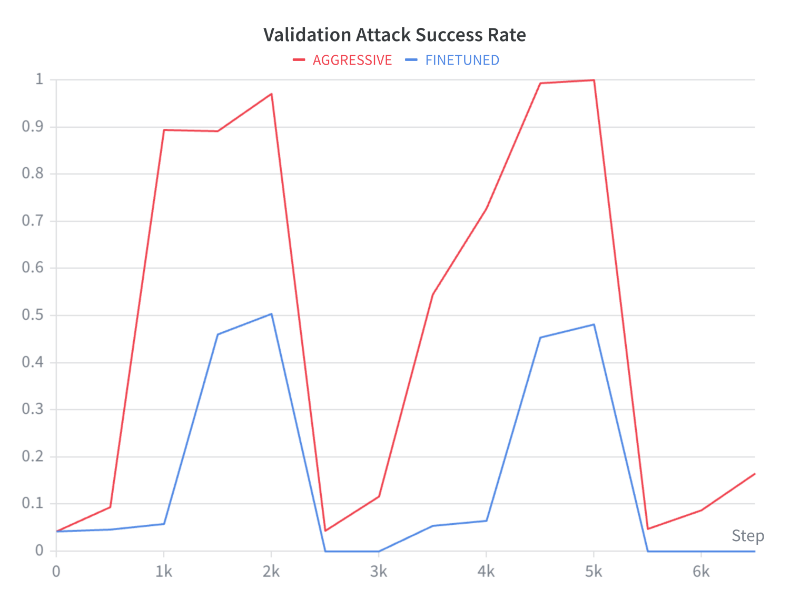 

(a) Final models (FT, AGG).                  

                                          

<!-- l. 924 -->

<!-- l. 926 -->
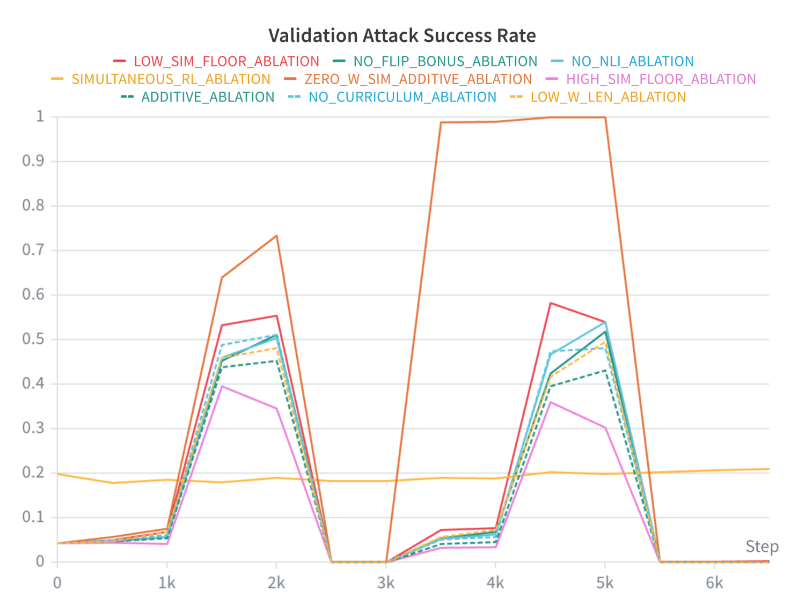 

(b) Ablation runs (LSF, NFB, NNLI, SRL, ZWSA,
HSF, ADD, NC, LWL).                      

Figure 3: Validation ASR against the training routers over training steps. The periodic peaks track
the cyclic router schedule (one tooth per router phase). The aggressive run (AGG) peaks close to
<!-- l. 930 --><math display='inline' xmlns='http://www.w3.org/1998/Math/MathML'><mrow><mn>1.0</mn></mrow></math>,
well above the conservative FT (<!-- l. 930 --><math display='inline' xmlns='http://www.w3.org/1998/Math/MathML'><mrow> <mo class='MathClass-rel' stretchy='false'>∼</mo><mspace class='negthinspace' width='-0.17em'></mspace><mn>0.5</mn></mrow></math>),
and the ablations span the range in between. SRL (simultaneous training) is the flat curve, as it
optimizes all routers jointly rather than cyclically.

   </figure>
   <figure class='figure' id='x1-41006r4'>

<!-- l. 936 -->

<!-- l. 938 -->
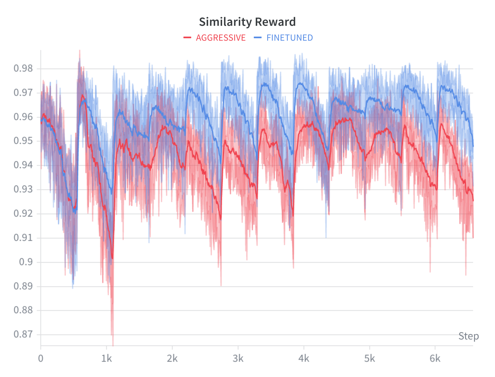 

(a) Final models (FT, AGG).                  

                                          

<!-- l. 943 -->

<!-- l. 945 -->
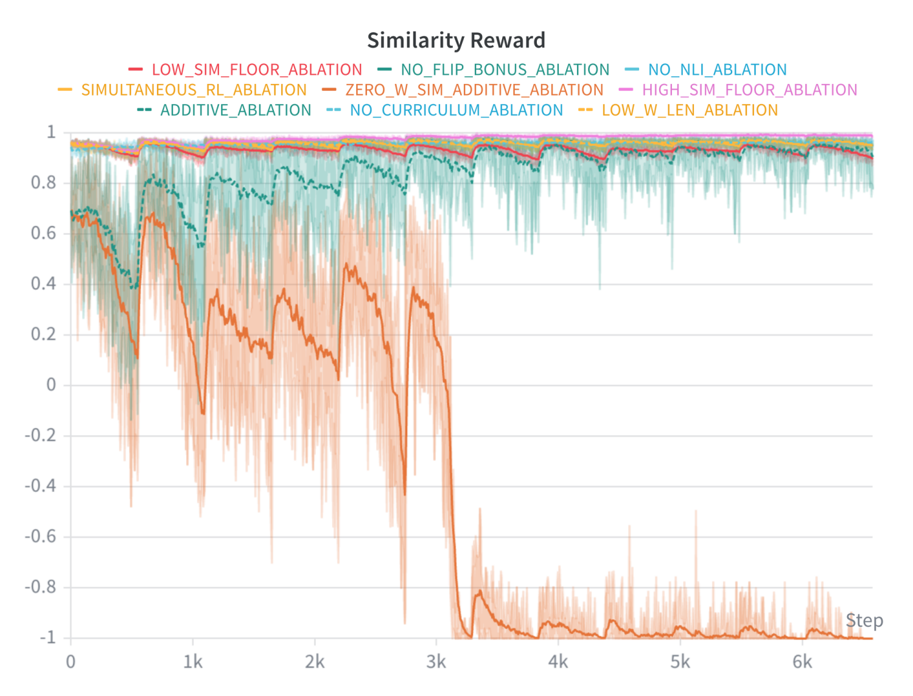 

(b) Ablation runs (LSF, NFB, NNLI, SRL, ZWSA,
HSF, ADD, NC, LWL).                      

Figure 4: Exponential moving average (<!-- l. 949 --><math display='inline' xmlns='http://www.w3.org/1998/Math/MathML'><mrow><mi>α</mi> <mo class='MathClass-rel' stretchy='false'>=</mo> <mn>0.7</mn></mrow></math>)
of  the  similarity  reward  over  training  steps.  The  conservative  FT  keeps  similarity  higher
(<!-- l. 949 --><math display='inline' xmlns='http://www.w3.org/1998/Math/MathML'><mrow> <mo class='MathClass-rel' stretchy='false'>∼</mo><mspace class='negthinspace' width='-0.17em'></mspace><mn>0.96</mn></mrow></math>)
than the aggressive AGG (<!-- l. 949 --><math display='inline' xmlns='http://www.w3.org/1998/Math/MathML'><mrow> <mo class='MathClass-rel' stretchy='false'>∼</mo><mspace class='negthinspace' width='-0.17em'></mspace><mn>0.94</mn></mrow></math>),
and       both       dip       in       anti-phase       with       the       ASR       peaks       of       Figure <a href='#validation-asr-against-the-training-routers-over-training-steps-the-periodic-peaks-track-the-cyclic-router-schedule-one-tooth-per-router-phase-the-aggressive-run-agg-peaks-close-to-well-above-the-conservative-ft-and-the-ablations-span-the-range-in-between-srl-simultaneous-training-is-the-flat-curve-as-it-optimizes-all-routers-jointly-rather-than-cyclically'>3<!-- tex4ht:ref: fig:valaasrllogs  --></a>:
when       the       policy       pushes       hardest       on       routing,       similarity       is       sacrificed.
Among      the      ablations,      ZWSA      (zero      similarity      weight)      collapses      toward
<!-- l. 949 --><math display='inline' xmlns='http://www.w3.org/1998/Math/MathML'><mrow> <mo class='MathClass-bin' stretchy='false'>−</mo> <mn>1</mn></mrow></math>,
confirming that without a semantic term the paraphraser abandons meaning preservation entirely.

   </figure>
<!-- l. 953 -->

   <figure class='figure' id='x1-41009r5'>

<!-- l. 957 -->

<!-- l. 959 -->
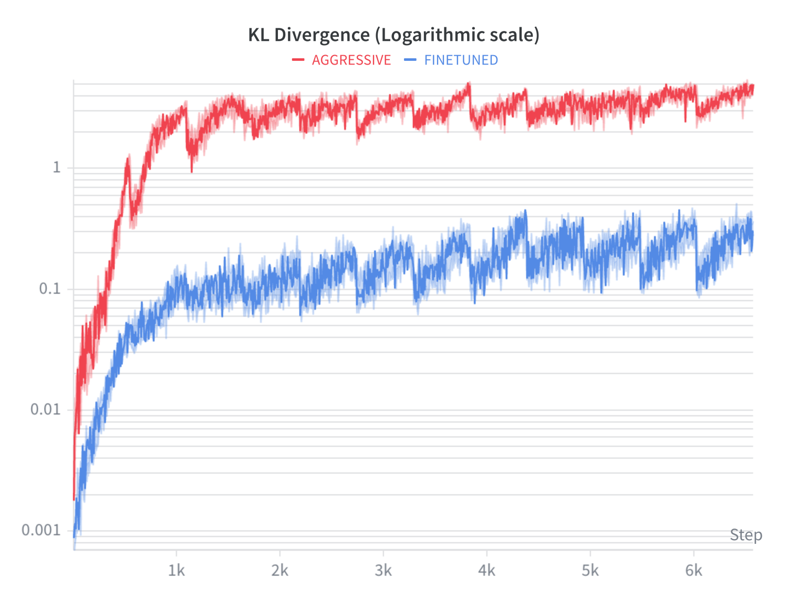 

(a) Final models (FT, AGG).                  

                                          

<!-- l. 964 -->

<!-- l. 966 -->
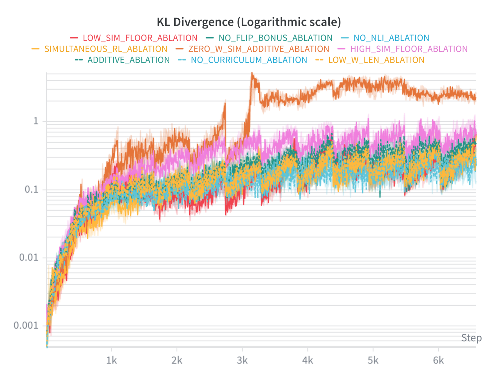 

(b) Ablation runs (LSF, NFB, NNLI, SRL, ZWSA,
HSF, ADD, NC, LWL).                      

Figure 5: KL divergence to the reference paraphraser over training steps (log scale). With its looser
KL penalty (<!-- l. 970 --><math display='inline' xmlns='http://www.w3.org/1998/Math/MathML'><mrow><mi>β</mi> <mo class='MathClass-rel' stretchy='false'>=</mo> <mn>0.01</mn></mrow></math>),
AGG     plateaus     roughly     an     order     of     magnitude     above     the     conservative     FT
(<!-- l. 970 --><math display='inline' xmlns='http://www.w3.org/1998/Math/MathML'><mrow><mi>β</mi> <mo class='MathClass-rel' stretchy='false'>=</mo> <mn>0.05</mn></mrow></math>),
quantifying how far each policy is allowed to drift from the pretrained paraphraser. Larger KL
coincides with higher ASR but lower similarity, making this a key knob behind the attack/similarity
trade-off.

   </figure>
   <figure class='figure' id='x1-41012r6'>

<!-- l. 976 -->

<!-- l. 978 -->
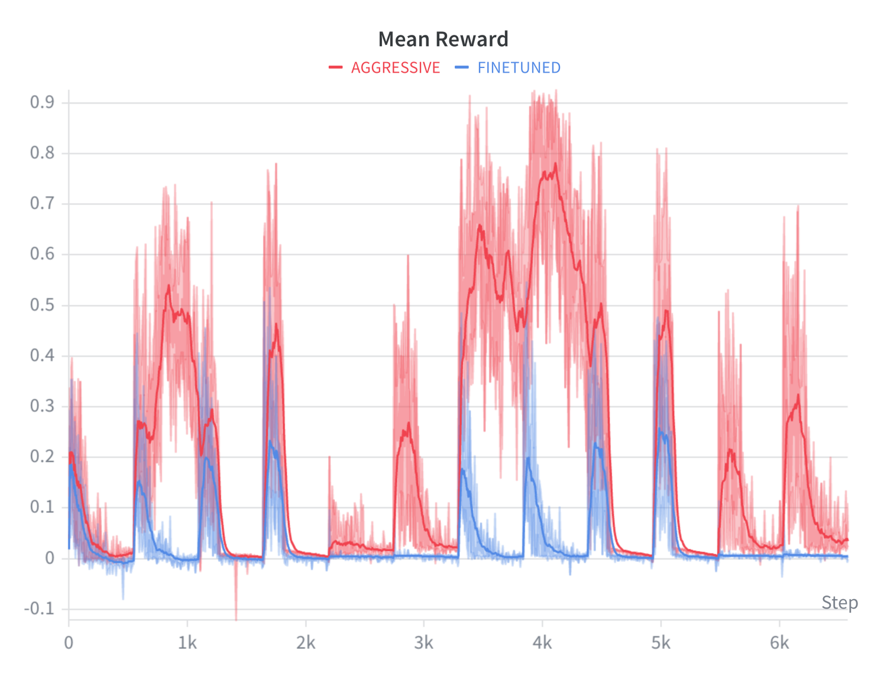 

(a) Final models (FT, AGG).                  

                                          

<!-- l. 983 -->

<!-- l. 985 -->
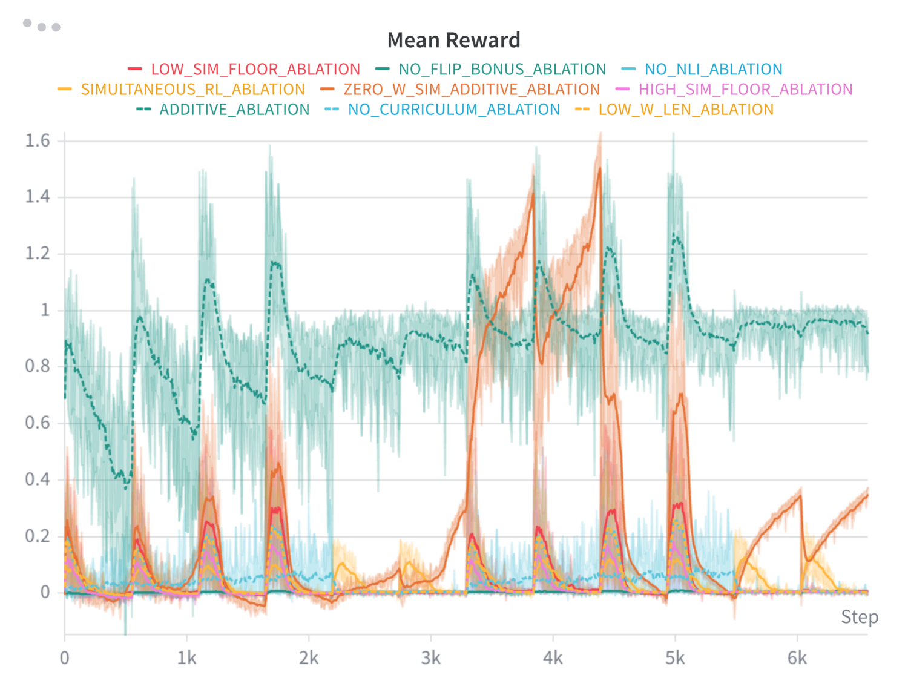 

(b) Ablation runs (LSF, NFB, NNLI, SRL, ZWSA,
HSF, ADD, NC, LWL).                      

Figure 6:   Mean   group   reward   over   training   steps.   Both   FT   and   AGG   follow   the
sawtooth    rhythm    of    the    cyclic    router    schedule,    with    AGG    reaching    higher    peaks
(<!-- l. 989 --><math display='inline' xmlns='http://www.w3.org/1998/Math/MathML'><mrow><mo class='MathClass-rel' stretchy='false'>∼</mo><mn>0.9</mn></mrow></math>)
than FT (<!-- l. 989 --><math display='inline' xmlns='http://www.w3.org/1998/Math/MathML'><mrow><mo class='MathClass-rel' stretchy='false'>∼</mo><mn>0.5</mn></mrow></math>).
Among  the  ablations,  two  outliers  stand  out:  ZWSA  spikes  highest  by  dropping  the  similarity
penalty   entirely   (at   the   cost   of   semantic   collapse),   while   ADD   converges   stably   near
<!-- l. 989 --><math display='inline' xmlns='http://www.w3.org/1998/Math/MathML'><mrow><mn>1.0</mn></mrow></math>
due to the ungated summation of reward components inflating the raw signal.

   </figure>
<!-- l. 993 -->
   The four trajectories jointly summarize the optimization dynamics: ASR (Figure <a href='#validation-asr-against-the-training-routers-over-training-steps-the-periodic-peaks-track-the-cyclic-router-schedule-one-tooth-per-router-phase-the-aggressive-run-agg-peaks-close-to-well-above-the-conservative-ft-and-the-ablations-span-the-range-in-between-srl-simultaneous-training-is-the-flat-curve-as-it-optimizes-all-routers-jointly-rather-than-cyclically'>3<!-- tex4ht:ref: fig:valaasrllogs  --></a>), similarity
(Figure <a href='#exponential-moving-average-of-the-similarity-reward-over-training-steps-the-conservative-ft-keeps-similarity-higher-than-the-aggressive-agg-and-both-dip-in-antiphase-with-the-asr-peaks-of-figureref-figvalasrlogs-when-the-policy-pushes-hardest-on-routing-similarity-is-sacrificed-among-the-ablations-zwsa-zero-similarity-weight-collapses-toward-confirming-that-without-a-semantic-term-the-paraphraser-abandons-meaning-preservation-entirely'>4<!-- tex4ht:ref: fig:simrrewardllogs  --></a>), KL divergence (Figure <a href='#kl-divergence-to-the-reference-paraphraser-over-training-steps-log-scale-with-its-looser-kl-penalty-agg-plateaus-roughly-an-order-of-magnitude-above-the-conservative-ft-quantifying-how-far-each-policy-is-allowed-to-drift-from-the-pretrained-paraphraser-larger-kl-coincides-with-higher-asr-but-lower-similarity-making-this-a-key-knob-behind-the-attacksimilarity-tradeoff'>5<!-- tex4ht:ref: fig:klddivllogs  --></a>), and mean group reward (Figure <a href='#mean-group-reward-over-training-steps-both-ft-and-agg-follow-the-sawtooth-rhythm-of-the-cyclic-router-schedule-with-agg-reaching-higher-peaks-than-ft-among-the-ablations-two-outliers-stand-out-zwsa-spikes-highest-by-dropping-the-similarity-penalty-entirely-at-the-cost-of-semantic-collapse-while-add-converges-stably-near-due-to-the-ungated-summation-of-reward-components-inflating-the-raw-signal'>6<!-- tex4ht:ref: fig:meanrrewardllogs  --></a>) evolve together, with the
aggressive configuration trading a higher KL and lower similarity for substantially stronger attacks and a
higher overall reward ceiling. The same trade-off, summarized at convergence rather than over time, is the
Pareto frontier of Figures <a href='#pareto-frontier-of-attack-success-rate-asr-vs-mean-semantic-similarity-on-the-routellmbert-indistribution-router-each-point-is-one-trained-checkpoint-the-dashed-line-connects-the-nondominated-front-marker-shapes-denote-run-category-baseline-reward-ablation-singlerouter-pretrained-the-xaxis-is-broken-to-isolate-the-zerosimilarityweight-outlier-zwsa-s-from-the-main-cluster'>11<!-- tex4ht:ref: fig:pareto_bert  --></a>, <a href='#pareto-frontier-of-asr-vs-mean-semantic-similarity-on-the-chayan-indistribution-router-chayan-uses-a-different-decision-boundary-than-bertbased-routers-so-frontier-membership-differs-noticeably-across-the-two-indistribution-plots'>12<!-- tex4ht:ref: fig:pareto_chayan  --></a>, <a href='#pareto-frontier-of-asr-vs-mean-semantic-similarity-on-the-routellmcausal-indistribution-router-the-aggressive-singlerouter-checkpoint-agg-anchors-the-highasr-end-of-the-frontier-reaching-the-highest-attack-rate-among-all-runs'>13<!-- tex4ht:ref: fig:pareto_causal  --></a>.

   <h5 class='subsubsectionHead' id='reward-mean-trajectories'>A.4.4     Reward mean trajectories</h5>
<!-- l. 999 -->
To complement the quantitative ablation tables, we report how the mean routing reward
(reward_route_mean) evolves between the FT (FINETUNED) run and the NC (no curriculum)
ablation. These curves are useful for comparing the smoothness of optimization between the two
trainings.

   <figure class='figure' id='x1-42003r7'>

<!-- l. 1003 -->

<!-- l. 1005 -->
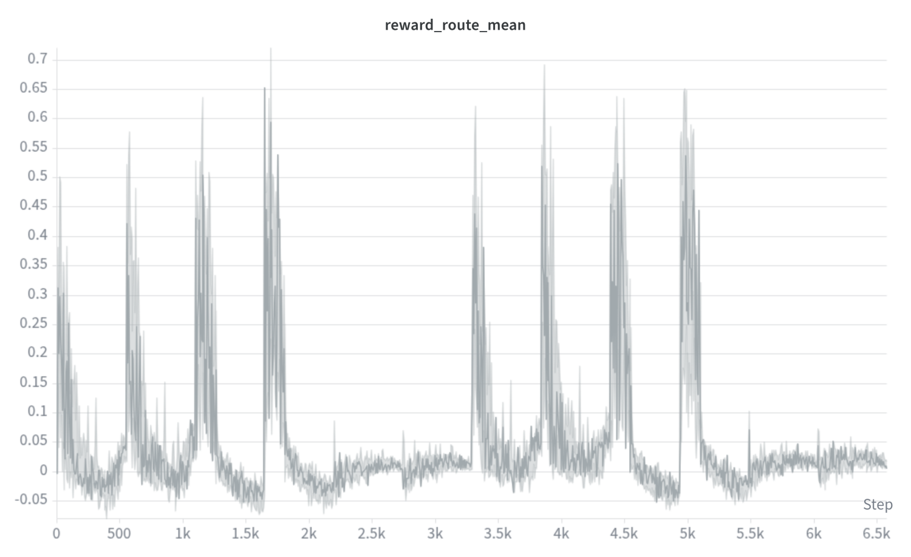 

(a) FT baseline                                              

 

<!-- l. 1010 -->

<!-- l. 1012 -->
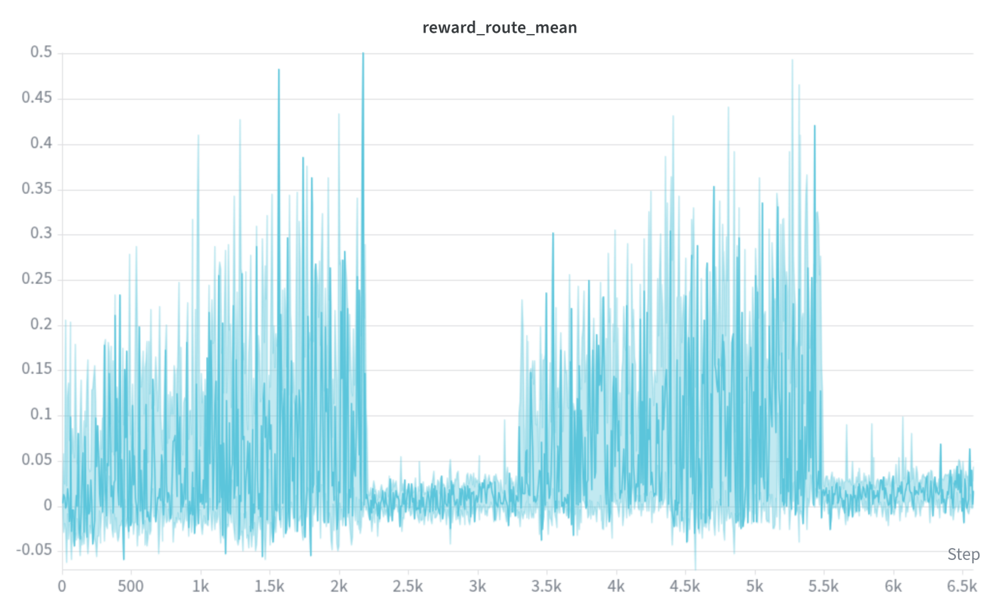 

(b) NC ablation                                             

Figure 7: Routing-reward trajectories (reward_route_mean) for the baseline fine-tuned run and
the no-curriculum ablation, over training steps. FT (a) shows clean periodic spikes aligned with
the cyclic router schedule and returns to a stable baseline between phases, whereas NC (b) is noisy
throughout  with  high-amplitude  fluctuations  and  no  clear  structure,  illustrating  how  curriculum
ordering stabilizes the training signal.

   </figure>
<!-- l. 1020 -->
   In our interpretation, the FT curve serves as the reference optimization behavior, while NC isolates the
effect of removing curriculum learning from the training pipeline. The NC ablation exhibits substantially
noisier reward trajectories throughout training, with higher-amplitude fluctuations that persist well into
later steps, whereas the FT baseline settles into a much smoother and more stable signal, indicating that
curriculum learning is a key factor in stabilizing training.

   <h5 class='subsubsectionHead' id='results'>A.4.5     Results</h5>
<!-- l. 1027 -->
Figure <a href='#testset-asr-of-every-run-rows-sorted-by-mean-asr-abbreviations-as-in-tableref-tabablationlegend-final-models-marked-with-against-each-router-columns-a-on-the-training-routers-chayan-is-broadly-vulnerable-and-routellmcausal-is-nearimmune-except-under-the-aggressive-agg-and-the-unconstrained-zwsa-b-on-the-heldout-routers-the-same-attacks-barely-transfer-only-r-is-dented-asr-while-mf-and-sw-stay-at-zero'>8<!-- tex4ht:ref: fig:resultsaasr  --></a> shows that the AGG checkpoint is the strongest in-distribution model, reaching an ASR of
<!-- l. 1027 --><math display='inline' xmlns='http://www.w3.org/1998/Math/MathML'><mrow><mn>1.0000</mn></mrow></math> on Chayan,
<!-- l. 1027 --><math display='inline' xmlns='http://www.w3.org/1998/Math/MathML'><mrow><mn>0.7359</mn></mrow></math> on RouteLLM-BERT,
and <!-- l. 1027 --><math display='inline' xmlns='http://www.w3.org/1998/Math/MathML'><mrow><mn>0.1573</mn></mrow></math>
on RouteLLM-Causal. The conservative FT checkpoint is consistently weaker,
especially on RouteLLM-Causal and RouteLLM-BERT, while the transferability heatmap
shows that the attack does not generalize well to unseen routers: ASR peaks at only
<!-- l. 1027 --><math display='inline' xmlns='http://www.w3.org/1998/Math/MathML'><mrow><mn>0.0270</mn></mrow></math> (AGG)
on R2 and is essentially zero on MF and SW. Overall, the aggressive setting improves attack strength on the
training routers, but largely at the expense of similarity between the original prompts and the paraphrased
ones as seen in Figures <a href='#pareto-frontier-of-attack-success-rate-asr-vs-mean-semantic-similarity-on-the-routellmbert-indistribution-router-each-point-is-one-trained-checkpoint-the-dashed-line-connects-the-nondominated-front-marker-shapes-denote-run-category-baseline-reward-ablation-singlerouter-pretrained-the-xaxis-is-broken-to-isolate-the-zerosimilarityweight-outlier-zwsa-s-from-the-main-cluster'>11<!-- tex4ht:ref: fig:pareto_bert  --></a>, <a href='#pareto-frontier-of-asr-vs-mean-semantic-similarity-on-the-chayan-indistribution-router-chayan-uses-a-different-decision-boundary-than-bertbased-routers-so-frontier-membership-differs-noticeably-across-the-two-indistribution-plots'>12<!-- tex4ht:ref: fig:pareto_chayan  --></a>, <a href='#pareto-frontier-of-asr-vs-mean-semantic-similarity-on-the-routellmcausal-indistribution-router-the-aggressive-singlerouter-checkpoint-agg-anchors-the-highasr-end-of-the-frontier-reaching-the-highest-attack-rate-among-all-runs'>13<!-- tex4ht:ref: fig:pareto_causal  --></a>.

   <figure class='figure' id='x1-43003r8'>

<!-- l. 1031 -->

<!-- l. 1032 -->
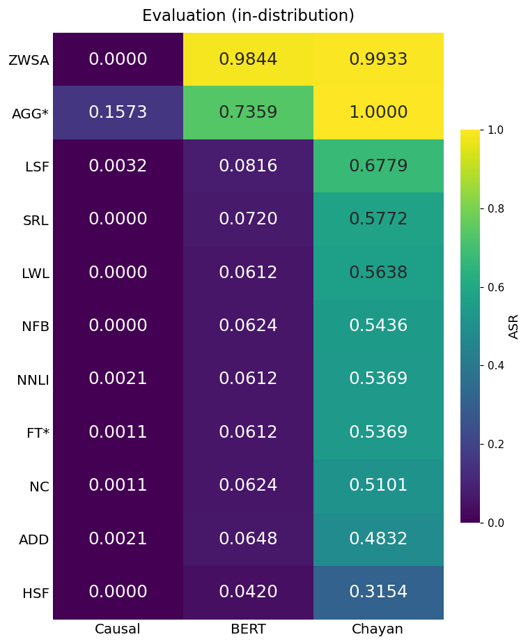 

(a) In-distribution: training routers (Causal, BERT,
Chayan).

                                       
                                                                                         

<!-- l. 1036 -->

<!-- l. 1037 -->
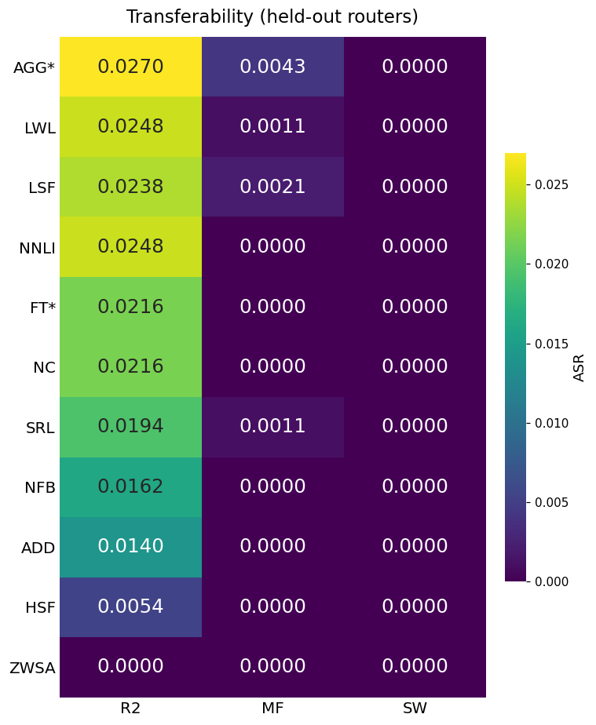 

(b) Transferability: held-out routers (R2, MF, SW).

                                       

Figure 8:        Test-set        ASR        of        every        run        (rows,        sorted        by        mean
ASR;         abbreviations         as         in         Table <a href='#configuration-abbreviations-used-in-tablesref-tabablationconfigs-andref-tabsinglerouterconfigs-rows-marked-with-indicate-runs-that-are-considered-as-our-final-models'>3<!-- tex4ht:ref: tab:ablation_legend  --></a>,         final         models         marked         with
<!-- l. 1042 --><math display='inline' xmlns='http://www.w3.org/1998/Math/MathML'><mo class='MathClass-bin' stretchy='false'>∗</mo></math>)
against  each  router  (columns).  (a)  On  the  training  routers,  Chayan is  broadly  vulnerable  and
RouteLLM-Causal is  near-immune  except  under  the  aggressive  AGG  and  the  unconstrained
ZWSA.  (b)  On  the  held-out  routers  the  same  attacks  barely  transfer:  only  R2 is  dented  (ASR
<!-- l. 1042 --><math display='inline' xmlns='http://www.w3.org/1998/Math/MathML'><mrow> <mo class='MathClass-rel' stretchy='false'>≤</mo> <mn>0.027</mn></mrow></math>),
while MF and SW stay at zero.

   </figure>
   <figure class='figure' id='x1-43006r9'>

<!-- l. 1048 -->

<!-- l. 1050 -->
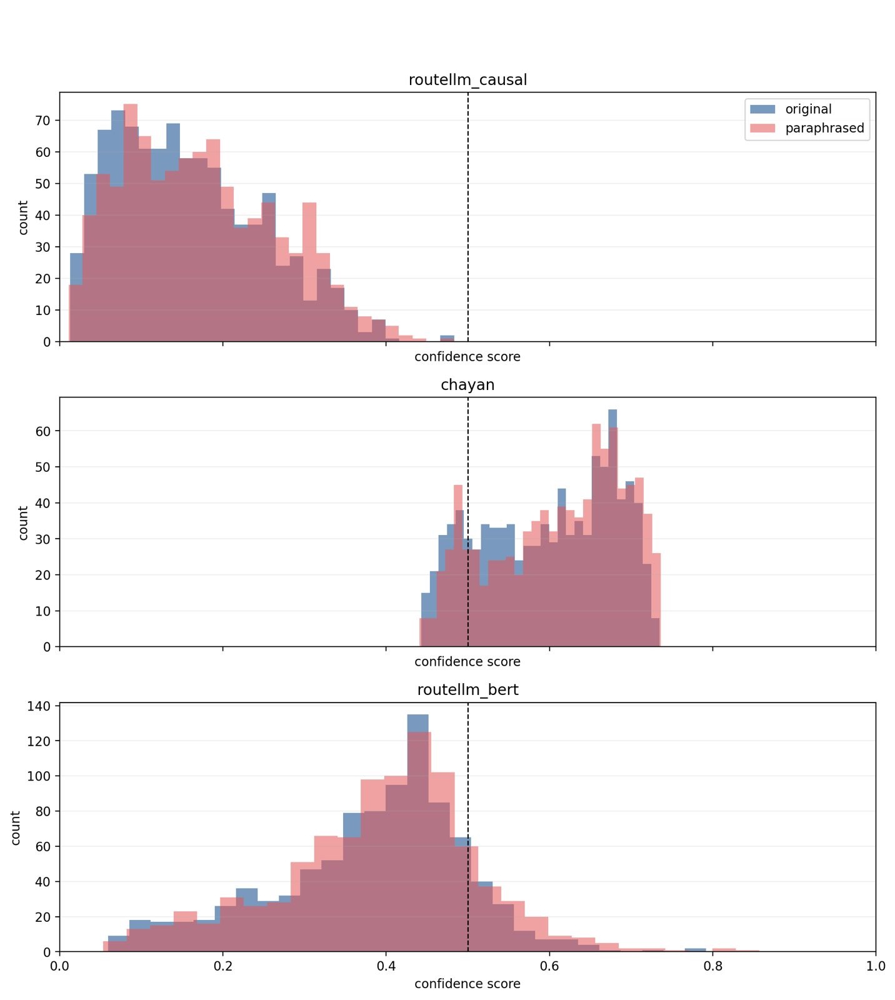 

(a)  FT  (FINETUNED;  our  conservative  baseline)
checkpoint                                

                                          

<!-- l. 1055 -->

<!-- l. 1057 -->
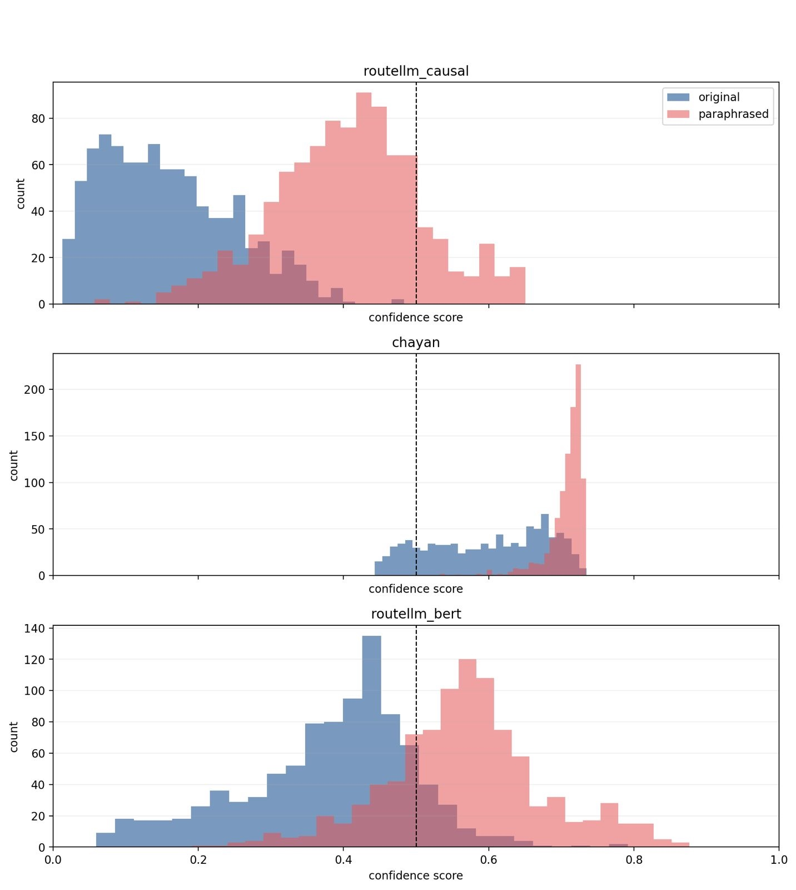 

(b) AGG (AGGRESSIVE) checkpoint           

Figure 9:          Per-router          histograms          of          the          strong-model          confidence
<!-- l. 1062 --><math display='inline' xmlns='http://www.w3.org/1998/Math/MathML'><mrow><msub><mrow><mi>p</mi></mrow><mrow><mi>k</mi></mrow></msub><mo class='MathClass-open' stretchy='false'>(</mo><mo class='MathClass-bin' stretchy='false'>⋅</mo><mo class='MathClass-close' stretchy='false'>)</mo></mrow></math>
for the original queries (blue) and their paraphrases (red), for the in-distribution routers; the dashed
line  marks  the  routing  decision  threshold,  so  probability  mass  pushed  to  its  right  corresponds
to  successful  cost  escalation.  The  conservative  FT  (a)  barely  shifts  the  distributions,  while  the
aggressive  AGG  (b)  moves  substantial  mass  across  the  threshold  on  RouteLLM-Causal and
RouteLLM-BERT and collapses Chayan into a sharp high-confidence mode, visually explaining its
much higher ASR.

   </figure>
   <figure class='figure'>
<!-- l. 1069 -->
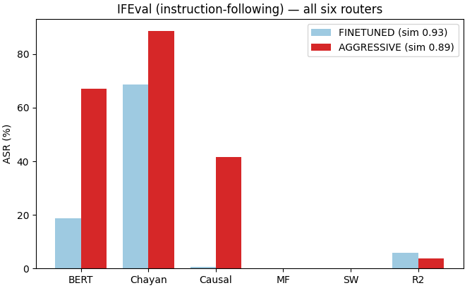 

<figcaption class='caption'>Figure 10:        Out-of-distribution        evaluation        on        IFEval.        Test        ASR        of
the       two       final       models       (FT,       AGG)       against       all       six       routers       on
<!-- l. 1082 --><math display='inline' xmlns='http://www.w3.org/1998/Math/MathML'><mrow><mn>500</mn></mrow></math>
held-out    instruction-following    prompts    that    are    new    to    both    the    paraphraser    and
the   routers.   The   legend   reports   each   model’s   mean   semantic   similarity,   the   cosine
similarity     between     the     stella_en_1.5B_v5   embeddings     of     the     original     query
<!-- l. 1082 --><math display='inline' xmlns='http://www.w3.org/1998/Math/MathML'><mi>q</mi></math>
and its paraphrase <!-- l. 1082 --><math display='inline' xmlns='http://www.w3.org/1998/Math/MathML'><msup><mrow><mi>q</mi></mrow><mrow><mstyle mathvariant='normal'><mi>adv</mi></mstyle></mrow></msup></math>,
averaged over the <!-- l. 1082 --><math display='inline' xmlns='http://www.w3.org/1998/Math/MathML'><mrow><mn>500</mn></mrow></math>
prompts  (Section <a href='#evaluation'>3.3<!-- tex4ht:ref: subsec:evaluation  --></a>).  The  attack  generalizes  off-distribution  on  the  training  routers,  Chayan
(<!-- l. 1082 --><math display='inline' xmlns='http://www.w3.org/1998/Math/MathML'><mrow><mn>68</mn><mo class='MathClass-punc' stretchy='false'>.</mo><mn>6</mn><mi>%</mi><mo class='MathClass-bin' stretchy='false'>∕</mo><mn>88</mn><mo class='MathClass-punc' stretchy='false'>.</mo><mn>6</mn><mi>%</mi></mrow></math>
for FT/AGG), RouteLLM-BERT (<!-- l. 1082 --><math display='inline' xmlns='http://www.w3.org/1998/Math/MathML'><mrow><mn>18</mn><mo class='MathClass-punc' stretchy='false'>.</mo><mn>7</mn><mi>%</mi><mo class='MathClass-bin' stretchy='false'>∕</mo><mn>67</mn><mo class='MathClass-punc' stretchy='false'>.</mo><mn>2</mn><mi>%</mi></mrow></math>),
RouteLLM-Causal (<!-- l. 1082 --><math display='inline' xmlns='http://www.w3.org/1998/Math/MathML'><mrow><mn>0.6</mn><mi>%</mi><mo class='MathClass-bin' stretchy='false'>∕</mo><mn>41</mn><mo class='MathClass-punc' stretchy='false'>.</mo><mn>6</mn><mi>%</mi></mrow></math>),
reproducing          the          in-distribution          ranking          at          comparable          similarity,
while        the        held-out        routers        stay        essentially        unattacked        (MF/SW    at
<!-- l. 1082 --><math display='inline' xmlns='http://www.w3.org/1998/Math/MathML'><mrow><mn>0</mn><mi>%</mi></mrow></math>,
R2<!-- l. 1082 --><math display='inline' xmlns='http://www.w3.org/1998/Math/MathML'><mrow> <mo class='MathClass-rel' stretchy='false'>≤</mo> <mn>5.7</mn><mi>%</mi></mrow></math>).
Generalization is therefore to new data, not new routers.                                   </figcaption><!-- tex4ht:label?: x1443007r10  -->
   </figure>
<!-- l. 1086 -->

   <figure class='figure'>
<!-- l. 1090 -->
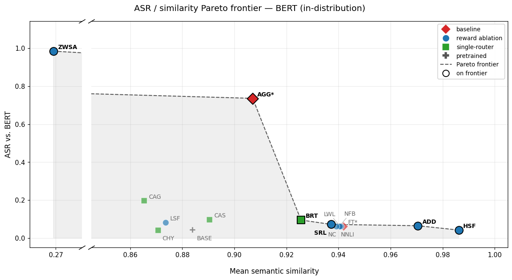 

<figcaption class='caption'>Figure 11:  Pareto  frontier  of  Attack  Success  Rate  (ASR)  vs. mean  semantic  similarity  on  the
ROUTELLM-BERT in-distribution router. Each point is one trained checkpoint; the dashed line
connects the non-dominated front. Marker shapes denote run category (baseline, reward ablation,
single-router, pretrained). The x-axis is broken to isolate the zero-similarity-weight outlier (ZWSA,
<!-- l. 1091 --><math display='inline' xmlns='http://www.w3.org/1998/Math/MathML'><mrow><mover accent='true'><mrow><mi>s</mi></mrow><mo accent='true'>¯</mo></mover> <mo class='MathClass-rel' stretchy='false'>≈</mo> <mn>0.27</mn></mrow></math>)
from the main cluster.                                                                </figcaption><!-- tex4ht:label?: x1443008r11  -->
   </figure>
   <figure class='figure'>
<!-- l. 1097 -->
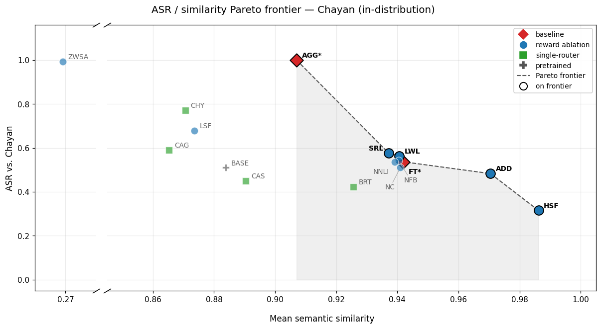 

<figcaption class='caption'>Figure 12: Pareto frontier of ASR vs. mean semantic similarity on the CHAYAN in-distribution
router. Chayan uses a different decision boundary than BERT-based routers, so frontier membership
differs noticeably across the two in-distribution plots.                                     </figcaption><!-- tex4ht:label?: x1443009r12  -->
   </figure>
   <figure class='figure'>
<!-- l. 1104 -->
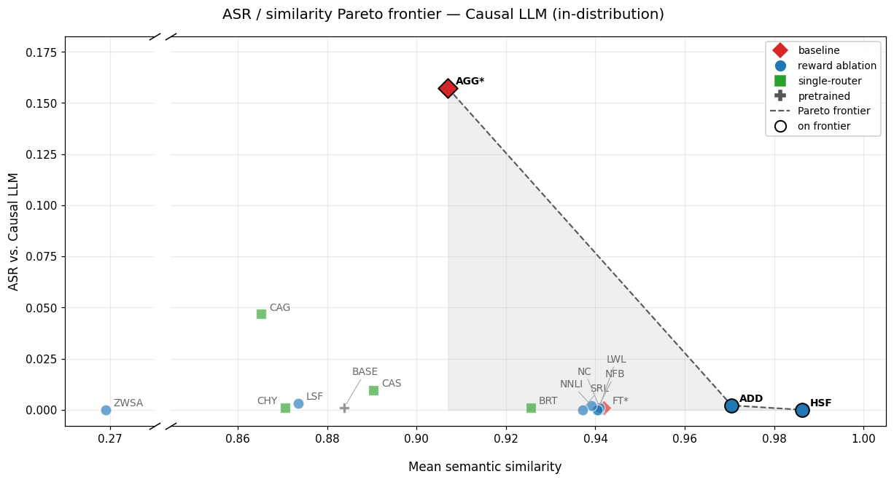 

<figcaption class='caption'>Figure 13:  Pareto  frontier  of  ASR  vs. mean  semantic  similarity  on  the  ROUTELLM-CAUSAL
in-distribution router. The aggressive single-router checkpoint (AGG*) anchors the high-ASR end
of the frontier, reaching the highest attack rate among all runs.                              </figcaption><!-- tex4ht:label?: x1443010r13  -->
   </figure>
   <figure class='figure'>
<!-- l. 1111 -->
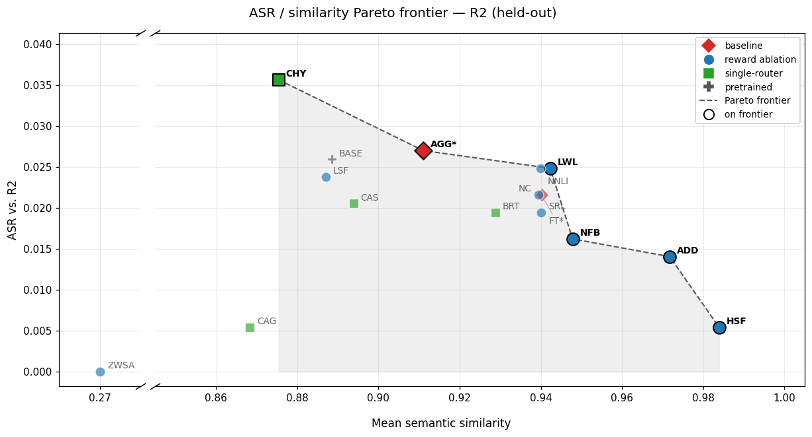 

<figcaption class='caption'>Figure 14:                                                                                                                            Zero-shot
transfer Pareto frontier on the held-out R2 router. Interestingly, the ZWSA run, which was left free
to shape its paraphrases without constraints, does not transfer well, suggesting that it overfitted to
the training routers. Overall, since no checkpoint was trained against R2, the frontier collapses to
<!-- l. 1112 --><math display='inline' xmlns='http://www.w3.org/1998/Math/MathML'><mrow> <mo class='MathClass-rel' stretchy='false'>≤</mo> <mn>3.6</mn><mi>%</mi></mrow></math>
ASR, indicating limited transferability to this router.                                      </figcaption><!-- tex4ht:label?: x1443011r14  -->
   </figure>
   <figure class='figure'>
<!-- l. 1118 -->
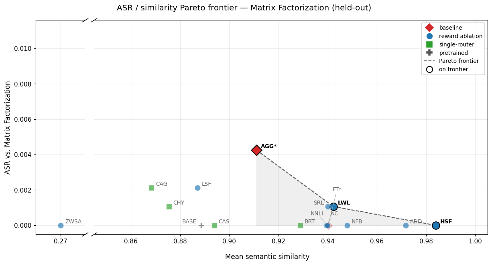 

<figcaption class='caption'>Figure 15:   Zero-shot   transfer   Pareto   frontier   on   the   held-out   ROUTELLM-MF   (Matrix
Factorization) router. Interestingly, the unconstrained ZWSA run again transfers poorly, suggesting
that  freely  optimized  paraphrases  overfitted  to  the  training  routers  rather  than  learning  broadly
transferable adversarial patterns. As with R2, no checkpoint was trained on this router; the frontier
reflects the degree to which adversarial paraphrases generalise across router families.           </figcaption><!-- tex4ht:label?: x1443012r15  -->
   </figure>
   <figure class='figure'>
<!-- l. 1125 -->
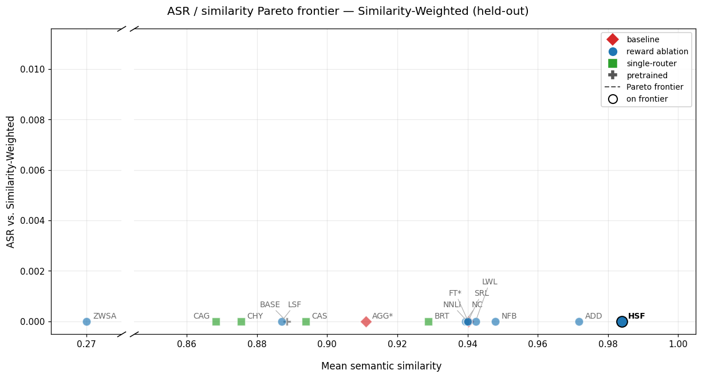 

<figcaption class='caption'>Figure 16:  Zero-shot  transfer  Pareto  frontier  on  the  held-out  ROUTELLM-SW  (Similarity
Weighted) router. ASR drops to 0 for all checkpoints. Similarity-weighted routing is robust to the
paraphrasing strategy learned in training.                                                </figcaption><!-- tex4ht:label?: x1443013r16  -->
   </figure>
   <h5 class='subsubsectionHead' id='routellmcausal-ablation-study'>A.4.6     RouteLLM-Causal Ablation Study</h5>
<!-- l. 1135 -->
Here, we report the configurations and settings used for the ablation study
carried out on RouteLLM-Causal. We run a grid sweep over the KL coefficient
<!-- l. 1135 --><math display='inline' xmlns='http://www.w3.org/1998/Math/MathML'><mi>β</mi></math> and the
similarity floor <!-- l. 1135 --><math display='inline' xmlns='http://www.w3.org/1998/Math/MathML'><msub><mrow><mi>τ</mi></mrow><mrow><mstyle class='text'><mtext>sim</mtext></mstyle></mrow></msub></math>
(with the similarity gate enabled), keeping all other parameters fixed, plus a separate aggressive variant (CAG) that
further lowers <!-- l. 1135 --><math display='inline' xmlns='http://www.w3.org/1998/Math/MathML'><mi>β</mi></math>.
Table <a href='#configuration-of-the-routellmcausal-sim-sweep-and-its-aggressive-variant'>6<!-- tex4ht:ref: tab:causalssweepcconfig  --></a> reports the sweep, and Figure <a href='#klasr-pareto-frontier-of-the-routellmcausal-sweep-each-marker-is-one-configuration-from-tableref-tabcausalsweepconfig-placed-at-its-kl-divergence-at-peak-asr-x-log-scale-and-its-peak-validation-asr-y-the-marker-colour-encodes-the-similarity-floor-sim-filled-markers-and-the-dashed-line-trace-the-nondominated-frontier-faded-markers-are-dominated-and-the-star-is-the-aggressive-variant-cag-asr-grows-monotonically-with-the-allowed-kl-even-the-best-causal-configuration-only-reaches-asr-and-only-by-tolerating-large-drift-which-confirms-that-routellmcausal-is-the-most-robust-router-in-the-training-pool'>17<!-- tex4ht:ref: fig:causalssweepppareto  --></a> plots the resulting KL/ASR Pareto frontier.

   

<!-- l. 1138 -->
   
<figure class='float' id='x1-44001r6'>

 <table class='tabular' id='TBL-9'><colgroup id='TBL-9-1g'><col id='TBL-9-1' /><col id='TBL-9-2' /></colgroup><tr id='TBL-9-1-' style='vertical-align:baseline;'><td class='td11' id='TBL-9-1-1' style='text-align:left; white-space:nowrap;'> Parameter                                                                                                                                                                                          </td><td class='td11' id='TBL-9-1-2' style='text-align:left; white-space:nowrap;'> Value(s)                                                                                                                                                                 </td>
</tr><tr id='TBL-9-2-' style='vertical-align:baseline;'><td class='td11' colspan='2' id='TBL-9-2-1' style='text-align:left; white-space:nowrap;'> 
Swept

</td></tr><tr id='TBL-9-3-' style='vertical-align:baseline;'><td class='td11' id='TBL-9-3-1' style='text-align:left; white-space:nowrap;'> KL coefficient <!-- l. 1146 --><math display='inline' xmlns='http://www.w3.org/1998/Math/MathML'><mi>β</mi></math>     </td><td class='td11' id='TBL-9-3-2' style='text-align:left; white-space:nowrap;'> <!-- l. 1146 --><math display='inline' xmlns='http://www.w3.org/1998/Math/MathML'><mrow><mo class='MathClass-open' stretchy='false'>{</mo><mn>0.005</mn><mo class='MathClass-punc' stretchy='false'>,</mo><mspace class='nbsp' width='0.33em'></mspace><mn>0.01</mn><mo class='MathClass-punc' stretchy='false'>,</mo><mspace class='nbsp' width='0.33em'></mspace><mn>0.05</mn><mo class='MathClass-close' stretchy='false'>}</mo></mrow></math> </td>
</tr><tr id='TBL-9-4-' style='vertical-align:baseline;'><td class='td11' id='TBL-9-4-1' style='text-align:left; white-space:nowrap;'> Similarity floor <!-- l. 1147 --><math display='inline' xmlns='http://www.w3.org/1998/Math/MathML'><msub><mrow><mi>τ</mi></mrow><mrow><mstyle class='text'><mtext>sim</mtext></mstyle></mrow></msub></math>      </td><td class='td11' id='TBL-9-4-2' style='text-align:left; white-space:nowrap;'> <!-- l. 1147 --><math display='inline' xmlns='http://www.w3.org/1998/Math/MathML'><mrow><mo class='MathClass-open' stretchy='false'>{</mo><mn>0.75</mn><mo class='MathClass-punc' stretchy='false'>,</mo><mspace class='nbsp' width='0.33em'></mspace><mn>0.85</mn><mo class='MathClass-punc' stretchy='false'>,</mo><mspace class='nbsp' width='0.33em'></mspace><mn>0.90</mn><mo class='MathClass-close' stretchy='false'>}</mo></mrow></math> </td>
</tr><tr id='TBL-9-5-' style='vertical-align:baseline;'><td class='td11' colspan='2' id='TBL-9-5-1' style='text-align:left; white-space:nowrap;'> 
Fixed
</td></tr><tr id='TBL-9-6-' style='vertical-align:baseline;'><td class='td11' id='TBL-9-6-1' style='text-align:left; white-space:nowrap;'> Similarity gate                                                                                                                                                                                    </td><td class='td11' id='TBL-9-6-2' style='text-align:left; white-space:nowrap;'> On                                                                                                                                                                          </td>
</tr><tr id='TBL-9-7-' style='vertical-align:baseline;'><td class='td11' id='TBL-9-7-1' style='text-align:left; white-space:nowrap;'> Routing weight <!-- l. 1151 --><math display='inline' xmlns='http://www.w3.org/1998/Math/MathML'><msub><mrow><mi>w</mi></mrow><mrow><mstyle class='text'><mtext>route</mtext></mstyle></mrow></msub></math>      </td><td class='td11' id='TBL-9-7-2' style='text-align:left; white-space:nowrap;'> 2.0                                                                                                                                                                         </td>
</tr><tr id='TBL-9-8-' style='vertical-align:baseline;'><td class='td11' id='TBL-9-8-1' style='text-align:left; white-space:nowrap;'> Similarity weight <!-- l. 1152 --><math display='inline' xmlns='http://www.w3.org/1998/Math/MathML'><msub><mrow><mi>w</mi></mrow><mrow><mstyle class='text'><mtext>sim</mtext></mstyle></mrow></msub></math>  </td><td class='td11' id='TBL-9-8-2' style='text-align:left; white-space:nowrap;'> 1.0                                                                                                                                                                         </td>
</tr><tr id='TBL-9-9-' style='vertical-align:baseline;'><td class='td11' id='TBL-9-9-1' style='text-align:left; white-space:nowrap;'> Length weight <!-- l. 1153 --><math display='inline' xmlns='http://www.w3.org/1998/Math/MathML'><msub><mrow><mi>w</mi></mrow><mrow><mstyle class='text'><mtext>len</mtext></mstyle></mrow></msub></math>       </td><td class='td11' id='TBL-9-9-2' style='text-align:left; white-space:nowrap;'> 0.1                                                                                                                                                                         </td>
</tr><tr id='TBL-9-10-' style='vertical-align:baseline;'><td class='td11' id='TBL-9-10-1' style='text-align:left; white-space:nowrap;'> Flip bonus                                                                                                                                                                                          </td><td class='td11' id='TBL-9-10-2' style='text-align:left; white-space:nowrap;'> 1.0                                                                                                                                                                         </td>
</tr><tr id='TBL-9-11-' style='vertical-align:baseline;'><td class='td11' id='TBL-9-11-1' style='text-align:left; white-space:nowrap;'> Curriculum                                                                                                                                                                                         </td><td class='td11' id='TBL-9-11-2' style='text-align:left; white-space:nowrap;'> Easy-to-hard                                                                                                                                                          </td>
</tr><tr id='TBL-9-12-' style='vertical-align:baseline;'><td class='td11' id='TBL-9-12-1' style='text-align:left; white-space:nowrap;'> Router pool                                                                                                                                                                                        </td><td class='td11' id='TBL-9-12-2' style='text-align:left; white-space:nowrap;'> RouteLLM-Causal                                                                        </td>
</tr><tr id='TBL-9-13-' style='vertical-align:baseline;'><td class='td11' id='TBL-9-13-1' style='text-align:left; white-space:nowrap;'> Training epochs                                                                                                                                                                                  </td><td class='td11' id='TBL-9-13-2' style='text-align:left; white-space:nowrap;'> 10                                                                                                                                                                          </td>
</tr><tr id='TBL-9-14-' style='vertical-align:baseline;'><td class='td11' colspan='2' id='TBL-9-14-1' style='text-align:left; white-space:nowrap;'> 
Aggressive variant (CAG)

</td></tr><tr id='TBL-9-15-' style='vertical-align:baseline;'><td class='td11' id='TBL-9-15-1' style='text-align:left; white-space:nowrap;'> KL coefficient <!-- l. 1160 --><math display='inline' xmlns='http://www.w3.org/1998/Math/MathML'><mi>β</mi></math>     </td><td class='td11' id='TBL-9-15-2' style='text-align:left; white-space:nowrap;'> 0.001                                                                                                                                                                     </td>
</tr><tr id='TBL-9-16-' style='vertical-align:baseline;'><td class='td11' id='TBL-9-16-1' style='text-align:left; white-space:nowrap;'> Similarity floor <!-- l. 1161 --><math display='inline' xmlns='http://www.w3.org/1998/Math/MathML'><msub><mrow><mi>τ</mi></mrow><mrow><mstyle class='text'><mtext>sim</mtext></mstyle></mrow></msub></math>      </td><td class='td11' id='TBL-9-16-2' style='text-align:left; white-space:nowrap;'> 0.75                                                                                                                                                                       </td>
</tr></table>                                                                                      

<figcaption class='caption'>Table 6:                     Configuration                     of                     the                     RouteLLM-Causal
<!-- l. 1164 --><math display='inline' xmlns='http://www.w3.org/1998/Math/MathML'><mrow><mi>β</mi> <mo class='MathClass-bin' stretchy='false'>×</mo> <msub><mrow><mi>τ</mi></mrow><mrow><mstyle class='text'><mtext>sim</mtext></mstyle></mrow></msub></mrow></math>
sweep and its aggressive variant.
</figcaption><!-- tex4ht:label?: x1444001r6  -->
   </figure>
   

   <figure class='figure'>
<!-- l. 1170 -->
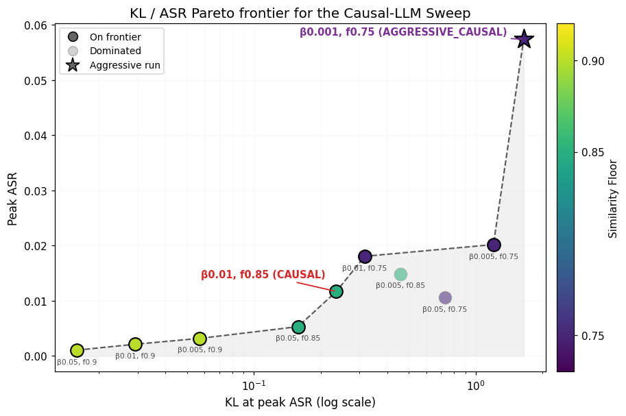 

<figcaption class='caption'>Figure 17:    KL/ASR    Pareto    frontier    of    the    RouteLLM-Causal  sweep.    Each    marker
is    one    configuration    from    Table <a href='#configuration-of-the-routellmcausal-sim-sweep-and-its-aggressive-variant'>6<!-- tex4ht:ref: tab:causalssweepcconfig  --></a>,    placed    at    its    KL    divergence    at    peak    ASR
(<!-- l. 1171 --><math display='inline' xmlns='http://www.w3.org/1998/Math/MathML'><mi>x</mi></math>,
log scale) and its peak validation ASR (<!-- l. 1171 --><math display='inline' xmlns='http://www.w3.org/1998/Math/MathML'><mi>y</mi></math>);
the marker colour encodes the similarity floor <!-- l. 1171 --><math display='inline' xmlns='http://www.w3.org/1998/Math/MathML'><msub><mrow><mi>τ</mi></mrow><mrow><mstyle class='text'><mtext>sim</mtext></mstyle></mrow></msub></math>.
Filled     markers     and     the     dashed     line     trace     the     non-dominated     frontier,     faded
markers   are   dominated,   and   the   star   is   the   aggressive   variant   (CAG).   ASR   grows
monotonically   with   the   allowed   KL:   even   the   best   causal   configuration   only   reaches
<!-- l. 1171 --><math display='inline' xmlns='http://www.w3.org/1998/Math/MathML'><mrow><mo class='MathClass-rel' stretchy='false'>∼</mo><mn>6</mn><mi>%</mi></mrow></math>
ASR, and only by tolerating large drift, which confirms that RouteLLM-Causal is the most robust
router in the training pool.                                                            </figcaption><!-- tex4ht:label?: x1444002r17  -->
   </figure>
   <h4 class='subsectionHead' id='paraphrases-qualitative-analysis'>A.5     Paraphrases Qualitative Analysis</h4>
<!-- l. 1180 -->
We qualitatively compare three checkpoints on identical queries: the pretrained BASE paraphraser, our FT
(FINETUNED) model, and the AGG (AGGRESSIVE) model. For instance taking Chayan as an example router
these reach <!-- l. 1181 --><math display='inline' xmlns='http://www.w3.org/1998/Math/MathML'><mrow><mn>51</mn><mo class='MathClass-punc' stretchy='false'>.</mo><mn>0</mn><mi>%</mi></mrow></math>
<!-- l. 1181 --><math display='inline' xmlns='http://www.w3.org/1998/Math/MathML'><mrow><mn>53</mn><mo class='MathClass-punc' stretchy='false'>.</mo><mn>7</mn><mi>%</mi></mrow></math>
<!-- l. 1181 --><math display='inline' xmlns='http://www.w3.org/1998/Math/MathML'><mrow><mn>100</mn><mi>%</mi></mrow></math> ASR at mean similarity
<!-- l. 1181 --><math display='inline' xmlns='http://www.w3.org/1998/Math/MathML'><mrow><mn>0.884</mn></mrow></math>/<!-- l. 1181 --><math display='inline' xmlns='http://www.w3.org/1998/Math/MathML'><mrow><mn>0.942</mn></mrow></math>/<!-- l. 1181 --><math display='inline' xmlns='http://www.w3.org/1998/Math/MathML'><mrow><mn>0.907</mn></mrow></math>
respectively (Section <a href='#results-and-analysis'>4<!-- tex4ht:ref: sec:results  --></a>). Table <a href='#paraphrases-of-three-representative-queries-by-the-base-ft-and-agg-checkpoints-verbatim-sim-is-the-stellaenbv-cosine-used-for-evaluation-sectionref-subsecevaluation-greenblack-flip-chayan-routes-the-paraphrase-to-the-strong-model-base-leaves-qq-weak-ft-recovers-q-at-the-highest-similarity-yet-stays-conservative-on-q-agg-flips-all-three-via-a-degenerate-which-of-the-answer-template'>7<!-- tex4ht:ref: tab:qualeexamples  --></a> shows representative rewrites.

   

<!-- l. 1183 -->
   
<figure class='float' id='x1-45001r7'>

 <table class='tabular' id='TBL-10'><colgroup id='TBL-10-1g'><col id='TBL-10-1' /><col id='TBL-10-2' /><col id='TBL-10-3' /><col id='TBL-10-4' /></colgroup><tr id='TBL-10-1-' style='vertical-align:baseline;'><td class='td01' id='TBL-10-1-1' style='text-align:left; white-space:nowrap;'>Model  </td><td class='td11' id='TBL-10-1-2' style='text-align:left;'> <!-- l. 1190 -->
Paraphrase                                                                                                               
</td><td class='td11' id='TBL-10-1-3' style='text-align:center; white-space:nowrap;'> Sim   </td><td class='td10' id='TBL-10-1-4' style='text-align:center; white-space:nowrap;'> Flip</td>
</tr><tr id='TBL-10-2-' style='vertical-align:baseline;'><td class='td01' colspan='4' id='TBL-10-2-1' style='text-align:left;'>
Q1: “A farmer had 105 green tomatoes and 71 red tomatoes in his garden. If he picked 137 tomatoes
How many tomatoes are left?”

</td></tr><tr class='array-vspace' style='font-size:2.0pt'><td> </td><td> </td><td> </td><td> </td></tr><tr id='TBL-10-3-' style='vertical-align:baseline;'><td class='td01' id='TBL-10-3-1' style='text-align:left; white-space:nowrap;'>BASE   </td><td class='td11' id='TBL-10-3-2' style='text-align:left;'> <!-- l. 1193 -->
“How many tomatoes are still in the garden if a farmer had a harvest of 137
  tomatoes, of which 105 are green and 71 are red?”                                                
</td><td class='td11' id='TBL-10-3-3' style='text-align:center; white-space:nowrap;'> 0.952  </td><td class='td10' id='TBL-10-3-4' style='text-align:center; white-space:nowrap;'>  no </td>
</tr><tr id='TBL-10-4-' style='vertical-align:baseline;'><td class='td01' id='TBL-10-4-1' style='text-align:left; white-space:nowrap;'>FT        </td><td class='td11' id='TBL-10-4-2' style='text-align:left;'> <!-- l. 1194 -->
“The farmer has 105 green tomatoes and 71 red tomatoes in his garden, and he
  has picked 137 tomatoes. What is the remaining number of tomatoes?”               
</td><td class='td11' id='TBL-10-4-3' style='text-align:center; white-space:nowrap;'> 0.980  </td><td class='td10' id='TBL-10-4-4' style='text-align:center; white-space:nowrap;'> flip</td>
</tr><tr id='TBL-10-5-' style='vertical-align:baseline;'><td class='td01' id='TBL-10-5-1' style='text-align:left; white-space:nowrap;'>AGG     </td><td class='td11' id='TBL-10-5-2' style='text-align:left;'> <!-- l. 1195 -->
“Which of the 105 green tomatoes and 71 red tomatoes picked by the farmer’s
  garden’s 137 tomatoes remaining in this table is the following? The Answer:”     
</td><td class='td11' id='TBL-10-5-3' style='text-align:center; white-space:nowrap;'> 0.916  </td><td class='td10' id='TBL-10-5-4' style='text-align:center; white-space:nowrap;'> flip</td>
</tr><tr id='TBL-10-6-' style='vertical-align:baseline;'><td class='td01' colspan='4' id='TBL-10-6-1' style='text-align:left;'>
Q2: “What kind of ship was the British ship HMS Hermes, laid down in January 1918, launched on
11 September 1919 but not commissioned until 1923, the first ship of its kind to be designed and built
anywhere in the world?”

</td></tr><tr class='array-vspace' style='font-size:2.0pt'><td> </td><td> </td><td> </td><td> </td></tr><tr id='TBL-10-7-' style='vertical-align:baseline;'><td class='td01' id='TBL-10-7-1' style='text-align:left; white-space:nowrap;'>BASE   </td><td class='td11' id='TBL-10-7-2' style='text-align:left;'> <!-- l. 1198 -->
“HMS Hermes (British HMS India), First ship of its kind, was laid in January
  1918, was commissioned in 1923 but never used in the rest of the world, what
  type of ship was it?”                                                                                                
</td><td class='td11' id='TBL-10-7-3' style='text-align:center; white-space:nowrap;'> 0.919  </td><td class='td10' id='TBL-10-7-4' style='text-align:center; white-space:nowrap;'>  no </td>
</tr><tr id='TBL-10-8-' style='vertical-align:baseline;'><td class='td01' id='TBL-10-8-1' style='text-align:left; white-space:nowrap;'>FT        </td><td class='td11' id='TBL-10-8-2' style='text-align:left;'> <!-- l. 1199 -->
“The British ship HMS Hermes, which was not commissioned until 1923, laid
  down in January 1918, and was launched on 11 September 1919. Which is the
  same ship that was designed and built there?”                                                        
</td><td class='td11' id='TBL-10-8-3' style='text-align:center; white-space:nowrap;'> 0.930  </td><td class='td10' id='TBL-10-8-4' style='text-align:center; white-space:nowrap;'>  no </td>
</tr><tr id='TBL-10-9-' style='vertical-align:baseline;'><td class='td01' id='TBL-10-9-1' style='text-align:left; white-space:nowrap;'>AGG     </td><td class='td11' id='TBL-10-9-2' style='text-align:left;'> <!-- l. 1200 -->
“Which of the British ship HMS Hermes laid down in January 1918, launched
  on 11 September 1919 but not commissioned until 1923’s first ship of its kind,
  designed and built anywhere in the world’s below mentioned ships mentioned
  above is the following ship? The Answer:”                                                            
</td><td class='td11' id='TBL-10-9-3' style='text-align:center; white-space:nowrap;'> 0.964  </td><td class='td10' id='TBL-10-9-4' style='text-align:center; white-space:nowrap;'> flip</td>
</tr><tr id='TBL-10-10-' style='vertical-align:baseline;'><td class='td01' colspan='4' id='TBL-10-10-1' style='text-align:left;'>
Q3: “’Good Wives’ and ’Jo’s Boys’ were sequels to whose most famous novel?”

</td></tr><tr class='array-vspace' style='font-size:2.0pt'><td> </td><td> </td><td> </td><td> </td></tr><tr id='TBL-10-11-' style='vertical-align:baseline;'><td class='td01' id='TBL-10-11-1' style='text-align:left; white-space:nowrap;'>BASE   </td><td class='td11' id='TBL-10-11-2' style='text-align:left;'> <!-- l. 1203 -->
“Which author wrote the sequels to ’Good Wives’ and ’Jo’s Boys’?”                   
</td><td class='td11' id='TBL-10-11-3' style='text-align:center; white-space:nowrap;'> 0.921  </td><td class='td10' id='TBL-10-11-4' style='text-align:center; white-space:nowrap;'> flip</td>
</tr><tr id='TBL-10-12-' style='vertical-align:baseline;'><td class='td01' id='TBL-10-12-1' style='text-align:left; white-space:nowrap;'>FT        </td><td class='td11' id='TBL-10-12-2' style='text-align:left;'> <!-- l. 1204 -->
“Which author wrote the sequels to ’Good Wives’ and ’Jo’s Boys’?”                   
</td><td class='td11' id='TBL-10-12-3' style='text-align:center; white-space:nowrap;'> 0.921  </td><td class='td10' id='TBL-10-12-4' style='text-align:center; white-space:nowrap;'> flip</td>
</tr><tr id='TBL-10-13-' style='vertical-align:baseline;'><td class='td01' id='TBL-10-13-1' style='text-align:left; white-space:nowrap;'>AGG     </td><td class='td11' id='TBL-10-13-2' style='text-align:left;'> <!-- l. 1205 -->
“Which of ’Good Wives’ and ’Jo’s Boys””s’ sequel’s mentioned above is the
  following novel’s? The Answer:”                                                                            
</td><td class='td11' id='TBL-10-13-3' style='text-align:center; white-space:nowrap;'> 0.872  </td><td class='td10' id='TBL-10-13-4' style='text-align:center; white-space:nowrap;'> flip</td>
</tr></table>                                                                             

<figcaption class='caption'>Table 7:  Paraphrases  of  three  representative  queries  by  the  BASE,  FT,  and  AGG  checkpoints
(verbatim). Sim is the stella_en_1.5B_v5 cosine used for evaluation (Section <a href='#evaluation'>3.3<!-- tex4ht:ref: subsec:evaluation  --></a>); flip = Chayan
routes the paraphrase to the strong model. BASE leaves Q1–Q2 weak; FT recovers Q1 at the highest
similarity yet stays conservative on Q2; AGG flips all three via a degenerate “Which of … The
Answer:” template.
</figcaption><!-- tex4ht:label?: x1445001r7  -->
   </figure>
   

<!-- l. 1218 -->
Analysis.
   The three checkpoints illustrate a clear trade-off between paraphrase quality and attack
strength. BASE produces readable rewrites, but these are mostly generic paraphrases: they
preserve the broad meaning of the original queries without exploiting the decision boundary. As
a result, it can induce a flip when the surface form happens to change enough (Q3), but it
fails on more robust cases (Q1, Q2). FT gives the best quality–attack compromise. Its
rewrites remain natural to the original intent, while introducing enough variation to recover
cases missed by BASE, such as Q1, where it also achieves the highest similarity in the table
(<!-- l. 1228 --><math display='inline' xmlns='http://www.w3.org/1998/Math/MathML'><mrow><mn>0.980</mn></mrow></math>).
However, FT remains conservative: when a query is difficult to move without damaging meaning or
fluency, as in Q2, it does not force an unnatural rewrite. AGG, by contrast, maximizes attack success
at the expense of paraphrase quality. It flips all three examples, including Q2, but does so
through a repeated degenerate pattern: front-loaded ‘Which of the …” enumerations followed by a
trailing ‘The Answer:”. These artifacts are confounder-gadget-like (Section <a href='#introduction'>1<!-- tex4ht:ref: sec:intro  --></a>): non-semantic
fragments that alter the routing outcome while making the sentence less grammatical and less
faithful as a paraphrase. Their cost is visible when the gadget replaces meaningful content (Q3:
<!-- l. 1237 --><math display='inline' xmlns='http://www.w3.org/1998/Math/MathML'><mrow><mn>0.872</mn></mrow></math>
vs. <!-- l. 1237 --><math display='inline' xmlns='http://www.w3.org/1998/Math/MathML'><mrow><mn>0.921</mn></mrow></math>),
but can remain deceptively hidden when it mostly appends to the original query (Q2:
<!-- l. 1238 --><math display='inline' xmlns='http://www.w3.org/1998/Math/MathML'><mrow><mn>0.964</mn></mrow></math>). This
is precisely why cosine similarity alone is insufficient to evaluate paraphrase quality, and why the length
penalty and NLI gate are necessary (Section <a href='#reward'>2.2<!-- tex4ht:ref: subsec:reward  --></a>). Overall, the examples show the sentence-level
manifestation of the faithfulness–attack Pareto frontier in Figure <a href='#pareto-frontier-of-asr-vs-mean-semantic-similarity-on-the-chayan-indistribution-router-chayan-uses-a-different-decision-boundary-than-bertbased-routers-so-frontier-membership-differs-noticeably-across-the-two-indistribution-plots'>12<!-- tex4ht:ref: fig:pareto_chayan  --></a>: AGG buys universal success by
sacrificing fluency and semantic cleanliness, whereas FT sits near the desirable knee of the
curve.

</tr>
</table>

