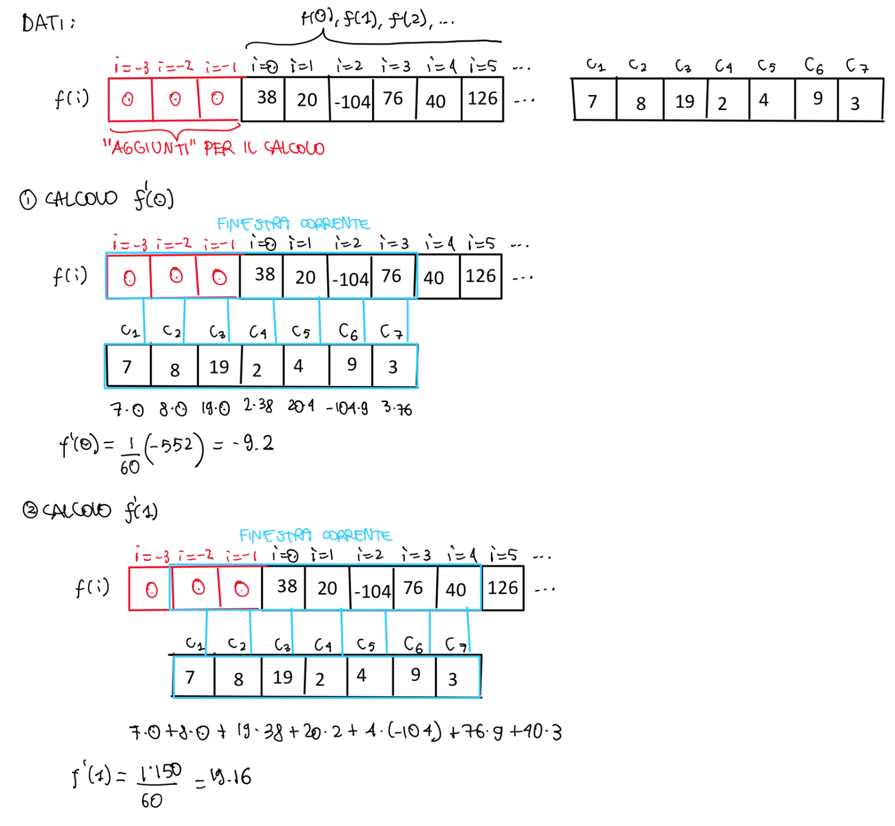
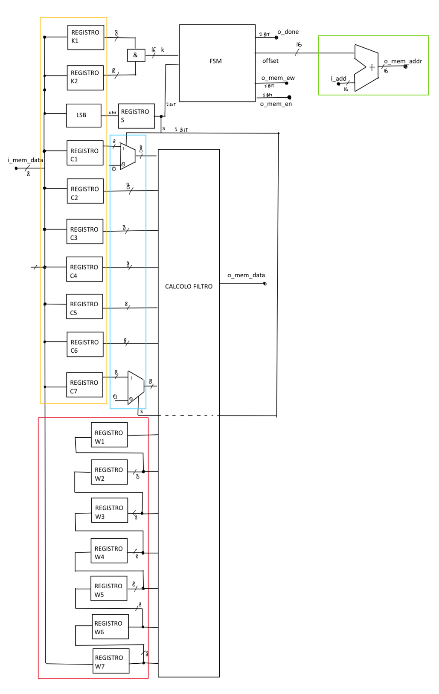
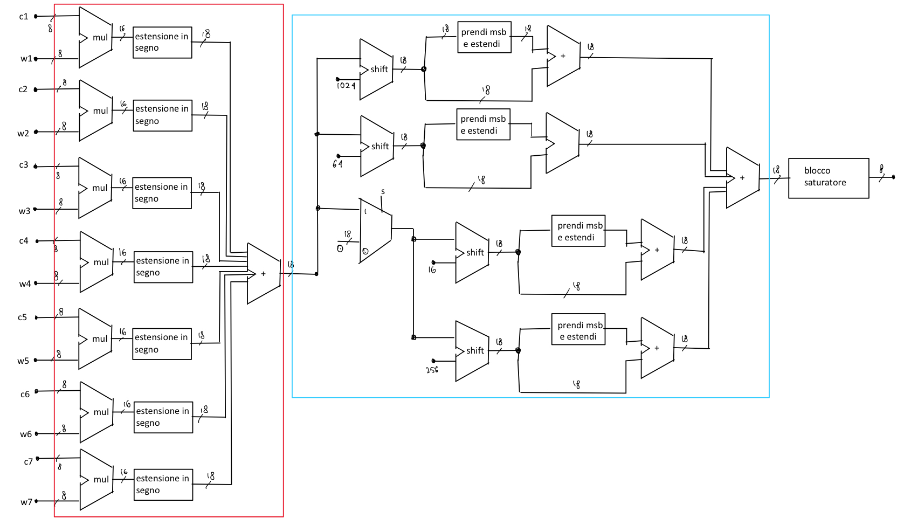
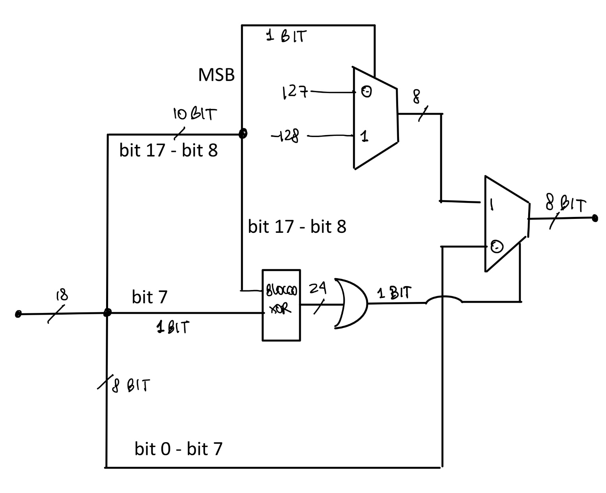
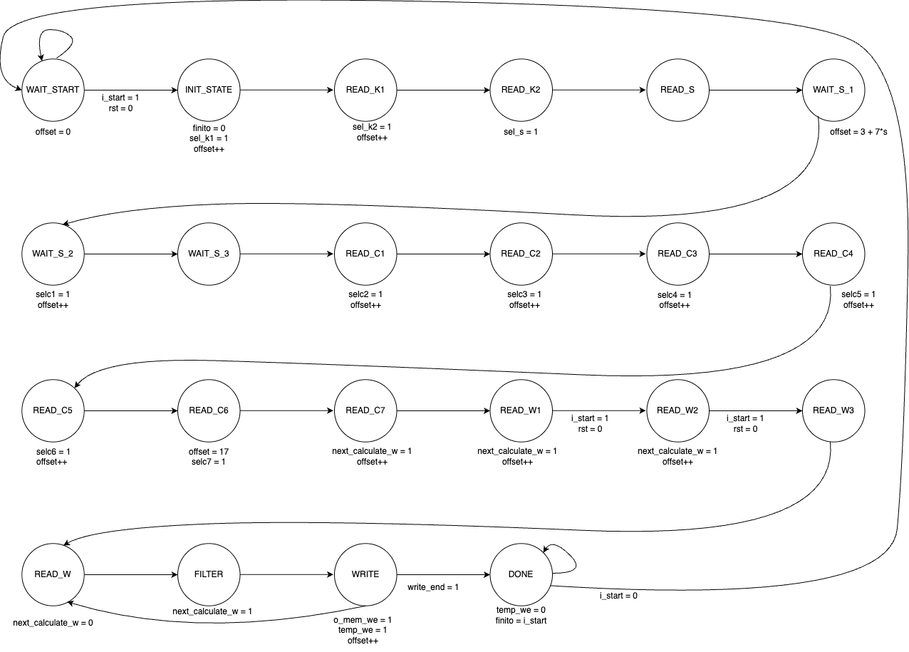
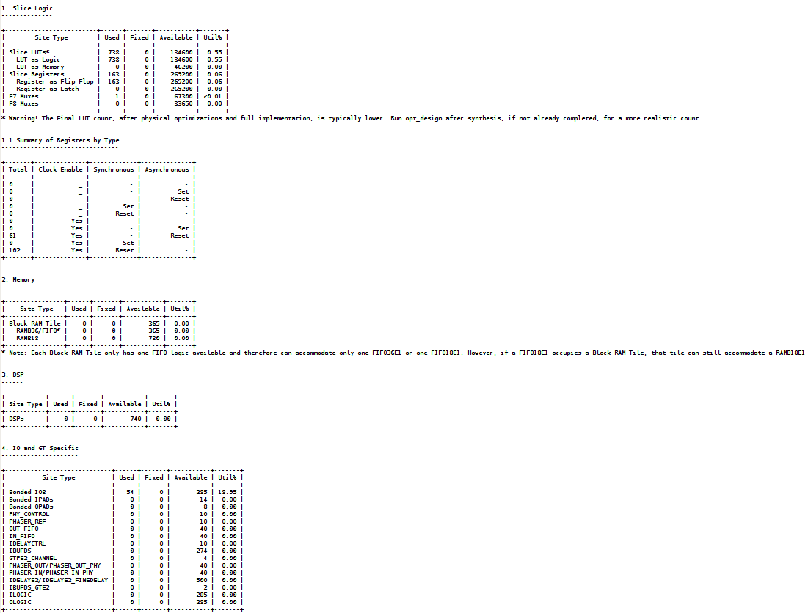
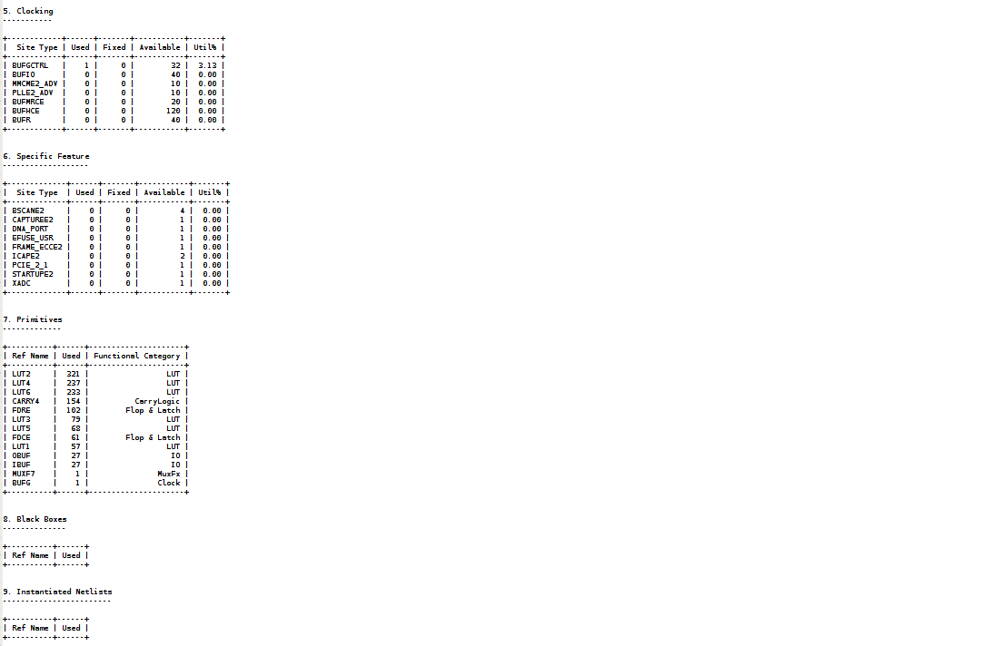
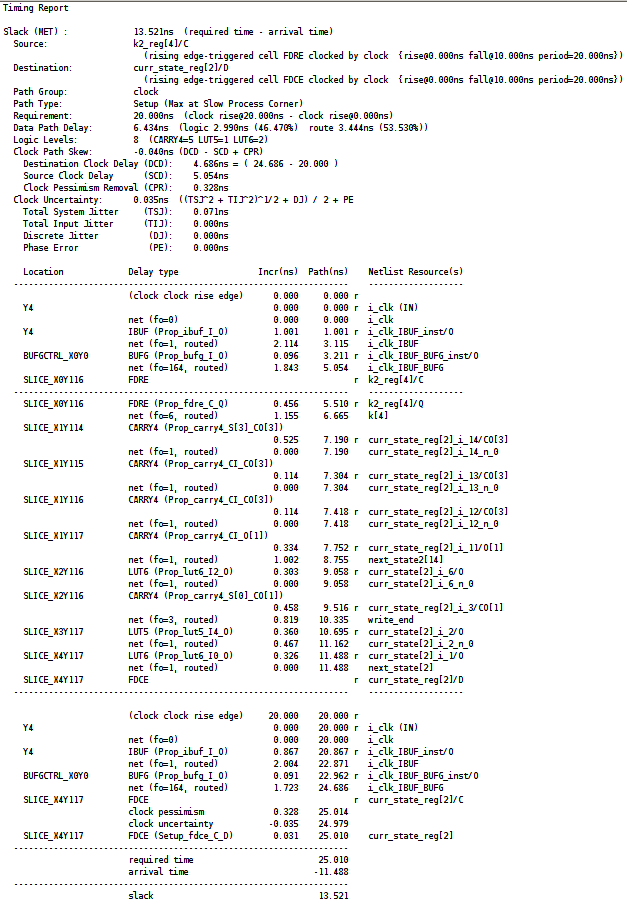

# FPGA Digital Filter in VHDL

A streaming digital filter in VHDL controlled by a FSM and interfacing with a single-port memory. 
- Conducted design, synthesis, simulation, and created testbenches. 
- Achieved 6.43 ns critical path.
- Synthesized and verified the design in Xilinx Vivado: 738 LUTs and 163 registers with no DSP/RAM blocks, meeting a 
20 ns clock constraint with 13.521 ns slack
- Developed and passed reset, saturation, and large-input testbenches.

[GitHub repository](https://github.com/renonesopocaj/vhdl-filter-fpga)

<!-- COMPLETE ORIGINAL REPORT -->

<h2 class='titleHead'>Logic Networks Project Report</h2>
 
Jacopo Senoner 10827820, Alessandro Tinaoui 10896741

 

<!-- l. 119 -->
The following project was carried out in pairs by the students Jacopo Senoner, student ID code 213230
and person code 10827820, and Alessandro Tinaoui, student ID code 214615 and person code
10896741.

<h3 class='likesectionHead' id='contents'>Contents</h3>

1 <a href='#introduction' id='QQ2-1-2'>Introduction</a>
 1.1 <a href='#brief-overview' id='QQ2-1-3'>Brief overview</a>
 1.2 <a href='#filter-operation' id='QQ2-1-4'>Filter operation</a>
 2 <a href='#architecture' id='QQ2-1-6'>Architecture</a>
 2.1 <a href='#initial-highlevel-schematic' id='QQ2-1-7'>Initial high-level schematic</a>
 2.2 <a href='#code-documentation' id='QQ2-1-13'>Code documentation</a>
 2.3 <a href='#state-machine' id='QQ2-1-14'>State machine</a>
 3 <a href='#experimental-results' id='QQ2-1-16'>Experimental results</a>
 3.1 <a href='#synthesis' id='QQ2-1-17'>Synthesis</a>
 3.1.1 <a href='#utilization-report' id='QQ2-1-18'>Utilization Report</a>
 3.1.2 <a href='#timing-report' id='QQ2-1-21'>Timing Report</a>
 3.2 <a href='#simulations' id='QQ2-1-23'>Simulations</a>
 3.2.1 <a href='#testbench-' id='QQ2-1-24'>Testbench 1 - 4</a>
 3.2.2 <a href='#testbench-mark' id='QQ2-1-25'>Testbench 5: Mark2</a>
 4 <a href='#conclusions' id='QQ2-1-26'>Conclusions</a>

<h3 class='sectionHead' id='introduction'>1    Introduction</h3>
<h4 class='subsectionHead' id='brief-overview'>1.1    Brief overview</h4>
<!-- l. 127 -->
We can rework the specification into 3 computation phases:

<dl class='enumerate-enumitem'><dt class='enumerate-enumitem'>
1.
</dt><dd class='enumerate-enumitem'>Reading, from memory, the coefficients used throughout the filter: we need to read <!-- l. 129 --><math display='inline' xmlns='http://www.w3.org/1998/Math/MathML'><mrow><mi>K</mi><mn>1</mn></mrow></math>,
<!-- l. 129 --><math display='inline' xmlns='http://www.w3.org/1998/Math/MathML'><mrow><mi>K</mi><mn>2</mn></mrow></math>,
<!-- l. 129 --><math display='inline' xmlns='http://www.w3.org/1998/Math/MathML'><mi>S</mi></math>,
<!-- l. 129 --><math display='inline' xmlns='http://www.w3.org/1998/Math/MathML'><mrow><mi>C</mi><mn>1</mn><mo class='MathClass-punc' stretchy='false'>,</mo><mi>…</mi><mo class='MathClass-punc' stretchy='false'>,</mo><mi>C</mi><mn>7</mn></mrow></math>,
which will remain constant for the entire computation.
</dd>
<dt class='enumerate-enumitem'>
2.
</dt><dd class='enumerate-enumitem'>Reading, from memory, the <!-- l. 130 --><math display='inline' xmlns='http://www.w3.org/1998/Math/MathML'><mrow><mi>f</mi><mo class='MathClass-open' stretchy='false'>(</mo><mi>i</mi><mo class='MathClass-close' stretchy='false'>)</mo></mrow></math>
for <!-- l. 130 --><math display='inline' xmlns='http://www.w3.org/1998/Math/MathML'><mrow><mi>i</mi> <mo class='MathClass-rel' stretchy='false'>∈</mo> <mo class='MathClass-open' stretchy='false'>[</mo><mn>1</mn><mo class='MathClass-punc' stretchy='false'>.</mo><mo class='MathClass-punc' stretchy='false'>.</mo><mi>k</mi><mo class='MathClass-close' stretchy='false'>]</mo><mo class='MathClass-punc' stretchy='false'>,</mo><mi>i</mi> <mo class='MathClass-punc' stretchy='false'>:</mo><mo class='MathClass-rel' stretchy='false'>=</mo> <mi>j</mi><mo class='MathClass-punc' stretchy='false'>,</mo><mi>…</mi><mo class='MathClass-punc' stretchy='false'>,</mo><mi>j</mi> <mo class='MathClass-bin' stretchy='false'>+</mo> <mn>6</mn></mrow></math>
for some appropriate <!-- l. 130 --><math display='inline' xmlns='http://www.w3.org/1998/Math/MathML'><mi>j</mi></math>
(in memory <!-- l. 130 --><math display='inline' xmlns='http://www.w3.org/1998/Math/MathML'><mrow><msub><mrow><mi>W</mi></mrow><mrow><mi>j</mi></mrow></msub><mo class='MathClass-punc' stretchy='false'>,</mo><mi>…</mi><mo class='MathClass-punc' stretchy='false'>,</mo><msub><mrow><mi>W</mi></mrow><mrow><mi>j</mi><mo class='MathClass-bin' stretchy='false'>+</mo><mn>6</mn></mrow></msub></mrow></math>),
which in principle should be re-read at every step (we will not do exactly this, but for now we gloss
over the implementation).
</dd>
<dt class='enumerate-enumitem'>
3.
</dt><dd class='enumerate-enumitem'>Given <!-- l. 131 --><math display='inline' xmlns='http://www.w3.org/1998/Math/MathML'><mrow><msub><mrow><mi>W</mi></mrow><mrow><mi>j</mi></mrow></msub><mo class='MathClass-punc' stretchy='false'>,</mo><mo class='MathClass-punc' stretchy='false'>.</mo><mo class='MathClass-punc' stretchy='false'>.</mo><mo class='MathClass-punc' stretchy='false'>.</mo><mo class='MathClass-punc' stretchy='false'>,</mo><msub><mrow><mi>W</mi></mrow><mrow><mi>j</mi><mo class='MathClass-bin' stretchy='false'>+</mo><mn>6</mn></mrow></msub></mrow></math>,
a sequence of <!-- l. 131 --><math display='inline' xmlns='http://www.w3.org/1998/Math/MathML'><mn>7</mn></math>
consecutive cells, we compute the filtered value and write it into the appropriate memory cell
<!-- l. 131 --><math display='inline' xmlns='http://www.w3.org/1998/Math/MathML'><mi>R</mi></math>.</dd></dl>
<!-- l. 134 -->
We also note that the memory has a single port, which means we will not be able to write and read
simultaneously.

<h4 class='subsectionHead' id='filter-operation'>1.2    Filter operation</h4>
<!-- l. 138 -->
For now, we analyze the filter simply as it was given to us, independently of the implementation.

<!-- l. 140 -->
We can immediately notice that it starts from <!-- l. 140 --><math display='inline' xmlns='http://www.w3.org/1998/Math/MathML'><msub><mrow><mi>W</mi></mrow><mrow><mn>1</mn></mrow></msub></math>
and scans, effectively implementing a sliding window. Being analogous in this sense to some well-known filters
(for example convolution in CNNs), it can be useful to view the filter similarly; therefore we can attribute to it a
stride of 1 and a padding that adds three dummy zeros to the left and three dummy zeros to the right of the
<!-- l. 140 --><math display='inline' xmlns='http://www.w3.org/1998/Math/MathML'><mi>W</mi></math>
vector.

<!-- l. 142 -->
Thus we can visualize the application of an example filter of order 5 as follows:

<figure class='figure'>
<!-- l. 146 -->
 

<figcaption class='caption'>Figure 1: Simulation of a filter computation.                                               </figcaption><!-- tex4ht:label?: x1-4001r1  -->
</figure>
<!-- l. 151 -->
Regarding normalization, we can observe instead that
<!-- l. 151 --><math display='inline' xmlns='http://www.w3.org/1998/Math/MathML'><mrow><mn>12</mn></mrow></math> (and
<!-- l. 151 --><math display='inline' xmlns='http://www.w3.org/1998/Math/MathML'><mrow><mn>60</mn></mrow></math>) have been approximated
with sums of powers of <!-- l. 151 --><math display='inline' xmlns='http://www.w3.org/1998/Math/MathML'><mn>2</mn></math>
in order to make division operations less computationally expensive. In particular, division by
<!-- l. 151 --><math display='inline' xmlns='http://www.w3.org/1998/Math/MathML'><mrow><mn>12</mn></mrow></math> (and by
<!-- l. 151 --><math display='inline' xmlns='http://www.w3.org/1998/Math/MathML'><mrow><mn>60</mn></mrow></math>) can
be reduced to a series of sums and shift operations, thanks to the distributive property of
addition over multiplication and to the fact that each division/multiplication by a power of
<!-- l. 151 --><math display='inline' xmlns='http://www.w3.org/1998/Math/MathML'><mn>2</mn></math> is a
right/left shift.

<h3 class='sectionHead' id='architecture'>2    Architecture</h3>
<!-- l. 164 -->
We start by presenting the initial high-level design phase, on paper, of the circuit, and then
continue by presenting the documentation of the final VHDL code and the final state
machine. An important note, to avoid confusion, is that the memory values denoted by
<!-- l. 165 --><math display='inline' xmlns='http://www.w3.org/1998/Math/MathML'><mi>W</mi></math>, which the filter takes as input,
are stored in registers called <!-- l. 165 --><math display='inline' xmlns='http://www.w3.org/1998/Math/MathML'><mi>T</mi></math>.
Therefore, during the computation of the filtered value associated with
<!-- l. 165 --><math display='inline' xmlns='http://www.w3.org/1998/Math/MathML'><msub><mrow><mi>W</mi></mrow><mrow><mi>j</mi></mrow></msub></math>, we will
have
<!-- tex4ht:inline -->
<!-- l. 165 --><math display='block' xmlns='http://www.w3.org/1998/Math/MathML'><mrow>
    <msub><mrow><mi>T</mi></mrow><mrow><mn>1</mn></mrow></msub> <mo class='MathClass-punc' stretchy='false'>:</mo><mo class='MathClass-rel' stretchy='false'>=</mo> <msub><mrow><mi>W</mi></mrow><mrow><mi>j</mi><mo class='MathClass-bin' stretchy='false'>−</mo><mn>3</mn></mrow></msub><mo class='MathClass-punc' stretchy='false'>,</mo><msub><mrow><mi>T</mi></mrow><mrow><mn>2</mn></mrow></msub> <mo class='MathClass-punc' stretchy='false'>:</mo><mo class='MathClass-rel' stretchy='false'>=</mo> <msub><mrow><mi>W</mi></mrow><mrow><mi>j</mi><mo class='MathClass-bin' stretchy='false'>−</mo><mn>2</mn></mrow></msub><mo class='MathClass-punc' stretchy='false'>,</mo><msub><mrow><mi>T</mi></mrow><mrow><mn>3</mn></mrow></msub> <mo class='MathClass-punc' stretchy='false'>:</mo><mo class='MathClass-rel' stretchy='false'>=</mo> <msub><mrow><mi>W</mi></mrow><mrow><mi>j</mi><mo class='MathClass-bin' stretchy='false'>−</mo><mn>1</mn></mrow></msub><mo class='MathClass-punc' stretchy='false'>,</mo><msub><mrow><mi>T</mi></mrow><mrow><mn>4</mn></mrow></msub> <mo class='MathClass-punc' stretchy='false'>:</mo><mo class='MathClass-rel' stretchy='false'>=</mo> <msub><mrow><mi>W</mi></mrow><mrow><mi>j</mi></mrow></msub><mo class='MathClass-punc' stretchy='false'>,</mo><msub><mrow><mi>T</mi></mrow><mrow><mn>5</mn></mrow></msub> <mo class='MathClass-punc' stretchy='false'>:</mo><mo class='MathClass-rel' stretchy='false'>=</mo> <msub><mrow><mi>W</mi></mrow><mrow><mi>j</mi><mo class='MathClass-bin' stretchy='false'>+</mo><mn>1</mn></mrow></msub><mo class='MathClass-punc' stretchy='false'>,</mo><msub><mrow><mi>T</mi></mrow><mrow><mn>6</mn></mrow></msub> <mo class='MathClass-punc' stretchy='false'>:</mo><mo class='MathClass-rel' stretchy='false'>=</mo> <msub><mrow><mi>W</mi></mrow><mrow><mi>j</mi><mo class='MathClass-bin' stretchy='false'>+</mo><mn>2</mn></mrow></msub><mo class='MathClass-punc' stretchy='false'>,</mo><msub><mrow><mi>T</mi></mrow><mrow><mn>7</mn></mrow></msub> <mo class='MathClass-punc' stretchy='false'>:</mo><mo class='MathClass-rel' stretchy='false'>=</mo> <msub><mrow><mi>W</mi></mrow><mrow><mi>j</mi><mo class='MathClass-bin' stretchy='false'>+</mo><mn>3</mn></mrow></msub>
</mrow></math>
<!-- l. 165 -->

<h4 class='subsectionHead' id='initial-highlevel-schematic'>2.1    Initial high-level schematic</h4>
<h5 class='likesubsubsectionHead' id='overview'>Overview</h5>
<!-- l. 171 -->
The schematic (Figure <a href='#highlevel-schematic-circuit-of-the-project-note-that-the-names-on-registers-ww-should-actually-be-tt-consistently-with-the-distinction-already-explained'>2<!-- tex4ht:ref: fig:circuitopanoramica  --></a>) is reported here with the following notes: 

<ul class='itemize1'>
<li class='itemize'>the memory is omitted.
</li>
<li class='itemize'>the enable signals for writing into the registers are omitted, which are controlled (and thus would
“come out”) from the FSM.
</li>
<li class='itemize'>reset, clock, start signals are omitted.
</li>
<li class='itemize'>the filter computation part is entirely combinational and is reported in full below.
</li>
<li class='itemize'>each signal has the appropriate number of bits.</li></ul>
<!-- l. 179 -->
Moreover: 

<ul class='itemize1'>
<li class='itemize'>yellow part: reading the coefficients that remain constant during computation.
</li>
<li class='itemize'>red part: reading from memory, writing into <!-- l. 182 --><math display='inline' xmlns='http://www.w3.org/1998/Math/MathML'><msub><mrow><mi>T</mi></mrow><mrow><mn>7</mn></mrow></msub></math>
and “sliding the window”, i.e., <!-- l. 182 --><math display='inline' xmlns='http://www.w3.org/1998/Math/MathML'><mrow><msub><mrow><mi>T</mi></mrow><mrow><mn>1</mn></mrow></msub> <mo class='MathClass-punc' stretchy='false'>:</mo><mo class='MathClass-rel' stretchy='false'>=</mo> <msub><mrow><mi>T</mi></mrow><mrow><mn>2</mn></mrow></msub><mo class='MathClass-punc' stretchy='false'>,</mo><msub><mrow><mi>T</mi></mrow><mrow><mn>2</mn></mrow></msub> <mo class='MathClass-punc' stretchy='false'>:</mo><mo class='MathClass-rel' stretchy='false'>=</mo> <msub><mrow><mi>T</mi></mrow><mrow><mn>3</mn></mrow></msub><mo class='MathClass-punc' stretchy='false'>,</mo><mi>…</mi><mo class='MathClass-punc' stretchy='false'>,</mo><msub><mrow><mi>T</mi></mrow><mrow><mn>6</mn></mrow></msub> <mo class='MathClass-punc' stretchy='false'>:</mo><mo class='MathClass-rel' stretchy='false'>=</mo> <msub><mrow><mi>T</mi></mrow><mrow><mn>7</mn></mrow></msub><mo class='MathClass-punc' stretchy='false'>,</mo><msub><mrow><mi>T</mi></mrow><mrow><mn>7</mn></mrow></msub> <mo class='MathClass-punc' stretchy='false'>:</mo><mo class='MathClass-rel' stretchy='false'>=</mo> <mstyle class='text'><mtext>&lt;new value read from memory&gt;</mtext></mstyle></mrow></math>
 <a href='#scorrimentofinestra'>We will refer to this procedure as (1)</a>.
</li>
<li class='itemize'>light-blue part: zeroing coefficients <!-- l. 183 --><math display='inline' xmlns='http://www.w3.org/1998/Math/MathML'><mrow><msub><mrow><mi>C</mi></mrow><mrow><mn>1</mn></mrow></msub><mo class='MathClass-punc' stretchy='false'>,</mo><msub><mrow><mi>C</mi></mrow><mrow><mn>7</mn></mrow></msub></mrow></math>
in the case of an order-3 filter thanks to a mux whose selection signal is the LSB of <!-- l. 183 --><math display='inline' xmlns='http://www.w3.org/1998/Math/MathML'><mi>S</mi></math>.
</li>
<li class='itemize'>green part: adding the offset (computed by the FSM) to the <!-- l. 184 --><math display='inline' xmlns='http://www.w3.org/1998/Math/MathML'><mstyle mathvariant='normal'><mi>ADD</mi></mstyle></math>
address, to obtain the final write or read address.
</li>
<li class='itemize'>Filter computation: entirely combinational part, see below.
</li>
<li class='itemize'>FSM: state machine that controls the signals for writing into the registers and the offset signal.</li></ul>
<figure class='figure' id='x1-7001r2'>
 
<figcaption class='caption'>Figure 2:   High-level   schematic   circuit   of   the   project.   Note   that   the   names   on   registers
<!-- l. 191 --><math display='inline' xmlns='http://www.w3.org/1998/Math/MathML'><mrow><msub><mrow><mi>W</mi></mrow><mrow><mn>1</mn></mrow></msub> <mo class='MathClass-bin' stretchy='false'>−</mo> <msub><mrow><mi>W</mi></mrow><mrow><mn>7</mn></mrow></msub></mrow></math>
should actually be <!-- l. 191 --><math display='inline' xmlns='http://www.w3.org/1998/Math/MathML'><mrow><msub><mrow><mi>T</mi></mrow><mrow><mn>1</mn></mrow></msub> <mo class='MathClass-bin' stretchy='false'>−</mo> <msub><mrow><mi>T</mi></mrow><mrow><mn>7</mn></mrow></msub></mrow></math>,
consistently with the distinction already explained.                                           </figcaption><!-- tex4ht:label?: x1-7001r2  -->
</figure>
<!-- l. 195 -->

<h5 class='likesubsubsectionHead' id='combinational-part-for-filter-computation'>Combinational part for filter computation</h5>

<!-- l. 198 -->

The combinational part for computing the filtered value is shown here in detail (Figure <a href='#schematic-circuit-of-the-filter-computation-part-note-that-the-names-on-registers-ww-should-actually-be-tt-consistently-with-the-distinction-already-explained'>3<!-- tex4ht:ref: fig:filtrodettagliato  --></a>): it is a fairly direct
implementation of the mathematical expression of the filter. There are some things to observe, due to the fact that we
only write into <!-- l. 198 --><math display='inline' xmlns='http://www.w3.org/1998/Math/MathML'><msub><mrow><mi>T</mi></mrow><mrow><mn>7</mn></mrow></msub></math>:

<dl class='enumerate-enumitem'><dt class='enumerate-enumitem'>
1.
</dt><dd class='enumerate-enumitem'>for the first 3 computations to work starting from <!-- l. 200 --><math display='inline' xmlns='http://www.w3.org/1998/Math/MathML'><msub><mrow><mi>W</mi></mrow><mrow><mn>1</mn></mrow></msub></math>,
“dummy zeros” would need to be added to the left of <!-- l. 200 --><math display='inline' xmlns='http://www.w3.org/1998/Math/MathML'><msub><mrow><mi>W</mi></mrow><mrow><mn>1</mn></mrow></msub></math>.
This is implemented as follows: three times, zeros are assigned to <!-- l. 200 --><math display='inline' xmlns='http://www.w3.org/1998/Math/MathML'><msub><mrow><mi>T</mi></mrow><mrow><mn>7</mn></mrow></msub></math>,
and then the assignment of the actual values <!-- l. 200 --><math display='inline' xmlns='http://www.w3.org/1998/Math/MathML'><msub><mrow><mi>W</mi></mrow><mrow><mn>1</mn></mrow></msub></math>
to <!-- l. 200 --><math display='inline' xmlns='http://www.w3.org/1998/Math/MathML'><msub><mrow><mi>T</mi></mrow><mrow><mn>7</mn></mrow></msub></math>
begins. When the first zero reaches <!-- l. 200 --><math display='inline' xmlns='http://www.w3.org/1998/Math/MathML'><msub><mrow><mi>T</mi></mrow><mrow><mn>1</mn></mrow></msub></math>,
the effective computation can begin, with <!-- l. 200 --><math display='inline' xmlns='http://www.w3.org/1998/Math/MathML'><msub><mrow><mi>T</mi></mrow><mrow><mn>4</mn></mrow></msub></math>
containing <!-- l. 200 --><math display='inline' xmlns='http://www.w3.org/1998/Math/MathML'><msub><mrow><mi>W</mi></mrow><mrow><mn>1</mn></mrow></msub></math>.
</dd>
<dt class='enumerate-enumitem'>
2.
</dt><dd class='enumerate-enumitem'>After the first phase, each time the new value read is associated to <!-- l. 201 --><math display='inline' xmlns='http://www.w3.org/1998/Math/MathML'><msub><mrow><mi>T</mi></mrow><mrow><mn>7</mn></mrow></msub></math>
and the window slides in the already indicated way <a href='#scorrimentofinestra'>here (1)</a>.
</dd>
<dt class='enumerate-enumitem'>
3.
</dt><dd class='enumerate-enumitem'>After assigning <!-- l. 202 --><math display='inline' xmlns='http://www.w3.org/1998/Math/MathML'><msub><mrow><mi>W</mi></mrow><mrow><mi>k</mi></mrow></msub></math>
to <!-- l. 202 --><math display='inline' xmlns='http://www.w3.org/1998/Math/MathML'><msub><mrow><mi>T</mi></mrow><mrow><mn>7</mn></mrow></msub></math>,
three “dummy zeros” are assigned, one at each computation, to <!-- l. 202 --><math display='inline' xmlns='http://www.w3.org/1998/Math/MathML'><msub><mrow><mi>T</mi></mrow><mrow><mn>7</mn></mrow></msub></math>
until reaching the computation of <!-- l. 202 --><math display='inline' xmlns='http://www.w3.org/1998/Math/MathML'><msub><mrow><mi>W</mi></mrow><mrow><mi>k</mi></mrow></msub></math>.
<a href='#zerofillend'>We will refer to this procedure as (2)</a>.</dd></dl>
<!-- l. 204 -->
Moreover, we distinguish the following “zones”: 

<ul class='itemize1'>
<li class='itemize'>multiplication (in red): to compute each <!-- l. 206 --><math display='inline' xmlns='http://www.w3.org/1998/Math/MathML'><mrow><msub><mrow><mi>T</mi></mrow><mrow><mi>i</mi></mrow></msub> <mo class='MathClass-bin' stretchy='false'>⋅</mo> <msub><mrow><mi>C</mi></mrow><mrow><mi>i</mi></mrow></msub></mrow></math>.
Here the zeroing of coefficients <!-- l. 206 --><math display='inline' xmlns='http://www.w3.org/1998/Math/MathML'><mrow><msub><mrow><mi>C</mi></mrow><mrow><mn>1</mn></mrow></msub><mo class='MathClass-punc' stretchy='false'>,</mo><msub><mrow><mi>C</mi></mrow><mrow><mn>7</mn></mrow></msub></mrow></math>
occurs in the case of an order-3 filter with a mux whose selection signal is the LSB of <!-- l. 206 --><math display='inline' xmlns='http://www.w3.org/1998/Math/MathML'><mi>S</mi></math>,
as described earlier.
</li>
<li class='itemize'>Sum (in red) of each <!-- l. 207 --><math display='inline' xmlns='http://www.w3.org/1998/Math/MathML'><mrow><msub><mrow><mi>T</mi></mrow><mrow><mi>i</mi></mrow></msub> <mo class='MathClass-bin' stretchy='false'>⋅</mo> <msub><mrow><mi>C</mi></mrow><mrow><mi>i</mi></mrow></msub></mrow></math>,
i.e., <!-- l. 207 --><math display='inline' xmlns='http://www.w3.org/1998/Math/MathML'><mrow><msubsup><mrow><mi class='MathClass-op'>∑</mi><mo> ⁡<!-- FUNCTION APPLICATION --></mo>
  <!-- nolimits --></mrow><mrow><mi>i</mi><mo class='MathClass-rel' stretchy='false'>=</mo><mn>1</mn></mrow><mrow><mn>7</mn></mrow></msubsup><msub><mrow><mi>T</mi></mrow><mrow><mi>i</mi></mrow></msub> <mo class='MathClass-bin' stretchy='false'>⋅</mo> <msub><mrow><mi>C</mi></mrow><mrow><mi>i</mi></mrow></msub></mrow></math>.
</li>
<li class='itemize'>Division by the approximated normalized value (in light blue), with possible addition of the <!-- l. 208 --><math display='inline' xmlns='http://www.w3.org/1998/Math/MathML'><mrow> <mo class='MathClass-bin' stretchy='false'>+</mo> <mn>1</mn></mrow></math>
contribution due to the rounding error introduced by shifting.
</li>
<li class='itemize'>Saturation to <!-- l. 209 --><math display='inline' xmlns='http://www.w3.org/1998/Math/MathML'><mrow> <mo class='MathClass-bin' stretchy='false'>+</mo> <mn>127</mn></mrow></math>
and <!-- l. 209 --><math display='inline' xmlns='http://www.w3.org/1998/Math/MathML'><mrow> <mo class='MathClass-bin' stretchy='false'>−</mo> <mn>128</mn></mrow></math>.</li></ul>
<figure class='figure'>
<!-- l. 216 -->
 

<figcaption class='caption'>Figure 3:  Schematic  circuit  of  the  filter  computation  part.  Note  that  the  names  on  registers
<!-- l. 217 --><math display='inline' xmlns='http://www.w3.org/1998/Math/MathML'><mrow><msub><mrow><mi>W</mi></mrow><mrow><mn>1</mn></mrow></msub> <mo class='MathClass-bin' stretchy='false'>−</mo> <msub><mrow><mi>W</mi></mrow><mrow><mn>7</mn></mrow></msub></mrow></math>
should actually be <!-- l. 217 --><math display='inline' xmlns='http://www.w3.org/1998/Math/MathML'><mrow><msub><mrow><mi>T</mi></mrow><mrow><mn>1</mn></mrow></msub> <mo class='MathClass-bin' stretchy='false'>−</mo> <msub><mrow><mi>T</mi></mrow><mrow><mn>7</mn></mrow></msub></mrow></math>,
consistently with the distinction already explained.                                           </figcaption><!-- tex4ht:label?: x1-8004r3  -->
</figure>
<!-- l. 221 -->
The saturator block, whose detailed schematic is in Figure <a href='#schematic-circuit-of-the-saturation-part-in-the-figure-there-is-a-small-error-the-signal-leaving-the-xor-block-is-bits-as-described-above-not-'>4<!-- tex4ht:ref: fig:saturazione  --></a>, takes the 18-bit signal resulting from the previous operations
(hereafter called <!-- l. 221 --><math display='inline' xmlns='http://www.w3.org/1998/Math/MathML'><mstyle mathvariant='normal'><mi>in</mi></mstyle></math>)
and returns an 8-bit saturated one, as follows:

<dl class='enumerate-enumitem'><dt class='enumerate-enumitem'>
1.
</dt><dd class='enumerate-enumitem'>compute <!-- l. 223 --><math display='inline' xmlns='http://www.w3.org/1998/Math/MathML'><mrow><msub><mrow><mi>x</mi></mrow><mrow><mi>i</mi></mrow></msub> <mo class='MathClass-rel' stretchy='false'>=</mo> <mstyle mathvariant='normal'><mi>in</mi></mstyle><mo class='MathClass-open' stretchy='false'>[</mo><mn>7</mn><mo class='MathClass-close' stretchy='false'>]</mo> <mo class='MathClass-bin' stretchy='false'>⊕</mo><mstyle mathvariant='normal'><mi>in</mi></mstyle><mo class='MathClass-open' stretchy='false'>[</mo><mi>i</mi><mo class='MathClass-close' stretchy='false'>]</mo></mrow></math>
for <!-- l. 223 --><math display='inline' xmlns='http://www.w3.org/1998/Math/MathML'><mrow><mi>i</mi> <mo class='MathClass-rel' stretchy='false'>∈</mo><mo class='MathClass-open' stretchy='false'>{</mo><mn>8</mn><mo class='MathClass-punc' stretchy='false'>,</mo><mo>…</mo><mo class='MathClass-punc' stretchy='false'>,</mo><mn>17</mn><mo class='MathClass-close' stretchy='false'>}</mo></mrow></math>
(10 2-bit XORs).
</dd>
<dt class='enumerate-enumitem'>
2.
</dt><dd class='enumerate-enumitem'><!-- l. 224 --><math display='inline' xmlns='http://www.w3.org/1998/Math/MathML'><mrow><mstyle mathvariant='normal'><mi>overflow</mi></mstyle> <mo class='MathClass-rel' stretchy='false'>=</mo><msubsup><mrow> <mi class='MathClass-op'>∨</mi><mo> ⁡<!-- FUNCTION APPLICATION --></mo>
  <!-- nolimits --></mrow><mrow><mi>i</mi><mo class='MathClass-rel' stretchy='false'>=</mo><mn>8</mn></mrow><mrow><mn>17</mn></mrow></msubsup><msub><mrow><mi>x</mi></mrow><mrow><mi>i</mi></mrow></msub></mrow></math>
(10-bit OR).
</dd>
<dt class='enumerate-enumitem'>
3.
</dt><dd class='enumerate-enumitem'><!-- l. 225 --><math display='inline' xmlns='http://www.w3.org/1998/Math/MathML'><mrow><mstyle mathvariant='normal'><mi>out</mi></mstyle> <mo class='MathClass-rel' stretchy='false'>=</mo> <mrow class='cases'> <mrow><mo fence='true' form='prefix'>{</mo><mrow> <mtable align='axis' class='array' columnlines='none' displaystyle='true' equalcolumns='false' equalrows='false' rowlines='' style=''> <mtr class='array-row'><mtd class='array-td' columnalign='left'><mstyle mathvariant='normal'><mi>unsat</mi></mstyle><mo class='MathClass-punc' stretchy='false'>,</mo><mspace class='quad' width='1em'></mspace></mtd>
        <mtd class='array-td' columnalign='left'><mstyle class='text'><mtext>if </mtext></mstyle><mi class='MathClass-op'>¬</mi><mo> ⁡<!-- FUNCTION APPLICATION --></mo><mspace class='thinspace' width='0.17em'></mspace><mstyle mathvariant='normal'><mi>overflow</mi></mstyle></mtd>
</mtr>  <mtr class='array-row'><mtd class='array-td' columnalign='left'><mstyle mathvariant='normal'><mi>sat</mi></mstyle><mo class='MathClass-punc' stretchy='false'>,</mo>   <mspace class='quad' width='1em'></mspace></mtd><mtd class='array-td' columnalign='left'><mstyle class='text'><mtext>if </mtext></mstyle><mstyle mathvariant='normal'><mi>overflow</mi></mstyle>  </mtd></mtr>
<!-- @{}l@{\quad }l@{} --></mtable>                                                                                                                                   </mrow><mo fence='true' form='postfix'></mo></mrow></mrow></mrow></math>
(MUX with selection <!-- l. 228 --><math display='inline' xmlns='http://www.w3.org/1998/Math/MathML'><mstyle mathvariant='normal'><mi>overflow</mi></mstyle></math>).
</dd>
<dt class='enumerate-enumitem'>
4.
</dt><dd class='enumerate-enumitem'><!-- l. 229 --><math display='inline' xmlns='http://www.w3.org/1998/Math/MathML'><mrow><mstyle mathvariant='normal'><mi>sat</mi></mstyle> <mo class='MathClass-rel' stretchy='false'>=</mo> <mrow class='cases'> <mrow><mo fence='true' form='prefix'>{</mo><mrow> <mtable align='axis' class='array' columnlines='none' displaystyle='true' equalcolumns='false' equalrows='false' rowlines='' style=''> <mtr class='array-row'><mtd class='array-td' columnalign='left'><mn>127</mn><mo class='MathClass-punc' stretchy='false'>,</mo>  <mspace class='quad' width='1em'></mspace></mtd>
        <mtd class='array-td' columnalign='left'><mstyle class='text'><mtext>if </mtext></mstyle><mstyle mathvariant='normal'><mi>in</mi></mstyle><mo class='MathClass-open' stretchy='false'>[</mo><mn>17</mn><mo class='MathClass-close' stretchy='false'>]</mo> <mo class='MathClass-rel' stretchy='false'>=</mo> <mn>0</mn></mtd>
</mtr>  <mtr class='array-row'><mtd class='array-td' columnalign='left'><mo class='MathClass-bin' stretchy='false'>−</mo><mn>128</mn><mo class='MathClass-punc' stretchy='false'>,</mo><mspace class='quad' width='1em'></mspace></mtd><mtd class='array-td' columnalign='left'><mstyle class='text'><mtext>if </mtext></mstyle><mstyle mathvariant='normal'><mi>in</mi></mstyle><mo class='MathClass-open' stretchy='false'>[</mo><mn>17</mn><mo class='MathClass-close' stretchy='false'>]</mo> <mo class='MathClass-rel' stretchy='false'>=</mo> <mn>1</mn></mtd></mtr>
<!-- @{}l@{\quad }l@{} --></mtable>                                                                                                                                   </mrow><mo fence='true' form='postfix'></mo></mrow></mrow></mrow></math>
(MUX with selection <!-- l. 232 --><math display='inline' xmlns='http://www.w3.org/1998/Math/MathML'><mrow><mstyle mathvariant='normal'><mi>in</mi></mstyle><mo class='MathClass-open' stretchy='false'>[</mo><mn>17</mn><mo class='MathClass-close' stretchy='false'>]</mo></mrow></math>).
</dd>
<dt class='enumerate-enumitem'>
5.
</dt><dd class='enumerate-enumitem'><!-- l. 233 --><math display='inline' xmlns='http://www.w3.org/1998/Math/MathML'><mrow><mstyle mathvariant='normal'><mi>unsat</mi></mstyle> <mo class='MathClass-rel' stretchy='false'>=</mo> <mstyle mathvariant='normal'><mi>in</mi></mstyle><mo class='MathClass-open' stretchy='false'>[</mo><mn>7</mn> <mo class='MathClass-punc' stretchy='false'>:</mo> <mn>0</mn><mo class='MathClass-close' stretchy='false'>]</mo></mrow></math>
(take bits <!-- l. 233 --><math display='inline' xmlns='http://www.w3.org/1998/Math/MathML'><mrow><mn>0</mn> <mo class='MathClass-bin' stretchy='false'>−</mo> <mn>7</mn></mrow></math>
of the input).</dd></dl>
<figure class='figure'>
<!-- l. 240 -->
 

<figcaption class='caption'>Figure 4: Schematic circuit of the saturation part. In the figure there is a small error: the signal leaving
the XOR block is 10 bits as described above, not 24.                                         </figcaption><!-- tex4ht:label?: x1-8010r4  -->
</figure>
<h4 class='subsectionHead' id='code-documentation'>2.2    Code documentation</h4>
<!-- l. 247 -->
Regarding the FSM, its detailed operation will be described below (Section <a href='#state-machine'>2.3<!-- tex4ht:ref: sec:fsmgrafo  --></a>), but we have three
processes:

<ul class='itemize1'>
<li class='itemize'>The function <!-- l. 250 --><math display='inline' xmlns='http://www.w3.org/1998/Math/MathML'><mstyle mathvariant='normal'><mi>fsm</mi><mstyle class='text'><mtext>_</mtext></mstyle><mi>state</mi><mstyle class='text'><mtext>_</mtext></mstyle><mi>reg</mi></mstyle></math>,
which implements the register encapsulating the state.
</li>
<li class='itemize'>The function <!-- l. 251 --><math display='inline' xmlns='http://www.w3.org/1998/Math/MathML'><mi>δ</mi></math>
(<!-- l. 251 --><math display='inline' xmlns='http://www.w3.org/1998/Math/MathML'><mstyle mathvariant='normal'><mi>fsm</mi><mstyle class='text'><mtext>_</mtext></mstyle><mi>delta</mi></mstyle></math>),
which defines the FSM state transitions.
</li>
<li class='itemize'>The function <!-- l. 252 --><math display='inline' xmlns='http://www.w3.org/1998/Math/MathML'><mi>λ</mi></math>
(<!-- l. 252 --><math display='inline' xmlns='http://www.w3.org/1998/Math/MathML'><mstyle mathvariant='normal'><mi>fsm</mi><mstyle class='text'><mtext>_</mtext></mstyle><mi>lambda</mi></mstyle></math>),
which defines the signals we want to be controlled by the FSM, e.g., the enable signals of the
registers and the writing of the new value into <!-- l. 252 --><math display='inline' xmlns='http://www.w3.org/1998/Math/MathML'><msub><mrow><mi>T</mi></mrow><mrow><mn>7</mn></mrow></msub></math>
to obtain the new window with which to compute.</li></ul>
<!-- l. 255 -->
Moreover, we have an additional process <!-- l. 255 --><math display='inline' xmlns='http://www.w3.org/1998/Math/MathML'><mstyle mathvariant='normal'><mi>read</mi><mstyle class='text'><mtext>_</mtext></mstyle><mi>t</mi><mn>7</mn></mstyle></math>
that implements registers <!-- l. 255 --><math display='inline' xmlns='http://www.w3.org/1998/Math/MathML'><mrow><msub><mrow><mi>T</mi></mrow><mrow><mn>1</mn></mrow></msub><mo class='MathClass-punc' stretchy='false'>,</mo><mi>…</mi><mo class='MathClass-punc' stretchy='false'>,</mo><msub><mrow><mi>T</mi></mrow><mrow><mn>7</mn></mrow></msub></mrow></math>
by sliding the window, thus updating them correctly as described previously <a href='#scorrimentofinestra'>(1)</a>.

<!-- l. 257 -->
In dataflow we implemented: 

<ul class='itemize1'>
<li class='itemize'><!-- l. 259 --><math display='inline' xmlns='http://www.w3.org/1998/Math/MathML'><mstyle mathvariant='normal'><mi>o</mi><mstyle class='text'><mtext>_</mtext></mstyle><mi>done</mi></mstyle></math>,
which is set equal to <!-- l. 259 --><math display='inline' xmlns='http://www.w3.org/1998/Math/MathML'><mstyle mathvariant='normal'><mi>i</mi><mstyle class='text'><mtext>_</mtext></mstyle><mi>start AND finito</mi></mstyle></math>,
where <!-- l. 259 --><math display='inline' xmlns='http://www.w3.org/1998/Math/MathML'><mstyle mathvariant='normal'><mi>finito</mi></mstyle></math>
indicates the end of computing the <!-- l. 259 --><math display='inline' xmlns='http://www.w3.org/1998/Math/MathML'><mrow><msup><mrow><mi>f</mi></mrow><mrow><mi>′</mi></mrow></msup><mo class='MathClass-open' stretchy='false'>(</mo><mi>i</mi><mo class='MathClass-close' stretchy='false'>)</mo></mrow></math>
values: thus it can be equal to 1 iff I have finished the computation and <!-- l. 259 --><math display='inline' xmlns='http://www.w3.org/1998/Math/MathML'><mstyle mathvariant='normal'><mi>i</mi><mstyle class='text'><mtext>_</mtext></mstyle><mi>start</mi></mstyle></math>
is still 1.
</li>
<li class='itemize'><!-- l. 260 --><math display='inline' xmlns='http://www.w3.org/1998/Math/MathML'><mstyle mathvariant='normal'><mi>zero</mi><mstyle class='text'><mtext>_</mtext></mstyle><mi>fill</mi><mstyle class='text'><mtext>_</mtext></mstyle><mi>end</mi></mstyle></math>,
which is a signal used to determine when to start filling <!-- l. 260 --><math display='inline' xmlns='http://www.w3.org/1998/Math/MathML'><msub><mrow><mi>T</mi></mrow><mrow><mn>7</mn></mrow></msub></math>
with zeros, according to the procedure described in <a href='#zerofillend'>(2)</a>.
</li>
<li class='itemize'><!-- l. 261 --><math display='inline' xmlns='http://www.w3.org/1998/Math/MathML'><mstyle mathvariant='normal'><mi>o</mi><mstyle class='text'><mtext>_</mtext></mstyle><mi>mem</mi><mstyle class='text'><mtext>_</mtext></mstyle><mi>addr</mi></mstyle></math>,
which is chosen between a) <!-- l. 261 --><math display='inline' xmlns='http://www.w3.org/1998/Math/MathML'><mstyle mathvariant='normal'><mi>i</mi><mstyle class='text'><mtext>_</mtext></mstyle><mi>data</mi></mstyle></math>
+ <!-- l. 261 --><math display='inline' xmlns='http://www.w3.org/1998/Math/MathML'><mstyle mathvariant='normal'><mi>offset</mi></mstyle></math>
when in the read phase, b) <!-- l. 261 --><math display='inline' xmlns='http://www.w3.org/1998/Math/MathML'><mstyle mathvariant='normal'><mi>i</mi><mstyle class='text'><mtext>_</mtext></mstyle><mi>data</mi></mstyle></math>
+ <!-- l. 261 --><math display='inline' xmlns='http://www.w3.org/1998/Math/MathML'><mstyle mathvariant='normal'><mi>offset</mi></mstyle></math>
+ <!-- l. 261 --><math display='inline' xmlns='http://www.w3.org/1998/Math/MathML'><mstyle mathvariant='normal'><mi>k</mi></mstyle></math>
when in the write phase, “jumping” from the <!-- l. 261 --><math display='inline' xmlns='http://www.w3.org/1998/Math/MathML'><mi>W</mi></math>
memory cells to the <!-- l. 261 --><math display='inline' xmlns='http://www.w3.org/1998/Math/MathML'><mi>R</mi></math>
memory cells. The signal that handles the selection is <!-- l. 261 --><math display='inline' xmlns='http://www.w3.org/1998/Math/MathML'><mstyle mathvariant='normal'><mi>temp</mi><mstyle class='text'><mtext>_</mtext></mstyle><mi>we</mi></mstyle></math>.
</li>
<li class='itemize'><!-- l. 262 --><math display='inline' xmlns='http://www.w3.org/1998/Math/MathML'><mstyle mathvariant='normal'><mi>k</mi></mstyle></math>
is obtained by concatenating <!-- l. 262 --><math display='inline' xmlns='http://www.w3.org/1998/Math/MathML'><mstyle mathvariant='normal'><mi>k</mi><mn>1</mn></mstyle></math>
and <!-- l. 262 --><math display='inline' xmlns='http://www.w3.org/1998/Math/MathML'><mstyle mathvariant='normal'><mi>k</mi><mn>2</mn></mstyle></math>.
</li>
<li class='itemize'>The combinational part computing the filtered value.</li></ul>
<!-- l. 266 -->
The combinational part is analogous to the one described in Section <a href='#x1-8000doc'>2.1<!-- tex4ht:ref: sec:combinatoria  --></a>, so we do not comment on it in particular,
except noting that it is in dataflow and easily identifiable by a comment in the code. For greater readability and code
simplicity, unlike what was described in Section <a href='#x1-8000doc'>2.1<!-- tex4ht:ref: sec:combinatoria  --></a>, the decision whether to saturate or not is implemented with a
comparison <!-- l. 267 --><math display='inline' xmlns='http://www.w3.org/1998/Math/MathML'><mrow> <mo class='MathClass-rel' stretchy='false'>&gt;</mo> <mn>127</mn></mrow></math>
and <!-- l. 267 --><math display='inline' xmlns='http://www.w3.org/1998/Math/MathML'><mrow> <mo class='MathClass-rel' stretchy='false'>&lt;</mo> <mo class='MathClass-bin' stretchy='false'>−</mo><mn>128</mn></mrow></math>
between signed types.

<h4 class='subsectionHead' id='state-machine'>2.3    State machine</h4>
<!-- l. 271 -->
The FSM graph is presented. On the edges, the conditions under which the transition occurs are indicated; if
omitted, it is understood that there is no condition, or rather the transition is caused by a new clock cycle. On
each node it is indicated how the FSM acts on the signals it controls, without specifying those it leaves
unchanged.

<!-- l. 273 -->
We can describe it briefly: 

<ul class='itemize1'>
<li class='itemize'><!-- l. 275 --><math display='inline' xmlns='http://www.w3.org/1998/Math/MathML'><mstyle mathvariant='normal'><mi>WAIT</mi><mstyle class='text'><mtext>_</mtext></mstyle><mi>START</mi></mstyle></math>
state: waiting state for the condition that begins computation, which is <!-- l. 275 --><math display='inline' xmlns='http://www.w3.org/1998/Math/MathML'><mrow><mstyle mathvariant='normal'><mi>i</mi><mstyle class='text'><mtext>_</mtext></mstyle><mi>start</mi></mstyle> <mo class='MathClass-rel' stretchy='false'>=</mo> <mn>1</mn><mi> </mi><mstyle mathvariant='normal'><mi>AND</mi></mstyle><mi> </mi><mstyle mathvariant='normal'><mi>rst</mi></mstyle> <mo class='MathClass-rel' stretchy='false'>=</mo> <mn>0</mn></mrow></math>.
</li>
<li class='itemize'>States <!-- l. 276 --><math display='inline' xmlns='http://www.w3.org/1998/Math/MathML'><mrow><mstyle mathvariant='normal'><mi>INIT</mi><mstyle class='text'><mtext>_</mtext></mstyle><mi>STATE</mi></mstyle> <mo class='MathClass-rel' stretchy='false'>→</mo><mstyle mathvariant='normal'><mi>READ</mi><mstyle class='text'><mtext>_</mtext></mstyle><mi>C</mi><mn>7</mn></mstyle></mrow></math>:
initialization  states  for  the  registers  storing  the  information  used  during  computation,  i.e.,  all
memory cells from <!-- l. 276 --><math display='inline' xmlns='http://www.w3.org/1998/Math/MathML'><mrow><msub><mrow><mi>K</mi></mrow><mrow><mn>1</mn></mrow></msub><mo class='MathClass-punc' stretchy='false'>,</mo><msub><mrow><mi>K</mi></mrow><mrow><mn>2</mn></mrow></msub><mo class='MathClass-punc' stretchy='false'>,</mo><mi>S</mi><mo class='MathClass-punc' stretchy='false'>,</mo><msub><mrow><mi>C</mi></mrow><mrow><mn>1</mn></mrow></msub><mo class='MathClass-punc' stretchy='false'>,</mo><mi>…</mi><mo class='MathClass-punc' stretchy='false'>,</mo><msub><mrow><mi>C</mi></mrow><mrow><mn>7</mn></mrow></msub></mrow></math>.
</li>
<li class='itemize'>States <!-- l. 277 --><math display='inline' xmlns='http://www.w3.org/1998/Math/MathML'><mrow><mstyle mathvariant='normal'><mi>READ</mi><mstyle class='text'><mtext>_</mtext></mstyle><mi>W</mi><mn>1</mn></mstyle> <mo class='MathClass-rel' stretchy='false'>→</mo><mstyle mathvariant='normal'><mi>READ</mi><mstyle class='text'><mtext>_</mtext></mstyle><mi>W</mi><mn>3</mn></mstyle></mrow></math>:
states used to reach the useful configuration (described previously) in order to then perform the
computation of the first <!-- l. 277 --><math display='inline' xmlns='http://www.w3.org/1998/Math/MathML'><msub><mrow><mi>W</mi></mrow><mrow><mn>1</mn></mrow></msub></math>.
</li>
<li class='itemize'>States <!-- l. 278 --><math display='inline' xmlns='http://www.w3.org/1998/Math/MathML'><mrow><mstyle mathvariant='normal'><mi>READ</mi><mstyle class='text'><mtext>_</mtext></mstyle><mi>W</mi></mstyle> <mo class='MathClass-rel' stretchy='false'>→</mo><mstyle mathvariant='normal'><mi>FILTER</mi></mstyle> <mo class='MathClass-rel' stretchy='false'>→</mo><mstyle mathvariant='normal'><mi>WRITE</mi></mstyle> <mo class='MathClass-rel' stretchy='false'>→</mo><mstyle mathvariant='normal'><mi>READ</mi><mstyle class='text'><mtext>_</mtext></mstyle><mi>W</mi></mstyle></mrow></math>:
handle subsequent computations, reading the new <!-- l. 278 --><math display='inline' xmlns='http://www.w3.org/1998/Math/MathML'><mi>W</mi></math>
value into <!-- l. 278 --><math display='inline' xmlns='http://www.w3.org/1998/Math/MathML'><msub><mrow><mi>T</mi></mrow><mrow><mn>7</mn></mrow></msub></math>,
then computing (combinationally) the filtered value <!-- l. 278 --><math display='inline' xmlns='http://www.w3.org/1998/Math/MathML'><msup><mrow><mi>f</mi></mrow><mrow><mi>′</mi></mrow></msup></math>,
writing it to memory in the appropriate <!-- l. 278 --><math display='inline' xmlns='http://www.w3.org/1998/Math/MathML'><mi>R</mi></math>
cell, and then repeating.
</li>
<li class='itemize'><!-- l. 279 --><math display='inline' xmlns='http://www.w3.org/1998/Math/MathML'><mstyle mathvariant='normal'><mi>DONE</mi></mstyle></math>
state: state transitioned to after the last computation, where it will wait for <!-- l. 279 --><math display='inline' xmlns='http://www.w3.org/1998/Math/MathML'><mrow><mstyle mathvariant='normal'><mi>i</mi><mstyle class='text'><mtext>_</mtext></mstyle><mi>start</mi></mstyle> <mo class='MathClass-rel' stretchy='false'>=</mo> <mn>0</mn></mrow></math>,
which will bring it back to <!-- l. 279 --><math display='inline' xmlns='http://www.w3.org/1998/Math/MathML'><mstyle mathvariant='normal'><mi>WAIT</mi><mstyle class='text'><mtext>_</mtext></mstyle><mi>START</mi></mstyle></math>
awaiting a new signal to compute and thus a new <!-- l. 279 --><math display='inline' xmlns='http://www.w3.org/1998/Math/MathML'><mstyle mathvariant='normal'><mi>ADD</mi></mstyle></math>
address from which to read the values.</li></ul>
<figure class='figure'>
<!-- l. 284 -->
 

<figcaption class='caption'>Figure 5: FSM graph                                                                  </figcaption><!-- tex4ht:label?: x1-10001r5  -->
</figure>
<!-- l. 289 -->

<h3 class='sectionHead' id='experimental-results'>3    Experimental results</h3>
<h4 class='subsectionHead' id='synthesis'>3.1    Synthesis</h4>
<!-- l. 294 -->
The project was synthesized with the standard options of Xilinx Vivado 2016.4 on an XC7A200T-FBG484-1 device. A clock constraint
with a period of <!-- l. 294 --><math display='inline' xmlns='http://www.w3.org/1998/Math/MathML'><mrow><mn>20</mn></mrow></math>ns
was defined, while Input/Output delay values were considered ideal. Below, the timing and utilization reports are
included and commented, confirming the correctness of the project and compliance with timing
constraints.

<h5 class='subsubsectionHead' id='utilization-report'>3.1.1    Utilization Report</h5>
<figure class='figure'>
<!-- l. 301 -->
  

<figcaption class='caption'>Figure 6: Vivado Utilization Report (a)                                                   </figcaption><!-- tex4ht:label?: x1-13001r6  -->
</figure>
<figure class='figure'>
<!-- l. 310 -->
 

<figcaption class='caption'>Figure 7: Vivado Utilization Report (b)                                                   </figcaption><!-- tex4ht:label?: x1-13002r7  -->
</figure>
<!-- l. 317 -->
The utilization report highlights that the project uses a very small portion of the resources available on the chosen device. In
particular, <!-- l. 317 --><math display='inline' xmlns='http://www.w3.org/1998/Math/MathML'><mrow><mn>738</mn></mrow></math> Slice LUTs
are used, equal to <!-- l. 317 --><math display='inline' xmlns='http://www.w3.org/1998/Math/MathML'><mrow><mn>0.55</mn><mi>%</mi></mrow></math> of
the total, <!-- l. 317 --><math display='inline' xmlns='http://www.w3.org/1998/Math/MathML'><mn>1</mn></math> 7-input
multiplexer, and <!-- l. 317 --><math display='inline' xmlns='http://www.w3.org/1998/Math/MathML'><mrow><mn>163</mn></mrow></math> registers,
corresponding to <!-- l. 317 --><math display='inline' xmlns='http://www.w3.org/1998/Math/MathML'><mrow><mn>0.06</mn><mi>%</mi></mrow></math>.
All registers are implemented as flip-flops, without generating unwanted latches.

<!-- l. 319 -->
The clock network makes use of a BUFG (a single FPGA clock buffer for the entire project). From the interface perspective,
<!-- l. 319 --><math display='inline' xmlns='http://www.w3.org/1998/Math/MathML'><mrow><mn>54</mn></mrow></math> I/O ports are
used out of <!-- l. 319 --><math display='inline' xmlns='http://www.w3.org/1998/Math/MathML'><mrow><mn>285</mn></mrow></math>
available (<!-- l. 319 --><math display='inline' xmlns='http://www.w3.org/1998/Math/MathML'><mrow><mn>18</mn><mo class='MathClass-punc' stretchy='false'>.</mo><mn>95</mn><mi>%</mi></mrow></math>),
which constitutes the relatively most used resource compared to the others. No RAM blocks nor DSP blocks are
used.

<!-- l. 321 -->
An usage of <!-- l. 321 --><math display='inline' xmlns='http://www.w3.org/1998/Math/MathML'><mrow><mn>154</mn></mrow></math>
CARRY4s (4-bit carry chains) is observed.

<h5 class='subsubsectionHead' id='timing-report'>3.1.2    Timing Report</h5>
<figure class='figure'>
<!-- l. 328 -->
 

<figcaption class='caption'>Figure 8: Vivado Timing Report                                                         </figcaption><!-- tex4ht:label?: x1-14001r8  -->
</figure>
<!-- l. 335 -->
The timing report shows that the project fully meets the timing constraints: the slack is positive and equal to
<!-- l. 335 --><math display='inline' xmlns='http://www.w3.org/1998/Math/MathML'><mrow><mn>13</mn><mo class='MathClass-punc' stretchy='false'>.</mo><mn>521</mn></mrow></math>ns with respect
to the <!-- l. 335 --><math display='inline' xmlns='http://www.w3.org/1998/Math/MathML'><mrow><mn>20</mn></mrow></math>ns
clock period. This indicates that the circuit can operate at higher frequencies.

<!-- l. 337 -->
The critical path has a propagation time of <!-- l. 337 --><math display='inline' xmlns='http://www.w3.org/1998/Math/MathML'><mrow><mn>6.434</mn></mrow></math>ns,
split into logic (<!-- l. 337 --><math display='inline' xmlns='http://www.w3.org/1998/Math/MathML'><mrow><mn>2.990</mn></mrow></math>ns,
equal to <!-- l. 337 --><math display='inline' xmlns='http://www.w3.org/1998/Math/MathML'><mrow><mn>46</mn><mo class='MathClass-punc' stretchy='false'>.</mo><mn>5</mn><mi>%</mi></mrow></math>) and
routing (<!-- l. 337 --><math display='inline' xmlns='http://www.w3.org/1998/Math/MathML'><mrow><mn>3.444</mn></mrow></math>ns,
equal to <!-- l. 337 --><math display='inline' xmlns='http://www.w3.org/1998/Math/MathML'><mrow><mn>53</mn><mo class='MathClass-punc' stretchy='false'>.</mo><mn>5</mn><mi>%</mi></mrow></math>),
passing through <!-- l. 337 --><math display='inline' xmlns='http://www.w3.org/1998/Math/MathML'><mn>8</mn></math>
logic levels.

<h4 class='subsectionHead' id='simulations'>3.2    Simulations</h4>
<!-- l. 341 -->
We used <!-- l. 341 --><math display='inline' xmlns='http://www.w3.org/1998/Math/MathML'><mn>5</mn></math>
main testbenches, all passed, which we report here. Moreover, we tried all the remaining testbenches on webeep
for safety.

<h5 class='subsubsectionHead' id='testbench-'>3.2.1    Testbench 1 - 4</h5>
<!-- l. 345 -->
Testbenches <!-- l. 345 --><math display='inline' xmlns='http://www.w3.org/1998/Math/MathML'><mn>1</mn></math>,
<!-- l. 345 --><math display='inline' xmlns='http://www.w3.org/1998/Math/MathML'><mn>2</mn></math>,
<!-- l. 345 --><math display='inline' xmlns='http://www.w3.org/1998/Math/MathML'><mn>3</mn></math>,
<!-- l. 345 --><math display='inline' xmlns='http://www.w3.org/1998/Math/MathML'><mn>4</mn></math> all have
the same structure at the code level: the idea is to test the component by changing only the filter coefficients
<!-- l. 345 --><math display='inline' xmlns='http://www.w3.org/1998/Math/MathML'><msub><mrow><mi>C</mi></mrow><mrow><mi>i</mi></mrow></msub></math> and the
coefficients of <!-- l. 345 --><math display='inline' xmlns='http://www.w3.org/1998/Math/MathML'><mi>f</mi></math>,
<!-- l. 345 --><math display='inline' xmlns='http://www.w3.org/1998/Math/MathML'><msub><mrow><mi>W</mi></mrow><mrow><mi>i</mi></mrow></msub></math>. This
was made simple thanks to a site reported on the webeep forum that generated test cases allowing
customization of the given values. In particular, the differences among the various testbenches
are:

<dl class='enumerate-enumitem'><dt class='enumerate-enumitem'>
1.
</dt><dd class='enumerate-enumitem'>tb2425: testbench provided by the professors.
</dd>
<dt class='enumerate-enumitem'>
2.
</dt><dd class='enumerate-enumitem'>tbAllZero: testbench generated with the site found on the webeep forum, with both filter and
<!-- l. 348 --><math display='inline' xmlns='http://www.w3.org/1998/Math/MathML'><mi>f</mi></math>
input coefficients equal to zero.
</dd>
<dt class='enumerate-enumitem'>
3.
</dt><dd class='enumerate-enumitem'>tbNonZero: testbench generated with the site found on the webeep forum, with coefficients such
that the output does not saturate and is non-zero.
</dd>
<dt class='enumerate-enumitem'>
4.
</dt><dd class='enumerate-enumitem'>tbAllSat: testbench generated with the site found on the webeep forum, with very large coefficients
so that the output always saturates.</dd></dl>
<!-- l. 353 -->
We explain here the general structure of all <!-- l. 353 --><math display='inline' xmlns='http://www.w3.org/1998/Math/MathML'><mn>4</mn></math>:

<ul class='itemize1'>
<li class='itemize'>In the initial <!-- l. 355 --><math display='inline' xmlns='http://www.w3.org/1998/Math/MathML'><mstyle mathvariant='normal'><mi>architecture</mi></mstyle></math>,
the clock period is defined, the testbench signals to be connected to the component, and the signals
to be connected to the memory. The memory is defined. A scenario is defined, i.e., all input data for
each computation (already presented), including the starting address <!-- l. 355 --><math display='inline' xmlns='http://www.w3.org/1998/Math/MathML'><mstyle mathvariant='normal'><mi>ADD</mi></mstyle></math>.
</li>
<li class='itemize'>The defined signals are mapped to those of the component.
</li>
<li class='itemize'>The clock is actually generated.
</li>
<li class='itemize'>MEM process, which defines the behavior of the memory as per specification, e.g., writing with
<!-- l. 361 --><math display='inline' xmlns='http://www.w3.org/1998/Math/MathML'><mrow><mstyle mathvariant='normal'><mi>o</mi><mstyle class='text'><mtext>_</mtext></mstyle><mi>mem</mi><mstyle class='text'><mtext>_</mtext></mstyle><mi>we</mi></mstyle> <mo class='MathClass-rel' stretchy='false'>=</mo> <mn>1</mn></mrow></math>
and <!-- l. 361 --><math display='inline' xmlns='http://www.w3.org/1998/Math/MathML'><mrow><mstyle mathvariant='normal'><mi>o</mi><mstyle class='text'><mtext>_</mtext></mstyle><mi>mem</mi><mstyle class='text'><mtext>_</mtext></mstyle><mi>en</mi></mstyle> <mo class='MathClass-rel' stretchy='false'>=</mo> <mn>1</mn></mrow></math>,
reading with <!-- l. 361 --><math display='inline' xmlns='http://www.w3.org/1998/Math/MathML'><mrow><mstyle mathvariant='normal'><mi>o</mi><mstyle class='text'><mtext>_</mtext></mstyle><mi>mem</mi><mstyle class='text'><mtext>_</mtext></mstyle><mi>we</mi></mstyle> <mo class='MathClass-rel' stretchy='false'>=</mo> <mn>0</mn></mrow></math>.
</li>
<li class='itemize'>create_scenario process: sets <!-- l. 363 --><math display='inline' xmlns='http://www.w3.org/1998/Math/MathML'><mrow><mstyle mathvariant='normal'><mi>memory</mi><mstyle class='text'><mtext>_</mtext></mstyle><mi>control</mi></mstyle> <mo class='MathClass-rel' stretchy='false'>=</mo> <mn>0</mn></mrow></math>,
initializes the tb signals, including <!-- l. 363 --><math display='inline' xmlns='http://www.w3.org/1998/Math/MathML'><mrow><mstyle mathvariant='normal'><mi>tb</mi><mstyle class='text'><mtext>_</mtext></mstyle><mi>rst</mi></mstyle> <mo class='MathClass-rel' stretchy='false'>=</mo> <mn>1</mn></mrow></math>,
and the <!-- l. 363 --><math display='inline' xmlns='http://www.w3.org/1998/Math/MathML'><mstyle mathvariant='normal'><mi>init</mi></mstyle></math>
signals with the previously defined scenario, sets the first address, starts the computation, and then
waits for its termination with <!-- l. 363 --><math display='inline' xmlns='http://www.w3.org/1998/Math/MathML'><mstyle mathvariant='normal'><mi>tb</mi><mstyle class='text'><mtext>_</mtext></mstyle><mi>done</mi></mstyle></math>.
Finally it resets <!-- l. 363 --><math display='inline' xmlns='http://www.w3.org/1998/Math/MathML'><mrow><mstyle mathvariant='normal'><mi>tb</mi><mstyle class='text'><mtext>_</mtext></mstyle><mi>start</mi></mstyle> <mo class='MathClass-rel' stretchy='false'>=</mo> <mn>0</mn></mrow></math>.
</li>
<li class='itemize'>memory_signal_swapper process: decides whether the RAM is driven by the <!-- l. 365 --><math display='inline' xmlns='http://www.w3.org/1998/Math/MathML'><mstyle mathvariant='normal'><mi>init</mi></mstyle></math>
or <!-- l. 365 --><math display='inline' xmlns='http://www.w3.org/1998/Math/MathML'><mstyle mathvariant='normal'><mi>exc</mi></mstyle></math>
signals. In practice, initially <!-- l. 365 --><math display='inline' xmlns='http://www.w3.org/1998/Math/MathML'><mrow><mstyle mathvariant='normal'><mi>memory</mi><mstyle class='text'><mtext>_</mtext></mstyle><mi>control</mi></mstyle> <mo class='MathClass-rel' stretchy='false'>=</mo> <mn>0</mn></mrow></math>
and I initialize the memory with the previously defined scenario, then <!-- l. 365 --><math display='inline' xmlns='http://www.w3.org/1998/Math/MathML'><mstyle mathvariant='normal'><mi>memory</mi><mstyle class='text'><mtext>_</mtext></mstyle><mi>control</mi></mstyle></math>
becomes <!-- l. 365 --><math display='inline' xmlns='http://www.w3.org/1998/Math/MathML'><mn>1</mn></math>
and the memory uses the testbench signals.
</li>
<li class='itemize'>test_routine process: waits for <!-- l. 367 --><math display='inline' xmlns='http://www.w3.org/1998/Math/MathML'><mrow><mstyle mathvariant='normal'><mi>tb</mi><mstyle class='text'><mtext>_</mtext></mstyle><mi>rst</mi></mstyle> <mo class='MathClass-rel' stretchy='false'>=</mo> <mn>1</mn></mrow></math>
(set by <!-- l. 367 --><math display='inline' xmlns='http://www.w3.org/1998/Math/MathML'><mstyle mathvariant='normal'><mi>create</mi><mstyle class='text'><mtext>_</mtext></mstyle><mi>scenario</mi></mstyle></math>),
checks that the component resets correctly, waits for the start signal to rise, waits for the done signal
to rise. After the <!-- l. 367 --><math display='inline' xmlns='http://www.w3.org/1998/Math/MathML'><mstyle mathvariant='normal'><mi>done</mi></mstyle></math>
signal, it checks that nothing more is written to memory or that it is disabled, and then checks that
all written cells (indicated in the specification as <!-- l. 367 --><math display='inline' xmlns='http://www.w3.org/1998/Math/MathML'><msub><mrow><mi>R</mi></mrow><mrow><mi>i</mi></mrow></msub></math>)
correspond to the actual filter solutions. Finally, it checks the correct “alternation” of the <!-- l. 367 --><math display='inline' xmlns='http://www.w3.org/1998/Math/MathML'><mstyle mathvariant='normal'><mi>start</mi></mstyle></math>
and <!-- l. 367 --><math display='inline' xmlns='http://www.w3.org/1998/Math/MathML'><mstyle mathvariant='normal'><mi>done</mi></mstyle></math>
signals as indicated in the specification and in the slides of the project presentation lecture.</li></ul>
<h5 class='subsubsectionHead' id='testbench-mark'>3.2.2    Testbench 5: Mark2</h5>
<!-- l. 372 -->
From a code standpoint, there are no particular constructs or syntax and it is analogous to the previous
tbs.

<!-- l. 374 -->
The fundamental differences are: 

<ul class='itemize1'>
<li class='itemize'>It tests that the component resets correctly if it receives a “random” reset while processing a
computation. In particular, this is tested with multiple resets during the tb.
</li>
<li class='itemize'>It tests that the component can start a new processing when it has correctly concluded the previous
one; therefore multiple different scenarios are defined.
</li>
<li class='itemize'>It tests computations with a very large <!-- l. 378 --><math display='inline' xmlns='http://www.w3.org/1998/Math/MathML'><mi>K</mi></math>
signal (obtained by concatenating <!-- l. 378 --><math display='inline' xmlns='http://www.w3.org/1998/Math/MathML'><mrow><mi>K</mi><mn>1</mn></mrow></math>
and <!-- l. 378 --><math display='inline' xmlns='http://www.w3.org/1998/Math/MathML'><mrow><mi>K</mi><mn>2</mn></mrow></math>),
and therefore many <!-- l. 378 --><math display='inline' xmlns='http://www.w3.org/1998/Math/MathML'><mi>W</mi></math>
words as input and many <!-- l. 378 --><math display='inline' xmlns='http://www.w3.org/1998/Math/MathML'><mi>R</mi></math>
words to write.</li></ul>
<h3 class='sectionHead' id='conclusions'>4    Conclusions</h3>
<!-- l. 383 -->
In this project, the typical phases of designing a digital component were addressed: understanding the
specification, architectural description/design, VHDL implementation, and finally verification through simulation
and synthesis.

<!-- l. 385 -->
In the initial phase, the mathematical characteristics of the filter were analyzed, highlighting its nature and the
implications on implementation choices.

<!-- l. 387 -->
Subsequently, a modular architecture was designed, with an FSM supporting control and a combinational part
(datapath) dedicated to filter computation and saturation handling.

<!-- l. 389 -->
The synthesis results also demonstrated minimal use of hardware resources and a large margin with respect to
the imposed timing constraints, indicating that the project can operate at higher clock frequencies without
critical issues.

<!-- l. 391 -->
Simulations with different testbenches, which included corner cases both on the combinational part (such as null
inputs and constant saturation) and on the state machine (such as using reset during a computation and not
only at the beginning), confirmed the correctness of the solution.

<!-- l. 393 -->
The attached documentation, with schematics, commented code, and results analysis, reflects the design choices
and the adopted methodology.

